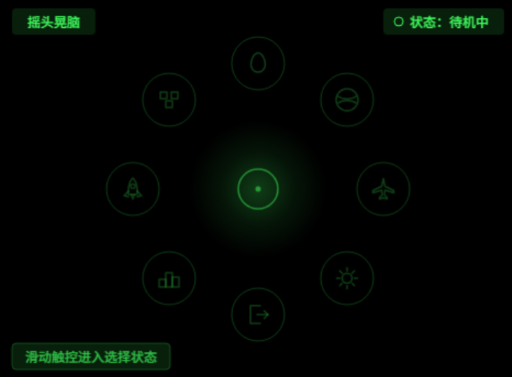
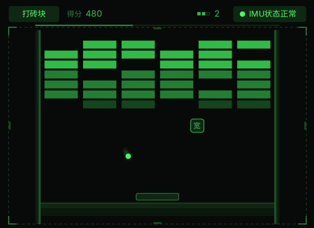
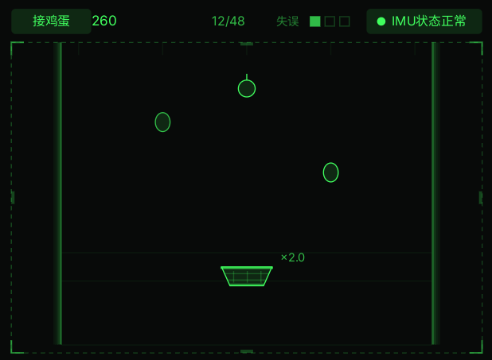
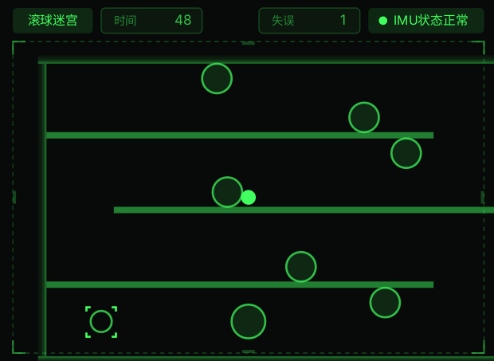
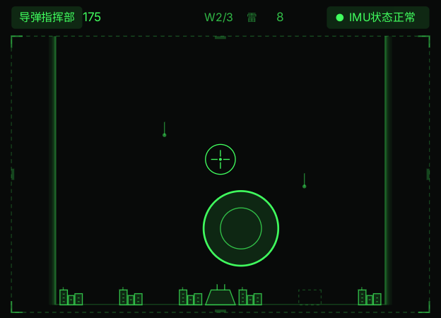
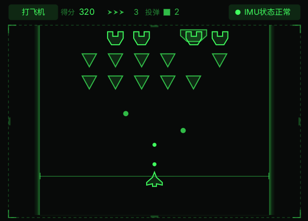

<div align="center">


# 摇头晃脑 · HEAD MOTION ARCADE

**为 Rokid Glasses 打造的头控体感小游戏合集**
五款经典玩法，一套头控交互。转头即方向，单击即确认。

[](LICENSE)
[](#技术底座)
[](#快速开始)
[](#回归与质量)
[](https://shake.memorymap.cn)



</div>

---

## 这是什么

一副没有手柄的眼镜，五款不用学操作的经典游戏。

Rokid Glasses 是单绿透明显示的 AR 眼镜，视野里只有线条、亮度和运动。这个项目把
打砖块、接鸡蛋、滚球迷宫、导弹指挥部、打飞机搬进这块 **480 × 352** 的画布，用眼镜
IMU（惯性测量单元）捕捉转头与俯仰，用镜腿触控板完成确认、引爆与投弹。

三件事决定了它的形态：

- **头是摇杆，不是鼠标。** 头部动作是连续量，抖动与意图混在同一个信号里，
  所以输入层做了完整的融合、死区、低通与限速流水线（见[头控流水线](#头控流水线)）。
- **透明屏不能靠"盖"。** 画面叠在现实上，黑色遮罩等于什么都看不见，
  所有"变暗"只能降元素自身透明度；视觉语言被压缩成 6 档亮度的单绿色阶。
- **宿主很省，也很挑。** AIUI 运行时没有承诺定时器 API、没有振荡器、
  音频通道要探测——这个项目的多数工程决策都是被这几个限制逼出来的。

> **范围说明**：本仓库是**纯客户端**工程，不含后端服务。五款游戏的分数、设置、
> 战绩全部落在设备本地存储（`wx.getStorageSync`），运行期不发起任何网络请求，
> 也没有账号体系。仓库里的 `site/` 是一张纯静态官网。

## 五款游戏

| # | 游戏 | 核心操作 | 玩法一句话 |
|---|---|---|---|
| 01 | **打砖块** | 左右转头移动整座球场 | 挡板恒在中央，球自动发射，清空 42 块砖即通关 |
| 02 | **接鸡蛋** | 转头 + 俯仰接取 | 抬头低头改变接取高度，倍率随高度变化，后段还要躲炸弹 |
| 03 | **滚球迷宫** | 准星对准后单击开跑，头动推进迷宫 | "划船式"增量控制：头停即停、回摆不回退 |
| 04 | **导弹指挥部** | 转头瞄准，单击引爆 | 选择拦截高度，用有限弹药守住六座城市 |
| 05 | **打飞机** | 头动机动，单击投弹 | 战机自动射击，专注走位；单击留给关键炸弹 |

五款游戏共用同一套页面状态机（`utils/gamepage.js` 的 `S`）：
`READY`（游玩提示，不自动关闭）→ `PLAY` → `MENU`（菜单）/ `CONT`（继续提示）
→ `OVER` / `LOADING`（跳转握手期间）。玩法差异只体现在 `tick` / `render` /
`onTap` 三个钩子上——这也是为什么新增一款游戏不需要再复制一份页面骨架。

<div align="center">

| 打砖块 | 接鸡蛋 | 滚球迷宫 |
|:---:|:---:|:---:|
|  |  |  |
| **导弹指挥部** | **打飞机** | **设置 / 战绩** |
|  |  | 见[官网](https://shake.memorymap.cn)实机录屏 |

</div>

## 交互模型

全应用只有一套交互语言，主页、设置页、退出确认都复用同一套环形选择：

```
待机 ──滑动──▶ 选择 ──转头点亮──▶ 就绪 ──单击──▶ 进入/切换
  ▲              │                                │
  └──15s 超时────┴──未点亮单击退待机◀──────────────┘
```

- **滑动唤出**：镜腿触控板任意方向滑动，环形八向入口从 24% 亮度升到选择态。
- **转头点亮**：中央准星固定，入口随头动反向补偿；转到中心即点亮。
- **单击确认**：点亮后单击进入；未点亮单击退回待机；空闲 15 秒自动退回。
- **游戏内单击的语义随玩法变化**：打砖块 / 接鸡蛋 / 滚球迷宫用单击唤出菜单；
  导弹指挥部与打飞机把单击留给引爆与投弹，改用滑动唤出菜单。
- **进游戏先看提示**：每局先落一个模态「游玩提示」，单击才以当前头姿重建中立基准
  再走 3 秒倒计时——这是为了让"启动 IMU 监控"有一个明确的、用户可见的时刻。

## 技术底座

| 层 | 选择 | 为什么 |
|---|---|---|
| 运行时 | Rokid AIUI（`import wx from 'wx'`） | 官方运行时，页面＝四件套 `.json + .js + .wxml + .wxss` |
| 渲染 | `<canvas id="stage">` + `wx.createCanvasContext` + 每帧 `flush()` | 无双缓冲/交换链，只能清屏→矢量绘制→提交 |
| 输入 | `AbsoluteOrientationSensor` + `Gyroscope` | 绝对姿态给直流、陀螺给动态，缺一不可 |
| 存储 | `wx.getStorageSync` 同步层 + 容错包装 | 存储不可用时必须降级而不是崩 |
| 音频 | `assets/sfx/*.wav`（16kHz / 16bit / 单声道） | 无振荡器 API；8-bit PCM 在真机**完全无声** |
| 依赖 | 零第三方依赖 | 包体与解析风险都省掉了 |

### 契约安全：渲染循环必须是"降级链"

AIUI 的 Confirmed API Scope 里**没有** `setInterval` / `setTimeout` /
`requestAnimationFrame`。直接依赖其中任何一个，宿主缺它时 `onReady` 抛
`ReferenceError` → 生命周期中断 → 只剩近黑背景，表现为"黑屏"。

`utils/boot.js` 因此提供五级驱动，且**无条件先画一帧**（最坏是静态画面，不能是黑屏）：

```
保底首帧 → setInterval → requestAnimationFrame → setTimeout → 传感器 reading 事件 → 无驱动
```

### 头控流水线

`utils/input.js` 的八级流水线，参数唯一来源是 `utils/layout.js` 的 `HEAD` 常量块：

```
采样(绝对姿态 + 陀螺) → 解算 → 互补融合(自适应 τ) → 死区 1.6° + 软启动至 5°
   → 低通 τ45ms + 抖动门 + 角速度前馈 → 映射 → 限速(游戏 1200 / 菜单 620 px·s⁻¹) → 快照
```

四条踩过坑的硬约束：

1. **所有参数按时间量给**，禁止"每帧"系数——按帧的写法在掉帧时会把延迟放大，
   曾经有过 12px/帧 ≈ 360px/s 的隐性加速。
2. **前馈只进像素通道**，不能进角度通道；否则滚球迷宫的棘轮会把回摆误判成推进。
3. **陀螺未通过 220ms 同向准入不得积分**——轴系判错就永远不要发出错误方向。
4. **互补滤波的 τ 必须自适应**：固定 τ 会把陀螺零偏变成恒偏移（零偏 1~5°/s ×
   2.5s ⇒ 画面恒漂 20~100px），表现是"头没动画面自己飘"。

### 视觉与合规红线

- 画布固定 **480 × 352**，单绿 `#40FF5E` + 6 档亮度（100 / 72 / 48 / 24 / 12 / 6%）。
- **禁止黑色遮罩**：变暗只降元素 alpha；浮层"遮盖"= 下层 6% + 面板 12%。
- 大面积填充 ≤12%，2px 描边仅用于焦点强调，同屏 ≤3 个字级，同屏仅一个主导动效。
- 调试信息不得上屏：取证走 `console.log` 与 `_diagMsg`，不画进 `render`。

## 目录结构

```
shake-head/
├── app.js / app.json          # 启动恢复设置；11 条路由
├── pages/                     # 每个页面四件套（.json + .js + .wxml + .wxss）
│   ├── index/                 # 主页：八向环形导航 + 双胶囊 HUD
│   ├── brick/ eggcatch/ marble/ missile/ plane/   # 五款游戏
│   ├── game/                  # 游戏框架页（模板，无入口指向）
│   ├── calibrate/ settings/ records/ result/      # 四个二级页
├── utils/                     # 运行时模块（无第三方依赖）
│   ├── layout.js              # 几何唯一来源（含 HEAD 头控参数）
│   ├── theme.js               # 视觉令牌唯一来源
│   ├── input.js               # 头控八级流水线 + 校准会话
│   ├── gamepage.js            # 五款游戏共用的页面底座
│   ├── pagebase.js            # 四个二级页共用的启动链
│   ├── ring.js overlay.js hud.js draw.js icons.js # 交互与绘制原语
│   └── sfx.js audio-host.js   # 音效中心（唯一 import 'audio' 的文件）
├── assets/sfx/                # 8 个短音效（16kHz/16bit/单声道，共 65KB）
├── tests/navsim/              # 14 套 harness + 1 套冒烟（1300+ 断言）
├── tools/                     # 打包、验证、音效生成、官网预览
├── docs/                      # 总章 + 6 册 PRD + 设计说明 + README 配图
├── site/                      # 官网静态页（index.html + assets/）
└── .github/                   # CI（verify）+ Issue / PR 模板
```

## 快速开始

### 1. 在眼镜上跑（真机 / Craft IDE）

AIUI 应用以「导入工程快照」方式运行，**必须每次重新导入**——沿用旧快照会静默跑旧代码，
现象不可信。

```bash
# 生成可导入的 zip（产物落在 dist/）
node tools/pack.mjs          # → dist/摇头晃脑-眼镜端-v1.54.zip
node tools/pack.mjs latest   # → dist/摇头晃脑-眼镜端-latest.zip（小步迭代用，固定名覆盖）
```

然后打开 [Rokid Craft Web IDE](https://js.rokid.com/craft)，**先清空旧快照 / 缓存**，
再导入刚生成的 zip，编译预览。主页应出现环形八向入口（待机 24% 档）与双胶囊 HUD。

> 快照里只有 `app.js` / `app.json` / `pages/` / `utils/` / `assets/` ——
> 打包脚本用的是**白名单**，`.gitignore`、`package.json`、测试与文档都不会混进去。

### 2. 本地开发（不需要设备）

```bash
node tools/verify.mjs        # 语法检查 + 产物化 + 全部 harness
node tools/check-pages.js .   # 页面四件套 / 编码 / import 链自检
```

harness 用 `tests/navsim/wx-mock.mjs` 替掉 `wx`，在普通 node 里直接跑页面模块与玩法模块，
所以改完逻辑不用上真机就能验证状态机、几何、头控数值。**改完必须让这两条命令全绿**。

### 3. 看官网

```bash
node tools/serve-site.mjs            # http://127.0.0.1:4173
node tools/serve-site.mjs 8080       # 换端口
```

## 环境变量与配置

**本项目不读取任何环境变量，也不需要任何密钥即可运行。** 没有后端、没有账号、
没有第三方 API。`.env.example` 只提供二次开发时的占位规范（例如将来接入在线排行榜），
默认全是注释；真实值写进 `.env`，该文件已被 `.gitignore` 忽略。

需要调的参数都在代码里，且各有唯一来源：

| 想改什么 | 改哪里 |
|---|---|
| 头控灵敏度 / 死区 / 限速 / 融合时间常数 | `utils/layout.js` 的 `HEAD` 常量块 |
| 所有坐标、面板、按钮几何 | `utils/layout.js` |
| 颜色、字号、亮度档 | `utils/theme.js` |
| 五款游戏的文案（提示弹窗里的说明与操作） | `utils/games.js` 的 `brief` / `ops` |
| 音色 | `tools/gen-sfx.py` 的 `SPECS`，改完 `python tools/gen-sfx.py` |
| 版本号 | `utils/layout.js` 的 `BUILD`（同时决定 zip 文件名） |

## 回归与质量

```bash
node tools/verify.mjs
```

当前结果：**15 / 15 套全绿，1378 条断言**。

| 套件 | 断言 | 覆盖 |
|---|---:|---|
| `harness.mjs` | 85 | 主页状态机、环形导航、跳转落地握手 |
| `harness-game.mjs` | 34 | 游戏框架页六态 + 品牌墙 |
| `harness-brick.mjs` | 121 | 打砖块物理、破墙、道具、结算契约 |
| `harness-egg.mjs` | 107 | 接鸡蛋波次、倍率、炸弹 |
| `harness-marble.mjs` | 155 | 滚球迷宫增量控制、贴壁、限时 |
| `harness-missile.mjs` | 215 | 导弹指挥部弹道、城市防线、弹药 |
| `harness-plane.mjs` | 161 | 打飞机编队、投弹、三点生命 |
| `harness-ready.mjs` | 145 | 游玩提示弹窗（`S.READY`）三处接入 |
| `harness-imu-warm.mjs` | 32 | 冷启动预热：窗口内转头必须有输出 |
| `harness-imu-latency.mjs` | 98 | 跟手性 × 幅度、零漂 × 灵敏度成对指标 |
| `harness-records.mjs` | 55 | 战绩页五行最近一局、无滚动 |
| `harness-settings.mjs` | 56 | 设置页环形头控与状态 |
| `harness-sfx.mjs` | 79 | 音效双通道 + `import 'audio'` 静态红线 |
| `harness-nosto.mjs` | 8 | 存储完全不可用时不崩 |
| `smoke-secondary.mjs` | 27 | 四个二级页启动链与导航死链 |

几条值得说明的做法：

- **断言成对测**。只测"跟手不跟手"会漏掉"幅度被吃掉"：曾经为了压延迟给预热加限速追赶，
  结果是用户转 25° 只输出 25px，快转时幅度甚至回 0——延迟指标全绿，体验是坏的。
- **收敛判据不得依赖"用户不动"**。用"窗口内极差 < 2°"判收敛，用户一转头就永远不收敛，
  直接导致"转头基本不识别"。预热窗口是纯时间盒。
- **静态红线也进回归**。`import 'audio'` 只允许出现在 `utils/audio-host.js`、
  页面必须 `export default`、几何常量不得复制粘贴——这些用读源码 + 正则在 harness 里钉死。

## 文档

`docs/` 下是完整的需求与设计推演（不是事后补的说明文档，是当时一边设计一边写的）：

| 文件 | 内容 |
|---|---|
| [`docs/prd/00-需求说明书-总章.md`](docs/prd/00-需求说明书-总章.md) | 全局约束、非功能指标、验收标准、变更记录 |
| [`docs/prd/PRD-01-主页头控交互与非游戏功能.md`](docs/prd/PRD-01-主页头控交互与非游戏功能.md) | 主页 / 设置 / 战绩 / 结算 / 校准五块的功能口径 |
| [`docs/prd/PRD-01-设计说明-主页头控交互.md`](docs/prd/PRD-01-设计说明-主页头控交互.md) | 逐像素设计说明：几何、视觉令牌、状态时序 |
| [`docs/prd/PRD-02-打砖块.md`](docs/prd/PRD-02-打砖块.md) 等五册 | 每款游戏一套：玩法规则、数值、界面、验收 |
| [`AGENTS.md`](AGENTS.md) | 给协作方（含 AI）的运行时约束与工程约定速览 |

文档里的坐标、亮度档、状态名与代码是**三处同步**关系，改一侧要同步其余。

## 已知限制

- 只在 Rokid Glasses / AIUI 上验证过。`wx` API 子集、传感器语义、音频通道都依赖该宿主，
  移植到微信小程序需要替换输入层与渲染驱动。
- 头控手感依赖设备 IMU 质量，`utils/input.js` 顶部的 `SIGN.yaw` / `SIGN.pitch`
  是实机校准项，不同批次可能需要取反。
- 每款游戏只有本地排行榜（Top3 + 最近一局），没有云端同步。
- 音效是程序生成的短音，不是采样素材；音色由 `tools/gen-sfx.py` 的 `SPECS` 决定。

## 许可

[MIT](LICENSE) — 全仓库统一，代码、`docs/` 文档、测试与素材均在授权范围内，
可自由使用、修改、分发与商用，保留版权声明即可。

「摇头晃脑」名称与应用图标仅用于标识本项目来源，再分发时建议替换为自己的标识。

<div align="center"><sub>为 Rokid Glasses 设计 · <a href="https://shake.memorymap.cn">shake.memorymap.cn</a></sub></div>
