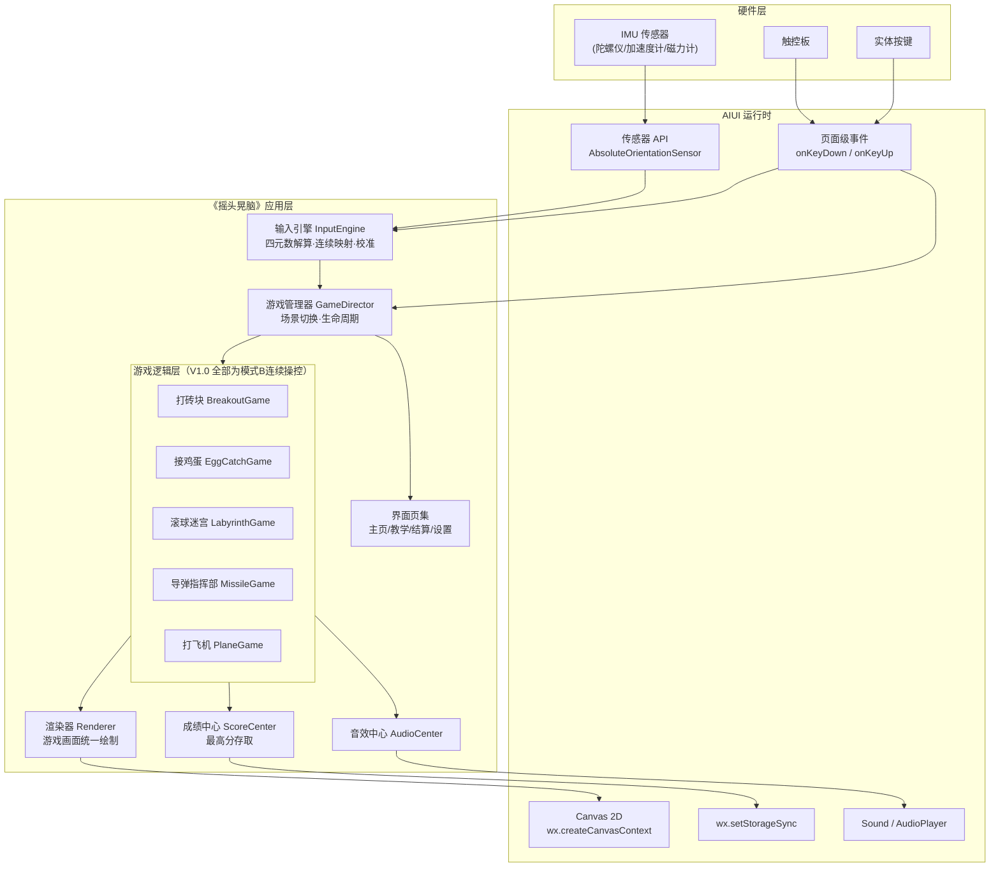
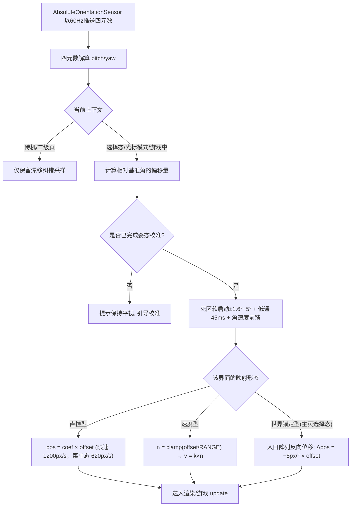
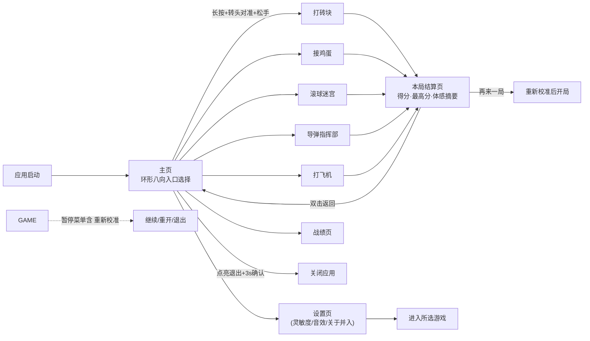
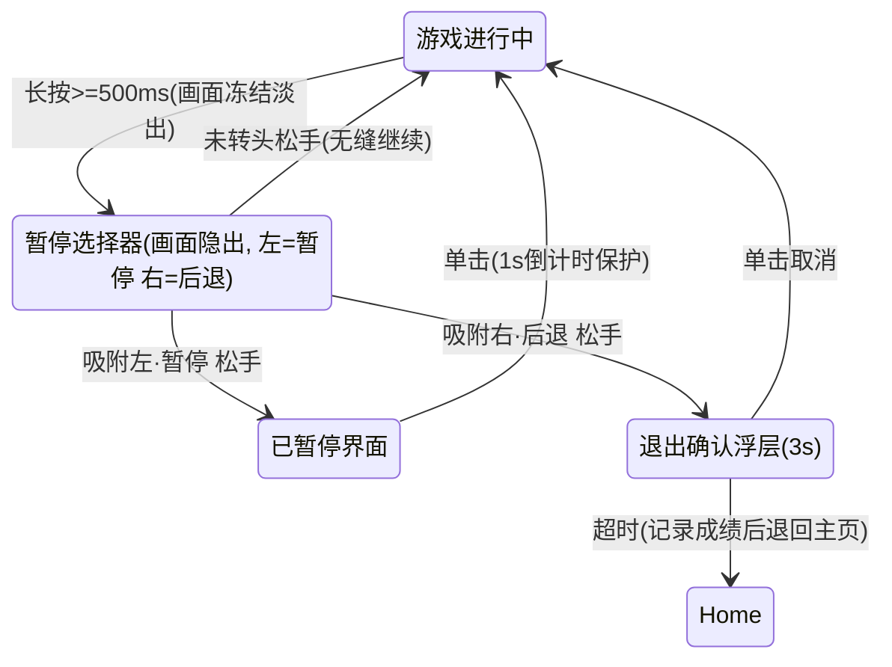
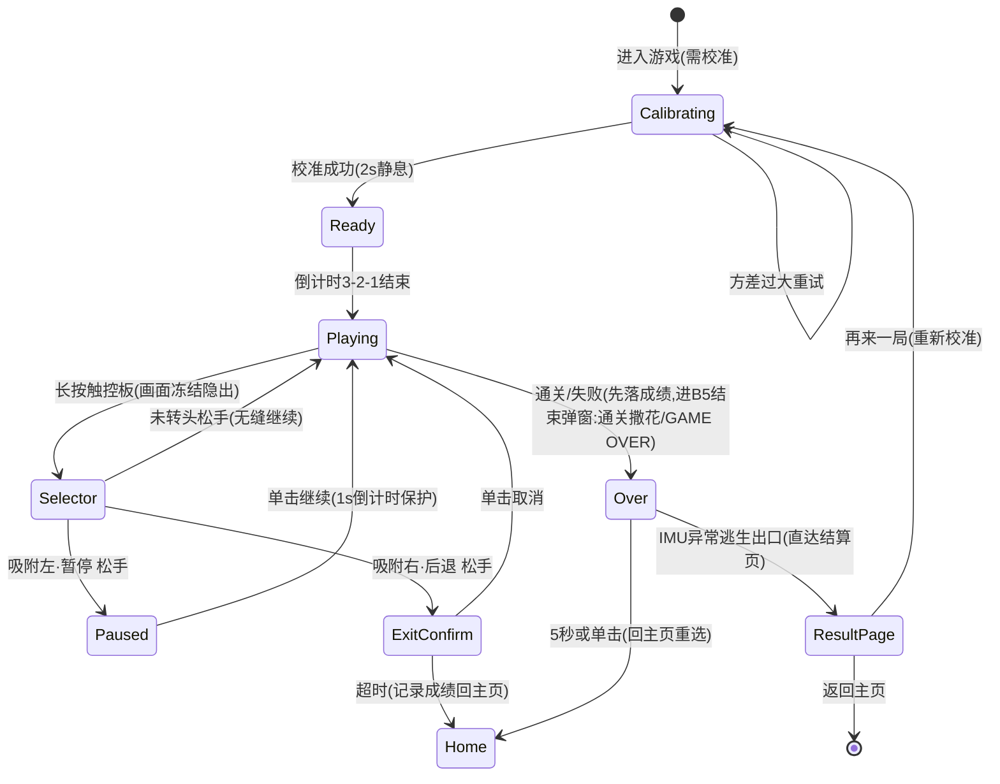

# 《摇头晃脑》游戏需求说明书

| 文档信息 | 内容 |
| --- | --- |
| 产品名称 | 摇头晃脑 |
| 版本 | V1.0 |
| 编写日期 | 2026-08-27 |
| 最近修订 | 2026-09-04（《接鸡蛋》横向输入改**锚定型相机**：蛋篮恒钉屏幕中心、头动驱动世界反向平移，球场 64~416 两侧加边界墙、墙外留白；同步 PRD-03 V1.0-r7，见 §1.1 / §4.1 / §5.5 / 附录 A / B / C 第 13 行 / D） |
| 目标平台 | Rokid Glasses（AIUI 平台） |
| 文档状态 | 初稿（待评审） |

---

## 0. 文档体系与分册索引

### 0.1 本文档的定位

本文档是《摇头晃脑》项目的**总章**，负责定义整体范围、边界、共享技术约束与跨模块一致的交互/视觉基线；**不承载任何单一游戏的完整可开发细节**。

因眼镜端需逐步实测与迭代（总章 §13 的 Spike-1 / Spike-2 先行策略），实际开发按"分册"推进。全部需求文档共 **7 份：1 份总章 + 6 份分册**。

### 0.2 分册索引

| 分册编号 | 名称 | 文件 | 需求前缀 | 优先级 |
| --- | --- | --- | --- | --- |
| **PRD-01** | 主页头控交互与非游戏功能 | `需求文档分册/PRD-01-主页头控交互与非游戏功能.md` | `F-HOME-*` / `F-PAGE-*` / `F-SYS-*` | P0 |
| **PRD-02** | 《打砖块》 | `需求文档分册/PRD-02-打砖块.md` | `F-BRK-*` | P0 |
| **PRD-03** | 《接鸡蛋》 | `需求文档分册/PRD-03-接鸡蛋.md` | `F-EGG-*` | P1 |
| **PRD-04** | 《滚球迷宫》 | `需求文档分册/PRD-04-滚球迷宫.md` | `F-LAB-*` | P1 |
| **PRD-05** | 《导弹指挥部》 | `需求文档分册/PRD-05-导弹指挥部.md` | `F-MSL-*` | P0 |
| **PRD-06** | 《打飞机》 | `需求文档分册/PRD-06-打飞机.md` | `F-PLN-*` | P0 |

### 0.3 职责边界（Own / Out）

| 内容 | 总章 | PRD-01 | PRD-02~06 |
| --- | --- | --- | --- |
| 项目范围、版本规划、风险与可行性 | ✅ **唯一来源** | ❌ | ❌ |
| 运行环境与技术约束（§2） | ✅ **唯一来源** | 只读镜像 | 只读镜像 |
| 头动控制总则 / 校准 / 触控板三态（§4） | ✅ **唯一来源** | 只读镜像 | 只读镜像 |
| 游戏内暂停选择器（§5.7） | ✅ **唯一来源** | 只读镜像 + 接入要求 | 只读镜像 + 接入约束 |
| 视觉与 UI 规范（§7） | ✅ **唯一来源** | 只读镜像 | 只读镜像 |
| 非功能需求（§9）/ 异常场景（§10） | ✅ **唯一来源** | 只读镜像（本册相关项） | 只读镜像（本册相关项） |
| 主页环形入口交互、二级页面、通用系统功能、**分册间接口契约** | 概述 | ✅ **唯一来源** | 只读引用 |
| 单款游戏的玩法、数值、关卡、专有 HUD | 概述（§5.2~§5.6） | ❌ | ✅ **各自唯一来源** |

> **分册间接口契约**（`GameManifest` / `GameResult` / 暂停选择器接入 / 校准接入 / 存储 key）定义在 **PRD-01 §3**，是 6 个分册之间的唯一耦合点。

### 0.4 协同规则（强制）

1. **单源原则**：上表标注"唯一来源"的内容，其他文档只能**镜像引用**，不得改写或另立数值；
2. **改共享基线（§2 / §4 / §5.7 / §7 / §9 / §10）**：**先改总章，再同步全部 6 册的镜像章节**，禁止任何单边先行改动；
3. **改分册专有内容**：只改该分册，分册修订号 +1（如 `V1.0-r1` → `V1.0-r2`）；
4. **改分册间接口契约**：由 PRD-01 发起，同批修订所有受影响的游戏分册；
5. **改光标交互引擎**：属 PRD-01 权域（《导弹指挥部》与主页共享该输入引擎，映射形态不同），须同步 PRD-05 §3；
6. **版本对齐**：分册版本号格式 `V{总章主版本}-r{本册修订号}`；总章主版本升级时全部修订号重置为 r1；
7. **变更登记**：任何变更必须在 **附录 C：分册同步登记表** 登记一行；
8. **Spike 回填**：Spike-1 / Spike-2 结论（风险 R1~R7）先回填**总章附录 A**，再由总章发起全局同步——P0 分册（PRD-02/05/06）首批复核。

### 0.5 遗留问题（已于 2026-08-29 全部裁决）

拆分过程中发现本文档存在内部冲突、笔误与参数缺口，共 **9 项冲突（C-01 ~ C-09）+ 25 项缺口（D-*）**。**现已全部裁决并回填至正文与附录 A**，下表保留作决策追溯（分册级明细见附录 D）。

| 编号 | 类型 | 位置 | 摘要 | **裁决结论（已落地）** |
| --- | --- | --- | --- | --- |
| C-01 | 冲突 | §4.2 注记 vs §5.1.3-6 / §5.1.4 / §5.1.5-3 | "双击不再承担任何语义" 与 "二级页双击返回主页" 矛盾 | ✅ §4.2 注记改为"双击的适用边界"：**游戏内不承担双击语义；主页与二级页可安全承担"返回上级"** |
| C-02 | 冲突 | §5.1.5-3 vs §4.2 表 / §5.1.6 / §5.7 | 长按阈值 "游戏内 800ms" vs 统一 500ms | ✅ **全端统一 500ms** |
| C-03 | 笔误 | §5.1.5-1 | "§4.5 的强制校准" 应为 §4.4 | ✅ 已改引 **§4.4** |
| C-04 | 笔误 | §1.3 | 章号重复（产品目标 / 目标用户） | ✅ 顺延为 **§1.3 产品目标 / §1.4 目标用户 / §1.5 使用场景** |
| C-05 | 歧义 | §5.2 打飞机 | 炸弹"向前下落" / "飞出屏前 0.5s 引爆" | ✅ 沿**机头前方（屏幕上方）** 200px/s；触敌即爆，未命中在**距画面区上沿 100px（引爆线 y=144）** 处自动引爆；同屏 ≤1 枚（"上边界"口径由 **C-13** 进一步裁决为画面区坐标） |
| C-06 | 歧义 | §5.6-3 滚球迷宫 | 加速度 `22px/s²` 与 240px/s 上限、60~90s 时限不自洽 | ✅ 改为**每帧速度增量 Δv = 22px/s × (offset/15°)**（等效 660px/s²），稳态 253px/s 恰被上限夹紧 |
| C-07 | 冲突 | §5.6-2 滚球迷宫 | 黑洞"半径 14px 实心圆" 与 §7.1 "填充 ≤12%" 冲突 | ✅ 改为 **12% 底纹 + 72% 描边环**；§7.1 新增"实心实体统一落地规则" |
| C-08 | 歧义 | §5.4 导弹指挥部 | "±30° 覆盖屏宽 60%" 与 8px/° × 30° = 240px 不自洽 | ✅ 改为 **±30° → 从屏心可达 ±240px，即全屏宽** |
| C-09 | 冲突 | §5.3-1 打砖块 | 砖阵总宽 462px 小于安全区横向 16px 内缩 | ✅ 砖宽 **56 → 54px**（总宽 446px，左右各留 17px） |
| C-10 | 范围 | §5.2 打飞机 | 首发仅实现一关，原三关 + Boss 结构过重 | ✅ **单关化**（PRD-06 V1.0-r4，D-PLN-08/09/10）：单关"编队歼灭战"（Space Invaders 经典第一波复刻）四段落递进；裁撤枪级成长；失败即结算不重开；压轴轰炸机替代 Boss；总章 §5.2 与附录 B 已同步 |
| **C-11** | **冲突（阻塞级）** | PRD-06 §6.2 vs §6.3 | 编队"列距 72px + 步进初速 24px/s"与"平均横移周期 ~14s"**相差 8.4 倍**：列距 72 时包围盒 384px 占满 448px 画面区，单程行程仅 40px → 单程 1.67s → **满编不杀 15s 必失守**，"不失守性"结论不成立 | ✅ **列距 72→56、初速 24→9px/s、每杀 +4%→+3%**（封顶 72→24px/s）：包围盒 384→304px、行程 40→120px、单程 1.67→**13.3s**；满编不杀失守 15s→**113s**、实战 ≈**86s**。横移轨道按满编包围盒固定、不随存活列收缩（PRD-06 D-PLN-13，V1.0-r6；总章 §5.2 已同步）。⚠️ **r7 再改**：该组参数按 424px 轨道解出，相机版战场只有 352px，已由 D-PLN-16 改为**列距 40 / 初速 8px/s**，见 §12 第 14 行 |
| **C-12** | **缺口（阻塞级）** | PRD-06 §5.2 / §10 | 本册只写"单击 = 投弹"，却**从未定义 B2 菜单入口**——框架 v1.22 的菜单入口正是单击，二者直接冲突；验收项"连点投弹不误触选择器"自相矛盾 | ✅ 复用导弹指挥部既有裁决 **`tapRole: 'fire'`**（D-MSL-09 / F-MSL-72~73）：**单击=投弹 / 滑动（四向任意）=唤出 B2 / 滑动后 300ms 单击忽略 / 长按不绑定**。打飞机是第二个 `'fire'` 游戏，框架分流已存在、无需改造（PRD-06 D-PLN-14，V1.0-r6；总章 §5.2 已同步） |
| **C-13** | 冲突 | PRD-06 §3 / §4 | ① 机体夹紧 `[18,462]×[46,330]` 按 480 全屏推算，与画面区契约冲突；② 投弹"距屏幕上边界 100px"自动引爆，按 y=0 得引爆线 y=100 会落入 HUD 条且扩散波溢出画面区 | ✅ ① 夹紧改 **`[34,446] × [62,322]`**（画面区缘 + 8px 死区 + 碰撞盒半宽 10），与画面设计稿 S13 实测一致（D-PLN-11）；② 引爆线取**画面区坐标 y=144**（＝上沿 44 + 100px），波峰上缘 y=54 ≥ 44 满足 C-FRM-01（D-PLN-12）。PRD-06 V1.0-r6；总章 §5.2 已同步。⚠️ **r7 部分作废**：① 横向夹紧随相机化取消（改 `camCx ∈ [76,404]`），纵向先收窄为 `[242,322]`、**v1.38 再放宽为 `[202,322]`**（上行程 80 / 下行程 40，home 282 不动）（D-PLN-15 / D-PLN-18）；② 引爆线 y=144 **维持不变**；③ **v1.38**：纵向由 `[242,322]` 再放宽为 `[202,322]`（上行程 80 / 下行程 40，home 282 不动） |

---

## 1. 项目概述

### 1.1 产品背景

《摇头晃脑》是一款运行在 Rokid AIUI 眼镜端的怀旧体感小游戏合集，主打 80 后童年经典的黑白机风格。经交互范式评估后确立聚焦策略：**只收录"摇杆式"连续操控类游戏**（头部姿态即模拟摇杆），首发阵容为《打砖块》《接鸡蛋》《滚球迷宫》《导弹指挥部》《打飞机》五款。

> **⚠ 输入语义的三种形态 + 一种呈现形态（2026-09-04 补充）**：绝大多数游戏把头当**摇杆**——用偏角的**绝对值**映射位置或速度（直控型 / 速度型），玩家需在中立位附近小幅摆动；**另有「锚定型」是与输入语义正交的呈现形态**（受控元素恒钉屏幕中心、世界反向平移，见 §4.1），用于消除"元素随头同向漂移"导致的眩晕，**已用于打砖块 v1.28、接鸡蛋 v1.29、打飞机 r7**；**《滚球迷宫》是唯一例外**，它用偏角的**变化量**做**增量式位移映射**（§4.1、PRD-04 §4）。起因是"**头部无法长时间维持静态偏转**"这一生理事实——原倾角直控模型要求玩家持续保持 ±15° 才能维持球速。若增量式模型在真机验证成立，将作为降低颈部负荷的通用方案推广至其余分册。

其核心创意在于**用头部代替手柄**：眼镜内置的 IMU（惯性测量单元）捕捉用户头部动作，将「抬头、低头、左转头、右转头」的连续偏转映射为游戏内准星/挡板/滚珠/飞行器的连续移动（头部即摇杆）；**《滚球迷宫》例外——其头动被映射为"位移增量"而非"摇杆位置"**（§4.1）。眼镜镜腿触控板的**单击**则映射为「发炮 / 发射 / 确认 / 开始」操作。

玩家无需任何外部控制器，仅靠摇头晃脑和轻点镜腿即可完成全部游戏操作——游戏名即玩法的最直观写照。

### 1.2 产品定位

本产品 V1.0 的首要目标是**验证"头部 IMU 摇杆式控制游戏"这一交互范式的可行性**：验证连续映射的操控精度与跟手度、触控板三态判定的可靠性、以及游玩过程中的颈部舒适性是否成立。**《滚球迷宫》额外承担"相对位移输入"这一备选范式的验证**（2026-09-04）：即在不要求头部维持静态偏转的前提下，连续操控是否依然成立。因此：

1. 每款游戏均以 **3 个关卡**封顶，单关时长约 1～2 分钟，单款完整体验约 5 分钟；
2. 重在体验闭环与数据采集，不做长线数值养成；通关即为验证成功；
3. 结算页除成绩外展示本局实测体感数据摘要（头部偏角利用率、单击次数与延迟），供可行性评估引用。

### 1.3 产品目标

1. 提供一款零学习成本的体感休闲小游戏合集，唤起 80 后群体的童年情怀；
2. 充分发挥 Rokid 眼镜的 IMU 体感优势，打造"身体就是手柄"的独特交互体验；
3. 在单绿色单色显示屏上还原经典黑白游戏的像素美学；
4. 保证长时间游玩的身体舒适度，避免颈部疲劳与误操作。

### 1.4 目标用户

- 核心用户：80 后 Rokid 眼镜持有者，对红白机/掌机时代经典游戏有情感认同；
- 泛用户：喜欢体感交互、猎奇尝鲜的眼镜用户。

### 1.5 使用场景

碎片化休闲场景：通勤间隙、居家放松、朋友聚会演示体感玩法等。单局时长建议控制在 2～5 分钟，适合短时间上手、随时中断。

---

## 2. 运行环境与技术约束

依据 AIUI 官方开发规范，本项目受以下硬性约束：

| 约束项 | 规格 |
| --- | --- |
| 应用框架 | AIUI（`.ink` 单文件组件格式 + `app.json` + `app.js` + `AGENTS.md`） |
| 屏幕类型 | **单绿色单色透明显示**（RokidGlasses1/2）：仅一个绿色发光通道叠加在透明黑底之上——纯黑即"透出现实"，不存在遮蔽现实的黑幕 |
| 应用宽度 | 固定 **480px**，不可变 |
| 推荐高度 | 120px ～ 352px，全屏参考尺寸 **480 × 352**；安全内边距横向 16px / 纵向 12px（有效内容区 448×328） |
| 视觉主题 | 官方单绿科学仪表风：6 级亮度阶梯（100/72/48/24/12/6%），1px 结构线，控件圆角 4px / 面板 6px；禁止大面积实色与装饰性 glow |
| 主渲染方式 | Canvas 2D 页面节点 + `wx.createCanvasContext(id)`；每帧 `clearRect → 矢量绘制 → flush()` 呈现；**无双缓冲语义、无 requestAnimationFrame**——游戏循环用 `setInterval` 固定节拍驱动 |
| Canvas 绘图限制 | `drawImage` 仅接受另一 `Canvas` 实例为源（离屏精灵可用 `new Canvas(w,h)` 自建）；`createPattern` 忽略传入图像不可依赖；fillStyle 仅支持 #rrggbb/#rgb/rgb()/rgba()/基础命名色 |
| IMU 数据源 | `AbsoluteOrientationSensor`（四元数）、`Gyroscope`、`Accelerometer`；frequency 参数为 best-effort 提示（建议请求 60Hz，不承诺保证） |
| 按键事件 | 页面级 `onKeyDown` / `onKeyUp`；触控板对应 `GlobalHook` 键码（官方定位即游戏类最快响应路径）；默认行为拦截只对 `onKeyUp` 的 `preventDefault()` 生效 |
| 本地存储 | `wx.setStorageSync` / `wx.getStorageSync` |
| 音效 | `Sound`（短音效）、`AudioPlayer`（背景音乐），资源置于 `assets/audio/` |

> 技术选型说明：本产品全部输入为连续模拟量，不需要「点头/摇头」粗粒度手势，因此**不启用** `enableWorldAwareness()` 环境感知链路；核心输入直接订阅 `AbsoluteOrientationSensor` 四元数流，解算欧拉角得到 pitch/yaw 后由应用层做连续映射。

---

## 3. 总体架构

### 3.1 系统结构图



### 3.2 工程目录结构

```
yaotouhuangnao/
├── AGENTS.md                      # Agent 清单
├── app.json                       # 全局配置（页面路由、字体）
├── app.js                         # 应用生命周期
├── assets/
│   ├── audio/                     # 音效资源（发射、爆炸、吃食物、背景乐）
│   └── fonts/                     # 像素风字体（可选）
└── pages/
    ├── home/home.ink              # 主页（环形八向入口选择）
    ├── tutorial/tutorial.ink      # 设置页（灵敏度 / 游戏音效）
    ├── breakout/breakout.ink      # 打砖块
    ├── eggcatch/eggcatch.ink      # 接鸡蛋
    ├── labyrinth/labyrinth.ink    # 滚球迷宫
    ├── missile/missile.ink        # 导弹指挥部
    ├── plane/plane.ink            # 打飞机
    ├── score/score.ink            # 战绩页
    ├── result/result.ink          # 结算页
    └── settings  → 已并入 tutorial 页
```

---

## 4. 核心交互需求（输入映射）

本产品交互基元只有两个：**头 = 摇杆（连续模拟量）**，**触控板 = 按钮（单击 + 长按两态）**。经交互范式评估，离散脉冲类方案已整体裁撤，全部输入均为连续模拟映射，玩家头部全程在中立位附近小幅摆动，无归位负担。

> **例外：《滚球迷宫》采用"相对位移输入"（2026-09-04 新增，PRD-04 §4）**。它消费的不是偏角的**绝对值**而是**变化量**（`Δpos = gain × Δrel`，回摆由**棘轮抑制**不产生反向位移），因此玩家**无需维持静态偏转**，只需在中立位附近"划船式"来回摆动。这是除"直控型 / 速度型"之外的**第三种映射形态**（见 §4.1 表）。

### 4.1 头动控制总则

以进入界面时静默采样的自然平视为**基准姿态**（中立位），一切输入均基于「当前姿态 − 基准姿态」的相对偏角：

1. **死区与滤波**：±1.6° 内视为中立，1.6~5° 走软启动 `f(u)=2u²−u³`（边界值与斜率双连续，消除旧版 ±3° 处 24px 的突跳）；低通**时间常数 τ=45ms**（按 dt 换算，与帧率解耦）；角速度 |ω| < 6°/s 且偏角 < 1.8° 的低幅高频抖动（说话、走路颠簸）直接抑制；另叠加**陀螺互补融合 + 角速度前馈**（详见 PRD-01 §05）
2. **坐标约定**：屏幕 y 轴向下而抬头为负 pitch，统一取反保证"抬头 = 向上"直觉；
3. **三种映射形态**（按游戏节奏选择，见各款规格表）：

| 形态 | 公式 | 手感 | 适用 |
| --- | --- | --- | --- |
| **直控型**（位置跟随） | `pos = coef × offset`，coef ≈ 8px/° | 头指哪、打到哪，零迟滞感 | 导弹指挥部光标；打砖块 / 接鸡蛋的**纵向输入语义** |
| **锚定型**（世界反向平移） | `camCx = 240 + SEM_FOLLOW × offset`；`dx = 240 − camCx`，世界层 `clip` 后 `translate(dx)` | 受控元素**恒钉屏幕中心**，头动驱动**世界反向滑动**；球场两侧立边界墙、**墙外留白** | ⚠ **呈现形态**，与上面三种输入语义**正交**（同一款游戏可"直控语义 + 锚定呈现"）：**打砖块 / 接鸡蛋 / 打飞机的横向**（PRD-02 v1.28 / PRD-03 v1.29 / PRD-06 v1.7） |
| **速度型**（摇杆拖拽） | `v = k × n`；`n = clamp(offset / RANGE, -1, 1)`，YAW_RANGE 30°、PITCH_RANGE 20° | 类似推摇杆的加速感，自带平滑缓冲 | ⚠ **当前无游戏采用**（原仅打飞机，其横向已于 2026-09-05 改锚定型，见 §12 第 14 行 / PRD-06 D-PLN-15）。**形态定义保留**，供后续新增游戏取用 |
| **增量位移型**（相对输入） | `Δpos = gain × Δrel`；回摆由**棘轮抑制**（不产生反向位移）；每帧限幅 | 头转即动、头停即停、回摆不回退；**无需维持静态偏转** | **滚球迷宫**（AIM 20px/° 驱动相机、PLAY 12px/° 驱动球；每帧 ≤8px、死区 ±1.5°） |

4. **平滑约束**：所有直控输出叠加**按时间的限速**（游戏态 ≤1200px/s、选择/菜单态 ≤620px/s），杜绝头部微颤导致实体高频抖动产生眩晕；**增量位移型（滚球迷宫）另设每帧 ≤8px 的位移限幅与 ±1.5° 死区**（PRD-04 §4.2 F-LAB-03 / F-LAB-04）。
   > 交互 v1.23：旧版「每帧 ≤12px」在 30fps 下只有 360px/s，是「转头迟钝」的最大单一来源；按时间后掉帧不再放大延迟。
5. **映射参数一览**：

| 界面/游戏 | 形态 | 轴数 | 有效量程 | 输出对象 |
| --- | --- | --- | --- | --- |
| 主页选择态图标阵列 | 世界锚定型（反向补偿） | 双轴 | 8px/° 反向位移 | 入口随头动反向移动；中心与屏显内容固定 |
| 打砖块 | 直控型 + **锚定型呈现** | 单轴 yaw | ±28° → `camCx ∈ [96,384]`（**TRAVEL 144** = 球场 352/2 − 挡板 64/2） | 挡板**恒钉屏幕中心**；世界（球场 / 砖阵 / 球）反向滑动 |
| 接鸡蛋 | **双轴**：横向 直控型 + **锚定型呈现**；纵向 直控型 | **双轴** yaw + pitch | yaw ±28° → `camCx ∈ [88,392]`（**TRAVEL 152**）；pitch ±13° → 篮口 `y ∈ [218,298]` | 蛋篮**恒钉屏幕中心 x=240**、世界反向滑动；**pitch 直控接取高度，决定得分倍率**（×2.0 / ×1.5 / ×1.0） |
| 滚球迷宫 | **增量位移型** | 双轴 | **AIM 20px/°（盘面相机）／PLAY 12px/°（球位移，每帧 ≤8px）** | AIM：盘面反向滚动；PLAY：小球位移 |
| 导弹指挥部 | **双轴**：横向 **锚定型相机**；纵向 直控型 | **双轴** yaw + pitch | yaw ±30° → `camCx ∈ [80,400]`（**TRAVEL 160** = 战场 352/2 − 光标 r16）；pitch ±20° × `vscale 0.5` → 光标 `y ∈ [96,256]`（home 176） | 十字光标**恒钉屏幕中心 x=240**、世界（战场 / 城市 / 弹道）反向滑动；**战场 64~416（w=352）明显窄于视口，两侧各 48px 恒为空白** |
| **打飞机** | **双轴**：横向 直控型 + **锚定型呈现**；纵向 直控型 | **双轴** yaw + pitch | yaw ±28° → `camCx ∈ [76,404]`（**TRAVEL 164** = 战场 352/2 − 机体 24/2）；pitch ±13° → 机体 `y ∈ [202,322]`（home 282，**上行程 80 / 下行程 40**） | 机体**恒钉屏幕中心 x=240**、世界（战场 / 编队 / 敌弹）反向滑动；**战场 64~416（w=352）明显窄于视口，两侧各 48px 恒为空白** |

> ⚠ **眩晕治理的横向统一口径（2026-09-05 用户裁决，真机实证）**：**屏幕上有东西跟头同向移动是眩晕主因**。凡"受控元素需横向大范围移动"的游戏，横向一律改为**锚定型相机**——元素恒钉屏幕中心、世界层反向滑动。**打砖块 → 接鸡蛋 → 打飞机 → 导弹指挥部已全部统一**（PRD-02 v1.28 / PRD-03 v1.29 / PRD-06 r7 / **PRD-05 r6**）。
> 统一四件套（缺一不可）：① 战场宽 **352**、明显窄于视口 448，两侧各恒留 48px 空白；② 边界墙属**世界层**、跟着画面滑；③ 裁剪窗 **56~424** 屏幕固定，越窗内容直接消失；④ 离屏实体贴屏幕边给方向指示器。
> 三条配套硬约束（三款一致，缺一不可）：① **战场宽度必须明显窄于视口**（打砖块/接鸡蛋球场 352 vs 视口 448，打飞机同）——否则边界墙贴住屏幕两侧，"墙跟着头走"的错觉依旧；② **边界墙属世界层**，跟着画面滑，玩家才认得出那是战场边界而不是眼镜框；③ **越出裁剪窗的内容直接消失**（`clip` 实现），墙外恒为空白。

### 4.2 触控板三态判定

同一物理操作在不同上下文承担不同语义，先分派再处理：

| 物理操作 | 按键码 | 上下文 | 功能 |
| --- | --- | --- | --- |
| 触控板长按（≥500ms 激活） | `GlobalHook`（onKeyDown 起计时） | 主页 | 唤起"选择模式"：原点亮起光晕，八向入口切换为世界锚定、随头动反向移动（§5.1） |
| 触控板长按（≥500ms 激活） | 同上 | 游戏内 | 唤起"暂停选择器"：画面冻结淡出，左右两功能位悬浮显示（§5.7） |
| 触控板松开 | `GlobalHook` 对应 keyup | 主页/选择器中 | 完成选取确认：有点亮入口即确认启动；无点亮入口则静默取消并恢复原状态 |
| 触控板单击（<300ms 且非长按） | `GlobalHook` + 时长判定 | 游戏内 | 发炮 / 发射 / 引爆（最快响应路径） |
| 触控板单击 | 同上 | 主页 | 显示引导文案："请长按触控后转头选择，松手完成确认"（3 秒淡出） |
| 触控板单击 | 同上 | 二级页面 / 确认浮层 / 已暂停界面 | 确认 / 开始 / 恢复游戏 / 取消浮层 |
| 实体返回键 | `Backspace`（onKeyUp 中 `preventDefault()`） | 全局 | 返回上级菜单（游戏中弹"退出确认"浮层防误退） |

> 双击的适用边界：游戏内高频单击发射会天然产生两次快速按下，若绑定后退将必然误触发——因此**游戏内不承担任何双击语义**，退出统一改道"长按 → 选择器 → 右侧后退位"；而**主页与二级页面不存在高频单击压力，双击可安全承担"返回上级"语义**（见 §5.1.3-6、§5.1.5-3）。

> ⚠ **`tapRole` 分流（PRD-05 F-MSL-72 引入；PRD-06 V1.0-r6 复用，D-PLN-14）**：上表"单击 = 发炮/发射/引爆"与"长按 = 暂停选择器"是**缺省口径**。当游戏在 `GameManifest` 声明 **`tapRole: 'fire'`** 时，PLAY 态 **单击 = 游戏动作**（引爆 / 投弹），菜单入口改由 **滑动（四向任意）** 承担，滑动后 300ms 内单击忽略，**长按不绑定**；缺省 `'menu'` 的游戏行为完全不变。
> 当前 `'fire'` 游戏共 **2 款**：**导弹指挥部**（§5.4，单击引爆）、**打飞机**（§5.2，单击投弹）——两者共用同一套分流逻辑，框架无需二次改造。

> **系统事件拦截要求**：长按的系统级默认行为必须在 `onKeyDown`/`onKeyUp` 阶段 `preventDefault()` 拦截并给出可见反馈，避免"拦了没反应"的假死感。三态在同一时间线互斥判定：按下后 <300ms 松手 = 单击；持续 ≥300ms 即预约长按态（期间松手若不足 500ms 按单击处理）；≥500ms 进入激活态并锁定语义直至松手。

### 4.3 头动输入处理流程



### 4.4 校准与基准姿态管理

1. **两级基准**：主页**不预置基准**（待机态不消费头动输入，选择态以长按达成时刻的姿态为锚定原点）；进入任意游戏前执行正式校准——提示"请保持自然平视注视中央 2 秒"，采样 pitch/yaw 均值与方差作为本局基准；
2. **漂移纠正**：偏移回到死区且持续 >3 秒时，基准向当前姿态缓慢插值迁移（**明显偏离 ≤0.1°/s、静止在死区附近 ≤0.35°/s**），补偿长时间佩戴漂移；**直控型与增量位移型界面均在波间/关卡过场等无输入压力期加速收敛**（D-PLN-05 已裁决，原表述只覆盖直控型）；主页选择态会话短（≤15s），期间**冻结漂移纠正**，避免入口阵列缓慢爬移；
3. **累计偏航保护**：本局基准累计迁移超过 ±45° 时强制提示"请重新校准"——躯干整体扭转的最后防线；
4. **手动重校准**：游戏中经暂停选择器冻结画面后，单击触控板即可触发快速重校准流程；
5. **异常姿态保护**：校准时方差过大（用户未静息）则提示重试，不采用错误基准。

### 4.5 舒适性与防误触要求

- 量程系数可在教学·设置页调节灵敏度（三档：迟钝 ×0.75 / 标准 ×1.0 / 灵敏 ×1.3 作用于各游戏 RANGE 与 coef，出厂默认标准档）；
- 单局累计大幅摆头超过 300 个有效指令周期时弹出关怀提示："晃得有点久了，休息一下眼睛和脖子～"；
- 所有游戏的中立位即屏幕布局重心附近，标准坐姿下头部始终无需离开舒适区超过 ±20°。

---

## 5. 功能需求

### 5.1 主页「环形八向入口 · 长按选择模式」交互

主页是本产品的交互门面，采用与游戏内不同的选择范式：**长按进入选择态 → 八向入口世界锚定 → 转头对准点亮 → 松手确认**。

#### 5.1.1 布局规格（环形八向排布）

- 进入应用即显示 **8 个功能入口 + 1 个中心原点**；8 个入口以屏心（240,176）为圆心、**半径 R = 130px 的正圆**等角排布（每 45° 一位，覆盖 上 / 右上 / 右 / 右下 / 下 / 左下 / 左 / 左上 八个方向），相邻入口弦距 ≈ 2×130×sin22.5° ≈ **99px**；
- 入口为 48px 圆环描边 + 线性图标（单绿主题），待机态维持 **24% 常态亮度**；中心"原点"（选择光标本体）常态为 36px 小圆环；
- 功能位分配（上半环五款游戏，下半环三格系统/销毁位）：

| 环位 | 功能 | 环位 | 功能 |
| --- | --- | --- | --- |
| 左上 | 打砖块（入门·单轴） | 上 | 接鸡蛋（轻量·双轴） |
| 右上 | 滚球迷宫（进阶·双轴倾斜） | 左 | 导弹指挥部（中阶·光标+点击） |
| 右 | 打飞机（高阶·双轴+策略投弹） | 下 | **退出应用**（销毁性入口，置于正下需刻意低头确认，天然防误触） |
| 左下 | 战绩页 | 右下 | 设置页 |

- 游戏难度沿"左上 → 上 → 右上 → 左 → 右"弧线递增，新手把低难游戏"转到面前"即达；
- 「退出应用」点亮松手后弹出 3 秒确认浮层"即将退出，单击取消"，期间单击即取消，超时自动执行退出（`wx.exitMiniProgram`）；
- 原独立「设置」「关于」入口并入教学页底部区域（灵敏度/音效开关与校准同属体验调节；关于信息以页脚文本呈现）；
- 背景支持半透明实景图层（透传现实画面感），入口与原点悬浮其上。

#### 5.1.2 双态交互模型（世界锚定）

主页交互分**待机态**与**选择态**两个互斥状态，以触控板长按（≥500ms）为切换开关：

**待机态（未长按）——屏显静态**：

- 8 个入口与中心原点是普通屏显元素，**位置固定，不随用户头部转动而转动**（不消费头动输入）；
- 传感器可暂停高频订阅（仅保留低频采样或完全 `stop()`），降低功耗与发热；长按达成时再恢复 60Hz 订阅。

**选择态（长按 ≥500ms）——世界锚定**：

- 原点由常态描边升级为**光晕激活**：100% 主色 + 72% 光晕环 + ≤8px bloom 点睛（单屏唯一主导光点），过渡 ≥200ms，并配触觉/听觉短提示——光晕即"已进入选择模式"的提示；
- 8 个入口切换为**世界锚定**：入口屏幕位置 = 基础位置 **− 8px/° × (Δyaw, Δpitch)**（Δ 相对**长按达成时刻的姿态**）。头部右转 → 入口整体左移（**随头动反方向移动**），效果即 8 个入口"钉"在用户面前的球面空间中不动（入口相对头部静止）；
- 中心原点、背景图层与屏上其余内容**保持屏幕固定**，不参与锚定；
- 转头即"把想去的入口转到原点面前"——原点不动，世界在动；
- 选择态期间**冻结漂移纠正**（会话 ≤15s，避免入口阵列缓慢爬移）。

**点亮与确认**：

- **接触点亮**：原点光晕与某入口接触（原点中心与入口中心距离 **< 48px**）→ 该入口**点亮**：描边 24% → **100%**，并追加 **12% 底纹 + 72% 强调环**（不以单一透明度承载状态，符合官方规范），过渡 ≥200ms；相邻弦距 99px > 2×48px，任意时刻**至多点亮一个入口**；
- **松手确认**：松开触控板时——有点亮入口 = 选中确认（启动对应功能，进游戏前照常走教学/校准流程；点亮"退出应用"则进 3 秒确认浮层）；无点亮入口 = 静默取消回待机态，不弹错误提示；
- **不松手可重选**：入口点亮后不松手仍是选择态，可继续转头改变方向，点亮随接触关系实时转移（原入口熄灭、新入口点亮），直至松手或超时。

#### 5.1.3 交互流程（状态机）

```mermaid
stateDiagram-v2
    Idle: 待机态(8入口+原点静态显示, 不随头动)
    Hint: 提示态(显示操作引导文本)
    Select: 选择态(原点亮起光晕, 入口世界锚定随头反向移动)
    Lit: 点亮态(光晕接触入口, 入口点亮; Select子状态)
    ExitConfirm: 退出确认浮层(3s倒计时, 单击取消)
    Idle --> Hint: 单击触控板
    Hint --> Idle: 3秒后自动淡出
    Idle --> Select: 长按>=500ms(原点亮起光晕, 入口世界锚定)
    Select --> Lit: 光晕接触某入口(距离<48px, 入口点亮)
    Lit --> Select: 光晕离开(入口熄灭)
    Lit --> Launch: 松手确认选取
    Launch --> Idle: 启动对应页面/游戏
    Select --> Idle: 松手且无点亮入口(静默取消)
    Lit --> ExitConfirm: 松手且点亮入口为"退出应用"
    ExitConfirm --> Idle: 单击取消
    ExitConfirm --> Exit: 倒计时结束自动退出
```



#### 5.1.4 行为细节需求

1. **长按激活**：按下持续 ≥500ms 进入选择态——原点亮起光晕（见 5.1.2），激活过渡 ≥200ms 并配触觉/听觉短提示；
2. **世界锚定随动**：选择态期间每帧按 −8px/° 反向补偿更新入口位置；锚定原点 = 长按达成时刻姿态，进入瞬间入口无跳变；中心原点与背景**不随头动**；
3. **接触点亮与重选**：见 5.1.2"点亮与确认"；点亮过渡 ≥200ms；
4. **松手确认**：见 5.1.2"点亮与确认"；
5. **单击提示**：待机态下单击（<300ms 且非长按）显示文本"请长按触控后转头选择，松手完成确认"，3 秒自动淡出；
6. **双击边界**：教学/战绩/结算等二级页双击返回主页并取消当前浮层；主页双击不承担销毁职能（退出走正下专属位），仅刷新提示文案；
7. **事件拦截**：长按期间的系统默认行为必须在按键事件阶段 `preventDefault()` 拦截；选择态进行中应用切换到后台时自动取消选择态并复位原点与入口位置；
8. **防误触**：选择态最长持续 15 秒，超时未松手自动视为取消并回到待机态（防止长按挂起导致传感器常开发热）。

#### 5.1.5 页面导航总览



首次进入任一游戏先跳转教学页；二级页面均支持双击触控板返回主页。

#### 5.1.6 全局交互一致性约定

为保证"主页选择范式"与"游戏内范式"并存时不产生认知混乱，做如下统一约定：

1. **姿态基准分两级**：主页**不预置基准**——待机态不消费头动输入，选择态以长按达成时刻的姿态为锚定原点，不做任何打断式校准仪式；进入游戏前仍执行 **§4.4** 的正式校准（游戏中误差代价高，主页导航误差代价低，两级的精度投入与风险匹配）；
2. **二级页面统一用"滚动列表范式"**：教学、战绩、结算及确认浮层均采用**头部上下偏角 = 列表滚动位置（直控型）+ 触控板单击确认 + 双击返回**，与游戏内操作心智一致，不引入第二套导航逻辑；该范式的映射参数见**附录 A**（单轴 pitch / ±18° 覆盖可滚动全程 / 限速 ≤620px/s（选择态档） / 非选中项维持 48% 亮度 / 长按无语义）；
3. **三态判定全局统一**：单击（<300ms）/ 双击（300ms 窗口）/ 长按（**全端统一 500ms**）在同一时间线互斥判定，任何页面下同一物理动作至多产生一种语义；
4. **退出层级收敛**：结算/二级页 → 双击返回主页；主页 → 点亮"退出应用"位 + 3 秒确认浮层；游戏内 → 返回键弹二次确认。所有退出路径均有防误触缓冲，无一步直达销毁性操作。

#### 5.1.7 关键设计决策与理由

| 决策 | 取值 | 理由 |
| --- | --- | --- |
| 长按阈值全端统一 500ms | 主页选择态与游戏内选择器同值 | 单击已全部退化为低频战术动作（发球/投弹/拦截），不存在高频连点与长按的判别压力，统一阈值降低记忆成本 |
| 九宫格改**环形八向排布** | R=130px 正圆、每 45° 一位 | 八个方向与头动方向语义天然对齐（上/下/左/右/四斜角）；相邻弦距均匀（≈99px），消除方形九宫格四角视觉权重不均、"正方形排布别扭"的问题 |
| 选择态用**世界锚定**而非屏内光标移动 | 入口 −8px/° 反向补偿，原点固定 | 原点固定消除"人追光标"的精细对位负担；"指针不动、世界在动"的空间心智更直觉——转头即把目标入口"转到面前"；与暂停选择器（屏内直控光标）形成"环境级锚定 / 页面级锚定"的明确分工 |
| 锚定原点 = 长按达成时刻姿态 | 进入选择态无跳变 | 若锚定到更早的页面基准，长按时头已偏转会导致入口瞬间跳动；以按压时刻为原点保证过渡平滑 |
| 接触点亮半径 48px | < 相邻弦距一半 | 任意时刻至多点亮一个入口，杜绝双点亮歧义 |
| 点亮 = 100% 描边 + 12% 底纹 + 72% 强调环 | 非单一透明度 | 官方规范要求语义状态不得仅以透明度承载；描边/底纹/强调环三通道保证绿屏可读性 |
| 未点亮松手静默取消 | 不提示 | 选择态是"按住才存在"的临时状态，取消是高频动作，出提示反而制造打断感 |
| 选择态 15s 超时 | 自动取消回待机 | 防长按挂起导致传感器常开、发热与耗电；也兜底"松手事件丢失"的异常 |
| 选择态期间冻结漂移纠正 | ≤15s 会话内不迁移基准 | 漂移纠正会让入口阵列在长按期间缓慢爬移，破坏"钉在空间中"的稳定感；会话短，冻结无副作用 |
| 双击退出加 2s 确认窗 | 已被替代 | 原方案废弃；现退出走环形正下专属位 + 3 秒确认浮层，双击不再承担销毁职能 |
| 待机态入口 24% 常态亮度 | 非 0% | 八个选项保持可见可数；点亮态 100% 与之拉开鲜明对比 |
| 设置/关于并入教学页 | 环形只留游戏+战绩+教学+退出 | 降低可达目标密度；灵敏度/音效本就属于体验调节，与校准天然同页 |


### 5.2 《打飞机》需求

竖版卷轴射击，**五款中同屏实体最多、对相机与裁剪最敏感的一款**。**单关复刻 Space Invaders 经典"编队歼灭战"**（2026-09-03 单关化裁决，详见分册 PRD-06 §6）。

**体感映射（⚠ r7 改锚定型相机，2026-09-05 用户裁决）**：

| 参数 | 取值 | 说明 |
| --- | --- | --- |
| **横向映射形态** | **锚定型相机** | 机体**恒钉屏幕中心 x=240**；`camCx = clamp(240 + SEM_FOLLOW × snap.x, 76, 404)`，世界层 `clip` 后 `translate(dx)`，`dx = 240 − camCx` |
| **纵向映射形态** | 直控型 | `planeY = clamp(282 − dy, 202, 322)`，其中 `dy = snap.y ≥ 0 ? min(snap.y × 0.62, 80) : −min(−snap.y × 0.31, 40)`（**上下行程不等 ⇒ 分别标定**，⚠ pitch 符号待真机标定） |
| **横向行程** | `dx ∈ [−164, +164]`（TRAVEL 164 = 战场 352/2 − 机体 24/2） | 由几何算出，代码内计算不写死 |
| **纵向行程** | **120px**（y 202~322，home 282；**上 80 / 下 40**） | 原 260px → 80px（D-PLN-18，躲避以横向为主）→ **v1.38 上行程放宽到 80**（用户反馈"飞机能飞到屏幕一半高"）。**home 282 不动**：反应窗 (282−142)/160 = 0.875s 是 §6.3 联立解 |
| **战场 / 裁剪窗** | 战场 **x 64~416（w=352）**；裁剪窗 **56~424** | 战场明显窄于视口 448，**两侧各 48px 恒为空白**；越窗内容直接消失 |
| **边界墙** | **世界层**，随画面滑动 | 墙是战场边界，必须跟着滑，否则会被误认成眼镜框 |
| 离屏指示器 | 轰炸机滑出裁剪窗时贴屏幕边给方向三角 | 只标方向不标距离 |

**玩法与数值细则：**

1. **视口与 HUD**：画面区 `VIEWPORT 448×296 @(16,44)`（x 16~464 / y 44~340，**非 480×352 全屏**）；顶部 HUD 条 y 12~36，**得分 / 生命图标 ×3 / 投弹余量三段一律落在中段空档 x 92~352**，右上状态胶囊由本册 `statusText()` 改写为「剩余 N」；单关三区：编队区（y 64~132）/ 交战区（y 132~276）/ **防线 y=276**（编队触线即失守）；左下提示条已取消（2026-09-03 裁定，见 PRD-06 §2.8.1）；
2. **机型设定**：侦察机（1 血、10 分，编队第 2、3 排 ×12）、攻击机（2 血、30 分，编队第 1 排 ×6，俯冲主力正弦横摆摆幅 40px）、**压轴轰炸机 ×1**（5 血、80 分、**缓慢直线下压 v=32px/s**、**撞击我方时伤害翻倍（损 2 点生命）**，不入编队不横移；速度由 50 改 32 见 D-PLN-17）；己方机体碰撞盒 20×20px，敌弹碰撞半径 4px；
3. **操作**：
   - 头部双轴：**横向 = 锚定型相机**（画面反向滑动、机体恒钉 240）；**纵向 = 直控上下机动**（y 202~322，home 282；上行程 80 / 下行程 40）；两轴独立、无耦合项；
   - **自动射击**：飞机始终自动开火，玩家零操作——操作压力全部集中在走位上；
   - **单击 = 投弹**（本册 `tapRole: 'fire'`）：在机头前方（**屏幕上方**）立即生成一枚炸弹（半径 8px 弹体，沿机头方向 **v=200px/s** 前进）；**触敌即引爆**，未命中则上行至**自动引爆线 y=144**（＝画面区上沿 44 + 100px，即"飞出屏前 0.5s"；取画面区坐标是为满足 C-FRM-01——扩散波半径 90px，圆心 y=144 时上缘 y=54 仍在画面区内）自动引爆为扩散波（半径 12→90→0px 扫过即毁，按 §7.1"实心实体统一落地规则"绘制），清空前进路径上的敌机与敌弹；**同屏同时最多 1 枚炸弹在飞**；本关补给 2 枚；
   - **滑动（四向任意）= 唤出 B2 二向菜单**（D-PLN-14 已裁决）：单击已被投弹占用，菜单移到滑动通道，**复用导弹指挥部 `tapRole` 分流（F-MSL-72~73），不新增框架概念**；滑动后 300ms 内单击忽略；**长按不绑定**（原"长按 = 暂停选择器"为 §5.7 旧口径，框架 v1.22 后由 B2 承担）；
4. **自动射击（单关简化，D-PLN-10 已裁决裁撤枪级成长）**：全程 G0 基准火力——单发直线弹伤害 1、每 0.4s 一发、弹速 300px/s；无成长道具、无枪级 HUD 项；己弹不与敌弹对消（躲避靠走位）；
5. **单关结构"编队歼灭战"（D-PLN-08 已裁决，原三关机制合并进单关四段落，全程约 60~90 秒）**：
   - 编队 3 排 × 6 列 = 18 架（攻击机 ×6 顶排 + 侦察机 ×12）；总分 300 + 压轴轰炸机 80 = 380 封顶；**列距 40px、排距 34px，编队包围盒 224px**（原 56/304 是为 424px 画面区轨道解的，相机版战场只有 352px，见 D-PLN-16）；
   - **P1 入场（0~12s）**：侦察机左路、攻击机右路斜线依次飞入编队区（原"交错斜落"转为入场动画）；
   - **P2 行进歼灭**：经典横移步进——编队整体 **8px/s** 横移（轨道 **184~296**、行程 **112px**，单程 **14s**），触边整体下移 16px 并反向，**每击落 1 架步进速度 +3%（封顶 24px/s，18 架全灭峰值 13.6px/s）**；横移轨道**按满编包围盒固定、不随存活列收缩**；最底部列随机投弹（间隔 2.2s 起、下限 0.8s；敌弹 120px/s 起、封顶 160px/s 保证可躲）；
   - **失守节奏**：底排下缘自 y=142 起，每触边下移 16px → **需 9 次触边越线**；满编不杀 **119s** 失守、实战（均速 10.6px/s）**≈90s**，正常发挥（60~90s 通关）不失守；
   - **P3 俯冲强袭**（编队剩 ≤6 架）：轰炸机从屏顶入场缓慢下压；残机周期性俯冲（正弦横摆），飞出屏底后从屏顶回归编队空位；同时最多 2 架在俯冲；
   - **通关**：编队 18 架 + 轰炸机全灭即 `cleared=true`；
6. **生存规则**：3 命；中弹/被撞损 1 命并获 2 秒无敌闪烁；被轰炸机撞击损 2 命；**生命耗尽或编队触及防线 → 直接结算（不重开，经典街机 Game Over 口径）**；
7. **计分**：单关击落分值累计（封顶 380）；结算页展示总分、最高分与本局体感摘要（偏角利用率、投弹命中率）；`reachedLevel` 字段保留、恒为 1。

**体感特殊点：**
- **机体恒钉屏幕中心**是根治眩晕的关键（真机实证：屏幕上有东西跟头同向动即眩晕主因），与打砖块 / 接鸡蛋横向同源；
- **战场 352px 明显窄于视口 448px**：不收窄则边界墙贴住屏幕两侧，"墙跟着头走"的错觉依旧，眩晕治不干净（v1.26/27 连错两次的根因）；
- **敌弹以横向让位躲避为主**（需相对位移 14px，相机型无速度积分、≈0.04s 完成），纵向 80px 行程仅用于微调与对齐弹道——垂直下落弹用横向躲最快；
- ⚠ **`snap.y`（pitch）符号尚未真机标定**，与 PRD-03/04/05 同一待办；若真机上下反向，改 `PLANE_Y.vscale` 或取反，**不要动 `input.js` 的 SIGN**（会连主页菜单一起反转）。

### 5.3 《打砖块》需求

经典 Breakout 复刻，"头部即摇杆"的最短上手路径。

**体感映射**：

| 参数 | 取值 | 说明 |
| --- | --- | --- |
| 映射形态 | 直控型·单轴 yaw（pitch 全程忽略） | 不低头也能玩，颈部负担最小化 |
| 量程 | ±28° → 挡板覆盖全屏宽 ±216px（coef ≈ 7.7px/°） | 灵敏度档缩放 coef |
| 平滑 | 挡板位置限速 ≤1200px/s | 杜绝微颤抖动 |

**玩法与数值细则：**

1. **视口与 HUD**：顶部 24px HUD（得分/生命 ×3/关卡）；砖阵区 8 列 × 5 行，砖块 **54×14px**、间距 2px（**8 列总宽 446px，居中后左右各留 17px，满足安全区横向 16px 内缩**）；挡板 64×10px 贴底 y=336；球半径 4px；
2. **操作**：
   - 左右转头连续控制挡板水平位置；
   - 单击 = 发射吸附在挡板上的球 / 球速 +15% 加力（**上限 1.6 倍基准速，无冷却；换关时球速重置为当关基准**）；
   - 长按 = 暂停选择器（§5.7）；
3. **物理**：球基准速 160px/s，与挡板碰撞时反弹角由命中点偏移决定（±60° 扇形），保证玩家用挡板边缘"切球"控向——这是体感版的核心技巧层；
4. **砖与计分**：普通砖 10 分；第 2 关起出现加固砖（需 2 击，30 分）；道具掉落（**普通砖 8%、加固砖 20% 概率，同屏最多 1 个掉落物**）：加宽挡板 15 秒（96px）、分裂多球（+1 球，**同屏最多 3 球**，任意一球存活即可继续）；
5. **关卡结构（共 3 关）**：第 1 关固定阶梯阵 → 第 2 关双排加厚 + 加固砖 → 第 3 关两行左右缓移移动砖（v=12px/s）+ 更快球速（1.15×），清空当关砖阵过关，第 3 关通关即胜利；
6. **失败与重开**：所有在场球落底损 1 命并重新吸附发射；命尽从当前关重开（砖阵复原），三关总分即最终成绩。

**体感特殊点：**
- 挡板位置采用加速度平滑（同 §4.1-4 的 ≤1200px/s 限速），杜绝头部微颤导致的挡板高频抖动；
- 单轴特性使本作成为"头部摇杆"的最短上手路径，教学文案仅一句："左右转头移挡板，轻点发球"。

### 5.4 《导弹指挥部》需求

> ⚠ 本节为**摘要**，完整可开发细节以 **PRD-05 V1.0-r6** 为准（单源原则 §0.4-1；**V1.0-r6 已代码落地**）。

复刻 Missile Command 的"瞄准镜"式玩法，**游戏内相机沿用与主页同源的输入引擎**（传感器解算/三态判定共享；映射形态不同——导弹为**横向锚定相机 + 纵向直控**、主页为世界锚定图标阵列）——转头平移画面、抬头调高度、轻点击发的眼镜原生体验。**V1.0-r6 起横向由"直控光标"改为"锚定型相机"**（真机眩晕反馈，D-MSL-16；纵向行程同时由 ±160 收窄到 ±80，D-MSL-17）。

**体感映射**：

| 参数 | 取值 | 说明 |
| --- | --- | --- |
| **横向映射形态** | **锚定型相机** | 光标**恒钉屏幕中心 x=240**；`camCx = clamp(240 + SEM_FOLLOW × snap.x, 80, 400)`，世界层 `clip` 后 `translate(dx)`，`dx = 240 − camCx` |
| **纵向映射形态** | 直控型 | `cursorY = clamp(176 − snap.y × 0.5, 96, 256)`（home 176、half 80） |
| **横向行程** | `dx ∈ [−160, +160]`（TRAVEL 160 = 战场 352/2 − 光标 r16） | 由几何算出，代码内计算不写死 |
| **纵向行程** | **160px**（y 96~256，home 176） | 由 320px 收窄（D-MSL-17）：爆炸 r60 覆盖 y 36~316 无死角 |
| **战场 / 裁剪窗** | 战场 **x 64~416（w=352）**；裁剪窗 **56~424** | 战场明显窄于视口 448，**两侧各 48px 恒为空白**；越窗内容直接消失 |
| **边界墙** | **世界层**，随画面滑动 | 墙是战场边界，必须跟着滑，否则会被误认成眼镜框 |
| 离屏指示器 | 弹头滑出裁剪窗时贴屏幕边给方向三角 | 只标方向不标距离 |

**玩法与数值细则：**

1. **视口与 HUD**：画面区 `VIEWPORT 448×296 @(16,44)`（x 16~464 / y 44~340，**非 480×352 全屏**）；顶部 HUD 条 y 12~36，**得分 / 波次 / 拦截雷三段一律落在中段空档 x 92~352**，右上状态胶囊由本册 `statusText()` 改写为「城市 N/6」；**地平线 y=332**（城市 / 炮台底边贴线，城市顶 = 316），左下提示条已取消（2026-09-03 裁定，见 PRD-05 §2.6.1）；
2. **战场与边界**：**x 64~416（w=352）明显窄于视口 448**，两侧各恒留 48px 空白；**边界墙属世界层**随画面滑；裁剪窗 **56~424** 屏幕固定，越窗内容直接消失、墙外恒为空白；
3. **目标**：6 座城市（24×16，中心 x = 80/144/208/272/336/400，底边贴 y=332）+ 中央发射炮台（32×16，x 224~256，与两侧城市各留 4px）；城市被毁当局内不可恢复，**炮台被毁即失败**；
4. **操作**：
   - 头部双轴：**横向 = 锚定型相机**（画面反向滑动、光标恒钉 240）；**纵向 = 直控瞄准高度**（y 96~256）；两轴独立、无耦合项；
   - **单击 = 引爆**（本册 `tapRole: 'fire'`）：在光标处（世界坐标 `camCx, cursorY`）立即生成爆炸，半径 8→60→0px、寿命 0.6s，扫过半径内弹头即毁；**同屏活跃爆炸 ≤3**，达上限或空仓时**不消耗拦截雷**并给 120ms 闪烁反馈（不静默吞输入）；
   - **滑动（四向任意）= 唤出 B2 二向菜单**（D-MSL-09 已裁决）：单击已被引爆占用，菜单移到滑动通道；滑动后 300ms 内单击忽略；**长按不绑定**（原"长按 = 暂停选择器"为 §5.7 旧口径，框架 v1.22 后由 B2 承担）；
   - **IMU 异常时单击 = 结束游戏**（本作逃生出口，F-MSL-75）；
5. **敌方弹道**：弹头自生成线 y=44、顶部任意 x（72~408）直线飞向出生时锁定的目标；**W1 仅瞄城市（新手保护），W2 起炮台入池（权重 城市4 : 炮台1）**；目标中途被毁 → 按锁定坐标继续飞、落地仅扬尘无害（不 retarget）；弹速 **40 / 55 / 70 px/s** 逐波递增；**W3 第 2、4 组各 1 发分叉弹**在 y=176 裂为 2~3 弹头、各弹头独立计分；
6. **单关三波**（原三关机制合并进单关，全程 ≈80s）：
   - **W1「拦截来袭导弹」**：10 发单发、每 2.8s 一发、40px/s、拦截雷 12；
   - **W2「双发齐落」**：10 发双发、每 3.2s 一组、55px/s、拦截雷 12；
   - **W3「分叉弹头 · 最后一波」**：12 发三发、每 4.0s 一组、70px/s、**分叉弹 2 发**（弹头总数 14~16）、拦截雷 15（**雷数 15 < 弹头上限 16 → 全拦必须依赖一爆多杀**，经典连锁策略保留）；
   - 波间 **1.2s 过场**（清场 + 停生成 + 副行提示，过场内启用漂移加速收敛）；**波末结算 存活城市 ×100 + 余雷 ×5**（通关波照常结算）；
7. **计分与失败**：拦截 1 弹 25 分；**失败判定：6 城全毁 或 炮台被毁**（全毁**立即**判定、不等弹道落地）；**通关 = W3 结束且 ≥1 座城市存活**；重开从 W1 全清零（城市 6、雷 12）；
8. **辅助设计**：光标贴近可拦弹道（<20px）时该段弹道 48% → 72% 微加亮——只做视觉辅助，不做自动吸附。

**体感特殊点：**
- 与打砖块 / 接鸡蛋 / 打飞机的相机版**同源**（三者横向都是"元素钉中心、世界反向滑"）；本册是唯一**纵向仍直控**的一款——瞄准需要纵向精度，且纵向不产生横向那种"整屏在追眼睛"的眩晕；
- 纵向只有 ±80（比 r5 的 ±160 位移降 75%），配合 ≤1200px/s 限速与波间静默期基线加速收敛，长时间游玩不会"越飘越歪"；
- 与主页选择态共享传感器解算与三态判定引擎层（映射形态不同：导弹 = 锚定相机 + 纵向直控、主页 = 世界锚定阵列）。
- 与主页选择态共享传感器解算与三态判定引擎层（映射形态不同：导弹 = 直控光标、主页 = 世界锚定阵列）；仍是三款中开发成本最低的。

### 5.5 《接鸡蛋》需求

> ⚠ 本节为**摘要**，完整可开发细节以 **PRD-03 V1.0-r7** 为准（单源原则 §0.4-1）。

LCD 掌机时代的国民级落物游戏，**双轴轻量玩法**：左右转头决定"接不接得到"，抬头低头决定"这一枚值多少分"。是本项目第一款把 **pitch 纳入玩法主循环**的游戏。

**体感映射（v1.29 · 2026-09-04 真机眩晕反馈后改造）**

| 轴 | 形态 | 取值 | 输出 |
| --- | --- | --- | --- |
| **yaw（横向）** | **锚定型相机**（呈现）+ 直控型（语义） | `camCx = clamp(240 + SEM_FOLLOW × snap.x, 88, 392)`；`TRAVEL = 152` | **蛋篮恒钉屏幕中心 x=240**，头动驱动**世界反向滑动** |
| **pitch（纵向）** | 直控型 | `mouthY = 258 − clamp(snap.y × 0.5, ±40)` → 篮口 `y ∈ [218,298]` | 接取高度 → **得分倍率** |

**为什么横向要改锚定型**：真机反馈"头一动，眼镜里的碗也跟着动 → 很头晕"。
改为元素恒钉中心、世界反向滑动后，屏幕上的参照物不再随头同向漂移；两侧再加**边界墙**、**墙外留白**，玩家才分得清"游戏区在哪、墙外是空的"。**同一改造已先用于《打砖块》v1.28（PRD-02）**。

**相机化几何（联立，改一处必须改全部）**：球场 **64~416（w=352）**，两侧各留 48px 空白带；边界墙厚 8（**世界层**，内侧面 64/416 即落物边界）；裁剪窗 **56~424**，越窗即留白；轨道 5 条 **80/160/240/320/400**（间距 80，旧的 96 会溢出球场）；地面线 **y=332**、倍率分界 244/271 —— 均为世界层、只横穿球场。

**玩法与数值细则：**

1. **视口与 HUD**：篮子 48×18（下窄梯形），**屏幕 x 恒 240**、纵向可动；HUD 中段条 `x ∈ [92,354]` 显示 得分 / `已接/48` / 失误槽（文字 + 实心方块双通道）；**提示条已取消**（五册统一口径）；
2. **操作**：左右转头平移世界（篮子不动）；抬头低头调篮口高度；**单击不承担任何游戏职能**，只唤出 B2 菜单（避免接蛋时误触发）；
3. **落物规则**：
   - **匀速下落**（D-EGG-10：头控链路已有 ≈100ms 延迟，加速段无法救球）；
   - 落物行程 **256px**，W1 落地 2.33s / W4 1.72s；
   - 鸡蛋 +10、金蛋 +50（落速 1.2×、全场同相位闪烁 480ms）、炸弹（接到填 1 格 + 震屏 0.3s，落地无事 —— **主动躲开是正确对策**）；
   - 接住判定：水平中心落在篮口**内缩 4px** 区间且底边进入篮口~篮底（**边缘擦过不算**）；
   - 落物**只从当前可见轨道生成**（相机推到极限位时远端轨道会滑出裁剪窗，在那里生成 = 必漏 = 致命不公平）；滑出窗的落物由**离屏指示器**提示方向；
   - **同屏上限 3；相邻两次不同轨**；
4. **单关四波**：每波 12 枚有效枚（**金蛋计入、炸弹不计**），共 **48 枚**通关；生成间隔 1.30 → 1.10 → 0.95 → 0.80s，落速 110 → 121 → 134 → 149px/s，权重 1:0:0 → 7:1:0 → 7:1:2 → 6:1:3；波间过场 1.2s；
5. **失败**：**单一 3 格失误槽**（漏接 或 接到炸弹各填 1 格）满即失败；重开一律从 **W1** 开始、全部清零；`reachedLevel` 复用为"到达波次" 1..4。

**体感特殊点：**
- 横向与《打砖块》v1.28 共享**锚定型相机**心智（同一 `SEM_FOLLOW`），玩家在打砖块养成的转头量可直接平移；
- 纵向是**新增维度**，行程仅 ±40px（横轴 1/5），抬头低头幅度小、不易疲劳；
- **风险回报自平衡**：抬得越高倍率越高（×2.0），但落物从投放线到篮口的时间越短、水平对准窗口越小 —— 无需额外难度参数。

**代码落地状态（2026-09-04）**：`pages/eggcatch/` 四件套 + `utils/eggcatch.js` 已实现（`pages/game/game.js` **零改动**），`utils/games.js` 的 egg 条 `page` 已指向新页；`harness-egg.mjs` **100/100**（含页面级 B1 推进 / B2 冻结 / statusText / 结算幂等 / 两个 fade 分开）。

### 5.6 《滚球迷宫》需求

复刻经典木质滚珠迷宫盘（Labyrinth）。**本作是五款中唯一采用"相对位移输入"的一款**（2026-09-04 重写，详见 PRD-04 §4）。

> **为什么不是"头部即倾斜盘面"**：原模型把头当摇杆——用偏角的**绝对值**当盘面倾角，玩家必须**持续保持 ±15° 偏转**才能维持球速。但**头部无法长时间维持静态偏转**（颈部疲劳 + 眩晕，NFR-04）。故改用偏角的**变化量**：头转 → 球动，头停 → 球停，回摆 → 球不回退（棘轮抑制），全程无需维持偏转。

**输入模型（两阶段，只有 PLAY 计时）**：

| 阶段 | 画面 | 头动作用 | 单击 |
| --- | --- | --- | --- |
| **AIM 对准** | 盘面 1:1 全显，**准星恒在屏幕中心 (240,192)** | 驱动**盘面反向滚动** 20px/°；球与准星中心距 <24px 即就绪 | **开始游戏**（仅就绪态）→ 0.4s 起跑缓冲 → 计时起算 |
| **PLAY 球心锁定** | 盘面 1:1，**视口中心恒等于球心**，球恒在 (240,192)，盘面随球滚动；**滚出迷宫处留空不画** | **增量式位移** 12px/°，每帧 ≤8px，死区 ±1.5°，回摆不回退 | **唤出 B2 二向菜单** |

**玩法与数值细则：**

1. **视口与 HUD**：迷宫世界 **448×294**（世界坐标），与视口 448×296 **1:1 同尺度**；相机 `cam = (ballX − 224, ballY − 148)`，视口滚出迷宫处**不绘制任何东西**（仅外墙标界，留空 17%~60%——透明屏透出的是现实场景，不是黑块）。**剩余时间 / 失误次数**两项游戏 HUD 移入系统 HUD 的中间空档（96×24 胶囊 @(100,12) 与 @(250,12)），画面区内不再绘制 HUD 文本；
2. **状态胶囊**：本册挂载 `statusText()` 钩子——AIM 未开始「状态：待校准」/ AIM 对准中与就绪「状态：校准中」/ 起跑缓冲起「状态：游戏中」；IMU 异常时回落框架默认「IMU状态异常」；
3. **盘面元素**：外墙 **8px 羽化收边带（内侧面 ≈40% → 向外 22%/13%/5%）**（加粗是刻意的——视口滚出迷宫时它是唯一边界标识）、隔墙 6px @48%、静止黑洞 **r14**（**12% 底纹 + 72% 描边环**，按 §7.1"实心实体统一落地规则"绘制；**一律贴壁**，让出 32px 走廊）、移动洞 **r16**（垂直往返 ±16、10px/s）、起点 / 终点孔 r10 空心、小球 r7 100% 亮度；
4. **物理**：**位移驱动，无惯性**——输入层已把头动转成目标位移增量，物理层只做**位移落地 + Circle-vs-AABB 碰撞**（撞墙 `e = 0` 纯滑行，不反弹）。原加速度模型（`ACC_MAX = 640px/s²`、`DAMP = 0.92/帧`、`RESTITUTION = 0.4`、`WALL_FRICTION = 0.1`）**全部作废**；原速度上限 `V_MAX = 240px/s` 重定义为 **`STEP_MAX = 8px/帧`**（30fps 下两者等价）；
5. **操作**：
   - 头部双轴转头：AIM 阶段滚盘面、PLAY 阶段推小球；
   - PLAY 态单击 = 本游戏**无主动职能**（发炮 / 重开一律不接），仅唤出 B2 二向菜单；**AIM 就绪态的单击才表示开始**；
6. **判定**：球心距静止洞心 <12px、距移动洞心 <14px 即被吸入 → **0.6s 过场**回起点并 +1 次失误（**计时不暂停**）；距终点孔 <8px 过关；
7. **关卡结构（单关《蛇形长廊》Serpentine Gallery）**：
   - **四折蛇形**通道：L1 左→右 / L2 右→左 / L3 左→右 / L4 右→左；**廊净高 65px**、隔墙 6px、转折口 64px；
   - **7 个洞**：6 个**贴壁**静止洞（r14，走廊 32px；L1 / L2 各两洞分别贴上、下壁形成之字绕桩）+ **1 个移动洞**（r16，位于 L4 挡在终点前，垂直往返 ±16，中位封路 11.5px / 端位让路 27.5px，**恒有解**）；
   - 路径总长 ≈1740px，**时限 75s**（首通预期 25~35s）；
   - 原三关的三种机制（静止洞教学 / 分叉路线 / 移动洞）**合并进单关的四个段落**，难度在关内递进；
8. **计分**：**得分 = max(0, 剩余秒数 ×10 − 失误 ×50)**，**下限为 0**（不出现负数）；无生命值设定，超时仅本关重开，是五款中最休闲的一款。

**体感特殊点：**
- 唯一一款"无实时惩罚压力"的首发游戏：失败仅回起点，无生命值，是各年龄用户的休闲入口；
- **本作是"相对位移输入"这一备选范式的验证样本**（§1.2）。若真机验证成立，其"无需维持静态偏转"的特性可推广至其余分册，系统性降低颈部负荷。

### 5.7 游戏内「暂停选择器」

解决高频点击（发炮）与退出意图的冲突：**游戏内退出与暂停统一收敛到长按手势**，单击不再有任何销毁/导航语义。

**触发与视觉流程：**

1. 游戏进行中长按触控板 ≥500ms → 原有游戏画面**冻结，全部元素 globalAlpha 整体渐隐至 0.15（过渡 ≥200ms）**——注意是降低元素自身亮度而非叠加黑色遮罩（透明屏上黑即现实背景，遮罩无效）；
2. 屏幕浮现一个简化两向选择器（复用主页同源输入引擎；映射形态为屏内直控光标）：仅 **左、右两个功能位 + 中央原点**，每个功能位按官方"双通道冗余"要求同时提供图形图标与文字标签——
   - 左位 = **暂停**（方块双竖线图标 + "暂停"）；
   - 右位 = **后退（返回主页）**（回折箭头图标 + "主页"）；
   - 布局刻意做得比主页稀疏，确保单次长按会话中只会遇到一个决策；
3. 选择器期间头部照常直控移动原点：
   - **吸附左位松手** → 进入持久"已暂停"界面：显示静止游戏画面（亮度恢复至 40%）+ "已暂停 · 单击继续"文案；此后单击触控板即恢复游戏（1 秒倒计时保护防止误吃伤害）；
   - **吸附右位松手** → 弹出确认浮层："确定退回主页？当前进度将丢失（单击取消 / 3 秒后自动执行）"；超时记录本局成绩后返回主页；
   - **未转头直接松手（原点仍在中央死区）** → 选择器淡出、画面亮度恢复、游戏从冻结帧无缝继续——这是最高频路径，必须零负担。



**设计要点：**

- 与主页选择态的差异：选择器为屏内直控光标（光标动、功能位固定），主页为世界锚定图标阵列（图标反向动、原点固定）；传感器解算与三态判定引擎共享，选择器无泛光激活态（出现即激活）；
- 长按阈值全端统一 500ms；游戏内单击发射与长按在时间线上互斥判定（<300ms 松手 = 发射）；
- 选择器期间传感器保持采样但游戏逻辑 tick 冻结，连续长按挂起超过 60 秒自动进入"已暂停"界面兜底。

### 5.8 通用系统功能

| 编号 | 功能 | 说明 |
| --- | --- | --- |
| F-Sys-01 | 最高分记录 | 五款游戏各自本地 `setStorageSync` 保存 Top3 成绩（key 前缀区分），结算页展示"新纪录!"标识；**【v1.50 增补】**另存 `last_{gameId}`（`readLast`）保存**最近一局**——⚠ Top3 按分数降序截断，**最近一局没进前三会被丢掉**，战绩页要显示"最近一次"必须独立落盘 |
| F-Sys-02 | 设置持久化 | 灵敏度档位、音效开关等全部落盘，下次启动恢复 |
| F-Sys-03 | 暂停选择器 | 全游戏统一长按唤起（见 §5.7）；已暂停状态挂机 ≥3 分钟自动挂起并释放传感器 |
| F-Sys-04 | 首次引导 | 每个游戏首次进入播放图文教学（动态示意该款的头动映射）+ 强制校准 |
| F-Sys-05 | 音效【**v1.45 双通道加固**】 | 每款 4~5 类短促合成音（发射/爆炸/接住/过关/失败，复刻电子味）；提供全局开关。**实现口径（v1.45 定稿）**：运行时**无振荡器 API** ⇒ 音效只能是文件，全部为 `assets/sfx/*.wav`（**16kHz / 16bit / 单声道**，8 个 key —— `select/confirm/launch/bounce/boom/catch/clear/fail` —— 共 **65KB**，整包约 +13%）。⚠ **v1.43 用 8kHz/8bit 真机实测完全无声**，v1.44 改 16bit PCM（嵌入式/移动端音频链路的通用位深）——**"没声音"优先怀疑音频规格，不要一上来怀疑代码链路**。**拿构造器的方式（v1.44 四级探测，全运行时、全 try-catch）**：① `injectSound()` 注入 ② `globalThis.Sound` ③ `globalThis.audio.Sound`（命名空间形式）④ 运行时 `require('audio').Sound`（**不是 import**，失败可 catch，无解析期崩溃面）。**import 红线（v1.47 收窄）**：`import 'audio'` **只允许出现在 `utils/audio-host.js` 一个文件里**（`import * as ns` namespace 导入——具名导入缺失是链接期错误；兼容 ESM 具名导出与 CJS 两种形态），且目前**仅设置页引用**——静态 import 解析失败会炸整条 import 链，隔离后最多设置页黑屏（可立刻定性），主页/游戏页零牵连。动态 `import()` 部分运行时解析期即失败（try-catch 救不了），任何位置仍禁用；两者都曾致整页黑屏（见 README 踩坑表）。**路径候选（v1.45 五个）**：`/assets/sfx/` → `assets/sfx/` → `./assets/sfx/` → `../assets/sfx/` → `../../assets/sfx/`，逐个试、成功即记住下标（官方示例 `new Sound('./click.wav')` 暗示部分运行时按**调用方文件**解析相对路径，utils/ 与 pages/<game>/ 基准各需一层 ../）。**降级**：拿不到构造器或文件缺失时一律静默 no-op，交互链路零感知。**实例复用**：按 key 缓存 Sound 实例，同 key 连击走 `play()` 截断重播（官方语义）。**构造失败**记入 `missing`，高频事件不反复抛；**音量**仅在宿主默认值为 0 时纠正为 1（宿主量程可能是 0~1 或 0~100，**绝不主动改小**）。音色由 `tools/gen-sfx.py` 的 `SPECS` 生成（16kHz/16bit、5ms 淡入 + 8ms 淡出、GAIN 0.82），改完重跑即覆盖。**v1.48 默认生效**：真机证实 `import 'audio'` 可解析 ⇒ 注入点由设置页下放到**主页 onLoad 与游戏底座 `utils/gamepage.js`**（读设置之前注入），音效**开机默认生效**，无需先进设置页；设置页保留同一注入（承载诊断与试听）。**v1.47 NO-CTOR 兜底试验**：v1.46 真机诊断报 `NO-CTOR`（四级探测全灭）⇒ 宿主只可能经官方具名导出暴露音频，故新增 `utils/audio-host.js`（唯一 import 'audio' 的位置）由设置页 onLoad 注入。**真机判读**：设置页若显示 `· S8/8x0` ⇒ import 可解析、宿主 Sound 可用；若设置页**黑屏** ⇒ 宿主无 'audio' 模块，回滚 = 删 settings.js 一行 import + audio-host.js；主页与游戏页不受影响。**真机自检（v1.45 迁移）**：**设置页「音效」行常驻显示** `· S8/8x3`（S=Sound 通道 / A=AudioPlayer 兜底；就绪数/总数 × 已播次数）或 `· NO-CTOR`——主页诊断行只有 6s 窗口且要先转头进选择态，设置页才是用户必进之处；设置页 onLoad 先 `sfx.probe()`（只构造不发声）。**双通道（v1.45）**：Sound 通道不可用（探测不到构造器或五路径全构造失败）时**自动切 AudioPlayer**（官方通用播放 API），播前 `seek(0)` 保证重头；两通道并存时优先 Sound。另有 `sfx.brief()` / `sfx.diag()` |
| F-Sys-06 | 退出保护 | 游戏内退出走暂停选择器右位 + 3 秒确认浮层；主页通过吸附"退出应用"格 + 3 秒确认浮层关闭应用 |
| F-Sys-07 | 体感数据摘要 | 结算页展示本局转向幅度分布、平均映射利用率、单击次数与延迟，供可行性验证引用 |
| F-Sys-08 | **留白品牌广告墙**【v1.35 引入 · v1.36 改钉世界层 · v1.37 改横版 · v1.53 改品牌墙 · **v1.54 迷宫版纵向钉世界**】 | 左右各一面**发布会背板式品牌墙**（**128 × 256**，4 列 × 8 行、格 32×32），四家品牌 logo（**Rokid / WorkBuddy / 智谱 / DeepSeek**）小尺寸密排交替重复，排列公式 **第 r 行第 c 列 = BRANDS[(r + c) % 4]**（右墙整体循环移位 +2 防同相位镜像）；logo 图形 Ø22 居中于格内，外圈 21×21 圆角方描边 @12%。**为什么密排**：头控转头 = 摄像机运镜，留白区就是被拍进画面的背景墙；密排重复后**任意裁切宽度下四家曝光次数相等**（单列纵向 8 格四家各 2 次 ⇒ 只露出最右一列时仍自洽），不会偏袒某一家。**钉在游戏世界上、随相机一起滑动** —— 相机居中时墙落在可见区之外被 clip 掉（**刚进游戏看不见**），**转头把画面推走后才滑进那一侧新露出的留白**（与边界墙同一套裁切机制；墙 89% 的时间处于被裁状态，绘制按**整列剔除**，只画可见列）。位置：四款相机版墙世界坐标 **−80 / 432**（clip 56~424，距边界墙 8px；转头到底留白 TRAVEL − 8 = 136~164px，128 **完整露出**）；滚球迷宫：墙钉在**迷宫矩形之外**（**−136 / 456**，clip 取视口全宽 16~464），横向、**纵向均随迷宫滑动**（**v1.54 修正**：本作相机双轴跟球，纵向改钉世界坐标 —— 墙顶与迷宫顶外墙平齐 **world y=0**、墙 0~256 ⊂ 迷宫 0~294；AIM 中立位时屏幕 45~301 与旧屏固值观感一致；v1.53 的「纵向屏幕固定 48」在球上下走动时会与迷宫画面脱节，已废）。四款相机版世界层只有横移（pitch 直控），屏幕固定 = 世界固定，维持 y=48 不变。**亮度（用户硬要求：不高于原广告文字）**：logo 填充 **24%** = 原文字亮度、格框描边 **12%** = 原卡片描边；调亮度只改 `AD.logoA / AD.strokeA` 一处。logo 数据为**构建期展平折线**（无 Path2D / 无运行时 SVG 解析），孔洞按 nonzero 反向，整墙同色图元**合并一次 fill + 一次 stroke** |
| F-Sys-09 | **玩法元素剪影精修**【v1.39 新增】 | 单绿 480×352 上，20~40px 的玩法元素**只有外轮廓时读作「几何形状」而非「物件」** —— 用户 2026-09-07 反馈「细节太粗糙」。统一原则：**外框尺寸一律不动**（几何是联立解，改了牵一发动全身），**只在框内补内部结构线**，且遵守三条：① **亮度分级固定** —— 外轮廓 72~100% / 主结构 48% / 纹理 24% / 底填充 12%；② **细节亮度按元素自身 alpha 等比缩放**，不得抹平既有的行间 / 机型间亮度梯度；③ **细节不得改变定位用的顶点数**（例：打飞机机体靠「11 顶点的 poly」被 harness 定位，内部构造线一律取 2 顶点）。本轮落地四处：接鸡蛋**蛋篮**（卷边 / 编织格 / 底板）、打飞机**四种机体**（机身中轴 / 座舱 / 翼缝 / 尾喷口）、打砖块**单砖**（上棱 / 竖缝 / 压痕）、导弹指挥部**城市**（3 栋错落楼 + 窗带 + 天线）与**炮台**（底座 + 双联装炮管 + 炮口） |

| F-Sys-10 | **通关 / 失败弹窗**【v1.40 新增 · 五款通用】 | 玩法结束（通关或失败）**不再直接跳结算页**，而是先落在本页的通用结束弹窗（B5 态 `S.OVER`）——玩家必须能看见"这局赢了还是输了"。规格：面板 **288×144 @(96,104)**（与 A5/B4 同心于屏心 240,176），12% 底 + 100% 描边 + 内嵌四角角标 48%；内容三件套 —— ① 标题：通关 **16/500「恭喜，您已通关」**、失败 **22/500「GAME OVER」**（经典失败文案）；② **倒计时环**（r24 + r44 光晕，环心 202，与 A5/B4 同规格）显示剩余秒数（**默认 5 秒**）；③ 小字提示 **11/400 @48%「单击触控板回到主页」**（墨中心 y=238）。**通关额外撒花**：画面区 44~340 内 **26 片纸屑**（4×2 横条 / 2×4 竖条交替，亮度 100% 与 48% 两档），匀速下落 + 正弦横摆、落到底部循环；粒子在**进入弹窗那一刻一次性随机生成**，之后按时间确定性推进（每帧随机 = 雪花噪点）；撒花画在面板**下层**，文案永不被压。**变暗规则**：弹窗展示期间游戏内容收至 **6% 隐藏档**（`contentFade = 1`）、HUD 降到 **48%**（`OVER_HUD_ALPHA`），弹窗是画面上唯一的高对比信息。**两个离开出口同一路径**：满 5 秒自动、或 5 秒内单击触控板 → 一律 `_beginLoading('home')` 走既有 B3 返回握手（navigateBack + 落地判定 + 最多 3 次重试）回主页重选游戏。**冻结契约**：弹窗期间不推进玩法（`g.t` 停走），与 B2/B3/B4 一致。⚠ **IMU 异常的逃生出口不进本弹窗**（它既非通关也非失败，显示「GAME OVER」不准确），仍走 `finishGame()` 直达结算页 |
| F-Sys-11 | **游玩提示弹窗**【v1.52 新增 · 五款通用】 | **进游戏 / 重开先落本弹窗（新状态 `S.READY`），不再"进页即开跑"**。背景：此前游戏页 onLoad 即起采 IMU 并开跑，而用户往往还保持着**上一屏选游戏时的头部姿态**（主页抬头选中「接鸡蛋」，进游戏仍是抬头）⇒ 会话基准取在一个歪着的姿态上，开局就偏。规格：面板 **400×240 @(40,56)**（比结束弹窗 288×144 大一号——信息量更大），12% 底 + 100% 描边 + 内嵌四角角标 48%（与 A5/B4/OVER 同一套面板语言）；内容三块 —— ① 标题 **16/500「游玩提示」**（墨中心 y=84）；② **简要说明** 12/400 @72%，**≤50 字**、自动折行、最多 3 行（y=116 起，行距 20）；③ **操作说明** 小标签 11/500 @48%（y=172）+ **≤3 行** 12/400 @72%（y=194 起，行距 20）；④ 底部提示 **12/500 @100%「调整好头部位置，单击触控开始」**（y=274），单击后改写为「准备开始 · N」并在其后显示 **3 秒倒计时**。**开跑两步走**：① 弹窗**不自动关闭**（无超时分支），**单击**才武装倒计时；② 满 3 秒 → `S.PLAY` 开跑。**"启动 IMU 监控"落在 `resetBase()`**：以**当前头部姿态**重建会话基准（`yaw0/pitch0`）+ `recenter()` + 解冻漂移。⚠ **传感器在弹窗期保持起采**——宿主可能没有定时器，渲染时钟由传感器读数驱动（`utils/boot.js` `useSensorClock`），停采 = 画面静止 = 弹窗永不动；且弹窗期正好把融合跑热，单击时拿到的是稳定读数。**变暗规则**：与 OVER 同款——游戏内容收 **6% 隐藏档**、HUD 降到 **48%**（`_hudAlpha()` 统一出口）。**冻结契约**：弹窗期不推进玩法（`g.t` 停走），`freezeDrift(true)` + `recenter()`，摆头不会喂进玩法。**重开同样要弹**：`initPlay()` 是开局与重开的唯一出口，`_beginReady()` 挂在它末尾。文案单一来源：`utils/games.js` 每款条目的 `brief`（≤50 字）与 `ops`（≤3 行），**改玩法必须同步改这里**（否则提示会教错操作）。连点不重置倒计时（不把 3 秒无限拉长） |---

## 6. 核心时序设计

### 6.1 游戏主循环与输入融合时序图

```mermaid
sequenceDiagram
    participant H as 用户头部动作
    participant S as AbsoluteOrientationSensor(60Hz)
    participant IE as 输入引擎(InputEngine)
    participant T as 触控板(GlobalHook)
    participant GM as 游戏管理器(游戏循环)
    part1 as —每帧 tick(如20fps)—
    participant CV as Canvas 渲染器

    loop 传感器读数流(独立于游戏帧)
        H->>S: 头部转动
        S->>IE: reading 事件(x,y,z,w 四元数)
        IE->>IE: 解算pitch/yaw→滤波→连续映射
        IE-->>GM: 缓存最新输入状态(速度向量/光标坐标)
    end

    loop 每个游戏帧(固定tick, setInterval驱动)
        T->>GM: 单击=开火标志 / 长按=暂停选择器
        GM->>GM: 合并输入状态(移动+开火)
        GM->>GM: 更新物理/碰撞/得分/生成
        GM->>CV: clearRect→矢量绘制/离屏贴图→flush()
    end
```

要点：传感器读数频率高于游戏帧率，输入引擎持续更新"最新意图快照"，游戏循环每帧合并一次，两者解耦，杜绝因渲染耗时丢输入；Canvas 无双缓冲语义，每帧以 `clearRect` 起手、`flush()` 收尾呈现。

### 6.2 一局游戏的状态机



---

## 7. 视觉与 UI 设计规范

严格对齐官方《Rokid AIUI 单绿科学仪表界面规范》（design-system-green beta），核心是把单绿通道当作"亮度 × 线条 × 留白"体系而非卡片体系：

### 7.1 亮度阶梯与颜色常量

| 亮度级 | 值 | 用途 |
| --- | --- | --- |
| 100% | `#40ff5e` | 仅保留给：光标本体、当前吸附图标、得分关键数值、拦截爆炸等主动焦点 |
| 72% | `rgba(64,255,94,.72)` | 主可读文本、激活结构线、游戏实体描边 |
| 48% | `rgba(64,255,94,.48)` | 次要文本、常规交互边界、未吸附实体 |
| 24% | `rgba(64,255,94,.24)` | 分隔线、非选中引导线、待机态主页环形入口常态 |
| 12% / 6% | 相应 alpha | 局部分组底纹（最大正常面积填充为 12%） |

- Canvas 内不得引用 WXSS Token 名，直接使用上述常量（Canvas fillStyle 仅支持十六进制/rgb/rgba 形式）；
- **禁止大面积 ≥24% 实色填充**；选区高亮 = 12% 底纹 + 72% 强调框 + 必要的 2px 焦点标记；
- **"实心"实体的统一落地规则**：需求文本中描述为"实心"的游戏实体（滚球迷宫黑洞、打飞机炸弹弹体与扩散波、导弹指挥部爆炸等），一律以**描边 100% + 内部填充 ≤12%** 呈现；仅当实体直径 ≤16px 时允许 100% 实心（面积不构成"大面积"）；
- 黑色即透明地板，禁止绘制黑色遮罩层去"压暗"内容——一切变暗都通过降低元素自身 alpha 实现。

### 7.2 版式与安全区

- 全画布 480×352，**有效内容区内缩：横向 16px、纵向 12px**；主页环形入口、HUD、暂停选择器均须落在安全区内；
- HUD 条高 24px，字号按官方阶梯：页面标题 22px/500、区块题 16px/500、正文 14px、密排 12px、标签 11px/500、数据值用 monospace 13px；同屏最多同时出现 3 个字级；
- 圆角：控件 4px、面板 6px、圆点才可用全圆；1px 为默认结构线宽，2px 只用于焦点强调；
- 每个语义状态至少双通道编码（文字标签 + 图形/线型变化），不得仅靠亮度区分——暂停选择器的左/右功能位必须"图标 + 文本"齐备。

### 7.3 渲染与动效细则

- **每帧渲染**：`clearRect → 矢量绘制实体 → flush()`；帧节拍用 `setInterval`（30fps ≈ 33ms），不假设 requestAnimationFrame 存在；
- **精灵策略**：静态复杂图形预绘到脚本自建离屏 `new Canvas(w,h)`，主循环以 `drawImage(offscreenCanvas,…)` 贴图；禁用 `createPattern`（运行时忽略传入图像）；
- 动效时长取官方档：120ms 快反馈 / 200ms 标准过渡 / 320ms 结构过渡（如选择器浮现、隐出渐暗）；
- 光标/激活点允许一个 ≤8px 的细微 bloom 点睛；**同一屏只允许一个主导脉冲动效**，禁止多路持续呼吸动画；
- 所有 UI 文案禁用 emoji；关键文案必须在明亮/杂乱现实背景下仍可读（≥72% 亮度）。

---

## 8. 数据结构定义

```text
// 最高分存储结构   key = "hi_{game}"  (game ∈ breakout | eggcatch | labyrinth | missile | plane)
[{ score: 1280, date: "2026-08-27", durationSec: 214 }, ...]   // 按分降序保留3条

// 设置存储       key = "settings"
{
  sensitivity: "normal",      // dull | normal | sharp (作用于各游戏 RANGE/coef 缩放)
  sfxOn: true
}

// 输入引擎内部状态（纯连续量，无离散事件通道）
InputState {
  baseYawDeg: Number, basePitchDeg: Number,  // 姿态基准
  offset: { yaw: Number, pitch: Number },    // 滤波后偏角(已过 ±1.6° 死区 + 1.6~5° 软启动)
  vec: { vx: -1~1, vy: -1~1 },               // 速度型归一化输出
  pos: { x: px, y: px },                     // 直控型坐标输出
  fireEdge: Boolean                           // 当帧单击沿信号
}

// 游戏结算数据契约（各游戏分册 → 结算页，详见 PRD-01 §3.2）
GameResult {
  gameId: "breakout"|"eggcatch"|"labyrinth"|"missile"|"plane",
  score: Number,          // 三关总分
  cleared: Boolean,       // 是否三关全通
  reachedLevel: 1|2|3,
  durationSec: Number,    // 净游玩时长(不含暂停/校准)
  motion: {               // 体感摘要，由输入引擎统一采集，游戏侧不透传原始量
    yawUtil: 0~1, pitchUtil: 0~1,     // 偏角利用率(|offset| 达量程 80% 的采样占比)
    yawAmpDeg: Number, pitchAmpDeg: Number,  // 本局最大摆幅(度)
    tapCount: Number,                  // 单击次数
    tapLatencyMs: Number               // 单击→生效 平均延迟(ms)
  },
  extra: [ { label: String, value: String } ]   // 游戏专有指标，≤2 项
}
```

---

## 9. 非功能需求

| 类别 | 编号 | 要求 |
| --- | --- | --- |
| 性能 | NFR-01 | 游戏帧率稳定 ≥ 30fps，输入到画面响应延迟 ≤ 100ms |
| 性能 | NFR-02 | 传感器高频订阅仅在游戏进行与选择器/光标状态维持；离开对应页面 `stop()` 释放 |
| 功耗 | NFR-03 | 待机/二级页仅保留低频采样，降低整机发热 |
| 健康 | NFR-04 | 见 §4.5 舒适性条款（休息提醒、灵敏度档位、死区防误触） |
| 健壮性 | NFR-05 | 传感器权限失败或 error 事件时降级：自动进入"已暂停"保护状态并给出明显提示（禁止在无输入状态下继续计时/推进关卡导致用户无谓损失） |
| 存储健壮性 | NFR-06 | 读档 JSON 解析失败时静默重置为空档案，绝不崩溃 |
| 国际化 | NFR-07 | V1.0 仅简体中文文案，文案须符合"眼睛端短句"原则（≤12 字/行） |

---

## 10. 异常与边界场景

| 场景 | 处理策略 |
| --- | --- |
| 戴歪了/基准失真 | 支持经暂停选择器重校准；自动漂移纠错兜底缓慢跟随；直控型光标偏移异常时浮层提示 |
| 行走颠簸途中游玩 | 低通滤波 + 死区屏蔽小幅噪声；角速度长期超限时提示"当前环境不适合游玩"并建议暂停 |
| 玩家突然摘下眼镜 | 依宿主行为切后台，自动冻结为"已暂停"，回来提示继续/退出 |
| 快速连环甩头 | 速度型因限幅不会瞬移；直控型出界夹紧 + 平滑限幅兜底 |
| 高频连点触控板 | 单击按发射处理，永不误触发导航；误入长按但 <500ms 松手仍按单击结算 |
| 传感器不可用（权限失败 / error） | 游戏内：自动进入"已暂停"保护状态并给出明显提示（NFR-05）；**主页：进入降级导航模式——环形入口图标按顺时针顺序高亮，单击 = 切换到下一个，长按 500ms = 确认当前高亮项**，保证传感器故障时应用仍可完整导航与退出 |
| 长时间静止挂机 | 无输入 >5 分钟自动暂停并停止卷轴类计时扣血 |
| 存储写满/异常 | 写入最高分失败仅 Toast 一次提示，不影响当局游戏 |

---

## 11. 验收标准（摘要）

**输入链路**
- [ ] 头部四向连续控制在标准灵敏度档下方向无反转错乱、无明显迟滞（用户盲测满意度 ≥ 90%）；
- [ ] ±3° 死区内的日常晃动不产生可见移动；
- [ ] 触控板单击到投弹/发射/引爆的可感知延迟 ≤ 100ms；
- [ ] 五款游戏单击均为低频战术动作（打砖块发球、导弹拦截、飞机投弹），实测连玩一局无高频连点需求；
- [ ] 主页选择模式：长按 500ms 原点光晕激活；待机态入口与原点不随头动；选择态入口世界锚定反向补偿（−8px/°）随动无跳变；光晕接触必点亮、离开必熄灭且至多一个；松手后正确启动/取消，误启动率为 0；
- [ ] 主页单击必出引导文案；主页吸附"退出应用"后必出 3 秒确认浮层，单击必取消、超时才退出；长按期间无系统默认行为被触发（拦截有效）；
- [ ] 游戏内长按必出暂停选择器且画面冻结隐出；未转头松手 100% 无缝继续；左右位吸附松手行为正确；
- [ ] 高频连点发射过程中不会误触暂停选择器或任何导航行为（三态互斥验证）；
- [ ] 游戏中按返回键必然出现二次确认，不会直接丢失进度。

**玩法完整性**
- [ ] 五个游戏均可从主页吸附选取开始，首次进入均有教学与校准；
- [ ] 各游戏规则与数值按本文 §5 执行，最高分正确落盘并在重启后可见。

**体验质量**
- [ ] 连续游玩 10 分钟无画面撕裂、丢帧 < 5%；
- [ ] 灵敏度三档切换后阈值变化在实际游玩中可感知且随设置持久化；
- [ ] 关闭应用或退出游戏页后 1 秒内停止传感器高频读取（可通过暂停后呼吸灯/发热情形佐证）。

**视觉合规（对照官方 design-system-green 验收清单）**
- [ ] 全部页面内容落在安全区内（横 16px / 纵 12px 内缩）；
- [ ] 主可读文本 ≥72% 亮度；大面积填充 ≤12%；2px 边框仅用于焦点强调；
- [ ] 语义状态均具备文字 + 图形双通道；Canvas 无黑色遮罩层变暗方案；
- [ ] 同屏仅一个主导脉冲动效，时长落在 120/200/320ms 官方档。

---

## 12. 版本规划

| 版本 | 范围 | 备注 |
| --- | --- | --- |
| V1.0-P0 | 《打砖块》《导弹指挥部》《打飞机》三款核心 + 模式 B 引擎 + 主页环形八向入口选择模式 + 暂停选择器 + 校准/战绩/教学·设置页/音效 + 体感数据摘要 | 可行性验证最小闭环，先按难度阶梯跑通三档画像 |
| V1.0-P1 | 补齐《接鸡蛋》《滚球迷宫》，主页五格游戏满编 | 依赖 P0 引擎手感调校结论 |
| V1.1 | 第五格之后的扩展游戏位（继续从摇杆类经典库甄选，如峡谷直升机 / 滑雪障碍赛）+ 成就系统 | 依据 P0/P1 验证数据确定优先级 |
| V1.2 | 语音能力探索（`SpeechRecognition` 选关、"再来一局"免手操）+ 蓝牙手柄联机对战预研（`navigator.bluetooth`） | 依赖平台能力开放程度 |

> 环形布局落地依据：上半环五格 = 五款摇杆游戏（左上打砖块 / 上接鸡蛋 / 右上滚球迷宫 / 左导弹指挥部 / 右打飞机），下半环三格 = 左下战绩、右下设置、正下退出应用（销毁位刻意置于正下，需低头确认，天然防误触）。
>
> 难度阶梯：打砖块 → 接鸡蛋 → 滚球迷宫 → 导弹指挥部 → 打飞机，单轴入门至双轴高速递进。（⚠《接鸡蛋》r4 起已是**双轴**：横向锚定型相机 + 纵向直控接取高度，"轻量"指节奏舒缓而非轴数。）

---

## 13. 可行性评估与技术风险（对照官方文档）

**总体判断：方案在官方能力边界内可行**——全部 API 依赖（AbsoluteOrientationSensor、Canvas 2D、GlobalHook、setStorageSync、Sound）均为官方已验证接口，交互范式没有超出平台的实现面。但可行性验证的成败取决于以下风险项的处理顺序。

### 13.1 风险矩阵

| # | 风险 | 等级 | 官方依据 | 缓解策略 |
| --- | --- | --- | --- | --- |
| R1 | **渲染帧率预算**：JS 侧逐帧全量重绘 + native 快照上屏，30fps 可能吃紧；官方 Canvas 无双缓冲语义 | 高 | components.md：canvas 为"native-backed surface、snapshot 经原生视图树呈现"，每帧绘制均标记 dirty 并重栅格化 | 离屏精灵复用（`new Canvas` 预绘静态图形）；控制每帧 draw call 数；P0 用打砖块实测帧率，必要时降 20fps 兜底（视觉验证版可接受） |
| R2 | **传感器真实采样率与延迟**：frequency 仅 best-effort 提示；若实际到达率低或延迟高，直控型映射会发涩/迟滞 | 高 | apis-device.md："frequency is forwarded to the host as a best-effort hint" | Spike-1 输入探针先行：记录四元数流的实际频率与 jitter，据此定 k_x/k_y 与平滑参数 |
| R3 | **触控板事件流真实行为未知**：长按是否连发 keydown？按下/松手事件时序？GlobalHook 在固件层的语义差异 | 中 | SKILL.md：GlobalHook "invoked before other handlers, tradeoff… device-specific" 并提示固有权衡 | Spike-1 一并打印按键事件原始流（含时长），三态判定以实测为准而非文档推断 |
| R4 | **长按的系统级抢占**：长按若被系统在应用层之前消费，preventDefault 无从生效 | 中 | SKILL.md 默认行为仅在 onKeyUp 阶段可拦截；更底层的宿主行为未承诺可拦 | 同上探针验证；若确认不可拦，主页选择态改用备用手势（如双击唤起），游戏内暂停改走返回键菜单 |
| R5 | **yaw 基线漂移（磁力计融合）**：室内磁场干扰导致 AbsoluteOrientationSensor 的 yaw 缓慢偏移，直控型光标"越玩越歪" | 中 | 绝对朝向依赖磁融合为通用物理常识，官方未提供无磁纯陀螺选项 | 已有漂移纠错 + 过场加速收敛设计；Spike-1 量化漂移速率，超阈值则降级为"相对运动模式"（用 Gyroscope 积分） |
| R6 | **佩戴轴系偏差**：眼镜 IMU 坐标系 ≠ 头部解剖轴（镜架佩戴角度因人而异） | 低~中 | 平台未提供个体校准层 | 校准流程天然吸收静态偏差；教学中加入"先扶正镜架再校准"提示 |
| R7 | **透明屏可读性**：24% 引导线在杂乱现实背景下可能不可见 | 低 | design-system-green §1.3 给出最低亮度指引 | 关键信息 ≥72% 已合规；实机按 Do's 条款对明亮/杂乱背景测试 |

### 13.2 建议的验证顺序（先于详细设计锁定）

1. **Spike-1 输入探针**（约 0.5 天）：单页 `.ink` 打印传感器流频次/jitter/yaw 漂移速率 + GlobalHook 全事件流 → 决算 R2/R3/R4/R5；
2. **Spike-2 渲染压测**（约 0.5 天）：满屏移动 N 个描边精灵（N=20/50/100）实测稳定帧率 → 决算 R1 与 P0 游戏的目标帧率档位；
3. 两个 Spike 结论回填本文附录 A 参数表，再冻结详细设计进入 UI 产出。

> 判停标准：若 Spike-2 显示 <15fps 且无法通过离屏优化救回，P0 阵容收缩为《打砖块》《接鸡蛋》两款入门游戏（它们正是对帧率最宽容的两款）；若 R4 证实长按不可拦截，退出路径整体回归返回键方案。

---

## 附录 A：输入与交互参数默认值一览

| 参数 | 默认值 | 备注 |
| --- | --- | --- |
| 死区 DEAD_ZONE | ±3°（非线性压扁，非硬切除） | 全局连续映射起点 |
| 低通抑制条件 | \|ω\| < 10°/s 且偏角 < 4° | 抑制说话/走路的低幅高频抖动 |
| YAW_RANGE（速度型） | 30° | 随灵敏度档 ×0.75 / ×1.0 / ×1.3 |
| PITCH_RANGE（速度型） | 20° | 同上 |
| 直控系数 coef | ≈8px/°（打砖块 / 接鸡蛋 / 导弹指挥部的**纵向**均为 4.0 ＝ 8 × VSCALE/vscale 0.5） | 随灵敏度档同比例缩放；**横向**一律走锚定型 `SEM_FOLLOW = −1`（**打砖块 / 接鸡蛋 / 打飞机 / 导弹指挥部四款**，`utils/input.js`，**不得改 `SIGN`**） |
| 滚球迷宫 AIM 对准增益 | 20px/°（相机位移）；起点对准全程 ≈9.8°；就绪阈值 24px | PRD-04 §4.1.1 |
| 平滑限幅 | 位置目标每帧 ≤12px；**滚球迷宫每帧位移 ≤8px**（增量位移型，死区 ±1.5°） | 防微颤眩晕；滚球迷宫另有死区例外 |
| 二级页滚动列表 | 单轴 pitch / ±18° 覆盖可滚动全程 / 每帧 ≤12px / 非选中项 48% / 长按无语义 | 见 §5.1.5-2 |
| 打砖块砖块尺寸 | 54×14px（8 列总宽 446px，满足安全区横向 16px 内缩） | 原 56px 超出安全区，已修 |
| 接鸡蛋基准落速 | **110 / 121 / 134 / 149px/s**（四波递增）；金蛋 ×1.2；落物行程 **256px**（W1 落地 2.33s / W4 1.72s） | 单关四波（r4）；⚠ r6 的"264px / 2.40s / 1.77s"是笔误已将蛋高当成 10，r7 订正为 256 |
| 滚球迷宫 PLAY 位移增益 | **12px/° · 每帧 ≤8px（⇔ 30fps 下 240px/s）· 棘轮抑制回摆** | **r6 起取代原"每帧速度增量 Δv = 22px/s"**（原模型要求维持静态偏转，不成立）；见 PRD-04 §6.2 |
| **打飞机编队步进** | **列距 40px · 包围盒 224px · 轨道 184~296 · 行程 112px · 初速 8px/s · 每击落 1 架 +3%（封顶 24px/s）· 触边下移 16px · 9 次触边失守** | PRD-06 §6.1/§6.2：三代参数迭代史 —— r5「列距 72 / 24px/s」满编 **15s** 必失守（已废）；r6「列距 56 / 9px/s」按 424px 轨道解出，在相机版 352px 战场下只剩 32px 行程、满编 **≈30s** 必失守（D-PLN-16，已废）；**r7「列距 40 / 8px/s」→ 满编 119s、实战 ≈90s**。横移轨道按满编包围盒固定、不随存活列收缩 |
| **打飞机相机与机体** | 机体屏幕坐标**恒为 `(240, planeY)`**；`camCx ∈ [76,404]`、`dx ∈ [−164,+164]`（TRAVEL 164 = 战场 352/2 − 机体 24/2）；`planeY ∈ [202,322]`（home 282，上行程 80 / 下行程 40） | PRD-06 §3 F-PLN-01~03（D-PLN-15 / D-PLN-18 + **v1.38**）。⚠ 原「碰撞盒中心 ∈ `[34,446] × [62,322]`」的**横向夹紧已作废**（横改相机夹紧），纵向先收窄为 80px、v1.38 上行程再放到 80 |
| **打飞机战场与裁剪窗** | 战场 **x 64~416（w=352，y 44~336）**；裁剪窗 **56~424**；**窗外恒为空白**；边界墙属**世界层** | PRD-06 §3 F-PLN-05/06（D-PLN-15）。战场必须明显窄于视口 448，两侧各留 48px，否则"墙跟着头走"的错觉依旧 |
| **打飞机投弹引爆线** | **画面区 y = 144**（＝上沿 44 + 100px） | PRD-06 §5.2 F-PLN-25（D-PLN-12）；扩散波 r=90 时上缘 y=54，满足 C-FRM-01 |
| **打飞机轰炸机下压** | **32px/s**（5 血 / 80 分 / 撞击损 2 命）；入场 y=44 到失守线 y=267 行程 223px → **6.97s** | PRD-06 §5.1 F-PLN-22（D-PLN-17）：原 50px/s 只有 4.5s，扣掉 5 发输出 2.0s 后仅余 2.5s 用于发现与对齐，过窄 |
| 同屏实体上限 | 打砖块球 ≤3；接鸡蛋落物 ≤3；打飞机炸弹 ≤1；导弹指挥部爆炸 ≤3 | 防帧率与视觉密度失控 |
| 帧率 | ≥30fps | 输入到画面延迟 ≤100ms |
| 长按激活阈值 | 500ms（主页选择态与游戏内菜单统一） | 固定。⚠ **`tapRole:'fire'` 游戏（导弹指挥部 / 打飞机）长按不绑定**，菜单走滑动，见 §4.2 |
| 单击上限 | <300ms 松手判单击 | 与长按互斥判定 |
| 环形入口分布半径 | 130px（屏心为圆心，八向等角 45°，相邻弦距 ≈99px） | 主页环形八向入口 |
| 接触点亮判定半径 | 48px（< 相邻弦距一半，至多单点亮点亮） | 主页选择态 |
| 世界锚定映射系数 | 8px/° 反向位移（与直控 coef 同值；锚定原点 = 长按达成时刻姿态） | 主页选择态 |
| 光标模式超时 | 15s 未松手自动取消回待机 | 防挂起发热 |
| 吸附淡出亮度 | 未选中图标降至 24%（ink-disabled 级），过渡 ≥200ms | 维持空间记忆 |
| 引导文案时长 | 3 秒自动淡出 | 单击提示 |
| 暂停选择器画面隐出 | 游戏元素 globalAlpha 整体渐至 0.15（过渡 ≥200ms）；已暂停界面恢复至 0.4 | 见 §5.7；透明屏禁用黑幕遮罩 |
| 光标激活 bloom | ≤8px 细微光晕，单屏唯一主导光点 | 官方设计语言上限 |
| 安全区内边距 | 横向 16px / 纵向 12px（内容区 448×328） | 全部页面适用 |
| 圆角体系 | 控件 4px / 面板 6px / 圆点 full | 对齐官方科学仪表规范 |
| 选择器挂起兜底 | 连续长按 >60s 自动转入"已暂停"界面 | 松手事件丢失兜底 |
| 退出确认浮层 | 3 秒倒计时，单击取消 | 主页退出格 / 游戏内后退位通用 |
| 漂移纠错速率 | ≤0.5°/s（死区内静息生效；直控型过场期加速收敛） | 全局 |
| 累计偏航保护 | 本局基准迁移超 ±45° → 强制重校准提示 | 最后防线 |
| 体感关怀提醒 | 单局累计 300 个有效指令周期 → 提示休息 | 可跳过 |

---

## 附录 B：五款游戏设计速查表

| 游戏 | 映射形态 | 轴 | 核心机制 | 失败模型 | 开发优先级 |
| --- | --- | --- | --- | --- | --- |
| 打砖块 | **直控型 + 锚定型呈现** | 1 | 反弹角由挡板命中点控制；**挡板恒钉屏幕中心、世界反向滑动** | 球落底损命 ×3 | P0 |
| 接鸡蛋 | **横向 直控 + 锚定型呈现** / 纵向 直控 | **2** | 接蛋得分（高度倍率 ×2.0/×1.5/×1.0）/ 躲炸弹取舍；单关四波共 48 枚 | **单一 3 格失误槽**（漏接 或 接到炸弹各填 1 格）满即失败 | P1 |
| 滚球迷宫 | **增量位移型·双轴**（AIM 头动对准 → PLAY 球心锁定） | 2 | **相机跟随球心、盘面随球滚动**，避黑洞 | 无生命值，仅时限重开 | P1 |
| 导弹指挥部 | **横向 锚定型相机** + 纵向直控 | 2 | 转头平移画面（**战场 64~416 / 裁剪窗 56~424 / 窗外留白 / 边界墙为世界层 / 离屏弹头指示器**）、抬头调高度（y 96~256）、单击引爆拦截雷（扩散圆 8→60→0，同屏 ≤3）；**单关三波**（10 单发 @40px/s 雷 12 → 10 双发 @55 雷 12 → 12 三发 @70 + 分叉弹 2、雷 15），波末 城市×100 + 余雷×5；**`tapRole:'fire'`：单击引爆 / 滑动唤出 B2** | 6 城全毁（立即判定）或 炮台被毁即失败 | P0 |
| 打飞机 | 横向**锚定型相机** + 纵向直控 | 2 | 单关"编队歼灭战"（Space Invaders 复刻）：自动射击走位 + 经典编队步进（**列距 40 / 轨道 184~296 / 行程 112px / 初速 8px/s / 每杀 +3%**）越打越快 + 稀缺投弹清屏（**引爆线 y=144**）+ 压轴轰炸机（**32px/s**）；机体**恒钉屏幕中心**、战场 64~416 / 裁剪窗 56~424、**窗外留白**；**`tapRole:'fire'`：单击投弹 / 滑动唤出 B2** | 命尽或编队触防线直接结算（满编不杀 119s、实战 ≈90s） | P0 |

共享引擎清单：传感器订阅与解算、死区滤波、**直控 / 速度 / 增量位移三种映射**、触控板三态判定、长按选择器、Canvas 渲染循环、分数存取、音效中心、体感数据统计。

---

## 附录 C：分册同步登记表

> **使用规则**（见 §0.4-7）：任何对总章或分册的变更都在此登记一行。
> - **影响范围**列填写：`总章` / `PRD-01` / `PRD-02` … / `全部 6 册`；
> - 涉及共享基线的变更，必须确认"全部 6 册"的镜像章节已同步后再置为 ✅。

| # | 日期 | 变更摘要 | 影响范围 | 同步状态 |
| --- | --- | --- | --- | --- |
| 1 | 2026-08-29 | 从总章 V1.0 拆分生成 6 个需求分册（PRD-01 ~ PRD-06），各分册版本均为 `V1.0-r1` | 总章 + 全部 6 册 | ✅ 已完成 |
| 2 | 2026-08-29 | 总章新增 §0「文档体系与分册索引」：分册索引、职责边界、协同规则、遗留问题汇总 | 总章 | ✅ 已完成 |
| 3 | 2026-08-29 | 总章新增附录 C「分册同步登记表」 | 总章 | ✅ 已完成 |
| 4 | 2026-08-29 | 新增分册间接口契约（PRD-01 §3）：`GameManifest` / `GameResult` / 暂停选择器接入 / 校准接入 / 存储 key | PRD-01（唯一来源）+ PRD-02~06 §9 引用 | ✅ 已完成 |
| 5 | 2026-08-29 | 新增二级页「滚动列表范式」参数（PRD-01 §6.1）：单轴 pitch / ±18° / 每帧 ≤12px / 非选中项 48% | PRD-01 | ⬜ 待评审后回填总章附录 A |
| 6 | 2026-08-29 | 登记遗留冲突与待决项 C-01 ~ C-09（§0.5），各分册 §13 另有明细 | 总章 + 相关分册 | ✅ 已裁决（见第 7~9 行） |
| 7 | 2026-08-29 | **裁决落地**：C-01 双击适用边界、C-02 长按统一 500ms、C-03 §4.4 引用、C-04 章号顺延、D-PLN-05 漂移纠正覆盖速度型 | 总章 + 全部 6 册（公共基线镜像） | ✅ 已同步 |
| 8 | 2026-08-29 | **裁决落地**：C-05 投弹方向与引爆时机、C-06 滚球迷宫加速度释义、C-07 黑洞填充合规、C-08 导弹量程表述、C-09 砖宽 54px | 总章 + PRD-02 / 04 / 05 / 06 | ✅ 已同步 |
| 9 | 2026-08-29 | **缺口补齐**：25 项 D-* 待决项全部定稿并回填总章 §5 / §7.1 / §8 / §10 / 附录 A；新增"实心实体统一落地规则"与"主页降级导航模式" | 总章 + 全部 6 册 | ✅ 已同步 |
| 10 | 2026-08-31 | **主页交互范式重设计**：九宫格 → 环形八向入口（R=130px 正圆）；长按选择态 + 原点光晕 + 入口世界锚定（−8px/° 反向补偿）+ 接触点亮（48px）+ 松手确认 + 不松手可重选；主页取消预置轻量基准；暂停选择器改称"简化两向选择器"（屏内直控光标不变） | 总章 §4 / §5.1 / §7.2 / §10 / 附录 A + 全部 6 册（公共基线镜像）+ PRD-01 §4/§5/§9/§10 | ✅ 已同步 |
| 11 | 2026-09-04 | **《滚球迷宫》输入模型重写（PRD-04 V1.0-r6）**：原"倾角直控 · 加速度物理"作废——头部无法长时间维持静态偏转；改为 **AIM 头动对准（准星恒在屏幕中心、盘面反向滚 20px/°、就绪阈值 24px、不计时）→ 0.4s 起跑缓冲 → PLAY 球心锁定（视口中心恒＝球心、增量式位移 12px/°、棘轮抑制回摆、每帧 ≤8px、死区 ±1.5°、回摆不回退）**。连带：总章新增**第三种映射形态「增量位移型」**（§4.1 表 / 参数表 / 平滑约束）、§1.1 补"输入语义两种形态"、§1.2 补范式验证目标、§5.6 整节重写、附录 A 三行替换、附录 B 速查表与共享引擎清单同步；PRD-04 §2.7 / §4 / §5 / §6 / §7 / §9 / §11 / §12 / §14 / §15 全量重写 | 总章 §1.1 / §1.2 / §4 / §5.6 / 附录 A / B / D + PRD-04 | ⬜ PRD-04 已同步；**PRD-02/03/05/06 待同步 §2.7 提示条取消与 B2 亮度分层**（五册逐字一致） |
| **12** | **2026-09-04** | **《打飞机》按画面设计稿订正（PRD-06 V1.0-r6，首期定稿）**：① **C-11（阻塞级）** 编队列距 72→**56**、步进初速 24→**9px/s**、每杀 +4%→**+3%**（封顶 72→24px/s）——修复"列距 72 时满编不杀 **15s 必失守**"与"~14s 周期"的 8.4 倍矛盾；包围盒 384→304px、行程 40→120px、单程 1.67→**13.3s**，满编失守 15s→**113s**、实战 ≈**86s**；横移轨道固定不随存活列收缩。② **C-12（阻塞级）** 补上从未定义的 B2 菜单入口：复用导弹指挥部 `tapRole:'fire'`，**单击=投弹 / 滑动=唤出 B2 / 滑动后 300ms 单击忽略 / 长按不绑定**。③ **C-13** 机体夹紧定 `[34,446]×[62,322]`；投弹引爆线取画面区坐标 **y=144**。④ 五册同步追平：提示条取消、B2 亮度分层 `MENU_FADE=0.55`、C-FRM-04 改为"无法避让、唯一前提是分层"。⑤ 新增 `statusText()`→「剩余 N」、§6.5 首期 MVP 裁剪。⑥ 相对位移输入方案（设计稿 `722148068486591` v1.25）**仅存档不实现**，本期继续用速度型双轴 | 总章 §5.2 / 附录 B / C / D + PRD-06 | ⬜ PRD-06 已同步；**PRD-02/05 待同步提示条取消与 B2 亮度分层**（五册逐字一致章节） |
| **13** | **2026-09-04** | **《接鸡蛋》横向改锚定型相机（PRD-03 V1.0-r7，代码已落地）**：①【**真机眩晕反馈**】横向由**直控型**改为**锚定型相机**——蛋篮恒钉屏幕中心 x=240，头动驱动世界反向平移（`SEM_FOLLOW`，与 PRD-02 v1.28 同源）；② 新增球场 **64~416(w=352)**、**边界墙**（厚 3，世界层）、**裁剪窗 61~419**（墙外留白）、**离屏指示器**；③ 轨道间距 **96 → 80**（旧值 48/144/240/336/432 会溢出球场）；④ 地面线 / 倍率分界线改**世界层**、只横穿球场；⑤ 生成器加**可见性约束**（不可见轨道生成 = 必漏 = 致命不公平）；⑥ 波次切换改为「生成满 12 → 等在场落物处理完 → 切 Gap」，单局净时长 ≈60s → **≈66~70s**（实测 69.7s）；⑦ 订正 r6 笔误：落物行程 **264 → 256px**；⑧ 删倍率标签翻转分支（锚定型下永不触发）；⑨ 新增裁决 **D-EGG-14~17**。代码：`utils/layout.js` 新增 `EGG`、`utils/eggcatch.js` 新建、`pages/eggcatch/` 四件套（`pages/game/game.js` **零改动**）、`app.json` 注册、`games.js` 的 egg 条 `page` 指新页；`harness-egg.mjs` **100/100** | 总章 §1.1 / §4.1 形态表 + 参数表 / §5.5 / 附录 A / B / D + PRD-03 | ⬜ PRD-03 已同步；**PRD-02 的相机化改版（v1.28）仍待回写 PRD 正文** |
| **14** | **2026-09-05** | **《打飞机》横向改锚定型相机（PRD-06 V1.0-r7，代码已落地）**：①【**真机眩晕反馈**】横向由**速度型**改为**锚定型相机**——机体恒钉屏幕中心 `(240, planeY)`，世界层 `clip` 后 `translate(dx)`，`camCx ∈ [76,404]`、`dx ∈ [−164,+164]`（TRAVEL 164 = 战场 352/2 − 机体 24/2），与 PRD-02 v1.28 / PRD-03 v1.29 **同源**；② **战场 64~416（w=352）明显窄于视口 448**、**裁剪窗 61~419**、**窗外恒为空白**、**边界墙判为世界层**、轰炸机离屏指示器；③ **D-PLN-16（阻塞级）几何联立重解**：r6 的「列距 56 / 初速 9px/s」是按 424px 轨道解的，在 352px 战场下只剩 32px 行程、满编 **≈30s 必失守**；改 **列距 56→40、初速 9→8px/s**（包围盒 304→**224px**、轨道 **184~296**、行程 →**112px**、单程 →**14s**、满编失守 →**119s**、实战 ≈**90s**）；④ **D-PLN-17** 轰炸机下压 **50→32px/s**（4.5s → **6.97s**）；⑤ **D-PLN-18** 纵向行程 **260→80px**（`y ∈ [242,322]`，home 282）——纵向同样是跟头同向动的眩晕源；⑥ 新增 F-PLN-05/06/07（分层 / 裁剪 / 离屏指示器），F-PLN-01/03/23/61 改写。代码：`utils/layout.js` 新增 `PLANE`、`utils/plane.js` 新建、`pages/plane/` 四件套（`pages/game/game.js` **零改动**）、`app.json` 注册、`games.js` 的 plane 条 `page` 指新页；`harness-plane.mjs` **152/152**（全套 navsim 361/361） | 总章 §1.1 / §4.1 形态表 + 参数表 + 眩晕统一口径注 / §4.4-2 漂移纠正 / §5.2 / 附录 B（4 行）/ C + PRD-06 | ⬜ PRD-06 已同步；**PRD-02 的相机化改版（v1.28）仍待回写 PRD 正文** |
| **15** | **2026-09-05** | **《导弹指挥部》横向改锚定型相机 + 纵向收窄（PRD-05 V1.0-r6，代码已落地）**：①【**真机眩晕反馈**】横向由**直控光标**改为**锚定型相机**——十字光标恒钉屏幕中心 x=240，头动驱动世界反向平移（`camCx = 240 + SEM_FOLLOW × snap.x`，`camCx ∈ [80,400]`、`dx ∈ [−160,+160]`，TRAVEL 160 = 战场 352/2 − 光标 r16），与 PRD-02 v1.28 / PRD-03 v1.29 / PRD-06 r7 **同源**；② **战场 64~416（w=352）明显窄于视口 448**、**裁剪窗 61~419**、**窗外恒为空白**、**边界墙判为世界层**、弹头离屏方向指示器；③ **D-MSL-17** 纵向行程 **±160 → ±80**（`cursorY ∈ [96,256]`，home 176、`vscale 0.5`）——由「爆炸 r60 下够城市顶 316 / 上够生成线 44」联立解出，纵向头动位移降 **75%**；④ **D-MSL-15 修订**：提示条已全局取消，原「地平线避让提示条」理由失效 → 地平线 **316 → 332**（城市 y 316~332，与接鸡蛋地面线拉齐），连带声明 **C-FRM-03 的「底边收到 y≤316」随提示条一并失效**；⑤ 新增 **F-MSL-09 / 09b / 09c / 09d**（边界墙 / 裁剪窗留白 / 战场窄于视口 / 离屏指示器），F-MSL-02 / 05 / 11 / 12 / 13 / 14 / 20 / 20b / 35 / 72 改写；⑥ 派生值重算：垂直落差 280px、弹道 280~431px、**W1 飞行 7.0~10.8s**、单关净时长 **≈80s**。代码：`utils/layout.js` 新增 `MSL`、`utils/missile.js` 新建、`pages/missile/` 四件套（`pages/game/game.js` **零改动**）、`app.json` 注册、`games.js` 的 missile 条 `page` 指新页并补 `tapRole:'fire'`（plane 条同补）；`harness-missile.mjs` **200/200**（全套 navsim **809/809**）；`harness.mjs` K3 段改为从清单动态取页面路径 | 总章 §1.1 / §4.1 形态表 + 参数表 + 眩晕统一口径注 / §5.4 / 附录 A / B（2 行）/ C + PRD-05 | ⬜ PRD-05 已同步；**PRD-02 的相机化改版（v1.28）仍待回写 PRD 正文** |
| **16** | **2026-09-07** | **【真机观感反馈】游戏左右边框降亮度 + 改风格**：原「3px 底纹 + 内侧面 1px @72% 亮线」过亮且单薄，改为 **8px 羽化收边带** —— 内侧面（= 物理反弹面）最亮 **≈40%**，向屏幕外侧分 4 级 × 2px 逐级淡出（40% → 22% → 13% → 5%）。连带：裁剪窗 61~419 → **56~424**；`markGap` 8 → **13**（离屏指示器落点恒 69/411 不变）。几何**零玩法变化**：球场 64~416、内侧面 64/416、TRAVEL 全部不变。《接鸡蛋》可见半幅 VIS_HALF 171 → **176**（公式不变，随裁剪窗加宽）。**代码已落地**：`utils/draw.js` 新增 `fadeBand()`；`utils/layout.js` 四册 `CAMERA` 改 `wallBand: 8` + `wallSteps`（删 `wallLine`）、`markGap: 13`；`MARBLE` 增 `WALL_STEPS`；`utils/marble.js` 外墙改羽化（**隔墙 6px @48% 不变**）；`harness-brick` B15h 坐标改由 `wallBand` 推导、`harness-missile` A15c/g 标签改动态取值。**八套 809/809 通过** | 总章 §4.1 / §5.5 / §5.6 / §12；PRD-03（F-EGG-1B/1C、§3.2、§11、附录 B、变更记录）/ PRD-04（F-LAB-20、§5.3、§7.3.1、§11、变更记录）/ PRD-05（F-MSL-09/09b、§11、附录 B、变更记录）/ PRD-06（§3、F-PLN-05、§11、变更记录）
| **17** | **2026-09-07** | **【留白利用】新增 F-Sys-08 招租卡片**：视口 16~464 内、裁剪窗 56~424 外的两侧各 40px 恒空白此前纯浪费，现各钉一张竖排卡片（圆角 7px 描边 @12%、两列竖排文字 @11px / 24%，亮度 12% / 24% 竖排卡片）。滚球迷宫留白随相机动态出现，故按留白宽度线性淡入（<10px 不画）。**代码已落地**：`utils/layout.js` 新增 `AD` 常量块；`utils/gamepage.js` 新增 `drawAdCards()`（**逐字竖排，不用 ctx.rotate** —— AIUI 的 canvas 是 API 子集，项目全程只用过 scale）；五款页面在 `drawCourt()` 后各接一行。**八套 809/809 + 二级页冒烟 27/27** | §5.8 F-Sys-08；PRD-02~06 各册变更记录 |
| **18** | **2026-09-07** | **【语义修正】招租卡片由「屏幕固定」改为「钉在游戏世界上」**：用户澄清卡片不是相对屏幕静止，而是**相对游戏画面不动** —— 刚进游戏看不见、左右转头后才看得到。实现靠 **clip** 完成：卡片画在**可见区之外**的世界坐标（四款 19 / 427，clip 56~424；迷宫 −37 / 451，clip 16~464），相机居中时被裁掉，转头推走画面后随墙一起滑进那侧留白（与边界墙「滑出窗即被裁」同一套机制）。实测：接鸡蛋 dx=0 时两张全不可见；dx=+152（头左转）左卡 171~205 可见、右卡不可见；dx=−152 反之。迷宫：AIM 开局与球在正中时均不可见，球走到右下角（off.x=−190）右卡 261~295 可见。**代码**：`layout.AD` 增 `cam` / `maze` 两组「clip + 世界坐标」（删 `gapCam` / `fadeFrom`）；`drawAdCards(ctx, cfg, dx, dy, fade)` 自带 save→clip→translate→restore，不侵入玩法模块的世界层，五页各接一行；四款传 `camDx(g)`，迷宫传 `worldOffset(cam).x`（纵向固定 104，不跟随）。**八套 809/809 + 二级页冒烟 27/27** | §5.8 F-Sys-08（已改写）；PRD-02~06 变更记录 |
| **19** | **2026-09-07** | **【可读性】招租卡片由竖排改横版**：竖排是"留白只有 40px"逼出来的妥协（v1.35 卡片钉屏幕固定层时的结论）；v1.36 改为钉世界层后，转头到底那一侧能空出 **TRAVEL − 8 = 136~156px**，横排完全放得下。卡片 **34×176 竖条 → 112×48 横版**，文字由"逐字竖排两列"改为**两行横排、水平居中**（11px / 24%，行距 6，圆角 7px、描边 12% 不变）。几何：`AD.w/h = 112/48`、`padY = 10`、`lineGap` 语义由"竖排列距 14"改为"横排行距 6"；`AD.cam.xL/xR = −64 / 432`（关于窗心 240 镜像，距墙 8px）；`AD.maze.xL/xR = −120 / 456`（距迷宫边 8px）；纵向 y 由 104 改 **168**（视口内垂直居中）。实测：四款 dx=0 两张均不可见；dx=±TRAVEL 该侧 **112/112 完整露出**、与墙间距恒 8px，另一侧不可见；dx=±TRAVEL/2 为部分滑入（64~74px）。迷宫 cam.x=0 不可见、cam.x=−164（开局）左卡 60~172 完整露出、cam.x=+209 右卡 263~375 完整露出。⚠ **迷宫的已知差异**：球起点在迷宫左上角，开局左侧本就有 164px 留白，故左卡开局即可见（"有留白就显示"的必然结果），与四款"开局不可见"不同；如需一致可加 phase 门槛。**八套 809/809 + 二级页冒烟 27/27** | §5.8 F-Sys-08（已改写）；PRD-02~06 变更记录 |
| **20** | **2026-09-07** | **【三处真机细节修复】**① **导弹指挥部：弹头画错层**（`utils/missile.js` `drawWarheads`）—— 该函数在世界层（已 `translate(dx)`）内作画却写成 `w.x + dx`，实际落在 `w.x + 2·dx`，转头时弹头偏离真实位置最多 ±160px；而爆炸圈画在正确位置、引爆判定用世界坐标也是对的 ⇒ 用户报的「导弹在圈里却打不掉」。改为世界坐标（只有"距光标加亮"判定换算屏幕系）。连带补**扫掠判定**：判定半径取 `max(当前, 上一帧)`，消除外圈"看得见打不掉"的窄带。② **打飞机：机体上限抬高 + 防线换样式**（用户反馈）—— 上行程 40 → **80**（`y ∈ [202,322]`，机身上缘 190 ≈ 画面区中线 192，即"飞到屏幕一半高"）；**下行程 40 与 home 282 不动**（反应窗 0.875s 是 §6.3 联立解）。上下行程不等 ⇒ `upScale 0.62 / downScale 0.31` **分别标定**，避免下向提前饱和。防线 y=276 由 `[7,5]` 虚线改为 **1px 实线 @48% + 两端 10px 竖刻度 @72%**（并在文档写明"它**不是**机体高度上限"）。③ **滚球迷宫：起点环起跑后隐藏**（用户反馈）—— `drawPorts` 加 phase 门控，只在 **AIM / LAUNCH** 画；PLAY / RESPAWN / TIMEOUT 不画。终点环恒显示。**代码**：`utils/missile.js`（drawWarheads / stepBooms / fire / booms 池）、`utils/layout.js`（PLANE_Y 结构改为 up/down + upScale/downScale）、`utils/plane.js`（pitch 分支 / drawField）、`utils/marble.js`（drawPorts 门控）。**新增回归断言 10 项**：`harness-missile` A19（弹头画在世界 x+dx ×3、扫掠判定 50/55/58px）、`harness-plane` A3d2~A3d5（上下行程 / 满偏到中线 192 / 下向不满偏）、`harness-marble` M13（AIM 显示 / PLAY·RESPAWN 隐藏 / 终点恒显）。**八套 823/823（84/8/17/100/100/156/152/206）+ 二级页冒烟 27/27** | §4.1 / §5.2 / §12；PRD-04（F-LAB-23/29）、PRD-05（F-MSL-16/30）、PRD-06（§3 表 / F-PLN-02/23 / §6.1 防线 / §11） |
| **21** | **2026-09-07** | **【美术精修 · 四处玩法元素】**用户反馈「基础流程差不多了，但细节太粗糙」。新增 **F-Sys-09 剪影精修原则**：外框尺寸一律不动，只在框内补内部结构线；亮度按 72~100% / 48% / 24% / 12% 四级；细节亮度随元素自身 alpha 等比缩放；细节不得改变定位用顶点数。落地四处：① 接鸡蛋**蛋篮** —— 卷边（比篮口各外挑 1px @72%）+ 编织格（3 竖 2 横 @24%，横箍宽度随梯形收窄）+ 篮底板（2px @48%）；② 打飞机**四种机体** —— 各补 3~4 条两顶点构造线（机身中轴 / 座舱 / 翼缝 / 尾喷口，48% 与 24% 两档）；③ 打砖块**单砖** —— 上棱亮线 + 两道竖缝 + 下棱压痕（按 `ROW_ALPHA` 等比缩放，不抹平行间梯度）；④ 导弹指挥部**城市**（3 栋错落楼 + 窗带 + 天线）与**炮台**（底座 + 双联装炮管 + 炮口）。**几何零变化**：砖阵 / 篮口 / 城市 24×16 / 炮台 32×16 / 地平线 332 全部原值。**代码已落地**：`utils/eggcatch.js` drawBasket、`utils/plane.js` 新增 `DETAIL` + `craftDetail()`、`utils/bricks.js` 抽出 `paintBrick()`（精灵与直绘共用）、`utils/missile.js` 新增 `TOWERS` + `drawCityBlock()`。**八套 840/840**（brick 103 / egg 104 / plane 159 / missile 213，其余不变）+ 二级页冒烟 27/27 | §5.8 F-Sys-09；PRD-02（F-BRK-15）/ PRD-03（F-EGG-11）/ PRD-05（F-MSL-11·13）/ PRD-06（§4 敌机表）+ 各册变更记录 |
| **22** | **2026-09-07** | **【结束画面】新增 F-Sys-10 通关 / 失败弹窗（五款通用）**：此前五款一律 finished → 直接 redirectTo 结算页，玩家**看不到这一局赢了还是输了**（结算页是数据页，不是情绪页）。现在玩法结束先落成绩（`_record()`：pushScore + setPendingResult），再进本页的通用结束弹窗（新增 `S.OVER` 态 / B5）：通关 **撒花 26 片 +「恭喜，您已通关」**，失败 **「GAME OVER」**；面板 288×144 @(96,104) 与 A5/B4 同心，倒计时环（r24 + r44 光晕，环心 202）显示剩余秒数，底部小字 **「单击触控板回到主页」**（11px / 48%）。**两个离开出口同一路径**：满 5 秒或 5 秒内单击 → 一律 `_beginLoading('home')` 走既有 B3 返回握手回主页。**变暗**：弹窗期间游戏内容收至 6% 隐藏档（contentFade=1）、HUD 降到 48%（`OVER_HUD_ALPHA`）。⚠ 撒花粒子**一次性**生成（进入弹窗那一刻），之后按时间确定性推进 —— 每帧 Math.random() 会变成雪花噪点；⚠ 撒花画在面板**下层**，文案永不被压；⚠ IMU 异常的逃生出口**不进本弹窗**（既非通关也非失败），仍走 `finishGame()` 直达结算页（导弹页由 `_finish()` 改为 `finishGame()`，与其余四款统一）。**两处口径已于 2026-09-07 由用户确认定稿**：① 撒花粒子一次性生成（非每帧随机）；② IMU 异常逃生出口不进本弹窗、仍直达结算页。**代码已落地**：`utils/layout.js` 新增 `OVER` 常量块（BUILD → v1.40）；`utils/overlay.js` 新增 `makeConfetti()` / `drawTerminal()`，`drawCountdown()` 增可选 alpha；`utils/hud.js` drawHud 增可选 alpha；`utils/gamepage.js` 新增 `S.OVER` / `_record()` / `_beginOver()` / `_tickOver()` / `_overHome()` / `drawOver()`；五款页面各接四处（onTap 分支 / tick 一行 / contentFade 一档 / render 末尾 drawOver + HUD 降级）。**八套 867/867 通过**（brick 120 / egg 107 / marble 155 / missile 215 / plane 161 / game 17 / index 84 / nosto 8）+ 二级页冒烟 27/27；已出包 `摇头晃脑-眼镜端-v1.40.zip` | §5.8 F-Sys-10；§6.2 状态机；PRD-01~06 变更记录 |
| **23** | **2026-09-07** | **【音效落地 · F-Sys-05】**五款游戏的音效此前是"链路全通、资源为空"的状态——`utils/sfx.js` 的 8 个 key、`gamepage.js` 的 `_play()` 出口、各页 `SFX_OF` 映射、设置页 `sfxOn` 开关早已就位，只差 wav 文件和宿主 `Sound` 构造器，一直静默 no-op。**本轮补齐两件事**，玩法代码**零改动**：① **8 个 wav 就位**（`assets/sfx/`，8kHz / 8bit / 单声道，共 **16.5KB**，整包 479KB → 496KB，+3.5%——用户原担心撑包，实测远低于预期）；音色为 8-bit 芯片音，与单绿像素风一致，由 `tools/gen-sfx.py` 生成（5ms 淡入消除起振爆音）。② **拿到宿主 Sound 构造器**：**不 import 任何模块**，改为在首次播放时读 **`globalThis.Sound`**（官方 apis.md：Sound 同时挂全局与 `'audio'` 具名导出），彻底绕开"静态 import 炸链 / 动态 import() 解析期失败"的黑屏崩溃面；`injectSound()` 保留为页面级兜底。**诊断**：新增 `sfx.ready()` / `sfx.diag()`，主页进选择态 6s 内诊断行追加 `\| sfx ok` / `\| sfx none`，真机一眼判断宿主 Sound 是否拿到。**代码**：`utils/sfx.js`（全局探测 + 按 key 缓存实例 + missing 标记 + diag/ready，路径改包内绝对 `/assets/sfx/`）、`pages/index/index.js`（诊断行追加 sfx 状态）、新增 `tools/gen-sfx.py` 与 `assets/sfx/*.wav`、`utils/layout.js` BUILD → **v1.43**；AGENTS.md / README 同步。**新增 `harness-sfx.mjs` 42 项**（A 无宿主纯 no-op / B 路径与实例复用 / C 开关语义 / D 八 key 全覆盖 / E 构造失败不反复抛 / F 非法注入 / H 全局探测 / G 八个 wav 真实存在且 8kHz-8bit-单声道、合计 <64KB）。**十套 941/941 通过**（原 899 + sfx 42）+ 二级页冒烟 27/27；已出包 `摇头晃脑-眼镜端-v1.43.zip` | §5.8 F-Sys-05；PRD-02~06 各册音效条款 |
| **24** | **2026-09-07** | **【音效规格修正 · 真机无声】**v1.43 出包后真机实测**完全没有任何音效**。逐段排查确认：包内 8 个 wav 确实在（`assets/sfx/` 全部随包）、`sfxOn` 默认 true、玩法链路 `SFX_OF` / `_play()` 均正常 ⇒ 问题锁定在"音频规格"与"拿构造器"两处，**本轮一并加固**。① **音频规格 8kHz/8bit → 16kHz/16bit**（65KB，+13%）：8-bit PCM 是遗留格式，**多数嵌入式/移动端解码器已不吃**，这是"没声音"最可能的主因；`tools/gen-sfx.py` 改用 `array('h')` 写 16-bit、新增 8ms 淡出、GAIN 0.82（留 1.8dB 余量防削波）。② **构造器获取改四级探测**：注入值 → `globalThis.Sound` → `globalThis.audio.Sound`（命名空间形式，v1.43 只认裸构造器）→ 运行时 `require('audio').Sound`（**非 import**，解析期无崩溃面，失败可 catch）。③ **路径候选**：`/assets/sfx/` → `assets/sfx/` → `./assets/sfx/` 逐个试，成功记住下标（官方两种示例都给过，不同运行时基准目录不同）。④ **音量**：仅在宿主默认值为 0 时纠正为 1——宿主量程可能是 0~1 或 0~100，**乱设会几乎无声**。⑤ **诊断可判读**：新增 `sfx.probe()`（进选择态时逐个构造、不发声）、`sfx.brief()`（`8/8x3` = 就绪数/总数 × 已播放次数；`NO-CTOR` = 四级全失败）；主页诊断行由 `sfx ok/none` 改为显示 `brief()`——**一眼区分是"拿不到构造器"还是"文件加载失败"还是"播了但不出声"**。玩法代码**仍零改动**。**代码**：`utils/sfx.js`（重写）、`pages/index/index.js`（诊断行 + probe 钩子）、`tools/gen-sfx.py`（16bit）、`utils/layout.js` BUILD → **v1.44**。**harness-sfx 42 → 58 项**（新增 I 组四级探测与路径回退；G2 改判 16kHz/16bit、G3 阈值 <128KB、**G4 新增"文件在≠有声"波形峰值校验**；E4 改为"三候选各试一次后不再重试"）。**十套 957/957 通过** + 冒烟 27/27 | §5.8 F-Sys-05；PRD-02~06 各册音效条款 |
| **25** | **2026-09-07** | **【音效双通道加固 · v1.44 仍无声】**v1.44 出包后真机**依旧无声**——16bit 规格没有命中，说明问题在**通道或路径基准**。本轮三处加固，玩法代码仍零改动：① **双通道**：Sound 通道不可用（探测不到构造器或五路径全构造失败）时**自动切 AudioPlayer**（官方通用播放 API，支持本地文件；播前 `seek(0)` 保证重头播）。② **路径候选 3 → 5 个**：新增 `../assets/sfx/` 与 `../../assets/sfx/`——官方示例 `new Sound('./click.wav')` 暗示部分运行时按**调用方文件**解析相对路径（utils/ 与 pages/<game>/ 基准各需一层 ../）。③ **诊断迁移到设置页**：主页诊断行只有 6s 窗口且要先转头，真机取证太难受；改为**设置页「音效」行常驻显示** `· S8/8x3`（S=Sound 通道，A=AudioPlayer 兜底）或 `· NO-CTOR`，设置页 onLoad 先 `sfx.probe()` 一轮；探测失败后 2s 节流（防止设置页每帧渲染都重试 require 抛异常）。**新增 `injectAudio()`**。代码：`utils/sfx.js`（探测重构为 `audio()` 一次拿全 Sound+AudioPlayer）、`pages/settings/settings.js`（音效行常驻诊断 + probe）、`utils/layout.js` BUILD → **v1.45**。harness-sfx 58 → **67 项**（新增 J 组 AudioPlayer 兜底通道：自动切换 / seek(0) / 实例复用 / brief A 前缀 / 双通道并存优先 Sound）。**十套 966/966 通过** + 冒烟 27/27 | §5.8 F-Sys-05；PRD-02~06 各册音效条款 |
| **26** | **2026-09-07** | **【设置页诊断不可见 · 渲染 bug】**v1.45 真机反馈「音效行右边没有字」——定位为**渲染 bug**：诊断 brief 被插在 `if (row.sub)` 块内，而「音效」toggle 行 push 时**没有 sub 字段**，整个右侧文字分支被跳过 ⇒ 该行状态文字（含"已开启/已关闭"）**从未渲染过**。修复：渲染改为 toggle 行**自产 sub**（不再以 row.sub 存在为前提），brief 调用加 try-catch（诊断绝不可拖垮渲染循环）。harness-sfx 67 → **70 项**（K 组源码静态回归：K2 断言 `if (row.sub) {` 结构已移除）。**十套 969/969**；BUILD → **v1.46** | §5.8 F-Sys-05；README 踩坑表 |
| **27** | **2026-09-07** | **【音效 NO-CTOR · import 兜底试验】**v1.46 真机音效行报 `已开启 · NO-CTOR`——四级探测（注入 / globalThis.Sound / globalThis.audio / require('audio')）全灭 ⇒ 宿主只可能经官方具名导出暴露音频。新增 `utils/audio-host.js` 为全项目**唯一** `import 'audio'` 位置（`import * as ns`，兼容 ESM/CJS），仅设置页 onLoad `injectAudio(host)` 后再 `probe()`——解析失败最多设置页黑屏，主页/游戏页零牵连；navsim 新增 `audio-mock.mjs`，build.mjs 对 utils 副本做 `from 'audio'` 重写。harness-sfx 70 → **77 项**（L 组隔离红线：L1 唯一 importer / L2 namespace 导入 / L3 注入先于 probe / L4 无其它页面引用 / L5 mock 全链路）。**十套 976/976** + 冒烟 27/27；BUILD → **v1.47** | §5.8 F-Sys-05；README 踩坑表；AGENTS.md |
| **28** | **2026-09-08** | **【设置页重构 + 音效默认生效】**① 音效：v1.47 真机「进过设置页才有声」⇒ 把 `utils/audio-host.js` 的注入下放到**主页 onLoad** 与**游戏底座**（均在 `readSettings()` 之前），开机即有声；引用白名单扩为 index / settings / gamepage 三处（harness-sfx L4 钉死）。② 设置页：`教学·校准·设置` 长列表页 → **环形头控设置页**——改名为「设置」，只保留**灵敏度（LT）/ 游戏音效（RT）/ 返回（B）**三项（半径同主页 `RING_POS`、复用 `utils/ring.js`）；滑动进选择态、转头点亮、**图标外侧显示当前状态**（灵敏度 低/标准/高、音效 开启/关闭）；**单击切换后停留在选择态**（与主页「单击即跳转」刻意不同），未点亮单击退待机、15s 自动回待机；HUD 状态胶囊与左下角提示条与主页同出口（`drawHud`/`drawHint`，后者由本版抽为公共函数）。新增图标 `sensitivity`/`volumeOn`/`volumeOff`。新增 **harness-settings.mjs 46 项**；**十一套 1022/1022** + 冒烟 27/27；BUILD → **v1.48** | §5.8 F-Sys-05；PRD-01 §7.1；README |
| **29** | **2026-09-08** | **【设置页三处修复 · v1.49】**① **IMU 冷启动漂移**：**每个页面各有自己的 `InputEngine` ⇒ 各自的传感器实例**，官方契约只描述单实例语义 ⇒ **二级页永远是一次冷启动**，融合未收敛。v1.48 设置页 onLoad 直接停采、且 `resetToIdle()` 无条件 `stop()` ⇒ 真机「进设置页后 IMU 突然漂移、反复出现」。修复：照搬主页 —— 进页起采跑满 `PRIME_MS`(2500ms) 再停采、预热窗口内复位不停采、tick 到期收口；`PRIME_MS` 由 index 私常量**上提为 `utils/layout.js` 共享常量**（两页同源）。② **左上角标题**：`drawHud` 第一参由应用名「摇头晃脑」改为**页名「设置」**。③ **返回单击无反应**：`wx.navigateBack()` 是**宿主请求型 API**（success 无条件回调），裸调用无效 —— 改为对象形态 `{ delta: 1, success, fail, complete }` + **落地判定**（onHide 置 `_hidden`）+ **有限重试**（800ms × 3），配额用尽回待机；并给设置页补 `onShow/onHide` 覆盖（原只靠 pagebase 的 lifecycle）。harness-settings 46 → **56 项**（M 组：共享常量 / 预热三件套 / 返回落地四件套）；**十一套 1034/1034** + 冒烟 27/27；BUILD → **v1.49** | §5.8 F-Sys-05；PRD-01 §7.1 F-PAGE-21/25/26 |
| **32** | **2026-09-08** | **【游玩提示弹窗 · v1.52】**游戏页新增第六态 **`S.READY`**：进游戏 / 重开**先落模态的「游玩提示」**，不再"进页即起采即开跑"。真机痛点——用户常保持着**上一屏选游戏时的头部姿态**（主页抬头选中「接鸡蛋」，进游戏仍是抬头）⇒ 会话基准取在歪着的姿态上、开局就偏。规格：面板 **400×240 @(40,56)**（比结束弹窗大一号），三块内容（简要说明 ≤50 字自动折行 ≤3 行 / 操作说明 ≤3 行 / 底部「调整好头部位置，单击触控开始」）；**不自动关闭**（无超时），**单击**才以当前姿态 `resetBase()` 重建基准 + **3s 倒计时** → `S.PLAY`；弹窗期游戏内容 **6% 隐藏档**、HUD **48%**（新增 `_hudAlpha()` 统一出口，五页不再各写一遍三元表达式）、**不推进玩法**。⚠ **传感器保持起采**（宿主可能无定时器，渲染时钟由传感器读数驱动，停采 = 画面静止）——「启动 IMU 监控」的语义因此落在 `resetBase` 而非 `start`。文案单一来源 = `utils/games.js` 的 `brief` / `ops`（改玩法必须同步，否则提示教错操作）。**代码**：`utils/gamepage.js`（`_beginReady`/`_readyTap`/`_tickReady`/`drawReady`/`_hudAlpha`，`initPlay()` 末尾挂 `_beginReady`）、`utils/overlay.js` `drawReady`、`utils/layout.js` `READY`、`utils/draw.js` **新增 `wrapText`**（中文折行，收尾标点不落行首）、五页各三处接入。**回归**：新增 **harness-ready.mjs 145 项**（A 源码接入 / B 文案 / C 状态机 / D 重开 / E 渲染 / F wrapText / G 不回归）；harness-brick 120 → 121（P9q 源码锁改钉 `_hudAlpha`）；**十三套 1236/1236** + 冒烟 27/27；BUILD → **v1.52** | §5.8 F-Sys-11；PRD-02~06 变更记录；README；AGENTS |
| **33** | **2026-09-08** | **【留白品牌广告墙 · v1.53】**F-Sys-08 由「招租文字卡」改版为**发布会背板式品牌墙**：头控转头 = 摄像机运镜，留白区就是被拍进画面的背景墙，参照 step-and-repeat 做法 —— **128×256（4 列 × 8 行、格 32×32）**，四家 logo **Rokid / WorkBuddy / 智谱 / DeepSeek**（Ø22 图形 + 21×21 圆角方描边框）按 **(r + c) % 4** 交替密排（右墙移位 +2 防同相位镜像），**任意裁切宽度下四家曝光次数相等**（单列 8 格四家各 2 次）。**亮度（用户硬要求：与原广告文字一致、不得更高）**：logo 填充 **24%**、格框描边 **12%**，调档只动 `AD.logoA / AD.strokeA`。几何：`AD.cam.xL/xR = −80 / 432`（y=48）、`AD.maze.xL/xR = −136 / 456`；转到底留白 136~164px，128 完整露出；墙 89% 时间被裁 ⇒ 绘制按**整列剔除**。**代码已落地**：`utils/layout.js` 重写 `AD`（删 lines/padY/size/textA，增 cols/rows/cellW/cellH/logo/box/logoA）、BUILD → **v1.53**；**新增 `utils/brandwall.js`**（`BRANDS` + `BRAND_POLY` 构建期展平折线 + `drawBrandWall()`，无 Path2D / 无运行时 SVG 解析，孔洞 nonzero 反向，整墙合并一次 fill + 一次 stroke）；`utils/gamepage.js` `drawAdCards()` 改调 `drawBrandWall`（对外签名与五页调用点**零变化**）；logo 资产 `.workbuddy/brand-logos-22.json`（四家官方矢量/官方截图描摹，WorkBuddy IoU 0.950）。设计定稿见 Ardot 画布 723576154403981。**回归**：harness-game 17 → **32 项**（BW1~BW15：品牌顺序 / 数据框 ±11 / 不写死色值 / 禁 audio / 几何锚点 / 亮度档 / dx=0 整墙剔除 / dx=136 全露出 / dx=100 逐列剔除 / fade=0 不画）；**十三套 1251/1251** + 冒烟 27/27 + marble 冒烟 44/44 | §5.8 F-Sys-08（已改写）；PRD-02~06 变更记录；README；AGENTS |
| **34** | **2026-09-08** | **【广告墙纵向锚定修正 · v1.54】**用户指出品牌墙**横向相对游戏画面固定、纵向却没有**：滚球迷宫是唯一**双轴相机**（AIM 就绪点 `cam.y=−107.5`、PLAY 恒 `ball−CAM_HALF`），迷宫世界纵向大幅滑动，而 v1.53 把墙纵向钉在**屏幕 48**（`marble.js` 只传 `adOff.x`、dy=0），球一上下走墙就与迷宫画面脱节。修正：**迷宫版墙纵向也钉世界坐标** —— 墙顶与迷宫顶外墙平齐（`AD.maze.y: 48 → 0`，墙 0~256 ⊂ 迷宫纵向跨度 0~294，任意相机位墙都在迷宫体侧不被切出悬空），AIM 中立位（`cam.y=−1`）时屏幕 45~301，与旧屏固值 48~304 观感一致；`marble.js` 改传 `worldOffset(cam).y` 作 dy。**四款相机版世界层只有横移**（pitch 直控不移动世界），屏幕固定 = 世界固定，`AD.cam.y=48` 维持不变。**代码**：`utils/layout.js`（`AD.maze` + 注释重写 + BUILD → **v1.54**）、`pages/marble/marble.js`（dy 接线）；**回归**：harness-game 32 → **34 项**（BW9 改钉 y=0、新增 BW16 源码锁 marble 必须传 `adOff.y` / BW17 墙世界跨度 ⊂ 迷宫）；**十三套 1253/1253** + 冒烟 27/27 + marble 冒烟 44/44 | §5.8 F-Sys-08（纵向表述已改写）；PRD-04 变更记录 |
| **35** | **2026-09-09** | **【头控响应三段优化 · 交互 v1.23 / v1.24 / v1.25 / v1.26】**① **交互 v1.23（工程 v1.54）响应重写**：原流水线低通 `α=0.35/帧` 与限幅 `12px/帧` 都是**按帧**量 （30fps ⇒ τ≈94ms、360px/s；掉到 15fps ⇒ τ≈190ms，越卡越迟钝）。全部改为**按时间**（τ=45ms、游戏态 1200px/s / 菜单态 620px/s）；死区 3°→1.6° 且 1.6~5° 走软启动 `f(u)=2u²−u³`（消除旧版 3° 处 24px 的突跳）；抖动门 10°/s+4° → 6°/s+1.8°；漂移回中改为明显偏离 0.1°/s / 死区附近 0.35°/s；新增**角速度前馈**（提前 22ms、上限 2°）；接入官方 `Gyroscope` 做**互补融合**（220ms 同向准入 + 偏离钳制 ±15° + 持续饱和自动关闭，三重降级）。转头 20° 阶跃：**≈400ms → ≈130ms 到位**。② **交互 v1.24（工程 v1.55）自适应 τ**：一阶互补滤波在恒定角速度偏差下 `稳态偏离 = 零偏 × τ`，τ 固定 2.5s 时消费级陀螺零偏 1~5°/s ⇒ 画面恒漂 20~100px（真机「进选择态头没动画面自己上下飘」）。改为**逐轴自适应**：静止 300ms / 运动 2500ms，按角速度插值 ⇒ 零偏 3°/s 由 46px 降到 1.5px。③ **交互 v1.25（工程 v1.56）冷启动残差**：带陀螺的融合角滞后绝对姿态约 12°（一阶滞后对斜坡的稳态误差 = τ×变化率），预热到点基准就冻在这段残差上。改为**预热期融合角直接等于绝对姿态**（不积分陀螺）+ 实例重建时基准一并作废 + 饱和判据改「接近上限 85%」（原判据在钳制振荡下永不触发，自动关闭形同虚设）。④ **交互 v1.26（工程 v1.57）转头幅度门控**：v1.42 的预热限速追赶是**无差别**的，把用户转头量当漂移吃掉，而选择态 `frozen` 后不再纠正 ⇒ 幅度永久丢失 —— 实测转头 25° 只输出 25px（12%）、60°/s 快转稳态回到 0px。改为用**陀螺**区分「真实头动」与「读数自己在收敛」（绝对姿态无法区分，冷启动收敛变化率与转头同量级）：头动 ⇒ 追赶停止并锁定基准、结束预热让陀螺接管；静止 ⇒ 追赶全速。四种角速度达成率 **12%~0% → 94%**（无陀螺旧设备 84%~91%）。**回归**：新增 `harness-imu-latency.mjs`（50 → **80 项**，J 组静止零漂 / K 组冷启动残差 / L 组转头幅度）；`harness-imu-warm` A5 阈值 0.6° → 死区语义（无陀螺退化路径无独立信号可区分收敛与转头，残余 ~1.3° 仍落进死区）；**十四套 1333/1333** + 冒烟 27/27。调参唯一来源 `utils/layout.js` 的 `HEAD` 块；页面代码零改动 | PRD-01 设计说明 §05（七级→八级流水线、自适应 τ、预热两节）；PRD-01 功能册 §2.2.2；PRD-02~06 参数表；README |
| **36** | **2026-09-09** | **【头控累积漂移根治 · 交互 v1.27（工程 v1.58）】**
用户反馈两条：① 主页「重新进入应用初期基本不漂了，但**用一会（1 分钟）或玩一两个游戏
之后**，进选择态又漂、头动识别也不准」；② **游戏页**头控也有异常，如打砖块「不动时自发
向左缓慢滑动」。诊断脚本 `dbg-cum.mjs` 定量复现，两条是**同一个根因**：
**绝对姿态自身会慢漂**（AHRS 融合误差随时间累积），而基准回中**无法区分「融合在漂」与
「你在转头」**（在绝对姿态上二者都只是"读数在变"）。v1.54 用"把回中速率降到 0.1°/s"折中，
掉进**双稳态陷阱**：rel<1.5×死区 时按 0.35°/s 回中（压得住 0.3°/s 慢漂），一旦被更快的慢漂
顶过分界就切到 0.1°/s ⇒ 净漂移再也收不回来。实测（60s 静止）：
| 慢漂 | 0.3°/s | 0.6°/s | 1.0°/s |\n|---|---|---|---|\n| 选择态（frozen，完全不纠正）| **136px** | 278px | 467px |\n| 游戏态（0.35→0.1 双档）| 0px | **217px** | 414px |\n这正好解释"刚开机正常、越用越明显"——慢漂是累积的，且突破分界后不可逆。
**修复（四处）**：
① **漂移解耦（治本，新增 `_decDrift`）**：用陀螺把融合角的变化拆成两笔账
`Δfuse = 用户头动（陀螺实测，扣零偏） + 融合漂移`，基准只跟随**后者**。用户转头时第二项
≈0 ⇒ 幅度完整保留；慢漂时第一项=0 ⇒ 全被吸收。两个诉求**同时**成立，不必在回中速率上
取舍。零偏以"绝对姿态差分速率 <4°/s"为静止判据做 EMA 估计（τ 静止 2.5s / 预热 0.4s），
并以"残差 <0.6°/s"作为**启用判据**——只按时长启用会在零偏没估准时就解耦，把残差永久
固化进 rel（rel 此后只由 user 驱动，不再回中）。**效果：慢漂 0.3/1.0/2.0°/s 三种、选择态与
游戏态各一，静止 60s 后 rel 全部 = 0.000°，像素输出恒为 0**；慢漂叠加转头 20° 的达成率
仍 ≥85%（解耦不吃转头）。
② **兜底参数修双稳态陷阱**：`driftRest` 0.35→**1.5°/s**（只在死区内生效，输出本就为 0 故
不可感知），分界 1.5×死区→**3.5×死区**；`frozen`（选择/点亮/暂停）时改为**仍吸收死区内
的慢漂**——旧代码完全不纠正，慢漂 100% 变成输出。
③ **`start()` 清零 `_armAcc`**：它是陀螺准入的"净同向时长"累加器，跨会话残留会让新会话
用上一次的样本量判定准入（实测残留 224ms）。`_gyroBad` 是设备级结论，跨会话保留才对。
④ **页面 `onUnload` 改 `engine.dispose()`**（原为 `stop()`）：每页各有自己的传感器实例，
玩过的每个游戏都留一份句柄 ⇒ 真机"玩一两个游戏之后头控变迟钝"（navsim 测不到）。
**回归**：`harness-imu-latency.mjs` 新增 M 组 **18 项**（三种慢漂 × 选择/游戏态 × rel 与峰
值、慢漂下转头幅度 ×2、零偏收敛、解耦在跑、`_armAcc` 重置、无陀螺退化路径），总计 **98 项**；
**十四套 1351 项 + 冒烟 27/27 全绿**。五款游戏模块均为每帧直接赋值、无自有累积，故游戏页
异常全部来自 `snap`，随本轮一并解决。调参唯一来源 `layout.js` 的 `HEAD`；逃生口
`HEAD.decouple=false` 一行回落旧口径 | PRD-01 设计说明 §05（漂移纠正两档+解耦、双稳态陷阱）；
PRD-01 功能册 §2.2 / F-HOME-36；PRD-02 打砖块 §4（自发滑动根因）；总章 |\n| **31** | **2026-09-08** | **【战绩页 HUD 口径 + 首页诊断行下屏 · v1.51】**① **战绩页右上角**：由「状态：只读」改为**「最近一局成绩」**——本页唯一需要说明的口径就是右侧那列数字；「只读」不是用户关心的信息，且圆点是状态灯、与新文案语义冲突，故 `drawHud` 新增 `dot: null` 形态（不画圆点，文字起点回落 `HUD.noDotTextX`，老调用点行为零变化）。② **列表上方小标题「最近一局」删除**（与右上胶囊重复），腾出的纵向空间补给留白：`REC.y` 64 → **84**（与 HUD 下沿留白 28 → **48px**；末行盒下沿 296，距提示条 316 仍有 20px）。③ **首页诊断行下屏**：原品牌胶囊下方 y=48 的 11px 诊断文字会在**选择态与跳转期间**把跳转 url（`s1 pages/brick/brick?gameId=…`）与 IMU/音效自检（`imu … \| sfx …`）直接显示给用户 —— 属调试期产物，按用户要求移除上屏。⚠ `_diag()` / `_diagMsg` **保留**（仍写 Craft 控制台，且 harness.mjs / harness-nosto.mjs 以 `_diagMsg` 作为落地握手取证入口，删则断回归）。harness-records 46 → **55 项**（A14 留白 ≥44 / A15~A17 文案三连 / C11~C15 实测绘制坐标：胶囊文案 x=368、小标题 0 次、首行盒 y=84）、harness 84 → **85 项**（N10b 首页无裸 `text()` 上屏）；**十二套 1090/1090** + 冒烟 27/27；BUILD → **v1.51** | PRD-01 §7.2（F-PAGE-33 改写）；§5.8 F-Sys-01；README |
| **30** | **2026-09-08** | **【战绩页精简为一屏五行 · 最近一局】**① 战绩页由「五款 × Top3（含日期/用时）+ 抬头低头滚动」改为**每款游戏一行、共五行、一屏放下、无滚动**，只读展示**最近一局得分**；未玩过显示「暂无记录」。② **数据源新增 `last_{gameId}`（`readLast`）**——⚠ 不能从 `hi_` 推导：Top3 按分数降序截断，最近一局没进前三会被丢掉；`pushScore` 同步落盘，`readLast` 对老存档回退为 Top3 中 `ts` 最新一条。③ HUD 左上角由应用名改页名「战绩」、右上角「只读」态；左下角常驻`单击触控回到主页`（本页唯一交互）。④ 返回由裸 `wx.navigateBack()` 改为对象形态 + 落地判定 + 有限重试（v1.49 定案）；无头控 ⇒ 进页即停采。⑤ 几何常量 `REC` 入 `utils/layout.js`。新增 **harness-records.mjs 46 项**；**十二套 1080/1080** + 冒烟 27/27；BUILD → **v1.50** | PRD-01 §7.2；F-Sys-01；README |

---

## 附录 D：待决项汇总索引

> 各分册 §13「遗留冲突与待决项」的完整索引。**全部待决项已于 2026-08-29 裁决并落地**（详见附录 C 第 7~9 行），下表保留作决策追溯；各分册 §13 已同步标注裁决结论。

| 分册 | 待决项编号 |
| --- | --- |
| PRD-01 | C-01、C-02、C-03、C-04、D-01（主页传感器降级）、D-02（二级页滚动参数）、D-03（体感摘要字段统一） |
| PRD-02 | D-BRK-01（砖阵超出安全区）、D-BRK-02（加力重置规则）、D-BRK-03（道具掉率）、D-BRK-04（多球上限） |
| PRD-03 | D-EGG-01（鸡蛋基准落速）、D-EGG-02（金蛋是否计数）、D-EGG-03（同屏落物上限）、D-EGG-04（相邻轨道约束）、D-EGG-05（槽位与生命是否独立，**r4 被 D-EGG-09 覆盖**）、**D-EGG-14（横向改锚定型相机，2026-09-04 真机眩晕）**、**D-EGG-15（球场宽度 + 墙的层级）**、**D-EGG-16（生成器可见性约束）**、**D-EGG-17（轨道间距 96 → 80）** |
| PRD-04 | ~~D-LAB-01 / 06 / 07~~（**r6 起随惯性模型一并作废**）、D-LAB-02（得分下限）、**D-LAB-03（黑洞实心 vs 填充合规）**、D-LAB-04（暂停后重校准）、~~D-LAB-05~~（r4 已作废）、D-LAB-08（时限）、D-LAB-09（移动洞速度）、D-LAB-10（洞数）、**D-LAB-11（设计稿洞位居中 vs 贴壁）**、**D-LAB-12（起跑屏留空 59.6%）**、**D-LAB-13（AIM 态 IMU 异常逃生）** |
| PRD-05 | D-MSL-01（拦截雷补给量）、D-MSL-02（每关波数）、**D-MSL-03（±30° 覆盖 60% 表述）**、D-MSL-04（炮台被毁后果）、D-MSL-05（斜线弹道形态）、D-MSL-06（通关波奖励） |
| PRD-06 | **D-PLN-01（炸弹方向与引爆时机）**、D-PLN-02（同屏炸弹上限）、**D-PLN-03（撞击伤害翻倍含义）**、D-PLN-04（实心块 vs 填充合规）、D-PLN-05（速度型漂移收敛）、D-PLN-06（轰炸机速度）、D-PLN-07（第 1 关落点模式）、D-PLN-08（单关化）、D-PLN-09（可躲性核验）、D-PLN-10（裁撤枪级成长）、**D-PLN-11（机体夹紧区间）**、**D-PLN-12（引爆线坐标口径）**、**D-PLN-13（列距/步进周期，阻塞级）**、**D-PLN-14（B2 菜单入口缺口，阻塞级）** |

> 📌 **PRD-06 已于 V1.0-r6（2026-09-04）清零全部待决项**；D-PLN-13 / D-PLN-14 为阻塞级，不裁决则无法实现。总章对应登记为 **C-11 / C-12 / C-13**（附录 C 第 12 行）。

> 加粗项为高优先级项（影响数值自洽性或物理可玩性）——**均已在 2026-08-29 完成裁决并同步至全部 6 册**。
