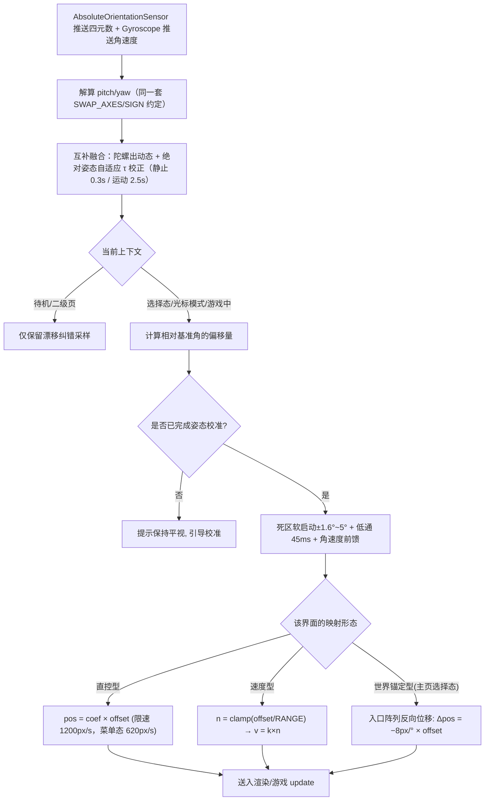
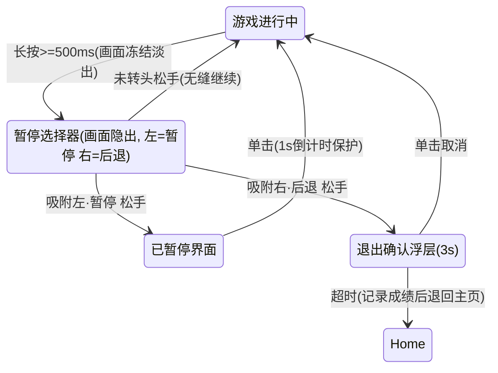
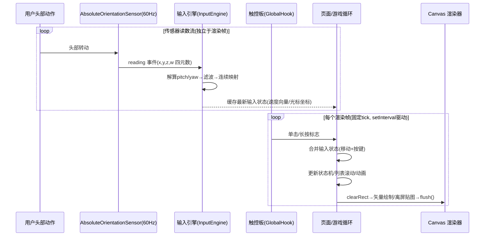
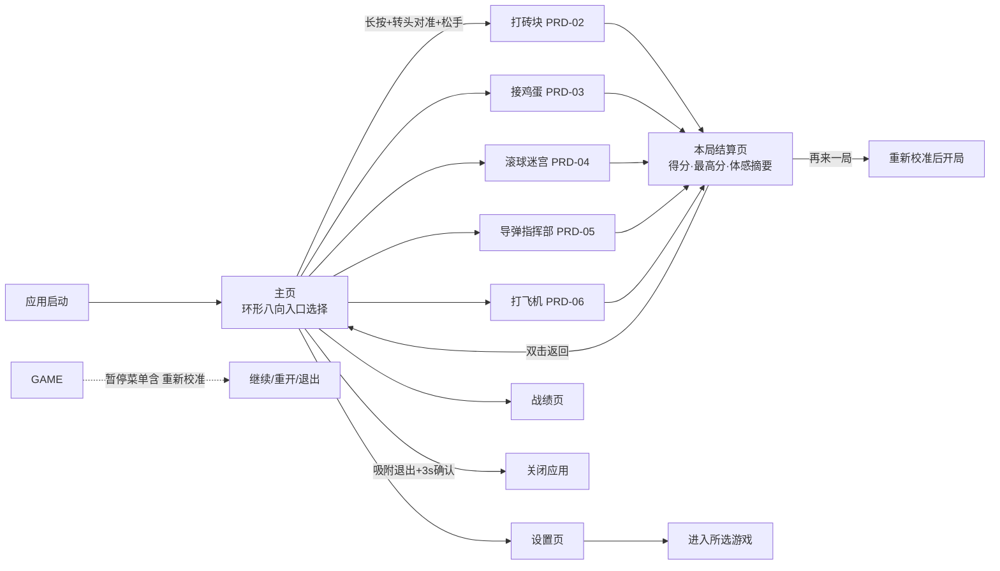
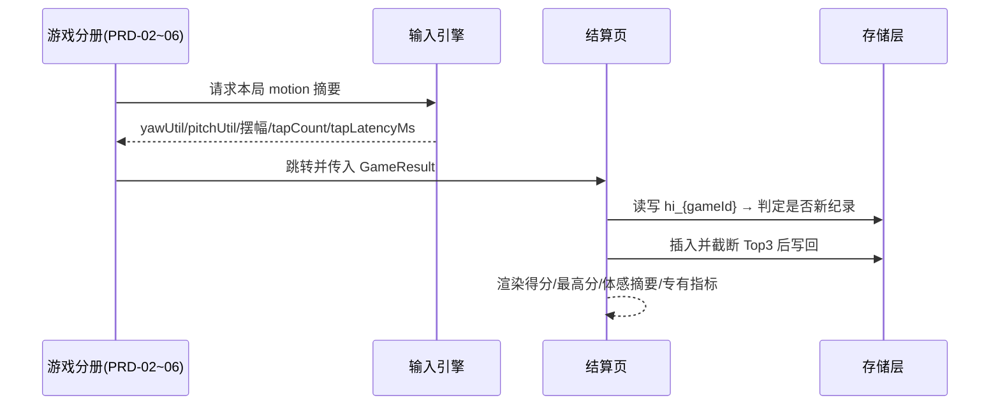
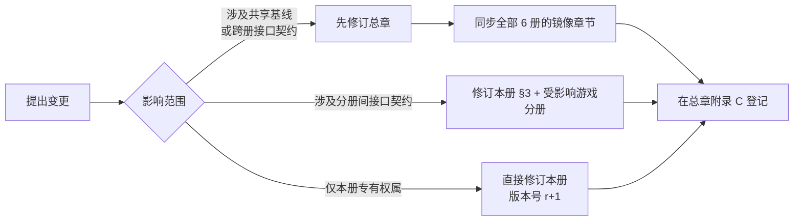

# PRD-01《摇头晃脑》主页头控交互与非游戏功能 · 需求分册

| 文档信息   | 内容                                                  |
| ------ | --------------------------------------------------- |
| 分册编号   | **PRD-01**                                          |
| 分册名称   | 主页头控交互与非游戏功能                                        |
| 归属总章   | 《摇头晃脑需求说明书》V1.0（下称"总章"，文件路径 `摇头晃脑需求说明书.md`）         |
| 分册版本   | V1.0-r3（对齐总章 V1.0，本册第 3 次修订：主页环形八向入口 + 世界锚定选择模式同步）                        |
| 编写日期   | 2026-08-29                                          |
| 目标平台   | Rokid Glasses（AIUI 平台）                              |
| 文档状态   | 初稿（待评审）                                             |
| 需求编号前缀 | `F-HOME-*`（主页交互）、`F-PAGE-*`（二级页面）、`F-SYS-*`（通用系统功能） |

---

## 1. 分册定位与范围边界

### 1.1 本册职责（Own）

本册是**除五款游戏玩法本体之外的全部需求**的唯一权威来源，覆盖：

1. **主页「环形八向入口 · 长按选择模式」交互**——本产品的交互门面与全局导航中枢；
2. **全局交互一致性约定**——主页范式与游戏内范式共存时的统一规则；
3. **二级页面体系**：设置页、战绩页、结算页，以及确认浮层；
4. **通用系统功能 F-Sys-01 ~ F-Sys-07**；
5. **分册间接口契约**——五款游戏分册（PRD-02 ~ PRD-06）与主页/系统层之间的数据与生命周期接口。

### 1.2 本册不负责（Out of Scope）

| 不在本册                              | 归属           |
| --------------------------------- | ------------ |
| 打砖块玩法、数值、关卡                       | PRD-02       |
| 接鸡蛋玩法、数值、关卡                       | PRD-03       |
| 滚球迷宫玩法、数值、关卡                      | PRD-04       |
| 导弹指挥部玩法、数值、关卡                     | PRD-05       |
| 打飞机玩法、数值、关卡                       | PRD-06       |
| 平台能力与物理参数实证（Spike-1 / Spike-2 结论） | 总章 §13 及附录 A |

### 1.3 总章条款映射表（双向追溯）

| 总章条款                                         | 本册落点                     |
| -------------------------------------------- | ------------------------ |
| §4.1 头动控制总则 / §4.3 头动输入处理流程 / §4.4 校准与基准姿态管理 | §2.2 公共基线·输入引擎契约         |
| §4.2 触控板三态判定                                 | §2.3 公共基线·触控板三态判定        |
| §4.5 舒适性与防误触要求                               | §2.2.6 / §7.3 灵敏度与关怀     |
| §5.1 主页「环形八向入口 · 长按选择模式」交互 | §4 主页环形八向入口                 |
| §5.1.4 页面导航总览                                | §5 页面导航总览                |
| §5.1.5 全局交互一致性约定                             | §6 全局交互一致性约定             |
| §5.1.6 关键设计决策与理由                             | §4.5 关键设计决策              |
| §5.7 游戏内暂停选择器                                | §2.4 公共基线（游戏侧接入要求见 §3.3） |
| §5.8 通用系统功能表                                 | §7 通用系统功能                |
| §7 视觉与 UI 设计规范                               | §2.5 公共基线·视觉规范           |
| §8 数据结构定义                                    | §3 分册间接口契约 / §7.6 存储结构   |
| §9 非功能需求                                     | §2.7 公共基线                |
| §10 异常与边界场景                                  | §9 异常与边界场景               |
| §11 验收标准（输入链路 / 体验质量 / 视觉合规）                 | §10 验收标准                 |

---

## 2. 公共基线（继承自总章，只读引用）

> **单源原则**：本节内容摘抄自总章 §2 / §4 / §7 / §9，对全部 6 个分册生效。
>
> - 若本册与总章冲突，**以总章为准**，并回写修正本册；
> - 若需变更本节任何数值，**必须先在总章修订，再同步全部 6 册**（流程见 §11.2）；
> - 本节在 6 册中保持**逐字一致**，评审时只需核对一次。


### 2.1 运行环境与技术约束（摘 总章 §2）

| 约束项         | 规格                                                                                                                                            |
| ----------- | --------------------------------------------------------------------------------------------------------------------------------------------- |
| 应用框架        | AIUI（`.ink` 单文件组件格式 + `app.json` + `app.js` + `AGENTS.md`）                                                                                    |
| 屏幕类型        | **单绿色单色透明显示**（RokidGlasses1/2）：仅一个绿色发光通道叠加在透明黑底之上——纯黑即"透出现实"，不存在遮蔽现实的黑幕                                                                       |
| 应用宽度        | 固定 **480px**，不可变                                                                                                                              |
| 推荐高度        | 120px ～ 352px，全屏参考尺寸 **480 × 352**；安全内边距横向 16px / 纵向 12px（有效内容区 **448×328**）                                                                  |
| 视觉主题        | 官方单绿科学仪表风：6 级亮度阶梯（100/72/48/24/12/6%），1px 结构线，控件圆角 4px / 面板 6px；禁止大面积实色与装饰性 glow                                                              |
| 主渲染方式       | Canvas 2D 页面节点 + `wx.createCanvasContext(id)`；每帧 `clearRect → 矢量绘制 → flush()` 呈现；**无双缓冲语义、无 requestAnimationFrame**——循环用 `setInterval` 固定节拍驱动 |
| Canvas 绘图限制 | `drawImage` 仅接受另一 `Canvas` 实例为源（离屏精灵可用 `new Canvas(w,h)` 自建）；`createPattern` 忽略传入图像不可依赖；fillStyle 仅支持 #rrggbb/#rgb/rgb()/rgba()/基础命名色         |
| IMU 数据源     | `AbsoluteOrientationSensor`（四元数）、`Gyroscope`、`Accelerometer`；frequency 参数为 best-effort 提示（建议请求 60Hz，不承诺保证）                                    |
| 按键事件        | 页面级 `onKeyDown` / `onKeyUp`；触控板对应 `GlobalHook` 键码（官方定位即游戏类最快响应路径）；默认行为拦截只对 `onKeyUp` 的 `preventDefault()` 生效                                  |
| 本地存储        | `wx.setStorageSync` / `wx.getStorageSync`                                                                                                     |
| 音效          | `Sound`（短音效）、`AudioPlayer`（背景音乐），资源置于 `assets/audio/`                                                                                         |

> 技术选型说明：本产品全部输入为连续模拟量，不需要「点头/摇头」粗粒度手势，因此**不启用** `enableWorldAwareness()` 环境感知链路；核心输入直接订阅 `AbsoluteOrientationSensor` 四元数流，解算欧拉角得到 pitch/yaw 后由应用层做连续映射。


### 2.2 输入引擎契约（摘 总章 §4.1 / §4.3 / §4.4）

#### 2.2.1 基准与相对偏角

以进入界面时静默采样的自然平视为**基准姿态**（中立位），一切输入均基于「当前姿态 − 基准姿态」的相对偏角。

#### 2.2.2 死区与滤波

1. **死区**：±1.6° 内视为中立——采用**软启动** `f(u)=2u²−u³`（1.6°~5°）过渡到线性，边界处**值与斜率双连续**。
   > 交互 v1.23：旧版在 3° 处输出从 0 **跳**到 3°（≈24px），即「先纹丝不动、再啪一下窜出去」，是迟钝感里最刺眼的一段，已消除。
2. **低通抑制**：角速度 |ω| < 6°/s 且偏角 < 1.8° 的低幅高频抖动（说话、走路颠簸）直接抑制。
3. **互补融合（交互 v1.23 + v1.55 修订）**：陀螺积分提供零滞后动态，`AbsoluteOrientationSensor` 校正直流与漂移，抵消融合自身 40~80ms 的滞后；**校正时间常数 τ 自适应**——静止 300ms（把陀螺零偏压进死区）、运动 2500ms（保住相位领先），逐轴按角速度插值。陀螺需 220ms 同向准入，轴系判错则永不准入 / 偏离钳制 / 自动关闭。无陀螺时自动回落纯绝对姿态口径。
   > v1.55 修订理由：τ 固定 2.5s 时，稳态偏离 = 零偏 × τ，消费级陀螺零偏 1~5°/s ⇒ 画面恒漂 20~100px。真机现象即「进选择态后头没动、画面却自己上下飘」。详见设计说明册 §05。
4. **角速度前馈**：输出 += clamp(0.022 × ω, ±2°)，补偿低通 45ms 带来的相位滞后（≈提前 22ms）。

#### 2.2.3 坐标约定

屏幕 y 轴向下而抬头为负 pitch，统一取反保证「**抬头 = 向上**」的直觉。

#### 2.2.4 两种映射形态

| 形态            | 公式                                                                           | 手感               | 适用                                              |
| ------------- | ---------------------------------------------------------------------------- | ---------------- | ----------------------------------------------- |
| **直控型**（位置跟随） | `pos = coef × offset`，coef ≈ 8px/°                                           | 头指哪、打到哪，零迟滞感     | 打砖块 / 接鸡蛋 / 导弹指挥部光标 / 滚球迷宫倾角（±15°）/ **二级页列表滚动** |
| **速度型**（摇杆拖拽） | `v = k × n`；`n = clamp(offset / RANGE, -1, 1)`，YAW_RANGE 30°、PITCH_RANGE 20° | 类似推摇杆的加速感，自带平滑缓冲 | 打飞机机身移动                             |

#### 2.2.5 平滑约束

所有直控输出叠加**按时间的限速**（游戏态 ≤1200px/s、选择/菜单态 ≤620px/s；滚球迷宫为倾角每帧 ≤2°），杜绝头部微颤导致实体高频抖动产生眩晕。
> 交互 v1.23：旧版是「每帧 ≤12px」，30fps 下只有 360px/s，相机全行程单程就要 420ms，是「转头迟钝」的最大单一来源；改为按时间后与帧率解耦，掉帧不再放大延迟。

#### 2.2.6 映射参数与灵敏度

| 界面/游戏   | 形态   | 轴数     | 有效量程            | 输出对象     |
| ------- | ---- | ------ | --------------- | -------- |
| 主页选择态图标阵列 | 世界锚定型（反向补偿） | 双轴 | 8px/° 反向位移 | 入口随头动反向移动；中心与屏显内容固定 |
| 打砖块     | 直控型  | 单轴 yaw | ±28° → 屏宽全幅     | 底部挡板水平位置 |
| 接鸡蛋     | 直控型  | 单轴 yaw | ±28°            | 接蛋篮水平位置  |
| 滚球迷宫    | 倾角直控 | 双轴     | ±15° → 盘面倾角     | 小球受重力滚动  |
| 导弹指挥部   | 直控型  | 双轴     | ±30°（8px/°）夹紧边界 | 十字瞄准光标   |
| 打飞机     | 速度型  | 双轴     | 30°/20°         | 机体平面速度   |

灵敏度三档：**迟钝 ×0.75 / 标准 ×1.0 / 灵敏 ×1.3**，作用于各游戏 RANGE 与 coef，出厂默认**标准档**。

#### 2.2.7 校准与基准姿态管理（摘 总章 §4.4）

1. **两级基准**：主页**不预置基准**（待机态不消费头动输入，选择态以长按达成时刻的姿态为锚定原点）；进入任意游戏前执行**正式校准**——提示"请保持自然平视注视中央 2 秒"，采样 pitch/yaw 均值与方差作为本局基准；
2. **漂移纠正**：优先走**漂移解耦**（交互 v1.27：用陀螺把融合角变化拆成「用户头动」与「融合漂移」，基准只跟随后者，故转头幅度与慢漂抑制可同时成立）；陀螺不可用时回落到插值迁移（**明显偏离 ≤0.1°/s、死区附近 ≤1.5°/s**），补偿长时间佩戴漂移；**直控型界面在波间/关卡过场等无输入压力期加速收敛，速度型界面（打飞机）在波次间隙与页面过场同样启用加速收敛；主页选择态会话短（≤15s），期间**冻结漂移纠正**，避免入口阵列缓慢爬移**；
3. **累计偏航保护**：本局基准累计迁移超过 **±45°** 时强制提示"请重新校准"；
4. **手动重校准**：游戏中经暂停选择器冻结画面后，单击触控板即可触发快速重校准流程；
5. **异常姿态保护**：校准时方差过大（用户未静息）则提示重试，不采用错误基准。

#### 2.2.8 头动输入处理流程（摘 总章 §4.3）



### 2.3 触控板三态判定（摘 总章 §4.2）

同一物理操作在不同上下文承担不同语义，先分派再处理：

| 物理操作               | 按键码                                       | 上下文                 | 功能                                |
| ------------------ | ----------------------------------------- | ------------------- | --------------------------------- |
| 触控板长按（≥500ms 激活）   | `GlobalHook`（onKeyDown 起计时）               | 主页                  | 唤起"选择模式"：原点亮起光晕，八向入口切换为世界锚定、随头动反向移动（本册 §4）    |
| 触控板长按（≥500ms 激活）   | 同上                                        | 游戏内                 | 唤起"暂停选择器"（各游戏分册）                  |
| 触控板松开              | `GlobalHook` 对应 keyup                     | 主页/选择器中             | 完成选取确认：有点亮入口即确认启动；无点亮入口则静默取消并恢复原状态           |
| 触控板单击（<300ms 且非长按） | `GlobalHook` + 时长判定                       | 游戏内                 | 发炮 / 发射 / 引爆（最快响应路径）              |
| 触控板单击              | 同上                                        | 主页                  | 显示引导文案："请长按触控后转头选择，松手完成确认"（3 秒淡出） |
| 触控板单击              | 同上                                        | 二级页面 / 确认浮层 / 已暂停界面 | 确认 / 开始 / 恢复游戏 / 取消浮层             |
| 实体返回键              | `Backspace`（onKeyUp 中 `preventDefault()`） | 全局                  | 返回上级菜单（游戏中弹"退出确认"浮层防误退）           |

**互斥判定时序**（同一时间线上至多产生一种语义）：

1. 按下后 **<300ms 松手** = 单击；
2. 持续 **≥300ms** 即预约长按态（期间松手若不足 500ms 仍按单击处理）；
3. **≥500ms** 进入激活态并锁定语义直至松手。

> **系统事件拦截要求**：长按的系统级默认行为必须在 `onKeyDown`/`onKeyUp` 阶段 `preventDefault()` 拦截并给出可见反馈，避免"拦了没反应"的假死感。
>
> **关于双击（已裁决）**：总章 §4.2 明确双击的适用边界——**游戏内不承担任何双击语义**（高频单击发射会天然产生两次快速按下），退出统一走"长按 → 选择器 → 右侧后退位"；**主页与二级页面无高频单击压力，双击安全承担"返回上级"语义**（总章 §5.1.3-6 / §5.1.5-3）。


### 2.4 游戏内暂停选择器（摘 总章 §5.7，游戏侧接入要求见本册 §3.3）

解决高频点击（发炮）与退出意图的冲突：**游戏内退出与暂停统一收敛到长按手势**，单击不再有任何销毁/导航语义。

1. 游戏进行中长按触控板 ≥500ms → 原有游戏画面**冻结，全部元素 globalAlpha 整体渐隐至 0.15（过渡 ≥200ms）**——降低元素自身亮度而非叠加黑色遮罩（透明屏上黑即现实背景，遮罩无效）；
2. 屏幕浮现简化两向选择器（复用主页同源输入引擎；映射形态为屏内直控光标）：仅 **左、右两个功能位 + 中央原点**，每功能位按"双通道冗余"要求同时提供图形图标与文字标签——
   - 左位 = **暂停**（方块双竖线图标 + "暂停"）；
   - 右位 = **后退（返回主页）**（回折箭头图标 + "主页"）；
3. 选择器期间头部照常直控移动原点：
   - **吸附左位松手** → 进入持久"已暂停"界面：静止游戏画面（亮度恢复至 40%）+ "已暂停 · 单击继续"文案；此后单击即恢复游戏（1 秒倒计时保护防止误吃伤害）；
   - **吸附右位松手** → 确认浮层："确定退回主页？当前进度将丢失（单击取消 / 3 秒后自动执行）"；超时记录本局成绩后返回主页；
   - **未转头直接松手（原点仍在中央死区）** → 选择器淡出、画面亮度恢复、游戏从冻结帧无缝继续（最高频路径，必须零负担）。



**设计要点**：

- 与主页选择态的差异：选择器为屏内直控光标（光标动、功能位固定），主页为世界锚定图标阵列（图标反向动、原点固定）；传感器解算与三态判定引擎共享，选择器无泛光激活态（出现即激活）；
- 长按阈值全端统一 500ms；游戏内单击发射与长按在时间线上互斥判定（<300ms 松手 = 发射）；
- 选择器期间传感器保持采样但游戏逻辑 tick 冻结，连续长按挂起超过 60 秒自动进入"已暂停"界面兜底。


### 2.5 视觉与 UI 规范（摘 总章 §7）

#### 2.5.1 亮度阶梯与颜色常量

| 亮度级      | 值                     | 用途                                |
| -------- | --------------------- | --------------------------------- |
| 100%     | `#40ff5e`             | 仅保留给：光标本体、当前吸附图标、得分关键数值、拦截爆炸等主动焦点 |
| 72%      | `rgba(64,255,94,.72)` | 主可读文本、激活结构线、游戏实体描边                |
| 48%      | `rgba(64,255,94,.48)` | 次要文本、常规交互边界、未吸附实体                 |
| 24%      | `rgba(64,255,94,.24)` | 分隔线、非选中引导线、待机态主页环形入口常态             |
| 12% / 6% | 相应 alpha              | 局部分组底纹（最大正常面积填充为 12%）             |

- Canvas 内不得引用 WXSS Token 名，直接使用上述常量（Canvas fillStyle 仅支持十六进制/rgb/rgba 形式）；
- **禁止大面积 ≥24% 实色填充**；选区高亮 = 12% 底纹 + 72% 强调框 + 必要的 2px 焦点标记；
- 黑色即透明地板，**禁止绘制黑色遮罩层去"压暗"内容**——一切变暗都通过降低元素自身 alpha 实现。

#### 2.5.2 版式与安全区

- 全画布 480×352，**有效内容区内缩：横向 16px、纵向 12px**；主页环形入口、HUD、暂停选择器均须落在安全区内；
- HUD 条高 24px，字号按官方阶梯：页面标题 22px/500、区块题 16px/500、正文 14px、密排 12px、标签 11px/500、数据值用 monospace 13px；**同屏最多同时出现 3 个字级**；
- 圆角：控件 4px、面板 6px、圆点才可用全圆；1px 为默认结构线宽，2px 只用于焦点强调；
- 每个语义状态至少双通道编码（文字标签 + 图形/线型变化），不得仅靠亮度区分。

#### 2.5.3 渲染与动效细则

- **每帧渲染**：`clearRect → 矢量绘制实体 → flush()`；帧节拍用 `setInterval`（30fps ≈ 33ms），不假设 requestAnimationFrame 存在；
- **精灵策略**：静态复杂图形预绘到脚本自建离屏 `new Canvas(w,h)`，主循环以 `drawImage(offscreenCanvas,…)` 贴图；禁用 `createPattern`；
- **动效时长**取官方档：120ms 快反馈 / 200ms 标准过渡 / 320ms 结构过渡（如选择器浮现、隐出渐暗）；
- 光标/激活点允许一个 **≤8px 的细微 bloom 点睛**；**同一屏只允许一个主导脉冲动效**，禁止多路持续呼吸动画；
- 所有 UI 文案禁用 emoji；关键文案必须在明亮/杂乱现实背景下仍可读（≥72% 亮度）。

### 2.6 渲染帧循环约定

传感器读数频率高于游戏帧率：输入引擎持续更新"最新意图快照"，页面/游戏循环每帧合并一次，两者解耦，杜绝因渲染耗时丢输入；Canvas 无双缓冲语义，每帧以 `clearRect` 起手、`flush()` 收尾呈现。



### 2.7 非功能需求（摘 总章 §9，本册相关项）

| 类别    | 编号     | 要求                                          |
| ----- | ------ | ------------------------------------------- |
| 性能    | NFR-01 | 帧率稳定 ≥ 30fps，输入到画面响应延迟 ≤ 100ms              |
| 性能    | NFR-02 | 传感器高频订阅仅在游戏进行与选择器/光标状态维持；离开对应页面 `stop()` 释放 |
| 功耗    | NFR-03 | 待机/二级页仅保留低频采样，降低整机发热                        |
| 健康    | NFR-04 | 舒适性条款（休息提醒、灵敏度档位、死区防误触）                     |
| 健壮性   | NFR-05 | 传感器权限失败或 error 事件时降级：自动进入"已暂停"保护状态并给出明显提示   |
| 存储健壮性 | NFR-06 | 读档 JSON 解析失败时静默重置为空档案，绝不崩溃                  |
| 国际化   | NFR-07 | V1.0 仅简体中文文案，文案须符合"眼睛端短句"原则（≤12 字/行）        |

---

## 3. 分册间接口契约（本册专有，6 册协同核心）

> 本节定义的契约是 PRD-02 ~ PRD-06 与主页/系统层之间的**唯一耦合点**。游戏分册只需按契约实现，无需关心主页与结算页内部实现；反之亦然。

### 3.1 游戏清单契约 `GameManifest`

各游戏分册必须向主页/教学页注册如下清单项（注册位置：`app.js` 导出的 `GAME_MANIFESTS` 常量数组）。

```text
GameManifest {
  id:   "breakout" | "eggcatch" | "labyrinth" | "missile" | "plane",
  name: String,                 // 显示名，≤4 字
  page: String,                 // 路由页，如 "pages/breakout/breakout"
  ringPos: "T"|"RT"|"R"|"RB"|"B"|"LB"|"L"|"LT",  // 环位：上/右上/右/右下/下/左下/左/左上（见 §4.1；上半环五位为游戏位，RB/B/LB 预留扩展）
  difficultyRank: 1..5,         // 难度阶梯序号，见 §4.1 弧线顺序
  axisLabel: String,            // 轴数标签，如 "单轴·左右转头" / "双轴·转头俯仰" / "双轴·倾斜盘面"
  tutorialLine: String,         // 一句话教学文案，≤12 字（NFR-07）
  iconId: String                // 圆环描边图标资源标识
}
```

| 契约要求      | 说明                                                          |
| --------- | ----------------------------------------------------------- |
| F-HOME-01 | 五款游戏的 `ringPos` 与 `difficultyRank` 必须与 §4.1 表格逐项一致，主页不做容错映射 |
| F-HOME-02 | `tutorialLine` 必须能独立表达该游戏的头动映射方向，不得出现"上下左右"之外的歧义表述          |

### 3.2 结算数据契约 `GameResult`

游戏结束时，各游戏分册必须构造如下结构并跳转结算页；结算页只消费该结构，不反向读取游戏内部状态。

```text
GameResult {
  gameId: "breakout"|"eggcatch"|"labyrinth"|"missile"|"plane",
  score: Number,            // 三关总分（本局最终成绩）
  cleared: Boolean,         // 是否三关全通
  reachedLevel: 1|2|3,      // 到达关卡
  durationSec: Number,      // 本局净游玩时长（不含暂停/校准）
  motion: {                 // 体感摘要，由输入引擎统一采集，游戏侧不透传原始量
    yawUtil:   0~1,         // 偏角利用率（|offset| 达量程 80% 的采样占比）
    pitchUtil: 0~1,
    yawAmpDeg: Number,      // 本局最大 yaw 摆幅（度）
    pitchAmpDeg: Number,
    tapCount:  Number,      // 单击次数
    tapLatencyMs: Number    // 单击 → 游戏内生效 的平均延迟（ms）
  },
  extra: [ { label: String, value: String } ]   // 游戏专有指标，≤2 项
}
```

| 契约要求      | 说明                                                                                                 |
| --------- | -------------------------------------------------------------------------------------------------- |
| F-HOME-03 | `motion` 字段由**输入引擎与触控板三态判定模块统一写入**，游戏分册不得自行计算或改写                                                   |
| F-HOME-04 | `extra` 最多 2 项，由各游戏分册定义（如打飞机"投弹命中率"、接鸡蛋"金蛋接取数"），label ≤6 字                                         |
| F-HOME-05 | 游戏分册在退出（GameOver / 通关 / 暂停选择器右位超时）三条路径上**都必须**产出 `GameResult`，否则结算页按 `score=0, cleared=false` 兜底展示 |

### 3.3 暂停选择器接入契约

| 契约要求      | 说明                                                                                |
| --------- | --------------------------------------------------------------------------------- |
| F-HOME-06 | 各游戏必须实现 `freeze()` / `resume()`：`freeze()` 停止逻辑 tick 但保留渲染最后帧；`resume()` 从冻结帧无缝继续 |
| F-HOME-07 | 各游戏在 `freeze()` 期间必须把画面全部元素 `globalAlpha` 整体降至 0.15（过渡 ≥200ms），**禁止使用黑色遮罩**       |
| F-HOME-08 | 选择器 UI 由系统层统一绘制并叠加在游戏画面之上，游戏分册**不得自行实现**选择器（引擎共享，见 §2.4）                          |
| F-HOME-09 | 暂停期间传感器保持采样（供漂移纠错与重校准），但游戏逻辑 tick 完全冻结；连续长按 >60s 自动转入"已暂停"界面                      |
| F-HOME-10 | 已暂停状态挂机 ≥3 分钟自动挂起并释放传感器（F-Sys-03）                                                 |

### 3.4 校准接入契约

| 契约要求      | 说明                                                                                   |
| --------- | ------------------------------------------------------------------------------------ |
| F-HOME-11 | 校准流程由系统层统一实现，游戏分册通过 `await requestCalibration({ mode: "formal" })` 调用，成功返回后方可开始倒计时开局 |
| F-HOME-12 | 校准失败（方差过大）由系统层负责重试提示，游戏分册不得跳过校准直接开局                                                  |
| F-HOME-13 | 暂停选择器触发的"快速重校准"复用同一实现，完成后画面保持冻结，需单击才恢复游戏                                             |

### 3.5 存储契约

```text
// 最高分（各游戏分册只写自己的 key，战绩页统一读）
key = "hi_{gameId}"   // gameId ∈ breakout | eggcatch | labyrinth | missile | plane
value = [{ score: Number, date: "YYYY-MM-DD", durationSec: Number }, ...]  // 按分降序保留 3 条

// 设置（仅本册读写）
key = "settings"
value = { sensitivity: "dull"|"normal"|"sharp", sfxOn: Boolean }

// 首次引导标记（仅本册读写）
key = "tutorial_seen"
value = { breakout: Boolean, eggcatch: Boolean, labyrinth: Boolean, missile: Boolean, plane: Boolean }
```

| 契约要求      | 说明                                                           |
| --------- | ------------------------------------------------------------ |
| F-HOME-14 | 游戏分册**只负责**在结算时写入 `hi_{gameId}`（读-插-排序-截断 Top3-写回），战绩页只读取不写入 |
| F-HOME-15 | `settings.sensitivity` 由本册持久化，游戏分册每帧从输入引擎读取当前生效系数，不得自行缓存副本   |
| F-HOME-16 | 所有读档必须 try/catch，JSON 解析失败或结构非法时静默重置为空档案（NFR-06）             |

---

## 4. 主页环形八向入口（F-HOME-20 ~ F-HOME-38）

> 对应总章 §5.1。主页采用与游戏内不同的选择范式：**长按进入选择态 → 八向入口世界锚定 → 转头对准点亮 → 松手确认**。

### 4.1 布局规格（F-HOME-20 ~ F-HOME-25）

- **F-HOME-20**：进入应用即显示 **8 个功能入口 + 1 个中心原点**；8 个入口以屏心（240,176）为圆心、**半径 R = 130px 的正圆**等角排布（每 45° 一位，覆盖 上 / 右上 / 右 / 右下 / 下 / 左下 / 左 / 左上 八个方向），相邻入口弦距 ≈ 2×130×sin22.5° ≈ **99px**；**待机态（未长按触控板）下，8 个入口与中心原点均为普通屏显元素——位置固定，不随用户头部转动而转动**（不消费头动输入）；
- **F-HOME-21**：入口为 48px 圆环描边 + 线性图标（单绿主题），待机态维持 **24% 常态亮度**；中心"原点"（选择光标本体）常态为 36px 小圆环；
- **F-HOME-22**：功能位分配（上半环五款游戏，下半环三格系统/销毁位）：

| 环位 | 功能 | 环位 | 功能 |
| --- | --- | --- | --- |
| 左上 | 打砖块（入门·单轴） | 上 | 接鸡蛋（轻量·单轴） |
| 右上 | 滚球迷宫（进阶·双轴倾斜） | 左 | 导弹指挥部（中阶·光标+点击） |
| 右 | 打飞机（高阶·双轴+策略投弹） | 下 | **退出应用**（销毁性入口，置于正下需刻意低头确认，天然防误触） |
| 左下 | 战绩页 | 右下 | 设置页 |

- **F-HOME-23**：游戏难度沿"左上 → 上 → 右上 → 左 → 右"弧线递增（`difficultyRank` 1→5），新手把低难游戏"转到面前"即达；
- **F-HOME-24**：「退出应用」点亮松手后弹出 **3 秒确认浮层**"即将退出，单击取消"，期间单击即取消，超时自动执行退出（`wx.exitMiniProgram`）；
- **F-HOME-25**：背景支持半透明实景图层（透传现实画面感），入口与原点悬浮其上。

> 原独立「设置」「关于」入口**并入教学页底部区域**（灵敏度/音效开关与校准同属体验调节；关于信息以页脚文本呈现），环形排布只保留 8 个可达目标。

### 4.2 双态交互模型与状态机（F-HOME-26）

主页交互分**待机态**与**选择态**两个互斥状态，以触控板长按（≥500ms）为切换开关：

**待机态（未长按）——屏显静态**：8 个入口与中心原点位置固定、不随头动（见 F-HOME-20）；传感器可暂停高频订阅（仅保留低频采样或完全 `stop()`），降低功耗与发热；长按达成时再恢复 60Hz 订阅。

**选择态（长按 ≥500ms）——世界锚定**：

- 原点由常态描边升级为**光晕激活**：100% 主色 + 72% 光晕环 + ≤8px bloom 点睛（单屏唯一主导光点），过渡 ≥200ms，并配触觉/听觉短提示——光晕即"已进入选择模式"的提示；
- 8 个入口切换为**世界锚定**：入口屏幕位置 = 基础位置 **− 8px/° × (Δyaw, Δpitch)**（Δ 相对**长按达成时刻的姿态**）。头部右转 → 入口整体左移（**随头动反方向移动**），效果即 8 个入口"钉"在用户面前的球面空间中不动（入口相对头部静止）；
- 中心原点、背景图层与屏上其余内容**保持屏幕固定**，不参与锚定；
- 转头即"把想去的入口转到原点面前"——原点不动，世界在动；
- 选择态期间**冻结漂移纠正**（会话 ≤15s，避免入口阵列缓慢爬移）。

```mermaid
stateDiagram-v2
    Idle: 待机态(8入口+原点静态显示, 不随头动)
    Hint: 提示态(显示操作引导文本)
    Select: 选择态(原点亮起光晕, 入口世界锚定随头反向移动)
    Lit: 点亮态(光晕接触入口, 入口点亮; Select子状态)
    ExitConfirm: 退出确认浮层(3s倒计时, 单击取消)
    Idle --> Hint: 单击触控板
    Hint --> Idle: 3秒后自动淡出
    Idle --> Select: 长按>=500ms(原点亮起光晕, 入口世界锚定)
    Select --> Lit: 光晕接触某入口(距离<48px, 入口点亮)
    Lit --> Select: 光晕离开(入口熄灭)
    Lit --> Launch: 松手确认选取
    Launch --> Idle: 启动对应页面/游戏
    Select --> Idle: 松手且无点亮入口(静默取消)
    Lit --> ExitConfirm: 松手且点亮入口为"退出应用"
    ExitConfirm --> Idle: 单击取消
    ExitConfirm --> Exit: 倒计时结束自动退出
```



### 4.3 行为细节需求（F-HOME-27 ~ F-HOME-34）

1. **F-HOME-27 长按激活**：按下持续 **≥500ms** 进入选择态——原点亮起光晕（100% 主色 + 72% 光晕环 + ≤8px bloom，单屏唯一主导光点），激活过渡 **≥200ms**，并配触觉/听觉短提示确认；
2. **F-HOME-28 世界锚定随动**：选择态期间每帧按 **−8px/°** 反向补偿更新入口位置；锚定原点 = 长按达成时刻姿态，进入瞬间入口无跳变；中心原点与背景**不随头动**；
3. **F-HOME-29 接触点亮与重选**：原点光晕与某入口接触（原点中心与入口中心距离 **< 48px**）→ 该入口**点亮**：描边 24% → **100%** + **12% 底纹 + 72% 强调环**（不以单一透明度承载状态，符合官方规范），过渡 ≥200ms；相邻弦距 99px > 2×48px，任意时刻**至多点亮一个**；**点亮后不松手仍是选择态**，可继续转头改变方向，点亮随接触关系实时转移（原入口熄灭、新入口点亮）；
4. **F-HOME-30 松手确认**：选择态中松开触控板——有点亮入口则启动对应功能（进入游戏前照常走教学/校准流程，见 §3.4）；点亮"退出应用"则进入 3 秒确认浮层；**无点亮入口则静默取消回到待机态，不弹错误提示**；
5. **F-HOME-31 单击提示**：待机态下单击（<300ms 且非长按）显示文本"请长按触控后转头选择，松手完成确认"，**3 秒自动淡出**；
6. **F-HOME-32 双击**：300ms 内两次按下判定为双击——**主页双击不承担销毁职能**（退出走正下专属位），仅刷新提示文案（见 §12 冲突 C-01）；
7. **F-HOME-33 事件拦截**：长按期间的系统默认行为必须在按键事件阶段 `preventDefault()` 拦截；选择态进行中应用切换到后台时自动取消选择态并**复位原点与入口位置**；
8. **F-HOME-34 防误触**：选择态最长持续 **15 秒**，超时未松手自动视为取消并回到待机态（防止长按挂起导致传感器常开发热）。

### 4.4 主页姿态基准（F-HOME-35 ~ F-HOME-36）

- **F-HOME-35**：主页**不预置姿态基准**——待机态不消费头动输入，选择态以长按达成时刻的姿态为锚定原点，无需打断式校准仪式；进入游戏前仍执行 §2.2.7 的**正式校准**（游戏中误差代价高，主页导航误差代价低，两级的精度投入与风险匹配）；
- **F-HOME-36**：选择态期间**冻结插值式漂移纠正**（基准迁移会让入口阵列"钉不住"）；但**漂移解耦仍生效**——它只吸收"非用户造成"的分量，用户不转头时它吸收的正是融合慢漂，不会推动入口阵列。选择态结束（松手/超时）后恢复低频漂移采样；累计偏航保护（±45°）只在游戏内生效。

### 4.5 关键设计决策与理由（摘 总章 §5.1.7）

| 决策 | 取值 | 理由 |
| --- | --- | --- |
| 长按阈值全端统一 500ms | 主页选择态与游戏内选择器同值 | 单击已全部退化为低频战术动作（发球/投弹/拦截），不存在高频连点与长按的判别压力，统一阈值降低记忆成本 |
| 九宫格改**环形八向排布** | R=130px 正圆、每 45° 一位 | 八个方向与头动方向语义天然对齐（上/下/左/右/四斜角）；相邻弦距均匀（≈99px），消除方形九宫格四角视觉权重不均、"正方形排布别扭"的问题 |
| 选择态用**世界锚定**而非屏内光标移动 | 入口 −8px/° 反向补偿，原点固定 | 原点固定消除"人追光标"的精细对位负担；"指针不动、世界在动"的空间心智更直觉——转头即把目标入口"转到面前"；与暂停选择器（屏内直控光标）形成"环境级锚定 / 页面级锚定"的明确分工 |
| 锚定原点 = 长按达成时刻姿态 | 进入选择态无跳变 | 若锚定到更早的页面基准，长按时头已偏转会导致入口瞬间跳动；以按压时刻为原点保证过渡平滑 |
| 接触点亮半径 48px | < 相邻弦距一半 | 任意时刻至多点亮一个入口，杜绝双点亮歧义 |
| 点亮 = 100% 描边 + 12% 底纹 + 72% 强调环 | 非单一透明度 | 官方规范要求语义状态不得仅以透明度承载；描边/底纹/强调环三通道保证绿屏可读性 |
| 未点亮松手静默取消 | 不提示 | 选择态是"按住才存在"的临时状态，取消是高频动作，出提示反而制造打断感 |
| 选择态 15s 超时 | 自动取消回待机 | 防长按挂起导致传感器常开、发热与耗电；也兜底"松手事件丢失"的异常 |
| 选择态期间冻结漂移纠正 | ≤15s 会话内不迁移基准 | 漂移纠正会让入口阵列在长按期间缓慢爬移，破坏"钉在空间中"的稳定感；会话短，冻结无副作用 |
| 双击退出加 2s 确认窗 | 已被替代 | 原方案废弃；现退出走环形正下专属位 + 3 秒确认浮层，双击不再承担销毁职能 |
| 待机态入口 24% 常态亮度 | 非 0% | 八个选项保持可见可数；点亮态 100% 与之拉开鲜明对比 |
| 设置/关于并入教学页 | 环形只留游戏+战绩+教学+退出 | 降低可达目标密度；灵敏度/音效本就属于体验调节，与校准天然同页 |

---

## 5. 页面导航总览（F-PAGE-01 ~ F-PAGE-06）



| 编号        | 要求                                                               |
| --------- | ---------------------------------------------------------------- |
| F-PAGE-01 | 首次进入任一游戏先跳转教学页（`tutorial_seen.{gameId}` 为 false 时）；已看过的游戏直接进校准开局 |
| F-PAGE-02 | 二级页面（教学 / 战绩 / 结算）均支持**双击触控板返回主页**                               |
| F-PAGE-03 | 游戏内返回键（`Backspace`）弹"退出确认"浮层，防误退；不可一步直达主页                        |
| F-PAGE-04 | 结算页"再来一局"必须**重新走正式校准**后开局（基准已漂移，不可复用）                            |
| F-PAGE-05 | 应用启动后首屏即主页，不做独立的开屏/加载页                                           |
| F-PAGE-06 | 所有页面跳转时先 `stop()` 上一页的传感器高频订阅，避免叠加订阅（NFR-02）                     |

---

## 6. 全局交互一致性约定（摘 总章 §5.1.5）

| 编号        | 约定              | 说明                                                                                   |
| --------- | --------------- | ------------------------------------------------------------------------------------ |
| F-PAGE-10 | 姿态基准分两级         | 主页 = 不预置基准（选择态以长按时刻姿态锚定）；游戏前 = 正式校准（2s 静息 + 方差校验）。见 §2.2.7                                   |
| F-PAGE-11 | 二级页面统一用"滚动列表范式" | 教学、战绩、结算及确认浮层均采用**头部上下偏角 = 列表滚动位置（直控型）+ 触控板单击确认 + 双击返回**，与游戏内操作心智一致，不引入第二套导航逻辑       |
| F-PAGE-12 | 三态判定全局统一        | 单击（<300ms）/ 双击（300ms 窗口）/ 长按（500ms）在同一时间线互斥判定，任何页面下同一物理动作至多产生一种语义                    |
| F-PAGE-13 | 退出层级收敛          | 结算/二级页 → 双击返回主页；主页 → 吸附"退出应用"格 + 3 秒确认浮层；游戏内 → 返回键弹二次确认。所有退出路径均有防误触缓冲，**无一步直达销毁性操作** |

### 6.1 二级页「滚动列表范式」规格（本册细化，F-PAGE-14 ~ F-PAGE-19）

> 总章 §5.1.5-2 确立范式；参数于 2026-08-29 定稿并回填总章附录 A，本表与总章附录 A 逐项一致。

| 编号        | 项     | 规格                                                                     |
| --------- | ----- | ---------------------------------------------------------------------- |
| F-PAGE-14 | 映射形态  | 直控型·**单轴 pitch**（左右 yaw 不参与），抬头 = 列表向上滚动                               |
| F-PAGE-15 | 量程    | ±18° 覆盖列表可滚动全程（列表不足一屏时按实际可滚动距离等比缩放），出界夹紧                               |
| F-PAGE-16 | 平滑    | 滚动位移每帧限幅 ≤12px（同全局约束）                                                  |
| F-PAGE-17 | 选中项视觉 | 12% 底纹 + 72% 强调框 + 2px 焦点标记；**非选中项维持 48%**，不淡出（列表需整体可读，与主页环形入口的常态亮度策略不同） |
| F-PAGE-18 | 确认    | 单击 = 确认当前选中项；长按在二级页**不承担任何语义**（避免与单击歧义）                                |
| F-PAGE-19 | 返回    | 双击（300ms 内两次按下）= 返回主页并取消当前浮层；返回键 `Backspace` 等效                        |

---

## 7. 二级页面详细需求


### 7.1 设置页（F-PAGE-20 ~ F-PAGE-30）【v1.48 重构 · 环形头控；v1.49 三处修复】

**v1.48 起本页由「教学 / 校准 / 设置」滚动列表改为环形头控设置页**：只保留灵敏度、
游戏音效两项设置 + 一个返回位，教学区 / 校准区 / 关于页脚按产品口径移出。

#### 7.1.1 布局与交互（v1.48）

| 编号 | 要求 |
| --- | --- |
| F-PAGE-20 | **三项圆形分布**：灵敏度 LT、游戏音效 RT、返回 B；半径与主页同为 `RING_POS`（屏心 ±114），复用 `utils/ring.js` 的 `makeItem/layoutEntries/pickLit/drawEntries`——**不引入第二套判定与绘制** |
| F-PAGE-21 | **滑动触控进入选择态**（与主页同源）：选择态起采 + 冻结漂移基准，待机真·停采；待机单击无语义。**v1.49 修（IMU 冷启动预热）**：**每个页面各有自己的 `InputEngine` ⇒ 各自的传感器实例**，而官方契约只描述单实例语义 —— 故**二级页永远是一次冷启动**，磁力计融合未收敛。进页须**先起采跑满 `PRIME_MS`(2500ms) 再停采**（与主页 onLoad 完全同口径，`PRIME_MS` 已由 index 私常量上提为 `utils/layout.js` 共享常量）；且 `resetToIdle()` 在**预热窗口内不得 stop**（否则收敛被反复打断，漂移反复出现）。v1.48 缺这段，真机表现为「进设置页后 IMU 突然漂移且反复出现」 |
| F-PAGE-22 | 点亮项在图标**外侧**显示当前状态：灵敏度 = 低 / 标准 / 高，音效 = 开启 / 关闭（近端对齐、越界镜像，同主页标签规则） |
| F-PAGE-23 | **单击点亮项 = 就地切换**：灵敏度三档循环、音效开关；**切换后停留在选择态**，可继续转头选其它项 —— 这是与主页"单击即跳转"**刻意不同**的唯一规则 |
| F-PAGE-24 | **未点亮时单击 = 退回待机**；15s 无操作自动回待机（与主页同参 `TOUCH.selectSuspend`） |
| F-PAGE-25 | 「返回」位单击 = `navigateBack` 回主页。**v1.49 修**：`navigateBack` 是**宿主请求型 API**（success 是无条件回调，只承诺已发出），必须走**对象形态** `wx.navigateBack({ delta: 1, success, fail, complete })` + **落地判定**（本页被出栈后宿主回调 `onHide` → `_hidden`） + **有限重试**（每 `BACK_PROBE_MS`=800ms 一次，最多 3 次；配额用尽则回待机并清在途，绝不留「点了没反应」的死角）。裸调用 `wx.navigateBack()` 在真机即表现为「选中返回单击无反应」 |
| F-PAGE-26 | **左上角页标题为「设置」**（v1.49 修：此前沿用应用名「摇头晃脑」，与「本页只承载设置项」的定位不符）；右上角状态胶囊（待机中 / 选择中 / 已选中）与左下角操作提示条，均与主页**同规格同出口**（`utils/hud.js` 的 `drawHud` / `drawHint`） |
| F-PAGE-27 | **灵敏度三档**：低 ×0.75 / 标准 ×1.0 / 高 ×1.3，作用于各游戏 RANGE 与 coef；出厂默认标准档；切换即时生效并落盘 `settings.sensitivity` |
| F-PAGE-28 | **音效开关**：全局开关，落盘 `settings.sfxOn`；关闭时全部 `Sound` / `AudioPlayer` 静音。**v1.48 起开机默认生效**（主页与游戏底座各自注入），无需先进设置页 |
| F-PAGE-29 | 音效不可用时该项状态退化为「不可用」，图标切 `volumeOff`，不额外铺诊断文案 |
| F-PAGE-30 | 图标：灵敏度 = IconPark「Tuning」滑杆、音效开 = 「VolumeNotice」、音效关 = 「VolumeMute」、返回 = 「Home」（`utils/icons.js`，48 viewBox / stroke 3） |

#### 7.1.2 已移出本页（v1.48）

| 原编号 | 内容 | 去向 |
| --- | --- | --- |
| 原 F-PAGE-20 ~ F-PAGE-24 | 游戏教学区（动态映射示意图 / 教学文案 / 轴标签 / 首玩强制跳转 / 游戏切换行） | 移出；不再由本页承载 |
| 原 F-PAGE-25 ~ F-PAGE-27 | 校准区（重新校准 / 方差校验 / 扶正提示） | 由 `pages/calibrate` 独立页承载 |
| 原 F-PAGE-30 | 关于页脚（产品名 / 版本号 / 平台） | 移出 |

### 7.2 战绩页（F-PAGE-31 ~ F-PAGE-35）【v1.50 精简 · 一屏五行】【v1.51 HUD 口径】

**v1.50 起由「五款 × Top3 滚动列表」改为「每款游戏最近一局 · 五款五行 · 一屏放下」**：
原方案信息密度过高（5 组 × 3 条 × 3 字段 + 分组标题），且要抬头/低头翻页；
本页实际只是"看一眼最近打成什么样"，五行足够。

**v1.51 口径收敛**：右上角胶囊由「状态：只读」改为「最近一局成绩」，列表上方的
同名小标题删除，列表整体上移（`REC.y` 64 → 84，与 HUD 留白 48px）。

| 编号 | 要求 |
| --- | --- |
| F-PAGE-31 | **每款游戏一行，共五行，一屏放下、无滚动**：左侧游戏图标（Ø22）+ 游戏名（14px/500），右侧最近一局得分（monospace 16px/500，右对齐）；行盒 448×36 @(16, **84**+i×44)，几何常量在 `utils/layout.js` 的 `REC`。**v1.51**：上沿 64 → 84（小标题删除后补留白），留白 ≥44px 由 harness-records A14 钉死 |
| F-PAGE-32 | 无记录的游戏显示「暂无记录」（12px/400，48% 亮度），**不得留空或报错** |
| F-PAGE-33 | **右上胶囊 = 口径说明「最近一局成绩」（12px/500，`dot: null` 不画状态圆点）**；HUD 左上角为页名「战绩」。**v1.51 口径**：右上由「状态：只读」改本文案（「只读」不是用户关心的信息，圆点是状态灯、与文案语义冲突），并**删除列表上方原 11px 小标题「最近一局」**（与胶囊重复） |
| F-PAGE-34 | 数据来源：**只读 `last_{gameId}`（`readLast`）**。⚠ **不能从 `hi_` 推导**：`hi_` 按分数降序截断 Top3，**最近一局若没进前三会被丢掉**。`pushScore` 落盘时同步写 `last_`；`readLast` 对 v1.50 之前的老存档回退为 Top3 中 `ts` 最新一条 |
| F-PAGE-35 | **单击触控返回主页**（本页唯一交互，左下角提示条常驻`单击触控回到主页`）。返回走**对象形态 `wx.navigateBack({ delta:1, success, fail, complete })` + 落地判定（onHide）+ 有限重试**（800ms × 3）——裸调用是宿主请求型 API，真机「点了没反应」（v1.49 定案）。本页无头控 ⇒ 进页即停采 |

### 7.3 结算页（F-PAGE-36 ~ F-PAGE-43）

| 编号        | 要求                                                                                                                                         |
| --------- | ------------------------------------------------------------------------------------------------------------------------------------------ |
| F-PAGE-36 | 顶部：本局得分（22px/500，**100% 亮度**——得分关键数值）、是否通关标识                                                                                               |
| F-PAGE-37 | 次行：历史最高分（13px monospace，72%）；**破纪录时展示"新纪录!"标识**（100% 亮度 + 120ms 快反馈动效）                                                                     |
| F-PAGE-38 | 体感数据摘要区（F-Sys-07）：展示**转向幅度分布**（yaw/pitch 最大摆幅，度）、**平均映射利用率**（yawUtil / pitchUtil，百分比）、**单击次数**与**平均延迟**（ms）；数值用 monospace 13px，标签 11px/500 |
| F-PAGE-39 | 游戏专有指标区：渲染 `GameResult.extra`（≤2 项），无则省略该区                                                                                                 |
| F-PAGE-40 | 底部操作项（滚动列表两项）：**再来一局**（重新校准后开局，F-PAGE-04）、**返回主页**                                                                                         |
| F-PAGE-41 | 本局成绩在进入结算页时**立即落盘**（不等用户操作），写入失败仅 Toast 一次提示，不影响后续操作                                                                                       |
| F-PAGE-42 | 双击直接返回主页（等同选中"返回主页"）                                                                                                                       |
| F-PAGE-43 | 结算页不自动跳转，等待用户显式选择                                                                                                                          |

**结算页数据流转**：



---

## 8. 通用系统功能（F-SYS-01 ~ F-SYS-07，摘 总章 §5.8）

| 编号       | 功能     | 说明                                                               | 实现归属                                   |
| -------- | ------ | ---------------------------------------------------------------- | -------------------------------------- |
| F-Sys-01 | 最高分记录  | 五款游戏各自本地 `setStorageSync` 保存 **Top3** 成绩（key 前缀区分），结算页展示"新纪录!"标识 | 写入：各游戏分册；读取：本册战绩页/结算页                  |
| F-Sys-02 | 设置持久化  | 灵敏度档位、音效开关等全部落盘，下次启动恢复                                           | 本册                                     |
| F-Sys-03 | 暂停选择器  | 全游戏统一长按唤起（§2.4）；已暂停状态挂机 **≥3 分钟**自动挂起并释放传感器                      | 选择器：本册；接入：各游戏分册                        |
| F-Sys-04 | 首次引导   | 每个游戏首次进入播放图文教学（动态示意该款的头动映射）+ 强制校准                                | 本册（页面）+ 各游戏分册（提供 `tutorialLine` / 示意图） |
| F-Sys-05 | 音效     | 每款 4~5 类短促合成音（发射/爆炸/接住/过关/失败，复刻电子味）；提供全局开关                       | 中心：本册；音效清单：各游戏分册 【**v1.45 双通道加固**：`assets/sfx/` 8 个 wav 就位（16kHz / 16bit / 单声道，共 65KB）；`utils/sfx.js` 经**四级探测**拿宿主构造器（注入 / `globalThis.Sound` / `globalThis.audio.Sound` / 运行时 `require('audio')`），**全项目禁止 `import 'audio'`**（静态 / 动态 import 均曾致整页黑屏）；拿不到时静默 no-op】 |
| F-Sys-06 | 退出保护   | 游戏内退出走暂停选择器右位 + 3 秒确认浮层；主页通过吸附"退出应用"格 + 3 秒确认浮层关闭应用              | 本册                                     |
| F-Sys-07 | 体感数据摘要 | 结算页展示本局转向幅度分布、平均映射利用率、单击次数与延迟，供可行性验证引用                           | 采集：输入引擎；展示：本册                          |

### 8.1 舒适性与防误触（摘 总章 §4.5，F-SYS-08 ~ F-SYS-10）

- **F-SYS-08**：量程系数可在教学·设置页调节灵敏度（三档 ×0.75 / ×1.0 / ×1.3），作用于各游戏 RANGE 与 coef，出厂默认标准档；
- **F-SYS-09**：单局累计大幅摆头超过 **300 个有效指令周期**时弹出关怀提示："晃得有点久了，休息一下眼睛和脖子～"（可跳过）；
- **F-SYS-10**：所有界面的中立位即屏幕布局重心附近，标准坐姿下头部始终无需离开舒适区超过 **±20°**。

---

## 9. 异常与边界场景（摘 总章 §10，本册相关项）

| 场景              | 处理策略                                                  |
| --------------- | ----------------------------------------------------- |
| 戴歪了/基准失真        | 支持在教学页与暂停选择器重校准；自动漂移纠错兜底缓慢跟随                          |
| 行走颠簸途中操作主页      | 低通滤波 + 死区屏蔽小幅噪声；角速度长期超限时提示"当前环境不适合游玩"并暂停选择态           |
| 玩家突然摘下眼镜        | 依宿主行为切后台，主页自动取消选择态并复位原点与入口位置；二级页保持当前滚动位置                   |
| 快速连环甩头          | 速度型因限幅不会瞬移；主页选择态入口反向补偿连续随动（入口暂出视野属正常，转回即可）                                     |
| 高频连点触控板（主页）     | 单击按引导文案处理，永不误触发导航；误入长按但 <500ms 松手仍按单击结算               |
| 长按挂起未松手         | 选择态 15s 超时自动取消回待机（F-HOME-34）                          |
| 传感器权限失败 / error | 主页降级：选择态不可用，提示"传感器不可用"，并进入**降级导航模式——环形入口图标按顺时针顺序高亮，单击 = 切换到下一个，长按 500ms = 确认当前高亮项**，保证传感器故障时仍可完整导航与退出（原待决 D-01，已裁决；总章 §10 已同步） |
| 存储写满/异常         | 写入最高分失败仅 Toast 一次提示，不影响当局游戏                           |
| 读档 JSON 解析失败    | 静默重置为空档案，绝不崩溃（NFR-06）                                 |
| 应用切后台           | 立即 `stop()` 传感器；回前台后主页回待机态；选择态下次长按时重新锚定（无需预置基准）                |

---


## 10. 验收标准（本册专有，摘 总章 §11 相关项）

**主页选择模式交互**

- [ ] 待机态 8 个入口与原点静态显示，头部转动时**无任何位移**（传感器处于低频/停止状态）；
- [ ] 长按 500ms 原点光晕激活，过渡 ≥200ms 且有触觉/听觉提示；
- [ ] 选择态入口随头动**反向**补偿移动（右转头 → 入口左移），8px/° 线性、无跳变；
- [ ] 光晕接触入口（<48px）必点亮、离开必熄灭，同一时刻至多点亮一个入口；
- [ ] 点亮 = 24%→100% 描边 + 12% 底纹 + 72% 强调环（**非单一透明度变化**）；
- [ ] 松手后正确启动/取消，**误启动率为 0**；无点亮入口松手静默取消且不弹提示；
- [ ] 点亮后不松手可转头改选，点亮随接触关系实时转移；
- [ ] 主页单击必出引导文案，3 秒自动淡出；
- [ ] 点亮"退出应用"后必出 3 秒确认浮层，**单击必取消、超时才退出**；
- [ ] 长按期间无系统默认行为被触发（`preventDefault()` 拦截有效）；
- [ ] 选择态 15s 超时自动取消并复位原点与入口位置；切后台自动取消选择态。

**二级页面**

- [ ] 教学页首次进入强制展示所选游戏映射示意 + 一句话文案 + 校准；
- [ ] 灵敏度三档切换后阈值变化在实际游玩中**可感知**且随设置持久化（重启后保持）；
- [ ] 音效开关落盘并在重启后生效；
- [ ] 战绩页五款游戏 Top3 正确读取，空档案显示"暂无记录"不报错；
- [ ] 结算页得分/最高分/新纪录标识/体感摘要/专有指标齐全，成绩进入即落盘；
- [ ] 二级页滚动列表：抬头 = 上滚，单击确认，双击返回主页，长按无语义。

**系统与性能**

- [ ] 关闭应用或退出游戏页后 **1 秒内**停止传感器高频读取；
- [ ] 连续游玩 10 分钟无画面撕裂、丢帧 < 5%；
- [ ] 读档结构非法时静默重置，无崩溃；
- [ ] 单一物理操作在任何页面只产生一种语义（三态互斥验证）。

**视觉合规（对照官方 design-system-green 验收清单）**

- [ ] 全部页面内容落在安全区内（横 16px / 纵 12px 内缩）；
- [ ] 主可读文本 ≥72% 亮度；大面积填充 ≤12%；2px 边框仅用于焦点强调；
- [ ] 语义状态（选中/未选中/确认/取消）均具备**文字 + 图形双通道**；
- [ ] Canvas **无黑色遮罩层**变暗方案；同屏仅一个主导脉冲动效，时长落在 120/200/320ms 官方档。

---

## 11. 与总章的协同规则

### 11.1 单源原则

| 内容类别                      | 唯一权威来源                       | 分册可否改写    |
| ------------------------- | ---------------------------- | --------- |
| 运行环境与技术约束（§2.1）           | 总章 §2                        | ❌ 只读引用    |
| 输入引擎契约（§2.2）              | 总章 §4.1 / §4.3 / §4.4 / 附录 A | ❌ 只读引用    |
| 触控板三态判定（§2.3）             | 总章 §4.2                      | ❌ 只读引用    |
| 暂停选择器（§2.4）               | 总章 §5.7                      | ❌ 只读引用    |
| 视觉与 UI 规范（§2.5）           | 总章 §7                        | ❌ 只读引用    |
| 非功能需求（§2.7）               | 总章 §9                        | ❌ 只读引用    |
| 主页交互 / 二级页 / 系统功能 / 分册间契约 | **本册**                       | ✅ 本册独享    |
| 各游戏玩法数值关卡                 | PRD-02 ~ PRD-06              | ❌ 本册不重复定义 |

> 分册中标注"摘 总章 §X"的章节为**镜像引用**，其内容必须与总章逐字一致。

### 11.2 变更流程




| 规则 | 说明                                            |
| -- | --------------------------------------------- |
| 1  | 改共享基线 → **先总章后分册**，6 册同批同步，禁止单边先行             |
| 2  | 改分册专有内容 → 只改本册，分册修订号 +1（如 V1.0-r1 → V1.0-r2）  |
| 3  | 改分册间接口契约（§3）→ 必须同批修订所有受影响的游戏分册                |
| 4  | 任何变更必须在**总章附录 C：分册同步登记表**登记一行（日期 / 影响分册 / 摘要） |
| 5  | Spike 实证结论（R1~R7 相关参数）回填总章附录 A 后，由总章发起全局同步    |

### 11.3 版本对齐规则

分册版本号格式：**`V{总章主版本}-r{本册修订号}`**。总章主版本升级时，全部分册修订号重置为 r1（内容随同步更新）。

---


## 12. 遗留冲突与待决项

> ✅ **全部待决项已于 2026-08-29 裁决并落地**（总章附录 C 第 7~9 行）。下表保留作决策追溯，裁决结论已写入总章 §1 / §4.2 / §4.4 / §5.1.5 / §7.1 / §8 / §10 / 附录 A 与本册对应条款。

| 编号       | 类型 | 位置                                         | 描述                                                           | **裁决结论（已落地）**                                                    |
| -------- | -- | ------------------------------------------ | ------------------------------------------------------------ | ----------------------------------------------------------------------- |
| **C-01** | 冲突 | 总章 §4.2 注记 vs §5.1.3-6 / §5.1.4 / §5.1.5-3 | §4.2 称"双击不再承担任何语义"，但 §5.1.3-6、§5.1.4、§5.1.5-3 仍保留"二级页双击返回主页" | ✅ **保留二级页双击返回主页、主页双击仅刷新提示**；总章 §4.2 注记已改为"双击的适用边界"——游戏内不承担双击语义，主页与二级页可安全使用（本册 §2.3 已同步） |
| **C-02** | 冲突 | 总章 §5.1.5-3 vs §4.2 表 / §5.1.6 / §5.7      | §5.1.5-3 写"长按（主页 500ms、**游戏内 800ms**）"，其余三处均为统一 500ms        | ✅ **全端统一 500ms**；总章 §5.1.5-3 已修订 |
| **C-03** | 笔误 | 总章 §5.1.5-1                                | "进入游戏前仍执行 §4.5 的强制校准" —— 校准条款在 **§4.4**                      | ✅ 已改引 **§4.4**（总章 §5.1.5-1） |
| **C-04** | 笔误 | 总章 §1.3                                    | 章号 §1.3 重复（产品目标 / 目标用户）                                      | ✅ 章号顺延为 **§1.3 产品目标 / §1.4 目标用户 / §1.5 使用场景** |
| **D-01** | 缺口 | 总章 §9 NFR-05                               | 传感器失败仅规定游戏内降级为"已暂停"，**未规定主页降级行为**                            | ✅ 采用**降级导航模式**：环形入口图标按顺时针顺序高亮，单击 = 切换到下一个，长按 500ms = 确认当前高亮项（本册 §9、总章 §10 已写入） |
| **D-02** | 缺口 | 总章 §5.1.5-2                                | "二级页滚动列表范式"未给映射参数                                            | ✅ 单轴 pitch / ±18° / 每帧 ≤12px / 非选中项 48% / 长按无语义（本册 §6.1，**已回填总章附录 A**） |
| **D-03** | 缺口 | 总章 §5.8 F-Sys-07                           | 体感摘要指标定义分散（§1.2 / §5.2 / F-Sys-07 表述不一）                      | ✅ 统一为 `GameResult.motion` 六字段（本册 §3.2），**已写入总章 §8 数据结构** |

---

## 13. 变更记录

| 版本      | 日期         | 变更摘要                                             | 影响范围               |
| ------- | ---------- | ------------------------------------------------ | ------------------ |
| V1.0-r1 | 2026-08-29 | 从总章 V1.0 拆分生成首版：主页九宫格、二级页面体系、通用系统功能、分册间接口契约、协同规则 | 本册新建；总章新增 §0 与附录 C |
| V1.0-r2 | 2026-08-29 | 待决项裁决落地：C-01 双击适用边界（§2.3）、D-01 主页降级导航模式（§9）、D-02 二级页滚动参数定稿（§6.1）、D-03 体感摘要写入总章 §8；公共基线漂移纠正条款同步 | 本册 + 总章 §0.5 / 附录 A / 附录 C / 附录 D |
| V1.0-r3 | 2026-08-31 | **主页交互范式重设计**：九宫格改环形八向入口（R=130px 正圆、每 45° 一位）；长按进入选择态——原点亮起光晕、入口世界锚定（−8px/° 反向补偿）、接触点亮（<48px）、松手确认、不松手可转头重选；主页不再预置轻量基准；待机态入口与原点不随头动 | 本册 §1/§4/§5/§6/§9/§10 + 总章 §4/§5.1/§7.2/§10/附录 A + PRD-02~06 公共基线 |
| V1.0-rN+（v1.40 结束画面） | 2026-09-07 | **玩法结束的默认去向改为「结束弹窗 → 回主页」（总章 F-Sys-10）**：五款游戏页新增 B5 态 `S.OVER` —— 通关撒花 +「恭喜，您已通关」/ 失败「GAME OVER」，5 秒或单击 → 走 B3 返回握手回主页。**结算页（§11 C3）不再是玩法结束的默认去向**，仅由「IMU 异常逃生出口」直达（它既非通关也非失败，显示 GAME OVER 不准确）；成绩仍照旧落盘（`_record()`：pushScore + setPendingResult），记录页与体感摘要不受影响。弹窗期游戏内容收 6% 隐藏档、HUD 降 48%。代码：`utils/gamepage.js` / `utils/overlay.js` / `utils/hud.js` / `utils/layout.js`(`OVER`) | §5.8（总章 F-Sys-10）/ §11 / 变更记录 |
| **V1.0-rN+（v1.43 音效）** | **2026-09-07** | **F-Sys-05 音效由「链路全通、资源为空」转为真正生效**：① `assets/sfx/` 补齐 8 个 wav（8kHz / 8bit / 单声道，共 **16.5KB**，整包 479KB → 496KB，**+3.5%**）；音色为 8-bit 芯片音，由 `tools/gen-sfx.py` 生成。② `utils/sfx.js` 改为读 **`globalThis.Sound`** 拿宿主构造器——**不 import 任何模块**，彻底绕开黑屏崩溃面；`injectSound()` 保留为页面级兜底。本册 `SFX_OF` 映射与调用点**零改动**。新增 `harness-sfx.mjs` 42 项；全套 **941/941 通过** | 总章变更记录 #23；本册音效条款 |
| **V1.0-rN+（v1.44 音效规格修正）** | **2026-09-07** | **F-Sys-05 音效规格修正（v1.43 真机无声）**：v1.43 出包后真机实测**完全没有任何音效**。逐段排查确认：包内 8 个 wav 确实在、`sfxOn` 默认开、玩法链路 `SFX_OF` / `_play()` 正常 ⇒ 问题锁定在**音频规格**与**拿构造器**两处，本轮一并加固。① **8kHz/8bit → 16kHz/16bit**（65KB，+13%）：8-bit PCM 是遗留格式，**多数嵌入式 / 移动端解码器已不吃**，是「没声音」最可能的主因。② **构造器改四级探测**：注入值 → `globalThis.Sound` → `globalThis.audio.Sound`（命名空间形式）→ 运行时 `require('audio').Sound`（**不是 import**，解析期无崩溃面，失败可 catch）。**全项目仍禁止 `import 'audio'`**（黑屏教训）。③ **路径候选**：`/assets/sfx/` → `assets/sfx/` → `./assets/sfx/` 逐个试、成功即记住下标。④ **音量**：仅在宿主默认值为 0 时纠正为 1（宿主量程可能是 0~1 或 0~100，**乱设会几乎无声**）。⑤ **诊断可判读**：新增 `sfx.probe()`（只构造不发声）与 `sfx.brief()`；主页诊断行由 `sfx ok/none` 改为 `8/8x3`（就绪数/总数 × 已播放次数）或 `NO-CTOR`——**一眼区分「拿不到构造器 / 文件加载失败 / 播了但不出声」**。**本册玩法代码零改动**。harness-sfx 42 → 58 项（新增 I 组四级探测与路径回退；G4 新增「文件在 ≠ 有声」波形峰值校验）；**十套 957/957 通过** + 冒烟 27/27 | 总章变更记录 #24；本册音效条款 |
| **V1.0-rN+（v1.45 音效双通道）** | **2026-09-07** | **F-Sys-05 双通道加固（v1.44 真机仍无声）**：16bit 规格未命中 ⇒ 问题在**通道或路径基准**。① **双通道**：Sound 不可用时自动切 **AudioPlayer**（官方通用播放 API；播前 `seek(0)` 保证重头播）。② **路径候选 3 → 5**：新增 `../assets/sfx/` 与 `../../assets/sfx/`——官方示例 `new Sound('./click.wav')` 暗示部分运行时按**调用方文件**解析相对路径。③ **诊断迁移**：主页诊断行只有 6s 窗口且要先转头 ⇒ 改为**设置页「音效」行常驻显示** `· S8/8x3`（S=Sound / A=AudioPlayer）或 `· NO-CTOR`；设置页 onLoad 先 `sfx.probe()`。**本册玩法代码零改动**。harness-sfx 58 → 67 项（J 组 AudioPlayer 兜底）；**十套 966/966 通过** | 总章变更记录 #25；本册音效条款 |
| **V1.0-rN+（v1.51 战绩页口径 + 首页诊断行下屏）** | **2026-09-08** | ① **战绩页右上角改口径**：「状态：只读」→ **「最近一局成绩」**（`drawHud` 新增 `dot: null`：不画状态圆点，文字起点回落 `HUD.noDotTextX`）；**列表上方小标题「最近一局」删除**（与胶囊重复）；`REC.y` 64 → **84**，列表与 HUD 留白 28 → **48px**（末行盒下沿 296，距提示条 316 仍 20px）。② **首页诊断行下屏**：原品牌胶囊下方 y=48 的 11px 诊断行会在**选择态与跳转期间**把跳转 url 与 IMU/音效自检暴露给用户，属调试期产物 ⇒ 移除上屏；`_diag()` / `_diagMsg` **保留**（Craft 控制台取证 + harness 落地握手入口）。harness-records 46 → 55 项、harness 84 → 85 项；**十二套 1090/1090** + 冒烟 27/27；BUILD → **v1.51** | 总章变更记录 #31；本册 §7.2（F-PAGE-31/33） |
