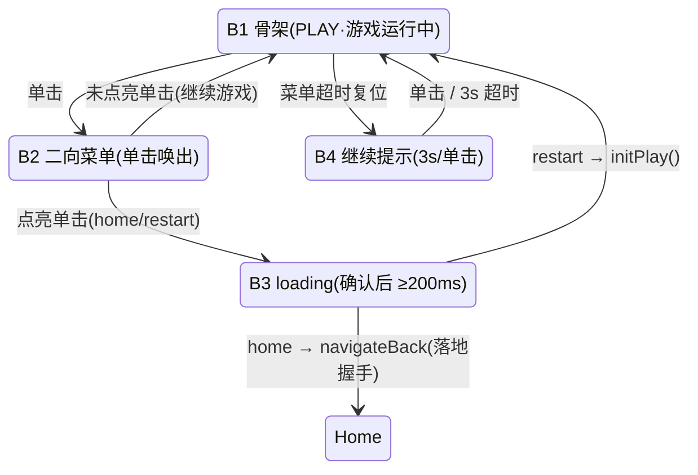

# PRD-02《打砖块》需求分册

| 文档信息 | 内容 |
| --- | --- |
| 分册编号 | **PRD-02** |
| 分册名称 | 《打砖块》Breakout |
| 归属总章 | 《摇头晃脑需求说明书》V1.0（下称"总章"，文件路径 `摇头晃脑需求说明书.md`） |
| 分册版本 | **V1.0-r4**（对齐总章 V1.0，本册第 4 次修订：**单关化 + 工程对齐 + 经典关卡定稿**） |
| 编写日期 | 2026-09-03 |
| 目标平台 | Rokid Glasses（AIUI 平台） |
| 文档状态 | **可开发**（已对齐现行工程架构 `摇头晃脑-眼镜端/`） |
| 需求编号前缀 | `F-BRK-*` |
| 开发优先级 | **P0**（总章 §12 / 附录 B） |

---

## 0. 本次修订摘要（r3 → r4 → r5）

r3 版是按"纸面理想交互"写的，与 2026-08-31 ~ 09-02 已落地的工程架构存在**系统性冲突**，且关卡结构（三关）超出本期实现范围。本次修订的**第一目标是可开发性**：改完即可照着写代码。

### 0.1 冲突裁决表

| # | 冲突点 | r3 写法 | 工程现状（真机实证） | **r4 裁决** |
| --- | --- | --- | --- | --- |
| **D1** | **单击语义** | 单击 = 发球 / 球速 +15% 加力 | 交互 v1.20：**游戏中单击 = 唤出菜单 B2**（系统级逃生出口，全五款统一）；宿主双击 = 退出程序且**不可拦截** | ✅ **单击不再承担任何游戏语义**，发球改为**自动发球**；加力机制删除，替换为"击砖递增球速" |
| **D2** | **长按** | 长按 ≥500ms = 暂停选择器 | GlobalHook **无长按语义**：一次按压 = D+U 脉冲（U@24ms），~483ms 后尾随 Enter | ✅ **删除长按**；暂停走 B2 菜单（L=退回主页面 / R=重新游戏），由框架页统一提供 |
| **D3** | **暂停选择器** | 自建两向选择器（左暂停/右后退） | B2 二向菜单已由 `pages/game/game.js` 实现并落地 | ✅ **本册不实现任何选择器 UI**；只提供 `freeze/resume` 契约（§8） |
| **D4** | **关卡数** | 共 3 关（阶梯阵 → 加固砖 → 移动砖） | 本期只做一关 | ✅ **单关**；原三关的精华（加固砖/移动砖）压缩为本关的"上层高分区 + 破墙加速"，见 §6 |
| **D5** | **挡板 y=336** | 挡板贴底 y=336 | 左下角提示条常驻 @(16,316) h=24 → 与挡板重叠 | ✅ 球场整体上收：挡板 **y=294**，球场底边 **y=308**，与提示条留 8px（§4） |
| **D6** | **砖块 54×14 / 8 列 5 行** | 8 列 × 5 行，砖高 14 | 球场高度由 296 缩到 260，需重排 | ✅ **8 列 × 6 行**，砖 **54×12**，行间距 3（§6.1） |
| **D7** | **±28° 量程** | ±28° → ±216px | 球场实际内宽 448，挡板半宽 32 → 行程只有 **±192px** | ✅ 标准档 **±24°**（= 192/8）；迟钝 ±32°、灵敏 ±18.5°（§3） |
| **D8** | **关卡切换过场** | ≥200ms 过场 + 漂移纠正加速收敛 | 单关无换关 | ✅ 保留"吸附等待期"作为收敛窗口（§3 F-BRK-04） |
| **D9** | **音效 4 类** | 反弹/碎砖/道具/落底 | `utils/sfx.js` KEYS 已定 7 项，无 wav 文件时纯 no-op | ✅ 复用现有 key，仅**追加 1 项** `bounce`（§9） |

### 0.2 变更范围

| 类别 | 章节 | 说明 |
| --- | --- | --- |
| **结构变更** | §6 | 三关 → 单关（经典关卡定稿） |
| **新增** | §11 | 开源参考与借鉴清单（GitHub 实证） |
| **新增** | §12 | 工程落地清单（改哪些文件、加哪些常量） |
| **重写** | §3 / §5 | 体感映射、操作与物理 —— 删除单击/长按语义 |
| **重写** | §4 | 视口与 HUD —— 按 480×352 实测可用区重排 |
| **重写** | §8 | 暂停选择器 → freeze/resume 契约 |
| **保留** | §2 | 公共基线（只读镜像，逐字继承总章） |
| **新增（r5）** | §2.7 | **游戏框架页契约（前提性要求 · 五册统一）**：顶部标题栏两处预留（左上=游戏名 / 右上=状态信息，可经 `statusText()` 改写）+ 画面区硬约束 C-FRM-01~05 + 冻结契约 + `GameResult` 契约 |

### 0.3 r5 补充（2026-09-03 · 交互 v1.22）

主页与游戏框架页定稿后，把 `pages/game/game.js` 已落地的结构**前提化**：五款游戏共用同一框架页，任何一款游戏的画面都必须长在这个框架里。要点三条——

1. **顶部标题栏是两处预留，不是本册 UI**：左上品牌胶囊恒由框架写入游戏名；右上状态胶囊默认承载框架状态（IMU / 打开中），本册可通过 `statusText()` 钩子改写为本局状态信息（可用宽 ≈86px，CJK ≈7 字）。
2. **游戏画面信息一律落进画面区** `VIEWPORT 448×296 @(16,44)`；顶部 HUD 条（y 12~36）与左下提示条（y 316~340）是框架资产，本册不得占用——本册 §4.1 的可用区核算即为该约束的实例化。
3. **中段空档 x 92~352 是本册唯一的 HUD 自由度**，得分 / 生命 / 进度一律排在此区间，墨中心 y=24。

---

## 1. 分册定位与范围边界

### 1.1 本册职责（Own）

《打砖块》的**玩法本体**需求的唯一权威来源：体感映射规格、物理与数值、砖阵与关卡、道具、失败与重开、本册专有 HUD 与视觉、音效清单、本册专有验收标准。

**一句话定位**：经典 Atari Breakout（1976）首关复刻，"头部即摇杆"的**最短上手路径**——单轴 yaw、零低头负担、零手部操作，是全部五款中认知与操作成本最低的一款，也是新用户的默认第一站。

### 1.2 本册不负责（Out of Scope）

| 不在本册 | 归属 |
| --- | --- |
| 头动输入解算、死区滤波、坐标系约定 | 公共基线 §2.2（总章 §4.1/§4.3/§4.4） |
| 触控板单击判定、滑动手势 | 公共基线 §2.3（`utils/gesture.js`） |
| **B1/B2/B3/B4 游戏框架页状态机** | `pages/game/game.js`（已落地） |
| 主页环形八向入口、教学页、结算页、最高分存储格式 | PRD-01 |
| 传感器/渲染引擎的性能实证 | 总章 §13 |
| 关卡编辑器、多关卡、关卡存档 | 本期不做（见 §6.4 备选关卡池） |

### 1.3 总章条款映射

| 总章条款 | 本册落点 |
| --- | --- |
| §5.3《打砖块》需求 | §3 ~ §8（完整展开，r4 需回写总章，见 §13.3） |
| 附录 B 速查表·打砖块行 | §3 体感映射规格 |
| 附录 A 参数表·打砖块砖块尺寸 | §4 / §6.1（54×12，r4 需回写） |
| §5.7 暂停选择器 | §8 接入契约（本册不实现 UI） |
| §5.8 F-Sys-01/04/05/07 | §9 系统功能接入 |

---

## 2. 公共基线（继承自总章，只读引用）

> **单源原则**：本节摘抄自总章 §2 / §4 / §7 / §9，对全部 6 个分册生效，**逐字一致**。
> - 若本册与总章冲突，**以总章为准**并回写修正本册；
> - 若需变更本节任何数值，**必须先在总章修订，再同步全部 6 册**（流程见 §13.2）。

### 2.1 运行环境与技术约束（摘 总章 §2）

| 约束项 | 规格 |
| --- | --- |
| 应用框架 | AIUI（**多文件页面四件套** `.json/.js/.wxml/.wxss` + `app.json` + `app.js` + `AGENTS.md`；单文件 `.ink` SFC 在 Craft 上静默失败） |
| 屏幕类型 | **单绿色单色透明显示**（RokidGlasses1/2）：仅一个绿色发光通道叠加在透明黑底之上——纯黑即"透出现实"，不存在遮蔽现实的黑幕 |
| 应用宽度 | 固定 **480px**，不可变；全屏参考尺寸 **480 × 352** |
| 安全内边距 | 横向 16px / 纵向 12px（有效内容区 **448×328**） |
| 视觉主题 | 官方单绿科学仪表风：6 级亮度阶梯（100/72/48/24/12/6%），1px 结构线，控件圆角 4px / 面板 6px；禁止大面积实色与装饰性 glow |
| 主渲染方式 | Canvas 2D 页面节点 + `wx.createCanvasContext(id)`；每帧 `clearRect → 矢量绘制 → flush()` 呈现；**无双缓冲语义、无 requestAnimationFrame**——游戏循环由 `startLoop`（`setInterval` 优先，降级链兜底）固定节拍驱动 |
| Canvas 绘图限制 | `drawImage` 仅接受另一 `Canvas` 实例为源（离屏精灵可用 `new Canvas(w,h)` 自建）；`createPattern` 忽略传入图像不可依赖；fillStyle 仅支持 #rrggbb/#rgb/rgb()/rgba()/基础命名色；**`ctx.measureText` 不在确认范围** |
| IMU 数据源 | `AbsoluteOrientationSensor`（四元数）；frequency 参数为 best-effort 提示（请求 60Hz，不承诺保证） |
| 按键事件 | 页面级 `onKeyDown` / `onKeyUp`；触控板对应 `GlobalHook` 键码；默认行为拦截只对 `onKeyUp` 的 `preventDefault()` 生效 |
| 本地存储 | `wx.setStorageSync` / `wx.getStorageSync`（**不支持时会 throw 且被静默吞** → 必须 `storageOk()` 显式探测） |
| 音效 | `Sound`（短音效）；资源置于 `assets/sfx/`；**缺少 wav 时 `utils/sfx.js` 为纯 no-op** |

### 2.2 输入引擎契约（摘 总章 §4.1 / §4.3 / §4.4）

#### 2.2.1 基准与相对偏角

以进入界面时采样的自然平视为**基准姿态**（中立位），一切输入均基于「当前姿态 − 基准姿态」的相对偏角。

#### 2.2.2 死区与滤波

1. **死区**：±1.6° 内视为中立——1.6~5° 走**软启动** `f(u)=2u²−u³`，>5° 线性跟随；
   > 交互 v1.23：旧版 3° 处输出从 0 跳到 3°（≈24px），"先不动再突跳"已消除。
2. **低通**：时间常数 **τ=45ms**（按 dt 计算系数，与帧率解耦；旧版 α=0.35/帧 ⇒ 30fps 下 τ≈94ms、掉帧更慢）；
3. **抖动抑制**：角速度 |ω| < 6°/s 且偏角 < 1.8° 的低幅高频抖动（说话、走路颠簸）直接归零；
4. **互补融合 + 前馈**：陀螺积分抵消融合滞后（须先 220ms 同向准入），输出再叠加 clamp(0.022×ω, ±2°) 的前馈补偿低通相位。详见 PRD-01 §05。

#### 2.2.3 坐标约定

屏幕 y 轴向下而抬头为负 pitch，统一取反保证「**抬头 = 向上**」的直觉。设备轴系与标准假设差 90°，由 `input.js` 的 `SWAP_AXES=true` 换回：**yaw 恒为水平通道（左右转头）、pitch 恒为垂直通道（抬头低头）**。

#### 2.2.4 两种映射形态

| 形态 | 公式 | 手感 | 适用 |
| --- | --- | --- | --- |
| **直控型**（位置跟随） | `pos = coef × offset`，coef = 8px/°（标准档） | 头指哪、打到哪，零迟滞感 | **打砖块** / 接鸡蛋 / 导弹指挥部光标 / 滚球迷宫倾角 |
| **速度型**（摇杆拖拽） | `v = k × n`；`n = clamp(offset / RANGE, -1, 1)` | 类似推摇杆的加速感 | 打飞机机身移动 |

#### 2.2.5 平滑约束

所有直控输出叠加**按时间的限速（游戏态 ≤1200px/s、选择/菜单态 ≤620px/s）**，杜绝头部微颤导致实体高频抖动产生眩晕。
> 交互 v1.23：旧版「每帧 ≤12px」在 30fps 下只有 360px/s，相机全行程单程 420ms，是「转头迟钝」的最大单一来源。

#### 2.2.6 映射参数与灵敏度

| 界面/游戏 | 形态 | 轴数 | 有效量程 | 输出对象 |
| --- | --- | --- | --- | --- |
| 主页选择态图标阵列 | 世界锚定型（反向补偿） | 双轴 | 8px/° 反向位移 | 入口随头动反向移动 |
| **打砖块** | **直控型** | **单轴 yaw** | **±24° → 挡板行程 ±192px** | **底部挡板水平位置** |
| 接鸡蛋 | 直控型 | 单轴 yaw | ±28° | 接蛋篮水平位置 |
| 滚球迷宫 | 倾角直控 | 双轴 | ±15° | 盘面倾角 |
| 导弹指挥部 | 直控型 | 双轴 | ±30° | 十字瞄准光标 |
| 打飞机 | 速度型 | 双轴 | 30° / 20° | 机体平面速度 |

灵敏度三档（`utils/input.js` `SENSITIVITY`）：**迟钝 low（coef 6.0）/ 标准 standard（coef 8.0）/ 灵敏 high（coef 10.4）**，出厂默认**标准档**。

#### 2.2.7 校准与基准姿态管理（摘 总章 §4.4）

1. **两级基准**：主页**不预置基准**；进入任意游戏前执行**正式校准**（`pages/calibrate/calibrate`，2s 静息 + 方差校验 ≤1.2°²，最多 3 次）；
2. **漂移纠正**：优先走**漂移解耦**（交互 v1.27，见 PRD-01 §05）；陀螺不可用时回落到插值迁移（**明显偏离 ≤0.1°/s、死区附近 ≤1.5°/s**）。\n   > v1.58：本作「不动时挡板自发缓慢滑动」的根因就是融合慢漂 —— 旧口径下 rel 一旦爬出 1.5×死区 分界就切到 0.1°/s，净漂移再也收不回来。解耦后慢漂被完全吸收。直控型界面在**无输入压力期加速收敛**；
3. **累计偏航保护**：本局基准累计迁移超 **±45°** 时强制提示"请重新校准"；
4. **异常姿态保护**：校准时方差过大则提示重试，不采用错误基准。

### 2.3 触控板判定（摘 总章 §4.2，工程实证修正版）

| 物理操作 | 上下文 | 功能 |
| --- | --- | --- |
| **单击（<300ms）** | **游戏内** | **唤出 B2 二向菜单**（L=退回主页面 / R=重新游戏）——**系统级，不分配给任何游戏语义** |
| 单击 | B2 菜单中 | 点亮项 = 确认；未点亮 = 继续游戏 |
| 单击 | 二级页 / 确认浮层 / 已暂停界面 | 确认 / 开始 / 恢复 / 取消浮层 |
| 滑动（ArrowUp/Down/Left/Right） | 主页待机 | 进入选择态 |
| 实体返回键 `Backspace` | 全局 | 返回上级（游戏中弹"退出确认"浮层） |

> **真机红线**：GlobalHook **无长按语义**（一次按压 = D+U 脉冲，U@24ms，~483ms 后尾随 Enter D/U）；宿主「双击 = 退出程序」**不可拦截**。因此本册不得设计任何依赖长按或双击的操作。

### 2.4 游戏框架页状态机（工程现状，本册依赖）



- **B2 菜单期间游戏必须冻结**（画面停在与进入前一帧一致的状态）；
- B2 菜单 15s 无确认自动回 B1；IMU 异常时 B2 强制回 B1（逃生出口）；
- 本册只在 B1 推进游戏逻辑，B2/B3/B4 只渲染最后一帧。

### 2.5 视觉与 UI 规范（摘 总章 §7）

#### 2.5.1 亮度阶梯与颜色常量

| 亮度级 | 值 | 用途 |
| --- | --- | --- |
| 100% | `#40ff5e` | 仅保留给：光标本体、得分关键数值、球本体、爆炸等主动焦点 |
| 72% | `rgba(64,255,94,.72)` | 主可读文本、激活结构线、游戏实体描边 |
| 48% | `rgba(64,255,94,.48)` | 次要文本、常规交互边界、未激活实体 |
| 24% | `rgba(64,255,94,.24)` | 分隔线、非选中引导线、球场结构线 |
| 12% / 6% | 相应 alpha | 局部分组底纹（**最大正常面积填充为 12%**） |

- Canvas 内不得引用 WXSS Token 名，直接使用上述常量（经 `utils/theme.js` 的 `C.*` / `g(a)`）；
- **禁止大面积 ≥24% 实色填充**；强调 = 12% 底纹 + 72% 强调框 + 2px 焦点标记；
- **禁止绘制黑色遮罩层**——一切变暗通过降低元素自身 alpha 实现；
- 单实体允许 **≤8px 细微 bloom 点睛**；**同一屏只允许一个主导脉冲动效**。

#### 2.5.2 版式与安全区

- HUD 条高 24px，字号阶梯：页面标题 22 / 区块题 16 / 正文 14 / 密排 12 / 标签 11 / 数据值 monospace 13；**同屏最多同时出现 3 个字级**；
- 圆角：控件 4px、面板 6px、圆点才可用全圆；1px 默认结构线宽，2px 只用于焦点强调；
- 每个语义状态至少**双通道编码**（文字标签 + 图形/线型变化）；
- 所有 UI 文案禁用 emoji；关键文案 ≥72% 亮度；单行 ≤12 字。

#### 2.5.3 渲染与动效细则

- **每帧渲染**：`clearRect → 矢量绘制实体 → flush()`；帧节拍 30fps（33ms）；
- **精灵策略**：静态复杂图形**预绘到离屏 `new Canvas(w,h)`**，主循环 `drawImage` 贴图；禁用 `createPattern`；
- **动效时长**：120ms 快反馈 / 200ms 标准过渡 / 320ms 结构过渡。

### 2.6 非功能需求（摘 总章 §9）

| 类别 | 编号 | 要求 |
| --- | --- | --- |
| 性能 | NFR-01 | 帧率稳定 ≥ 30fps，输入到画面响应延迟 ≤ 100ms |
| 性能 | NFR-02 | 传感器高频订阅仅在游戏进行与菜单状态维持；离开页面 `stop()` 释放 |
| 健康 | NFR-04 | 舒适性条款（休息提醒、灵敏度档位、死区防误触） |
| 健壮性 | NFR-05 | 传感器权限失败或 error 事件时降级：自动进入保护状态并给出明显提示 |
| 存储健壮性 | NFR-06 | 读档 JSON 解析失败时静默重置为空档案，绝不崩溃 |
| 国际化 | NFR-07 | V1.0 仅简体中文文案（≤12 字/行） |

### 2.7 游戏框架页契约（前提性要求 · 五册统一）

> **定位**：本节是 `pages/game/game.js` **已落地的既有事实**（交互 v1.22），不是待实现项。五款游戏共用同一个框架页，任何一款游戏的画面都必须长在这个框架里。
> **效力**：本册 §4（视口与 HUD）的一切布局都是本节约束下的**实例化**；两者冲突时**以本节为准**并回写修正本册。
> **同步**：本节在五册中**逐字一致**（仅章节编号随各册排布不同）。任何变更必须先在 PRD-01《设计说明》修订，再同步全部 5 册。

#### 2.7.1 三层布局结构（自上而下）

| 层 | 区域 | 规格 | 归属 | 本册可否改写 |
| --- | --- | --- | --- | --- |
| ① **顶部标题栏** | HUD 条 y 12 ~ 36（h 24） | 左品牌胶囊 76×24 @(16,12) ｜ **中段空档 x 92 ~ 352** ｜ 右状态胶囊 110×24 @(354,12) | 框架页 `drawHud()` | 中段空档**可自由排布**；两胶囊**不可覆盖** |
| ② **游戏画面区** | `VIEWPORT = 448×296 @(16,44)`，即 x 16~464 / y 44~340 | 虚线框 1px @24% `[4,4]` + 四角外角标 12px @48%（1.5px）+ 四边中点 12px 刻度 @24% | 框架页绘框，**本册填内容** | 内容全归本册；边框/刻度**不可重复绘制** |
| ③ **左下操作提示条** | `HINT (16, 316, h24)`，宽随文案自适应（`padX` 12） | 12% 底纹 + 24% 描边 + 72% 文字 12/500 | 框架页 `drawHint()` | **不可占用**（文案由框架按态切换） |

#### 2.7.2 顶部标题栏的两处预留（硬性）

1. **左上品牌胶囊 = 游戏名**：框架页以 `drawHud(ctx, meta.name, …)` 写入 `utils/games.js` 中本册的 `name`（如「打砖块」）。**本册不绘制、不覆盖**——游戏名是框架资产，不是本册 UI。
2. **右上状态胶囊 = 状态信息**：默认承载框架自身状态（`IMU状态正常 / IMU状态异常`；圆点实心 = 正常，空心 = 异常；B3 loading 期间为 `状态：打开中`）。**本册可通过 `statusText()` 钩子改写为本局状态信息**（波次 / 剩余目标 / 弹药 / 剩余时间等）。
   - 挂载方式：在游戏实例上定义 `statusText()` 返回字符串；**未挂载时行为与默认完全一致**（可选钩子，不挂载不报错）。
   - **宽度上限**：胶囊 110×24 → 状态圆点圆心 x=368、文字左起点 x=378、胶囊右缘 x=464，**可用宽 ≈ 86px**。按 12/500 字号计，CJK 约 **7 字**、数字/拉丁约 **16 字符**；超长会被裁切。
3. **中段空档 x ∈ [92, 352]（262px）、墨中心 y = 24**：这是本册**唯一**的 HUD 自由度。得分 / 生命 / 进度 / 波次等游戏状态一律排布在此区间，**与两胶囊同基线（墨中心 y=24）**，不得越入 x<92 或 x>352。

#### 2.7.3 画面区硬约束（「画面信息都要落到画面区」）

| 编号 | 约束 | 说明 |
| --- | --- | --- |
| C-FRM-01 | 本册全部游戏元素（含判定盒、特效、飘字、临时提示）**必须落在 VIEWPORT 内**（x 16~464 / y 44~340） | 越界即视觉溢出到 HUD 条或提示条 |
| C-FRM-02 | **顶部**：HUD 条底边 y=36，画面区上沿 y=44，中间 8px 空档。**不得在 y 36~44 之间放置元素** | 本册另有声明的顶部进度条类元素须显式标注并复核 |
| C-FRM-03 | **底部**：左下提示条占 y 316~340（x 自 16 起、宽度随文案）。需要底边的本册（球场、地面线、地平线等）底边应收到 **y=308 或 y=316** | 与提示条留 8px，或直接贴齐提示条上沿 |
| C-FRM-04 | **中央**：R=114 圆域是 B2 菜单活动区，但**菜单期间游戏已冻结**（不调用 `update`），与本册元素不冲突，**无需避让** | 见 §2.7.4 |
| C-FRM-05 | 画面区边框、四角外角标、四边中点刻度**由框架页绘制**，本册**不得重复绘制** | 重复 = 双线叠加发亮 |

#### 2.7.4 状态机与本册的冻结契约

| 框架态 | 触发 | 本册被调用 | 画面处理 |
| --- | --- | --- | --- |
| `B1 PLAY` | 进入 / 回场 | `update(dt)` + `render()` | 正常推进 |
| `B2 MENU` | 游戏中单击 | **仅** `render()` | 冻结；框架 `fadeTo` 统一降至 6% 隐藏档 |
| `B3 LOADING` | 菜单点亮项确认 | **仅** `render()` | 同上；最短 360ms 后执行导航 / 重置 |
| `B4 CONT` | 菜单未点亮单击 / 挂起 15s 超时 | **仅** `render()` | 同上；3s 倒计时归零或单击 → 回 PLAY |

- **时钟**：本册内部计时必须基于 `update(dt)` 累加的 `g.t`，**禁用 `Date.now()` 与任何定时器**——冻结期自动暂停、恢复时自动续算，无需显式 freeze / resume。
- **变暗**：一律由框架页 `fadeTo` 处理，本册**不得自绘遮罩或自行降 alpha**。
- **音效**：本册**不得直接 import sfx**；`update()` 返回事件数组，由框架页负责播音。
- **B2 二向菜单**：固定两项——左「退回主页面」/ 右「重新游戏」（`kind: 'system'` 的入口为「重新进入」），R=114，点亮阈值 48px，15s 无确认经 B4 回场。本册**不实现任何选择器 UI**。

#### 2.7.5 本册可覆写的钩子（其余一律归框架）

| 钩子 | 用途 | 缺省 |
| --- | --- | --- |
| `statusText()` → string | 改写右上状态胶囊文案（本局状态信息） | `IMU状态正常 / IMU状态异常`；B3 期间 `状态：打开中` |
| `render(ctx, …)` | 绘制画面区内容 | 占位文案「功能框架占位 · 分册实现后覆盖」 |
| `result()` → `GameResult` | 结算数据 | 见下方 GameResult 契约 |

> **GameResult 契约**：`{ score, cleared, reachedLevel, durationSec, motion{yawUtil, pitchUtil, yawAmpDeg, pitchAmpDeg, tapCount, tapLatencyMs}, extra[] }`。
> `motion` 由框架页 `InputEngine.stats.toMotion()` 统一写入、`durationSec` 由框架页计时——**本册只负责 `score`、`cleared`、`reachedLevel` 与 `extra[]`**。`extra` 每项 label ≤ 6 字。

#### 2.7.6 提示条文案五态（框架按态切换，本册不得改写）

| 框架态 | 提示条文案 |
| --- | --- |
| PLAY | 单击触控唤出菜单 |
| MENU · 有点亮项 | 单击触控确认选择 |
| MENU · 无点亮项 | 转头选择，单击返回游戏 |
| B4 CONT | 单击触控立即继续 |
| B3 LOADING | 正在打开… |

---

## 3. 体感映射规格（本册专有）

### 3.1 映射总表

| 参数 | 取值 | 说明 |
| --- | --- | --- |
| **映射形态** | 直控型·**单轴 yaw**（**pitch 全程忽略**） | 不低头也能玩，颈部负担最小化 |
| **量程** | 挡板行程 **±192px**；标准档 coef 8px/° → **±24°** | 迟钝档 ±32°，灵敏档 ±18.5° |
| **输入源** | `InputEngine.update(dt)` 返回的 `snap.x` | 已含死区/压扁/低通/限幅，本册**不得二次滤波** |
| **平滑** | 沿用引擎内建**限速（游戏态 ≤1200px/s）** | 本册不再叠加平滑，避免手感发黏 |
| **夹紧** | `paddleCx ∈ [COURT.x + w/2, COURT.right − w/2]` | w = 64（常态）/ 96（加宽态） |

### 3.2 映射公式

```js
// 每帧（B1 状态）执行，snap 来自 engine.update(dt)
/* ⚠ 方向语义（2026-09-04 真机修正）：snap.x > 0 ⇔ 头部向【左】转。
 *   本作是「直控跟随」，元素必须与头同向，故取负号（SEM_FOLLOW = -1）。
 *   反向的是主页八向环与 B2 菜单的「反向补偿」语义（+snap.x，内容反着走，
 *   使注视方向的项滑进屏幕中心）—— 两者符号相反且都正确，不可互抄。 */
const target = CENTER.x - snap.x;                 // 240 - snap.x（= CENTER.x + SEM_FOLLOW * snap.x）
const half   = paddle.w / 2;
paddle.cx    = clamp(target, COURT.x + half, COURT.x + COURT.w - half);
paddle.cy    = PADDLE.cy;                          // 恒定，pitch 不参与
```

> **修正记录（2026-09-04 首次真机试玩）**：原式写作 `240 + snap.x`，实测表现为
> 「向左转头、挡板向右滑」。根因是 `snap.x` 的符号约定与直觉相反（设备轴系经
> `SWAP_AXES` 交换后，yaw 输出源自 pitch 通道），而该式沿用了主页菜单的反向补偿
> 语义。修正只在本册取负，**未动 `input.js` 的 `SIGN`**——它是全局的，改了会把
> 已验过多轮的主页与菜单一起反转。

### 3.3 需求条目

| 编号 | 要求 |
| --- | --- |
| F-BRK-01 | 仅消费 `snap.x`（yaw 通道）；`snap.y`（pitch）在本作**完全不参与**任何逻辑（含 HUD、动画、判定） |
| F-BRK-02 | 挡板中心 `cx = 240 − snap.x`（**直控跟随取负号**，见 §3.2 修正记录），夹紧至球场内边界；挡板 `cy` 恒为常量 |
| F-BRK-03 | 挡板每帧位移由引擎内建 ≤12px 限幅保证；**本册禁止再叠加插值/惯性**，否则会出现"头停了挡板还在滑" |
| F-BRK-04 | **吸附等待期**（§5.3）为无输入压力窗口，期间 `engine.freezeDrift(false)` 允许漂移纠正正常收敛（陀螺可用时走漂移解耦，否则 ≤0.1°/s 明显偏离 / ≤1.5°/s 死区附近）；B2 菜单期间由框架页 `freezeDrift(true)` 冻结 |
| F-BRK-05 | 加宽道具生效时行程按新宽度重算；宽度回落瞬间若挡板越界，夹紧到新边界（不产生跳变以外的副作用） |

### 3.4 体感特殊点

- **单轴特性使本作成为"头部摇杆"的最短上手路径**，教学文案一句（提交 `GameManifest.tutorialLine`）：**"左右转头移挡板，球会自动发射"**；
- **发球方向也由头部决定**（§5.3）：吸附期转头即设定发球角，把"头 = 摇杆"贯彻到底；
- 挡板是玩家化身，**必须零迟滞**：任何额外平滑都会破坏"头指哪打到哪"的直觉（与打飞机的速度型手感刻意区分）。

---

## 4. 视口与 HUD（本册专有）

### 4.1 可用区核算（落地前提）

480×352 屏上，本作**不能**占用整块 `VIEWPORT(16,44,448,296)`，原因是左下角常驻提示条：

| 元素 | 占位 | 冲突 |
| --- | --- | --- |
| HUD 双胶囊 | y 12 ~ 36 | 顶部不可用 |
| 左下提示条 `HINT(16,316,24)` | y 316 ~ 340，x 16 ~ ≈160 | **底部左侧不可用** |
| B2 二向菜单 | 屏心 (240,176) 周边 R=114 | 覆盖中央，但菜单期间游戏已冻结，不冲突 |

→ **球场定义**：`COURT = { x: 16, y: 48, w: 448, h: 260 }`，底边 **y = 308**，与提示条留 **8px** 间隙。

### 4.2 元素布局表（唯一权威数值）

| 编号 | 元素 | 规格 | 说明 |
| --- | --- | --- | --- |
| F-BRK-10 | **球场 COURT** | x=16, y=48, w=448, h=260（底边 y=308） | 左右墙 x=16 / x=464，顶墙 y=48；**底部开放** |
| F-BRK-11 | **挡板** | 常态 **64×10**，中心 y=299（占 y 294~304） | 加宽态 96×10 |
| F-BRK-12 | **挡板行程** | `cx ∈ [48, 432]`（±192px）；加宽态 `[64, 416]`（±176px） | 对应 ±24°（标准档） |
| F-BRK-13 | **球** | 半径 **4px**，实心 100% + r8 光晕（`GLOW.core` 停点） | 光晕为 ≤8px bloom 点睛，符合 §2.5.1 |
| F-BRK-14 | **落底判定线** | 球心 `y > 308` | 球心越过球场底边即损命 |
| F-BRK-15 | **砖阵** | **8 列 × 6 行**；砖 **54×12**；列间距 2（列距 56）、行间距 3（行距 15） | 首砖左上 **(17, 64)**，砖阵占 x 17~463、y 64~151。**【v1.39 砖面纹理】**单砖在「12% 填充 + 圆角 2 描边」之上补三处细节：**上棱亮线** @α×0.55（距顶 2px、左右各内缩 3px）、**两道竖缝** @α×0.34（距顶/底各 3px，把砖宽切成 ≈1/4 : 1/2 : 1/4）、**下棱压痕** @α×0.30（距底 4px）。三处亮度均按**该行 `ROW_ALPHA` 等比缩放**，不得抹平行间亮度梯度（梯度是既有的可读性设计）。理由：只有 1px 描边时，42 块连成阵看着像「表格线」而不是「砖墙」 |
| F-BRK-16 | **顶部进度条** | x 16~464，y=40，h=2 | 底 12%，已完成部分 48%；位于 HUD 与球场之间的空档 |
| F-BRK-17 | **HUD 得分** | 标签「得分」11px/500 @48% 左缘 x=104；数值 monospace 13px/500 @72% 左缘 x=132；墨中心 y=24 | 落在两胶囊之间的空档 x 96~352 |
| F-BRK-18 | **HUD 生命** | 3 个 5×5 方块（x=300/307/314，y=21~26）：**已用 = 72% 实心，已失 = 24% 空心**；右侧 monospace 13px @72% 数字左缘 x=326 | 双通道编码：方块数 + 数字 |
| F-BRK-19 | **字级合规** | 本屏字级 = 12（HUD 胶囊）/ 13（mono 数值）/ 11（标签） = **3 级** | 满足 §2.5.2「同屏 ≤3 个字级」 |

> **砖阵总宽核算**：8×54 + 7×2 = **446px**，居中后左右各留 **17px**，满足安全区横向 16px 内缩（沿用 C-09 / D-BRK-01 裁决）。
> **砖阵与挡板空档**：砖阵底 y=151 → 挡板顶 y=294，**143px** 自由空间（球以 160px/s 需 0.89s 往返半程）。

### 4.3 球场视觉

沿用 `pages/game/game.js` B1 骨架既有语言，保证五款游戏的"游戏区"观感一致：

| 元素 | 规格 |
| --- | --- |
| 球场边框 | `dashRect` 1px @24%，虚线 [4,4] |
| 四角外角标 | `outerCorners` 12px @48%，1.5px |
| 四边中点刻度 | 12px 细条 @24%（上/下/左/右各一） |
| 顶部进度条 | 见 F-BRK-16 |

---

## 5. 操作与物理（本册专有）

### 5.1 操作

| 编号 | 输入 | 行为 |
| --- | --- | --- |
| F-BRK-20 | **左右转头（yaw）** | 连续控制挡板水平位置（直控型，见 §3） |
| F-BRK-21 | **（无输入）** | 球吸附挡板 **1.5s 倒计时后自动发射**；无需任何手部操作（**取代 r3 的"单击发球"**） |
| F-BRK-22 | **吸附期转头** | 实时设定发球角（§5.3），球心上方画方向预览线 |
| F-BRK-23 | **单击** | **唤出 B2 菜单**（系统级，框架页处理；本册不拦截） |
| F-BRK-24 | **滑动 ArrowUp（可选增强）** | 吸附期向上滑动 = **跳过倒计时立即发射**；非吸附期无语义 |
| F-BRK-25 | 返回键 | 弹"退出确认"浮层（框架页处理） |

> **为何删掉"单击加力"**：单击已被系统占用为菜单逃生出口（§2.3 红线），本作**不存在第二个可用手部输入**。因此把 r3 的"加力"重构为**环境难度递进**（§5.4 击砖递增 + §6.3 破墙加速），既保留"越打越快"的紧张感，又完全无需输入。

### 5.2 物理

| 编号 | 项 | 规格 |
| --- | --- | --- |
| F-BRK-30 | **球基准速** | **160 px/s**（标量速率，方向单位向量分离存储） |
| F-BRK-31 | **球速递增** | 每击碎 1 砖：`speed += 16 × (1 − speed / 240)`，**上限 240 px/s（1.5×）**；衰减曲线，越接近上限增量越小 |
| F-BRK-32 | **球速重置** | **损命后重置为 160 px/s**（给玩家喘息，降低挫败），并清空全部道具效果 |
| F-BRK-33 | **挡板反弹** | 反弹角由**命中点偏移**决定，扇形 **±60°**：`ratio = clamp((hitX − paddleCx)/(paddleW/2), −1, 1)`；`θ = ratio × 60°`；`dir = (sin θ, −cos θ)`；**速率不变** |
| F-BRK-34 | **防水平卡死** | 由 F-BRK-33 保证 `|dy| ≥ 0.5 × speed`；额外兜底：若 `|dy| < 0.25 × speed` 强制抬升到 0.25 |
| F-BRK-35 | **墙/顶反弹** | 左右墙与顶部按法向镜面反弹（分量取反），速率不变 |
| F-BRK-36 | **落底** | 球心 `y > 308` 即判落底（F-BRK-14） |
| F-BRK-37 | **固定子步** | 每帧把 `dt`（上限 100ms）拆成固定 **1/120s（8.33ms）** 子步，最多 **12** 步；每子步做一次 AABB 扫掠 |
| F-BRK-38 | **碰撞判定** | 球作 **8×8 AABB**；与砖/挡板做 AABB 重叠检测，**按最小穿透轴决定反弹面**（水平穿透小 → 反弹 X，否则反弹 Y）；单子步内只结算最近的一次命中 |
| F-BRK-39 | **穿透保障** | 最大子步位移 = 240 × 8.33ms = **2px**，远小于砖厚 12px 与挡板厚 10px，**结构上不可能穿透** |

> **为何用固定子步 + AABB 而非扫掠线段求交**：30fps 下 `dt` 可达 100ms（掉帧），单帧位移最大 24px 会直接穿过挡板。固定子步把单次位移压到 2px，用最简 AABB 即可获得稳定结果，实现量远小于 `ballIntercept` 线段求交，且无退化情况。

### 5.3 吸附与发球（本册核心交互）

| 编号 | 项 | 规格 |
| --- | --- | --- |
| F-BRK-40 | **吸附位置** | 球心 = `(paddleCx, 290)`（球下沿 294 贴挡板顶），随挡板同步平移 |
| F-BRK-41 | **倒计时** | **1.5s**；挡板上方 y=278 处 3 个 **4×4 方块**（间距 6，居中于 `paddleCx`），每 0.5s 点亮一个（24% → 72%） |
| F-BRK-42 | **发球角** | `θ = clamp((paddleCx − 240) / 192, −1, 1) × 50°`；**吸附期实时预览**：自球心画 24px 方向线 @48%（1px） |
| F-BRK-43 | **垂直兜底** | 倒计时结束时若 `|θ| < 8°`，取 **+25°**（避免垂直发射导致的枯燥对弹） |
| F-BRK-44 | **发射后** | `dir = (sin θ, −cos θ)`，速率 = 当前 `speed`；播放音效 `launch` |
| F-BRK-45 | **多球发射** | 分裂多球产出的新球**直接以随机 θ ∈ [−40°, 40°] 发射**，不进入吸附态 |

> **设计意图**：把发球方向交给头部，是本作"头部即摇杆"的收尾一笔——玩家在等待的 1.5s 里自然会把头转向想去的方向，零学习成本。

### 5.4 砖块、计分与道具

| 编号 | 项 | 规格 |
| --- | --- | --- |
| F-BRK-50 | **砖块类型** | 本关**全部为一击即碎的普通砖**（无加固砖 —— 加固砖属原第 2 关元素，见 §6.4 备选池） |
| F-BRK-51 | **分值分层** | 自上而下 6 行：**30 / 30 / 20 / 20 / 10 / 10 分**；**满分 = 8 列 × 120 = 960 分** |
| F-BRK-52 | **亮度分层** | 描边自上而下 **72% / 72% / 48% / 48% / 24% / 24%**；内部统一 **12% 底纹**（单色屏用亮度替代原版彩色分层） |
| F-BRK-53 | **碎裂反馈** | 120ms：砖心向外 4 条碎片线段（长度 6→12px），亮度 100% → 0；同时砖从网格移除 |
| F-BRK-54 | **道具·加宽挡板** | **15s** 内挡板 64 → **96px**；到期自动回落（回落瞬间按 F-BRK-05 夹紧） |
| F-BRK-55 | **道具·分裂多球** | **+1 球**（复制任一存活球的速度并旋转 ±22°），**同屏最多 3 球**；**任意一球存活即继续**，全部落底才损命 |
| F-BRK-56 | **道具掉落** | 被击碎的砖按 **8%** 概率掉落，**同屏最多 1 个**；自砖心**垂直下落 v = 90px/s**；被挡板接住即生效 |
| F-BRK-57 | **掉落物外形** | **20×20 方形胶囊（圆角 4）**，12% 底 + 72% 描边 + 内部 **11px/500 @72% 单字中文**：加宽 =「**宽**」，多球 =「**多**」（双通道：图形容器 + 文字） |
| F-BRK-58 | **连击定义** | 一条命内、自本次发球起的**累计击砖数**；落底即清零。取全局最大值记入结算（§7.3） |

---

## 6. 关卡结构（本册专有，**单关**）

### 6.1 关卡定稿：第 1 关「经典满墙 · 六层梯度阵」

**来源与理由**：复刻 Atari Breakout（1976）首关的**满墙矩形砖阵**——这是大众认知里"打砖块"的第一视觉符号。原版用 8 行彩色分层（上排分高、颜色不同）表达梯度，本作在单绿屏上用**亮度 + 分值双通道**复现同一语义。

| 项 | 取值 |
| --- | --- |
| 阵型 | 满墙矩形，**8 列 × 6 行 = 48 砖**，无预置缺口 |
| 砖尺寸 | 54×12，列距 56，行距 15 |
| 首砖左上 | (17, 64) |
| 行分值（自上而下） | 30 / 30 / 20 / 20 / 10 / 10 |
| 行描边亮度 | 72% / 72% / 48% / 48% / 24% / 24% |
| 满分 | **960** |
| 单关时长 | 约 **70 ~ 110s**（48 砖，含损命重来） |
| 过关条件 | 清空 48 砖即**通关** |

**关卡数据（字符矩阵，直接可用）**

```js
/* 字符 → { 分值, 描边亮度 }；空格 = 无砖
 * 借鉴 jakesgordon/javascript-breakout 的 levels.js 字符矩阵表达法 */
export const LEVEL_1 = {
  rows: 6, cols: 8,
  legend: {
    'A': { score: 30, alpha: 0.72 },   // 第 1 行（顶）
    'B': { score: 30, alpha: 0.72 },   // 第 2 行
    'C': { score: 20, alpha: 0.48 },   // 第 3 行
    'D': { score: 20, alpha: 0.48 },   // 第 4 行
    'E': { score: 10, alpha: 0.24 },   // 第 5 行
    'F': { score: 10, alpha: 0.24 },   // 第 6 行
  },
  bricks: [
    'AAAAAAAA',
    'BBBBBBBB',
    'CCCCCCCC',
    'DDDDDDDD',
    'EEEEEEEE',
    'FFFFFFFF',
  ],
};
```

### 6.2 为何不是其他经典阵型（决策留痕）

| 候选 | 出处 | 为何**不**选为本期第一关 |
| --- | --- | --- |
| **14 列 × 8 行 满墙（112 砖）** | Atari 原版真实规格 | 448px 宽下砖宽仅 30px，描边+底纹在 AR 透明屏上会糊成一片；112 砖 × 平均 1.3s ≈ 2.5 分钟，**超出颈部舒适时长**（NFR-04） |
| **金字塔阵（vintage，jakesgordon level 6）** | 经典改版 | 辨识度高，但斜边会造成"球沿斜面连续擦过"的不可控弹道，对入门关不友好；砖数 91 同样偏多 |
| **拱门 / 城堡阵** | Arkanoid 系列 | 需要 2 击砖与异形砖支撑，超出本期实现范围 |
| **左右缓移移动砖** | 原 PRD 第 3 关 | 动态砖在 30fps + 头控下易产生"砖追球"的失控感，留作后续关卡池 |

### 6.3 「破墙」机制（本关唯一的高光时刻）

复刻 Atari Breakout 的标志性机制——**把墙打穿后球会变快**：

| 编号 | 要求 |
| --- | --- |
| F-BRK-60 | 首次击碎**顶行（第 1 行）任意砖**时触发「破墙」：`speed × 1.12`（一次性，与 F-BRK-31 的递增叠加，仍受 240 上限夹紧） |
| F-BRK-61 | 触发反馈：播放音效 `launch`；球场中心一次 **r38 光晕波纹**（`PULSE.ripple[0]` = 0.30，120ms 单次，非循环——遵守"同屏仅一个主导脉冲"） |
| F-BRK-62 | 「破墙」在一条命内只触发一次；损命后球速重置（F-BRK-32）时**允许再次触发** |

### 6.4 备选关卡池（本期**不实现**，留待后续）

单关跑通后，若需增加重玩价值，按以下优先级取用（均为经典阵型，已验证可容纳于 8 列 × 6 行网格）：

| 优先级 | 阵型 | 新增元素 | 出处 |
| --- | --- | --- | --- |
| 1 | **双排加厚 + 加固砖** | 2 击砖（实心 → 空心双通道） | 原 PRD 第 2 关 |
| 2 | **左右缓移移动砖**（v=12px/s，安全区内往返） | 动态砖 | 原 PRD 第 3 关 |
| 3 | **金字塔阵** | 斜向阵型 | jakesgordon level 6 |
| 4 | **拱门阵** | 结构缺口 | jakesgordon level 2 |

---

## 7. 失败、通关与结算（本册专有）

### 7.1 失败与重开

| 编号 | 要求 |
| --- | --- |
| F-BRK-70 | **所有在场球落底** → 损 1 命；球重新吸附挡板，进入 1.5s 自动发射倒计时（**不自动发射、也不需要玩家操作**） |
| F-BRK-71 | 生命 **3 条**；损命时球速重置（F-BRK-32）、道具效果清空、连击清零 |
| F-BRK-72 | **命尽 → 直接结算**（`cleared = false`，score = 已得分）。**取消 r3 的"从当前关重开"**——单关场景下重开等于整局重来，语义冗余；重开入口由 B2 菜单右位「重新游戏」提供 |
| F-BRK-73 | 多球场景：仅移除落底的球；**仍有球存活则不损命**（F-BRK-55） |

### 7.2 通关

| 编号 | 要求 |
| --- | --- |
| F-BRK-74 | 清空 48 砖即通关；**无剩余生命奖励**（保持经典纯粹，剩余生命只作为结算指标展示） |
| F-BRK-75 | 通关演出 **320ms**（结构过渡档）：最后一块砖碎裂 + 球场中心一次 r38 光晕波纹 + 文字「通关」14px/500 @100% 淡入；随后调用框架页 `finishGame()` 跳结算 |
| F-BRK-76 | 演出期间球与挡板停止物理，画面不冻结（保持渲染） |

### 7.3 结算数据产出

```text
GameResult {
  gameId: "breakout",
  score: 本关得分 0 ~ 960,
  cleared: 是否清空 48 砖,
  reachedLevel: 1,
  durationSec: 净游玩时长（排除 B2 菜单冻结时长）,
  motion: { ...由 InputEngine.stats.toMotion() 填充... },
  extra: [
    { label: "最高连击", value: "23" },
    { label: "剩余生命", value: "2" }
  ]
}
```

| 编号 | 要求 |
| --- | --- |
| F-BRK-77 | `extra` 最多 2 项，label ≤6 字（PRD-01 §3.2 契约） |
| F-BRK-78 | `durationSec` 用**游戏内时钟**（§8 F-BRK-82）累计，不含冻结时长 |
| F-BRK-79 | 由框架页 `finishGame()` 统一写 `hi_breakout`（Top3）并跳 `pages/result/result`；本册不渲染战绩页 |

---

## 8. 与框架页的接入契约（本册专有实现约束）

> r3 的"暂停选择器"整章作废：B2 二向菜单已由 `pages/game/game.js` 落地，本册只提供冻结/恢复契约。

| 编号 | 要求 |
| --- | --- |
| F-BRK-80 | **本册不实现任何选择器 UI**（B2/B3/B4 由框架页绘制）；本册只导出 `create/update/render/result` 四个纯函数（§12.2） |
| F-BRK-81 | **冻结**：框架页处于 B2/B3/B4 时**不调用** `bricks.update()`，只调用 `bricks.render()` → 画面天然停在与进入前一帧一致的状态 |
| F-BRK-82 | **游戏内时钟**：本册内部维护 `g.t`（毫秒），仅在 `update(dt)` 中累加。所有计时（吸附 1.5s、道具 15s、碎裂 120ms、通关 320ms）**一律基于 `g.t`，禁止使用 `Date.now()` 与任何定时器** → 冻结期自动暂停、恢复时自动续算，无需显式 freeze/resume |
| F-BRK-83 | **禁止黑色遮罩**：B2 期间画面变暗由框架页的 `fadeTo` 统一处理，本册不自行降 alpha |
| F-BRK-84 | **IMU 异常降级**：`engine.imuOk === false` 时本册**停止物理推进**（球保持当前位置不动），并在球场中心提示「IMU 状态异常」；此时单击由框架页按 v1.20 规则结束游戏 → 逃生出口始终可达 |
| F-BRK-85 | **事件回调**：`update()` 返回事件数组（见 §12.2），由框架页负责播音效；本册**不得直接 import sfx**（保持模块可测） |
| F-BRK-86 | **无输入挂机**：`g.t` 累计 > 5 分钟且期间无任何击砖事件 → 触发 `idle` 事件，由框架页转入保护态 |

---

## 9. 系统功能接入（与 PRD-01 对齐）

| 编号 | 功能 | 本册接入要求 |
| --- | --- | --- |
| F-BRK-90 | F-Sys-01 最高分 | 由框架页 `pushScore('bricks', result)` 读写 `hi_breakout`（Top3）；本册不直接碰 storage |
| F-BRK-91 | F-Sys-04 首次引导 | 必须提交 `GameManifest{ id:"bricks", name:"打砖块", ringPos:"LT", difficultyRank:1, axisLabel:"单轴 · 左右转头", tutorialLine:"左右转头移挡板，球会自动发射" }`（`utils/games.js` 需同步更新 tutorialLine） |
| F-BRK-92 | F-Sys-05 音效 | 本作 **5 类短促合成音**，复用 `utils/sfx.js` 现有 key，**仅追加 1 项**：`launch`（发球/破墙）、`bounce`（挡板反弹，**新增 key**）、`boom`（碎砖）、`catch`（道具拾取）、`fail`（落底损命） 【**v1.45 双通道加固**：`assets/sfx/` 8 个 wav 就位（16kHz / 16bit / 单声道，共 65KB）；`utils/sfx.js` 经**四级探测**拿宿主构造器（注入 / `globalThis.Sound` / `globalThis.audio.Sound` / 运行时 `require('audio')`），**全项目禁止 `import 'audio'`**（静态 / 动态 import 均曾致整页黑屏）；拿不到时静默 no-op】 |
| F-BRK-93 | F-Sys-07 体感摘要 | `GameResult.motion` 由 `InputEngine.stats.toMotion()` 统一写入，本册不计算 |
| F-BRK-94 | 结算专有指标 | `extra` = **最高连击**（F-BRK-58）、**剩余生命**（label ≤6 字，已满足） |

---

## 10. 异常与边界场景（本册专有）

| 场景 | 处理策略 |
| --- | --- |
| 快速甩头 | 引擎限速 1200px/s + 球场夹紧，挡板不会瞬移；球不受直接影响 |
| 掉帧（dt 达 100ms） | 固定子步（F-BRK-37）拆成 12 × 8.33ms，单次位移 2px，不穿透 |
| 球被卡在挡板内（物理异常） | 球心 `y > 308` 强制判落底（F-BRK-14）；另设兜底：连续 200 子步未发生任何碰撞事件则强制判落底，避免死循环 |
| 多球时一球落底 | 仅移除该球；仍有球存活则不损命（F-BRK-73） |
| 加宽道具到期时球正在挡板边缘 | 挡板立即回落 64px；球按新边界重新判定（若被挤出球场外则正常走墙反弹，不会凭空损命） |
| 分裂多球时已达 3 球上限 | 道具改为**不掉落**（生成阶段即跳过），不产出拾不到的道具 |
| 同屏已有 1 个掉落物时又触发掉落 | 跳过，不叠加（F-BRK-56） |
| 传感器 error / 权限失败 | 停止物理 + 中心提示（F-BRK-84），禁止在无输入状态下继续推进 |
| 长时间静止挂机 | >5 分钟无击砖 → `idle` 事件（F-BRK-86）；吸附态不计入 |
| 挡板速度与球同向（贴边追球） | 反弹角按命中点计算后强制 `dy < 0`（向上），球不会被挡板"推出"球场底部 |

---

## 11. 开源参考与借鉴清单

### 11.1 主选参考

| 项目 | 地址 | 许可证 | 规模 |
| --- | --- | --- | --- |
| **jakesgordon / javascript-breakout** | `github.com/jakesgordon/javascript-breakout` | **MIT**（LICENSE 文件为 Jake Gordon 2011–2016 MIT 全文；GitHub 因格式未自动识别，显示 NOASSERTION） | 79★，纯原生 JS + Canvas，零依赖，4 个源文件 |

**借鉴点（只取算法与数值思路，代码全部自行重写）**

| # | 借鉴内容 | 原实现 | 本册落地 |
| --- | --- | --- | --- |
| 1 | **字符矩阵关卡定义** | `levels.js`：每行一个字符串，字符映射颜色，**水平连续相同字符合并为一个宽砖** | §6.1 `LEVEL_1` 直接采用该表达法；本册网格固定 8×6，不做合并（砖宽恒定 54） |
| 2 | **球速衰减递增曲线** | `speed += 10 × (1 − speed / maxspeed)`，`maxspeed = 1.5 × base` | F-BRK-31：系数 10 → **16**（本关砖数少，需更快感知到提速），上限同为 1.5× |
| 3 | **吸附倒计时自动发球** | `ball.labels = {3:'ready...', 2:'set..', 1:'go!'}`，倒计时结束 `setdir(1, −1)` | §5.3：3 秒 → **1.5 秒**（AR 场景节奏更紧凑），并把固定 45° 改为**头部可控角**（F-BRK-42） |
| 4 | **挡板反弹按命中点偏移** | `p2.dx = speed × (hitX − paddleCx) / (paddleW/2)`，再与旧 `dy` 一起归一化 | F-BRK-33 改为**显式 ±60° 扇形**：`θ = ratio × 60°`。原实现的角度依赖入射 `dy`，浅角入射时会出现"边缘切球几乎无效"的手感缺陷；显式扇形可保证切球手感恒定，且天然避免水平卡死 |
| 5 | **命中优先级：取最近碰撞点** | 遍历所有 target，按距离取 `closest` | F-BRK-38 保留"单子步只结算最近一次命中"；但因采用固定子步，检测简化为 AABB 重叠 + 最小穿透轴 |

**明确不借鉴**

- `Game.Runner` 引擎（依赖 `requestAnimationFrame` / DOM / 键盘事件，与 AIUI 零定时器约束冲突）；
- 颜色表、图片精灵（`images/paving.jpg`）、SoundManager；
- 30 列 × 25 行的网格与 `chunk` 自适应缩放（本册分辨率固定，直接用绝对像素）。

### 11.2 备选参考（如需第二种实现思路）

| 项目 | 许可证 | 用途 |
| --- | --- | --- |
| MDN《2D breakout game》Gamedev Canvas Workshop | CC0 | 教学级分步实现，适合核对基础碰撞与 `requestAnimationFrame` 循环结构 |
| `bborbe/breakout` | 未声明 | 模块化拆分（GameState / Renderer / InputHandler 三分离），可参考分层方式 |
| `DryAlif/breakout-games` | 未声明 | 最小实现（单 script.js），适合快速对照 |
| `igameproject/Breakout` | MIT | Atari 复刻，可参考其"原版手感"数值 |

> **合规要求**：若后续参考了 MIT 项目并被认定为"实质性复制"，须在 `AGENTS.md` / README 中保留原作者署名与许可证声明。当前方案为**思路借鉴 + 自主实现**，不触发署名义务。

---

## 12. 工程落地清单

### 12.1 需改动的文件

| 文件 | 改动 |
| --- | --- |
| **`utils/bricks.js`（新建）** | 本册全部玩法逻辑：常量、关卡数据、物理、渲染 |
| **`utils/layout.js`** | 新增 `export const BRICKS = { COURT, PADDLE, BALL, BRICK, LEVEL_1, ... }`（几何唯一来源，同步三处规则生效） |
| **`utils/sfx.js`** | `KEYS` 数组追加 `'bounce'` |
| **`utils/games.js`** | `bricks` 条目 `tutorialLine` 改为「左右转头移挡板，球会自动发射」 |
| **`pages/game/game.js`** | ① B1 态用 `bricks.render()` 替换 `drawPlayfield()` 占位；② B1 态每帧调 `bricks.update(dt, snap)` 并处理返回事件（播音效 / 结算）；③ 结算时调 `bricks.result()` 合并进 `buildResult()` |
| **`pages/game/game.json/.wxml/.wxss`** | 无需改动 |

### 12.2 `utils/bricks.js` 接口契约

```js
// 纯函数式，无副作用、无定时器、不 import sfx / storage
export function create(sensKey)          // → game 状态对象（砖阵、球[]、挡板、道具、生命、分数）
export function update(g, dtMs, snap)    // → events: ['bounce'|'brick'|'power'|'serve'|'breakthrough'|'lose'|'clear'|'idle']
export function render(g, ctx)           // 画球场/砖阵/道具/挡板/球/HUD（不含双胶囊与提示条，由框架页画）
export function result(g)                // → { score, cleared, reachedLevel, durationSec, extra[] }
```

- `update` 只在框架页 **B1（PLAY）** 状态被调用（F-BRK-81）；
- `render` 在 B1/B2/B3/B4 全部状态被调用，保证冻结帧可见；
- `g.t` 为游戏内时钟（F-BRK-82），`dtMs` 上限 100ms。

### 12.3 渲染性能预算（NFR-01）

| 手段 | 说明 |
| --- | --- |
| **砖阵离屏预绘** | 48 砖绘制到离屏 `new Canvas(446, 87)`，仅在砖块状态变化时置 `g.dirty = true` 重绘；每帧 1 次 `drawImage`（§2.5.3 精灵策略） |
| **每帧 draw call** | 球场框 ~10 + 进度条 2 + 砖阵 1 + 道具 ≤3 + 挡板 3 + 球 ≤3×3 + 发球指示 ~4 + HUD ~8 ≈ **40 次**（若逐砖直绘将达 110+ 次） |
| **禁止每帧创建对象** | 球、砖、粒子等一律预分配定长数组，避免 GC 抖动 |

### 12.4 本地验证（改完必跑）

```bash
# 1. ESM 语法检查（目录必须在工程内，勿用 /tmp）
#    把 utils/*.js 复制成 .mjs 后 node --check

# 2. navsim 导航回归（本册不改导航，但 game.js 改动需跑）
cd tests/navsim && node build.mjs && node harness.mjs
# 基线：harness 84/84、harness-nosto 8/8、ESM 22/22
```

---

## 13. 与总章的协同规则

### 13.1 单源原则

| 内容类别 | 唯一权威来源 | 本册可否改写 |
| --- | --- | --- |
| 运行环境与技术约束 | 总章 §2 | ❌ 只读引用（本册 §2.1） |
| 输入引擎契约 | 总章 §4.1/§4.3/§4.4 | ❌ 只读引用（本册 §2.2） |
| 触控板判定 | 总章 §4.2 | ❌ 只读引用（本册 §2.3） |
| 视觉与 UI 规范 | 总章 §7 | ❌ 只读引用（本册 §2.5） |
| 主页/教学/结算/存储契约 | PRD-01 | ❌ 只读引用（本册 §9） |
| **打砖块玩法数值与关卡** | **本册** | ✅ 本册独享 |

### 13.2 变更流程

1. 改共享基线 → **先总章后分册**，6 册同批同步，禁止单边先行；
2. 改本册玩法数值（§3 ~ §10）→ 只改本册，修订号 +1；
3. 改分册间接口契约（PRD-01 §3.2 `GameResult` / §3.1 `GameManifest`）→ 必须同批修订本册 §9；
4. 任何变更在**总章附录 C：分册同步登记表**登记一行；
5. Spike 实证结论（尤其 R1 渲染帧率——**本作是 P0 帧率实测样本**）回填总章附录 A 后，由总章发起全局同步，本册 §5.2 球速 / §12.3 性能预算随之一并复核。

### 13.3 ⬜ 待回写总章（本次修订的遗留动作）

本册 r4 已定稿，但以下总章位置仍保留 r3 口径，**需回写后才能消除文档间冲突**：

| 总章位置 | 现状 | 应改为 |
| --- | --- | --- |
| §5.3《打砖块》需求（全文） | 三关、单击发球/加力、长按暂停选择器、砖 54×14、挡板 y=336、±28° | 按本册 §3 ~ §8 整体替换（单关 / 自动发球 / 无长按 / 砖 54×12 / 挡板 y=294 / ±24°） |
| §4.3 映射参数表·打砖块行 | `±28° → 屏宽全幅` | `±24° → 挡板行程 ±192px` |
| §10 验收清单 | "五款游戏单击均为低频战术动作（打砖块发球…）" | 删除"打砖块发球"（本作单击已改为唤菜单） |
| 附录 A 参数表 | `打砖块砖块尺寸 54×14px` | `54×12px（8 列 × 6 行）` |
| 附录 B 速查表·打砖块行 | 核心机制列 | 补「破墙加速 ×1.12」 |
| 附录 C 登记表 | — | 新增第 11 行，记录本次修订（影响范围：总章 + PRD-02） |

---

## 14. 验收标准（本册专有）

**体感映射**

- [ ] 左右转头控制挡板方向无反转（向右转头 → 挡板右移）；
- [ ] 标准档下 **±24° 恰好覆盖球场全宽**（±192px），实测边界可及；迟钝档需 ±32°、灵敏档 ±18.5° 提前触边；
- [ ] ±3° 死区内的日常晃动不产生可见挡板移动；
- [ ] 挡板跟随无明显迟滞（输入到画面 ≤100ms），无高频抖动；
- [ ] pitch（抬头/低头）在任何情况下都不会影响挡板位置；
- [ ] 三档灵敏度切换后挡板行程变化可感知。

**发球与操作**

- [ ] 球吸附 1.5s 后**自动发射**，全程无需任何触控板操作；
- [ ] 吸附期转头可改变发球角，方向预览线与实际发射方向一致；
- [ ] 单击**只**唤出 B2 菜单，绝不触发发球/加力/任何游戏内动作；
- [ ] 连续快速单击不会误触任何游戏逻辑或导航。

**物理**

- [ ] 反弹角由命中点决定，扇形 ±60°，边缘"切球"可稳定改变球路；
- [ ] 球速随击砖递增并有明显感知，上限 240px/s（1.5×）不越界；
- [ ] 掉帧到 10fps 时球仍不穿透挡板与砖块（固定子步生效）；
- [ ] 首次击碎顶行砖触发「破墙」：球速 ×1.12 + 中心单次光晕波纹，音画同步。

**玩法完整性**

- [ ] 砖阵 8 列 × 6 行 = 48 砖，砖 54×12，首砖左上 (17,64)，与 §6.1 逐项一致；
- [ ] 行分值 30/30/20/20/10/10，满分 960；行描边亮度 72/72/48/48/24/24；
- [ ] 道具「宽」15s 挡板 64→96px、「多」分裂多球同屏 ≤3 且任意一球存活可继续；
- [ ] 落底损命 3 条，损命后球速重置 160、道具清空、连击清零；
- [ ] 命尽直接结算，不在游戏内自动重开；
- [ ] 清空 48 砖即通关，320ms 演出后跳结算页；
- [ ] 得分正确落盘 `hi_breakout`（Top3）并在战绩页与重启后可见。

**框架接入**

- [ ] B2 菜单期间画面完全冻结（球、道具、砖、计时器全停），恢复后从冻结时刻续算；
- [ ] 游戏内时钟 `g.t` 与任何 `Date.now()` / 定时器解耦（静态检查：模块内无 `Date.now`、无 `setTimeout`/`setInterval`）；
- [ ] IMU 异常时物理停止且提示可见，单击可结束游戏（逃生出口可达）；
- [ ] 结算页正确展示得分 / 最高分 / 新纪录 / 体感摘要 / 专有指标（最高连击、剩余生命）。

**视觉合规**

- [ ] 球场底边 y=308，与左下提示条（y=316）不重叠；内容全部落在安全区内；
- [ ] HUD 落在两胶囊之间的空档（x 96 ~ 352），同屏字级 ≤3（12/13/11）；
- [ ] 无大面积 ≥24% 实色填充（砖块内部仅 12% 底纹）；无黑色遮罩；
- [ ] 同屏仅一个主导脉冲动效；无 emoji。

**性能**

- [ ] 30fps 稳定，砖阵走离屏预绘，每帧 draw call ≤ 50；
- [ ] 一局（含 3 球 + 道具）无掉帧到 20fps 以下。

---

## 15. 遗留冲突与待决项

| 编号 | 类型 | 描述 | **裁决结论（r4 已落地）** |
| --- | --- | --- | --- |
| **D-BRK-05** | 冲突 | r3「单击 = 发球/加力」与交互 v1.20「单击 = 唤出菜单」冲突 | ✅ **单击不再承担游戏语义**；发球改自动（§5.3），加力删除（改为击砖递增 + 破墙加速） |
| **D-BRK-06** | 冲突 | r3「长按 = 暂停选择器」与真机"GlobalHook 无长按语义"冲突 | ✅ **删除长按**；暂停/退出走 B2 二向菜单（§8） |
| **D-BRK-07** | 冲突 | r3「挡板贴底 y=336」与左下提示条 (16,316,h24) 重叠 | ✅ 球场上收：挡板 y=294、球场底边 y=308（§4.1） |
| **D-BRK-08** | 冲突 | r3「±28° → ±216px」超出球场实际行程 ±192px | ✅ 改 **±24°**（±192px），三档重算（§3.1） |
| **D-BRK-09** | 缺口 | 单关场景下"命尽从当前关重开"语义冗余 | ✅ **命尽直接结算**，重开入口由 B2 右位提供（F-BRK-72） |
| **D-BRK-10** | 冲突 | r3「8 列 × 5 行 / 砖高 14」与压缩后的 260px 球场高度不匹配 | ✅ **8 列 × 6 行 / 砖 54×12 / 行距 3**（§6.1） |
| **D-BRK-11** | 决策 | 单关选哪个经典阵型 | ✅ **Atari 1976 满墙六层梯度阵**；其余经典阵型进入 §6.4 备选池 |

> 历史待决项 D-BRK-01（砖宽 54px）、D-BRK-03（掉率 8%）、D-BRK-04（同屏 ≤3 球）结论继续有效并已并入本版；**D-BRK-02（加力重置规则）随加力机制删除而作废**。

---

## 16. 变更记录

| 版本 | 日期 | 变更摘要 | 影响范围 |
| --- | --- | --- | --- |
| V1.0-r1 | 2026-08-29 | 从总章 V1.0 §5.3 拆分生成首版 | 本册新建；总章新增 §0 与附录 C |
| V1.0-r2 | 2026-08-29 | 待决项裁决落地：D-BRK-01 砖宽 56→54px、D-BRK-02 加力无冷却、D-BRK-03 掉率 8%/20%、D-BRK-04 同屏 ≤3 球 | 本册 + 总章 §5.3 / 附录 A / C / D |
| V1.0-r3 | 2026-08-31 | 公共基线同步：主页交互范式重设计（环形八向入口 + 世界锚定选择模式）；**玩法需求无变化** | 公共基线（§2） |
| **V1.0-r4** | **2026-09-03** | **单关化 + 工程对齐**：① 删除单击发球/加力与长按暂停（改为自动发球 + B2 菜单）；② 三关 → 单关（Atari 满墙六层梯度阵 8×6=48 砖）并新增「破墙 ×1.12」；③ 重排场地几何（球场 y48~308、挡板 y294、砖 54×12、±24°）；④ 新增 §11 开源参考（jakesgordon/javascript-breakout，MIT）与 §12 工程落地清单；⑤ 落定 `utils/bricks.js` 接口契约 | 本册 §0 / §3~§12 / §14~§16 重写；**总章 §5.3 / §4.3 / §10 / 附录 A / B / C 待回写（见 §13.3）** |
| **V1.0-r5** | **2026-09-03** | **框架页契约前提化（交互 v1.22）**：① 新增 **§2.7「游戏框架页契约（前提性要求 · 五册统一）」**——三层布局（顶部 HUD 条 / 画面区 `VIEWPORT 448×296 @(16,44)` / 左下提示条）、**顶部标题栏两处预留**（左上=游戏名由框架写入、右上=状态信息可经 `statusText()` 钩子改写，可用宽 ≈86px）、画面区硬约束 **C-FRM-01~05**、冻结契约（B2/B3/B4 仅调用 `render`）、`GameResult` 契约、提示条五态；② 明确本册 §4 的 `COURT(16,48,448,260)` 与 HUD 中段排布均为该契约的**实例化**，冲突以 §2.7 为准 | 本册 §2.7 新增（五册逐字同步）；`pages/game/game.js` 新增 `_hudStatus()` 状态预留钩子；`utils/layout.js` BUILD → **v1.22** |
| **V1.0-r4+（v1.35 视觉）** | **2026-09-07** | ① **新增留白招租卡片（总章 F-Sys-08）**：本册画面区两侧恒留 40px 空白（视口 16~464 内、裁剪窗 56~424 外），各钉一张竖排卡片 —— **圆角 7px 描边 @12%** + 两列竖排文字「Rokid头控游戏」/「广告招租中」@11px / **24%**；**钉在游戏世界上**（v1.36 修正：不是屏幕固定），随相机一起滑动 —— 相机居中时落在可见区之外被 clip 掉，**刚进游戏看不见，转头把画面推走后才滑进那侧留白**。② 卡片钉在世界坐标 19 / 427（裁剪窗 56~424 之外），居中不可见、转头才露出；③ 几何零变化：球场 64~416、内侧面 64/416、TRAVEL 144、边界墙羽化带（v1.34）全部不变。代码：`pages/brick/brick.js` 在 `drawCourt()` 后接 `drawAdCards(ctx, AD.cam, camDx(this.bk), 0, 1 - contentFade)`；**harness-brick 100/100** | 本册 §11 验收 / 变更记录
| **V1.0-rN+（v1.39 美术精修）** | **2026-09-07** | **砖面纹理**：单砖在「12% 填充 + 圆角 2 描边」之上补**上棱亮线** @α×0.55、**两道竖缝** @α×0.34（砖宽切成 ≈1/4:1/2:1/4）、**下棱压痕** @α×0.30 —— 只有 1px 描边时 42 块连成阵看着像表格线而不是砖墙。三处亮度按该行 `ROW_ALPHA` 等比缩放，**不抹平行间亮度梯度**。砖阵几何**零变化**（列/行/砖尺寸/首砖坐标全不动）。代码：`utils/bricks.js` 抽出 `paintBrick()`（离屏精灵与直绘两条路径共用）；**harness-brick 103/103**（新增 B16 三条断言） | 本册 F-BRK-15 / 变更记录
| **V1.0-rN+（v1.37 视觉）** | **2026-09-07** | ① **招租卡片改横版（v1.37）**：卡片 **34×176 竖条 → 112×48 横版**，文字由逐字竖排两列改为**两行横排、水平居中**（11px / 24% / 行距 6）；圆角 7px、描边 12% 不变，尺寸 11px / 24% 不变。② 落位：卡片世界坐标 **−64**（clip 56~424，距墙 8px）；本册 TRAVEL = 144 是四款里最窄的，转头到底留白 136px，横卡 112 **完整露出**；③ 实测 dx=0 不可见、dx=+144 左卡 80~192 完整露出、dx=−144 右卡 288~400 完整露出；④ 玩法几何零变化。代码：`layout.AD` + `gamepage.drawAdCards()`；**harness-brick 100/100** | 本册 §11 验收 / 变更记录
| **V1.0-rN+（v1.40 结束画面）** | **2026-09-07** | **新增通用结束弹窗（总章 F-Sys-10）**：本册 `finished`（通关 / 命尽）与 `idle`（挂机保护 F-BRK-86）不再直接 redirectTo 结算页，改为先进本页结束弹窗（`S.OVER`）—— 42 砖全清 → **撒花 26 片 +「恭喜，您已通关」**；3 命耗尽 / 挂机 5 分钟 → **「GAME OVER」**；**5 秒或单击 → 走 B3 握手回主页**（两出口同一路径）。**变暗**：弹窗期游戏内容收至 **6% 隐藏档**（`contentFade` 加 `S.OVER ? 1` 一档，与本册 B2 同档）、HUD 降 **48%**；弹窗期 `g.t` 冻结。⚠ IMU 异常的逃生出口**不进弹窗**，仍 `finishGame()` 直达结算页。几何零变化：球场 64~416 / 砖阵 6×7 / TRAVEL 144 全不动。代码：`utils/gamepage.js` 新增 B5 一套（`_record` / `_beginOver` / `_tickOver` / `_overHome` / `drawOver`），`pages/brick/brick.js` 接四处（onTap 分支 / tick 一行 / contentFade 一档 / render 末尾）；**harness-brick 120/120**（新增 P9 组 17 条断言：撒花 26 片、两档亮度、5s 自动、单击提前、HUD 降级、冻结契约） | 本册 §11 验收 / 变更记录 |
| **V1.0-rN+（v1.43 音效）** | **2026-09-07** | **F-Sys-05 音效由「链路全通、资源为空」转为真正生效**：① `assets/sfx/` 补齐 8 个 wav（8kHz / 8bit / 单声道，共 **16.5KB**，整包 479KB → 496KB，**+3.5%**）；音色为 8-bit 芯片音，由 `tools/gen-sfx.py` 生成。② `utils/sfx.js` 改为读 **`globalThis.Sound`** 拿宿主构造器——**不 import 任何模块**，彻底绕开黑屏崩溃面；`injectSound()` 保留为页面级兜底。本册 `SFX_OF` 映射与调用点**零改动**。新增 `harness-sfx.mjs` 42 项；全套 **941/941 通过** | 总章变更记录 #23；本册音效条款 |
| **V1.0-rN+（v1.44 音效规格修正）** | **2026-09-07** | **F-Sys-05 音效规格修正（v1.43 真机无声）**：v1.43 出包后真机实测**完全没有任何音效**。逐段排查确认：包内 8 个 wav 确实在、`sfxOn` 默认开、玩法链路 `SFX_OF` / `_play()` 正常 ⇒ 问题锁定在**音频规格**与**拿构造器**两处，本轮一并加固。① **8kHz/8bit → 16kHz/16bit**（65KB，+13%）：8-bit PCM 是遗留格式，**多数嵌入式 / 移动端解码器已不吃**，是「没声音」最可能的主因。② **构造器改四级探测**：注入值 → `globalThis.Sound` → `globalThis.audio.Sound`（命名空间形式）→ 运行时 `require('audio').Sound`（**不是 import**，解析期无崩溃面，失败可 catch）。**全项目仍禁止 `import 'audio'`**（黑屏教训）。③ **路径候选**：`/assets/sfx/` → `assets/sfx/` → `./assets/sfx/` 逐个试、成功即记住下标。④ **音量**：仅在宿主默认值为 0 时纠正为 1（宿主量程可能是 0~1 或 0~100，**乱设会几乎无声**）。⑤ **诊断可判读**：新增 `sfx.probe()`（只构造不发声）与 `sfx.brief()`；主页诊断行由 `sfx ok/none` 改为 `8/8x3`（就绪数/总数 × 已播放次数）或 `NO-CTOR`——**一眼区分「拿不到构造器 / 文件加载失败 / 播了但不出声」**。**本册玩法代码零改动**。harness-sfx 42 → 58 项（新增 I 组四级探测与路径回退；G4 新增「文件在 ≠ 有声」波形峰值校验）；**十套 957/957 通过** + 冒烟 27/27 | 总章变更记录 #24；本册音效条款 |
| **V1.0-rN+（v1.45 音效双通道）** | **2026-09-07** | **F-Sys-05 双通道加固（v1.44 真机仍无声）**：16bit 规格未命中 ⇒ 问题在**通道或路径基准**。① **双通道**：Sound 不可用时自动切 **AudioPlayer**（官方通用播放 API；播前 `seek(0)` 保证重头播）。② **路径候选 3 → 5**：新增 `../assets/sfx/` 与 `../../assets/sfx/`——官方示例 `new Sound('./click.wav')` 暗示部分运行时按**调用方文件**解析相对路径。③ **诊断迁移**：主页诊断行只有 6s 窗口且要先转头 ⇒ 改为**设置页「音效」行常驻显示** `· S8/8x3`（S=Sound / A=AudioPlayer）或 `· NO-CTOR`；设置页 onLoad 先 `sfx.probe()`。**本册玩法代码零改动**。harness-sfx 58 → 67 项（J 组 AudioPlayer 兜底）；**十套 966/966 通过** | 总章变更记录 #25；本册音效条款 |
| **V1.0-rN+（v1.52 游玩提示）** | **2026-09-08** | **进游戏 / 重开先落「游玩提示」弹窗（S.READY）**：总章 **F-Sys-11** —— 面板 400×240 @(40,56)，三块内容（简要说明 ≤50 字 / 操作说明 ≤3 行 / 底部「调整好头部位置，单击触控开始」）；**不自动关闭**，单击才以**当前头部姿态** `resetBase` 重建 IMU 基准 + **3s 倒计时**后开跑；弹窗期游戏内容收 **6% 隐藏档**、HUD **48%**、**不推进玩法**。⚠ 传感器**保持起采**（宿主可能无定时器，渲染时钟由传感器读数驱动；停采 = 画面静止）。本册文案（`utils/games.js` 的 `brief` / `ops`）：打砖块：球自动发射、挡板恒钉中央，转头平移画面接球。代码：`utils/gamepage.js`（`_beginReady` / `_readyTap` / `_tickReady` / `drawReady` / `_hudAlpha`）+ `utils/overlay.js` `drawReady` + `utils/layout.js` `READY` + `utils/draw.js` `wrapText` + 本页三处接入（onTap / tick / render）。新增 **harness-ready.mjs 145 项**；**十三套 1236/1236** + 冒烟 27/27；BUILD → **v1.52** | 总章 §5.8 F-Sys-11；本册 §2 公共基线 |
| **V1.0-rN+（v1.53 品牌广告墙）** | **2026-09-08** | **留白区由「招租文字卡」改版为品牌广告墙（总章 F-Sys-08 · v1.53）**：**128×256（4 列 × 8 行、格 32×32）**，四家 logo（**Rokid / WorkBuddy / 智谱 / DeepSeek**，Ø22 图形 + 21×21 圆角方描边框 @12%）按 **(r + c) % 4** 交替密排（右墙移位 +2 防同相位镜像），**任意裁切宽度下四家曝光次数相等**（单列 8 格四家各 2 次）。亮度 **logo 24% / 描边 12%**（= 原广告文字 / 卡片描边档，用户硬要求不更高）。落位：本册墙世界坐标 **−80 / 432**（cam 版，y=48；本册 TRAVEL 144 ⇒ 转到底留白 136px，128 完整露出），绘制按**整列剔除**（墙 89% 时间被裁）。代码：`utils/layout.js` 重写 `AD` + **新增 `utils/brandwall.js`**（构建期展平折线 + `drawBrandWall`，合并一次 fill/stroke）+ `utils/gamepage.js` `drawAdCards()` 改调 `drawBrandWall` —— **本册调用点零改动**。harness-game 17 → **32 项**（BW1~15）；**十三套 1251/1251** + 冒烟 27/27；BUILD → **v1.53** | 总章 §5.8 F-Sys-08（已改写）；本册变更记录 |
