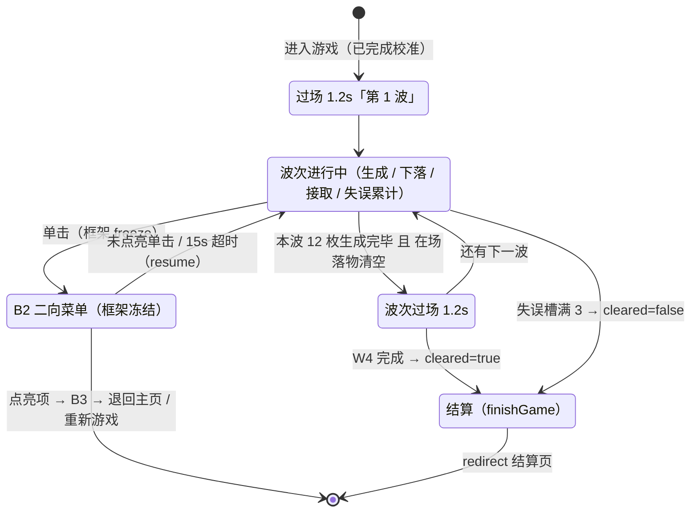

# PRD-03《接鸡蛋》需求分册

| 文档信息 | 内容 |
| --- | --- |
| 分册编号 | **PRD-03** |
| 分册名称 | 《接鸡蛋》Egg Catch |
| 归属总章 | 《摇头晃脑需求说明书》V1.0（下称"总章"） |
| 分册版本 | **V1.0-r7**（横向由直控改**锚定型相机**：蛋篮恒钉屏幕中心、世界反向滑动；球场两侧加边界墙、墙外留白） |
| 编写日期 | 2026-09-03 |
| 目标平台 | Rokid Glasses（AIUI 平台） |
| 文档状态 | **可实施**（数值已全部固化，可直接编码） |
| 需求编号前缀 | `F-EGG-*` |
| 开发优先级 | P1 |

> **本次重构的三条硬指令**（用户 2026-09-03）：
> ① 只实现**一关**；② 重点是用**头部 IMU 控制上下左右**（不再只是左右）；③ 选经典老游戏，GitHub 上有开源实现可借鉴改造。
> 落地结果见 §6（单关四波）与 §3（双轴映射），开源参考与借鉴边界见**附录 A**。

---

## 1. 分册定位与范围边界

### 1.1 本册职责（Own）

《接鸡蛋》**玩法本体**需求的唯一权威来源：双轴体感映射规格、落物规则与数值、单关波次结构、接取高度倍率、失败与重开、本册专有 HUD 与视觉、音效清单、验收标准。

**一句话定位**：掌机 / 雅达利时代的国民级落物游戏，**双轴轻量玩法**——左右转头决定"接不接得到"，抬头低头决定"值不值"，是本项目第一款把 pitch 纳入玩法主循环的游戏。

### 1.2 本册不负责（Out of Scope）

| 不在本册 | 归属 |
| --- | --- |
| 头动输入解算、死区滤波、坐标系约定、灵敏度三档 | 公共基线 §2.2（`utils/input.js`） |
| 触控板滑动 / 单击的原始判定 | 公共基线 §2.3（`utils/gesture.js`） |
| 游戏内二向菜单（B2）本体、返回握手、结算页 | PRD-01（`utils/ring.js` + `pages/game/game.js`） |
| 主页环形八向入口、教学页、最高分存储格式 | PRD-01（`utils/games.js` / `utils/storage.js`） |
| 《打砖块》的单轴直控实现 | PRD-02 |

### 1.3 总章条款映射

| 总章条款 | 本册落点 |
| --- | --- |
| §5.5《接鸡蛋》需求 | §3 ~ §7（完整展开，**已覆盖总章的三关 / 单轴口径**） |
| 附录 B 速查表·接鸡蛋行 | §3 体感映射规格（**待回写总章**） |
| §5.7 暂停选择器 | §2.4 + §8 接入要求（**口径已过时，见 §2.4 注**） |
| §5.8 F-Sys-01/04/05/07 | §9 系统功能接入 |

---

## 2. 公共基线（对齐 v1.20 工程现状）

> **单源原则**：本节为总章 §2/§4/§7/§9 的摘抄，但**已按 v1.20 工程实测结果就地纠正**。
> 凡标 ⚠ 的条目，总章原文已过时，本册采用工程实测口径，需按 §12.2 回写总章。

### 2.1 运行环境与技术约束

| 约束项 | 规格 |
| --- | --- |
| 应用框架 | AIUI **多文件四件套**（`.json` / `.js` / `.wxml` / `.wxss`）⚠（总章写的 `.ink` 单文件已废弃，Craft 静默失败） |
| 页面格式 | ESM `export default {}`；`.json` 只含 `navigationBarTitleText`；`.wxml` 顶层 `<view class="root">` 包 `<canvas id="stage">` |
| 生命周期 | **唯一确认的是 `onLoad`**；`onReady/onShow/onHide/onUnload` 按"有则调、无则跳"处理，初始化逻辑一律放 `onLoad` |
| 屏幕类型 | 单绿色单色透明显示，**480×352**，纯黑即透出现实，禁止黑色遮罩 |
| 安全区 | 横向 16px / 纵向 12px；游戏画面区 `VIEWPORT = 448×296 @ (16,44)` |
| 主渲染 | Canvas 2D + `wx.createCanvasContext('stage')`；每帧 `clearRect → 矢量绘制 → flush()`；**无双缓冲语义** |
| 帧循环 | ⚠ 禁止裸调 `setInterval` / `setTimeout` / `requestAnimationFrame`（不在 AIUI 确认范围）。统一走 `utils/boot.js` 的 `startLoop`（`setInterval → rAF → setTimeout → 传感器 reading` 降级链），节拍 `FRAME_MS = 33`（30fps） |
| 延时逻辑 | ⚠ 禁止定时器做延时。一律"未决登记 + 每帧 tick 派发"（本册的波次过场、震屏、接住闪光均按此实现） |
| 文本测宽 | ⚠ `ctx.measureText` 不在确认范围（真机可能返回 0）。容器宽度一律用 `utils/draw.js` 的 `textWidth()`（实测与估算**取大**） |
| IMU 数据源 | `AbsoluteOrientationSensor`（四元数，建议 60Hz，best-effort） |
| 本地存储 | `wx.setStorageSync` / `wx.getStorageSync`，**可能静默不可用**，必须 `storageOk()` 探测 |
| 音效 | ⚠ 当前 `utils/sfx.js` 为 **no-op 注入点**（`assets/sfx/` 无 wav，且顶部 import 'audio' 有整页崩溃面）。可用 key 固定为 `['select','confirm','launch','boom','catch','clear','fail']`，本册只做 key 映射，不自行引入音频模块 |

### 2.2 输入引擎契约（`utils/input.js`）

#### 2.2.1 七级流水线

```
采样(绝对姿态四元数 + 陀螺角速度) → 解算(视轴法 yaw/pitch + 同一套 SWAP_AXES/SIGN)
→ 互补融合(陀螺出动态 + 绝对姿态自适应 τ 校正：静止 0.3s / 运动 2.5s)
→ 死区(≤1.6° 归零) → 软启动(1.6~5°) → 低通(τ=45ms) + 抖动抑制(|ω|<6°/s 且偏角<1.8°)
→ 前馈(+0.022×ω，上限 2°)
→ 映射(coef px/°) → 限速(游戏态 1200px/s、菜单态 620px/s) → 快照
```

- **轴交换**：`SWAP_AXES = true`（设备轴系差 90°，交换后 `yaw` 恒为水平、`pitch` 恒为垂直）。
- **方向**：抬头 → `pitch` 为正（`SIGN.pitch = 1`）；右转 → `yaw` 为正（`SIGN.yaw = 1`）。真机若整体反向，只调 `SIGN.*`，不改解算数学。
- **引擎输出**：`engine.update(dt)` 返回 `{ ok, x, y, rawYaw, rawPitch }`，其中 `x/y` 是**已完成死区+低通+限幅的像素偏移量**（可直接用，不要再自己乘 coef）。

#### 2.2.2 灵敏度三档

| 档位 | factor | coef（px/°） | rangeYaw | rangePitch |
| --- | --- | --- | --- | --- |
| 迟钝 low | ×0.75 | 6.0 | 40° | 26.7° |
| **标准 standard（出厂默认）** | ×1.0 | **8.0** | **30°** | **20°** |
| 灵敏 high | ×1.3 | 10.4 | 23° | 15.4° |

`coef` 同时作用于 x 与 y；本册在 y 上再叠一个纵向缩放（§3.3）。

#### 2.2.3 校准与基准（两级）

1. 首次进入走 `pages/calibrate` 正式校准（2s 静息 + 方差 ≤1.2 度²，最多 3 次）；
2. 游戏中**单击唤出菜单时框架会 `engine.resetBase()`** —— 这是天然的重校准入口（见 §8.3）；
3. **漂移纠正**：本册**全程冻结**（`freezeDrift(true)`），仅波次过场启用加速收敛（§6.3）。理由见裁决 **D-EGG-11**；
4. 累计偏航 > ±45° 提示重新校准（单关 ≈60s，实际不会触发，保留作保护）。

#### 2.2.4 IMU 可用性

`engine.imuOk` = 有读数 + 未过期（3s）。为 false 时按 §10 处理，**不降级玩法**（不得改用手柄/自动接取）。

### 2.3 触控板判定（交互 v1.20 现行口径）⚠

| 物理操作 | 表现 | 上下文 | 语义 |
| --- | --- | --- | --- |
| **滑动**触控板 | 方向键 ArrowUp/Down/Left/Right | 主页待机 | 进入选择态 |
| **单击**（<300ms） | GlobalHook 一对 D+U（U@~24ms） | **游戏中** | **唤出二向菜单（暂停）** |
| 单击 | 同上 | 菜单态·有点亮项 | 确认该项 |
| 单击 | 同上 | 菜单态·无点亮项 | 继续游戏 |
| 双击 | — | 全局 | ⚠ **宿主"双击=退出程序"不可拦截**，全项目禁用双击语义 |

> ⚠ **总章 §4.2 的"长按 ≥500ms 唤起选择器"已废弃**（v1.2 起全单击语义，GlobalHook 无长按通道）。本册 §8 按现行口径重写。

**真机脉冲特征**（必须按此实现，否则误触）：
- 一次物理按压 = GlobalHook D/U 对 + 约 483ms 后的 Enter D/U 对 → `enterSuppress = 600ms` 吞掉后者；
- 真机可能连发 keyDown（auto-repeat）→ `gesture.js` 内部 `if (this.down) return true` 自守，本册不关心。

### 2.4 游戏内二向菜单（B2）⚠

> ⚠ 总章 §5.7 的"长按唤起 + 左暂停 / 右后退 + 画面降至 0.15"口径已废弃。
> 现行实现（`pages/game/game.js` + `utils/ring.js`，交互 v1.19/v1.20）：

1. 游戏中**单击** → `state = MENU`，唤出 B2 二向菜单：**左 = 退回主页面 / 右 = 重新游戏**；
2. 菜单沿用主页世界锚定范式：`R = 114`、`−8px/°`、点亮阈值 `<48px`、待机位 L(126,176) / R(354,176)；
3. 中心圈恒在屏心 (240,176)，圈内显示 15s 菜单倒计时；15s 无确认自动回游戏；
4. 点亮项单击 → B3 loading（最短 `LOADING_MIN_MS = 360ms`）→ 执行目标；未点亮单击 → 立即继续游戏；
5. 确认/淡出全程**禁止 `engine.recenter()`**（位置锁定在头部坐标系，只做亮度渐隐）。

本册**不自行实现暂停 UI**，只实现 `freeze()` / `resume()` 语义（§8）。

### 2.5 视觉与 UI 规范（v1.19 / v1.20 设计语言）

| 项 | 规格 |
| --- | --- |
| 亮度阶梯 | 6 级：100 / 72 / 48 / 24 / 12 / 6%（`utils/theme.js` 的 `L` / `C` / `g()`） |
| 100% 保留给 | 光标本体（= 本作蛋篮）、当前吸附图标、得分关键数值、爆炸等主动焦点 |
| 72% | 主可读文本、激活结构线、游戏实体描边 |
| 48% | 次要文本、常规边界 |
| 24% | 分隔线、非选中引导线 |
| 12% / 6% | 局部分组底纹（**最大正常面积填充 = 12%**）、渐隐带 |
| α 峰值上限 | **0.30**（透明屏上同 α 比灰底冲击更强）；大面填充红线 ≤0.12 |
| 线宽 | 1px 结构线，2px 只用于焦点强调 |
| 圆角 | 控件 4 / 面板 6 / 圆点可全圆 |
| 字号（`FS`） | title 22 / block 16 / body 14 / dense 12 / label 11 / mono 13；**同屏最多 3 个字级** |
| 字体 | Sarasa Gothic SC（Regular / Semi Bold，**无 Medium**）；数值用 JetBrains Mono |
| 字宽估算 | CJK ≈ 0.99×size，拉丁/半角 ≈ 0.52×size |
| 动效时长 | `DUR = { fast:120, normal:200, struct:320 }` |
| 禁止项 | 黑色遮罩 / 大面实色 / 装饰性 glow / emoji / **绕圆的放射标线** |
| 光晕面 | `GRADIENT_RADIAL` 三停（0 / 0.55 / 1），外缘 α=0；`GLOW.lit` 峰值 0.30 |
| 文字锚点 | `text()` 的 (x,y) 是**墨中心**（textBaseline middle），默认 `align:'center'` |
| 标签近端对齐 | 文字**近端边缘**贴在「主体外缘 + 8px」，再背向主体生长，**与字数无关** |

### 2.6 游戏框架页契约（前提性要求 · 五册统一）

> **定位**：本节是 `pages/game/game.js` **已落地的既有事实**（交互 v1.22），不是待实现项。五款游戏共用同一个框架页，任何一款游戏的画面都必须长在这个框架里。
> **效力**：本册 §4（视口与 HUD）的一切布局都是本节约束下的**实例化**；两者冲突时**以本节为准**并回写修正本册。
> **同步**：本节在五册中**逐字一致**（仅章节编号随各册排布不同）。任何变更必须先在 PRD-01《设计说明》修订，再同步全部 5 册。

#### 2.6.1 三层布局结构（自上而下）

| 层 | 区域 | 规格 | 归属 | 本册可否改写 |
| --- | --- | --- | --- | --- |
| ① **顶部标题栏** | HUD 条 y 12 ~ 36（h 24） | 左品牌胶囊 76×24 @(16,12) ｜ **中段空档 x 92 ~ 352** ｜ 右状态胶囊 110×24 @(354,12) | 框架页 `drawHud()` | 中段空档**可自由排布**；两胶囊**不可覆盖** |
| ② **游戏画面区** | `VIEWPORT = 448×296 @(16,44)`，即 x 16~464 / y 44~340 | 虚线框 1px @24% `[4,4]` + 四角外角标 12px @48%（1.5px）+ 四边中点 12px 刻度 @24% | 框架页绘框，**本册填内容** | 内容全归本册；边框/刻度**不可重复绘制** |
| ③ ~~左下操作提示条~~ | ~~`HINT (16, 316, h24)`~~ | — | 框架页 `drawHint()` | **【2026-09-03 用户裁定 · 已取消】**该行只是搭框架页时的占位，**真实游戏页不显示**；y 316~340 全部归还画面区。⚠ 五册逐字一致章节，本条为**本册先行修订**，PRD-02/04/05/06 待同步 |

#### 2.6.2 顶部标题栏的两处预留（硬性）

1. **左上品牌胶囊 = 游戏名**：框架页以 `drawHud(ctx, meta.name, …)` 写入 `utils/games.js` 中本册的 `name`（如「接鸡蛋」）。**本册不绘制、不覆盖**——游戏名是框架资产，不是本册 UI。
2. **右上状态胶囊 = 状态信息**：默认承载框架自身状态（`IMU状态正常 / IMU状态异常`；圆点实心 = 正常，空心 = 异常；B3 loading 期间为 `状态：打开中`）。**本册可通过 `statusText()` 钩子改写为本局状态信息**（波次 / 剩余目标 / 弹药 / 剩余时间等）。
   - 挂载方式：在游戏实例上定义 `statusText()` 返回字符串；**未挂载时行为与默认完全一致**（可选钩子，不挂载不报错）。
   - **宽度上限**：胶囊 110×24 → 状态圆点圆心 x=368、文字左起点 x=378、胶囊右缘 x=464，**可用宽 ≈ 86px**。按 12/500 字号计，CJK 约 **7 字**、数字/拉丁约 **16 字符**；超长会被裁切。
3. **中段空档 x ∈ [92, 352]（262px）、墨中心 y = 24**：这是本册**唯一**的 HUD 自由度。得分 / 生命 / 进度 / 波次等游戏状态一律排布在此区间，**与两胶囊同基线（墨中心 y=24）**，不得越入 x<92 或 x>352。

#### 2.6.3 画面区硬约束（「画面信息都要落到画面区」）

| 编号 | 约束 | 说明 |
| --- | --- | --- |
| C-FRM-01 | 本册全部游戏元素（含判定盒、特效、飘字、临时提示）**必须落在 VIEWPORT 内**（x 16~464 / y 44~340） | 越界即视觉溢出到 HUD 条或提示条 |
| C-FRM-02 | **顶部**：HUD 条底边 y=36，画面区上沿 y=44，中间 8px 空档。**不得在 y 36~44 之间放置元素** | 本册另有声明的顶部进度条类元素须显式标注并复核 |
| C-FRM-03 | **底部**：~~左下提示条占 y 316~340，需要底边的本册底边应收到 y=308 或 y=316~~ → **【2026-09-03 裁定】提示条取消，画面区下沿 y=340 全部可用**。需要底边的本册（球场、地面线、地平线等）底边最远可到 **y=340**；本册地面线取 **y=332**（见 F-EGG-16） | 与视口下沿留 8px 余量 |
| C-FRM-04 | **中央**：R=114 圆域（中心 (240,176)，覆盖 x 126~354 / y 62~290）是 B2 菜单活动区。该圆域**空间上无法避让**——5 条轨道中 x=144 / 240 / 336 三条从圆域内穿过，蛋篮（y 258~276）亦整体落入其中。冻结期"不冲突"的**唯一前提是亮度分层**：菜单期间本册元素由框架 `fadeTo` 退至次要层（见 §2.6.4），故**无需做空间避让** | 见 §2.6.4 |
| C-FRM-05 | 画面区边框、四角外角标、四边中点刻度**由框架页绘制**，本册**不得重复绘制** | 重复 = 双线叠加发亮 |

#### 2.6.4 状态机与本册的冻结契约

| 框架态 | 触发 | 本册被调用 | 画面处理 |
| --- | --- | --- | --- |
| `B1 PLAY` | 进入 / 回场 | `update(dt)` + `render()` | 正常推进，本册元素按 §4 各档位原亮度 |
| `B2 MENU` | 游戏中单击 | **仅** `render()` | 冻结；本册元素由框架经 `fadeTo(a, MENU_FADE)` **退至次要层**（`MENU_FADE = 0.55`，见下方换算表）。**框架资产（HUD / 视口框 / 角标 / 刻度）与菜单元素保持原亮度** |
| `B3 LOADING` | 菜单点亮项确认 | **仅** `render()` | 冻结；沿 `launchFade()` 节拍曲线收束至 **6% 隐藏档**（最短 360ms 后执行导航 / 重置） |
| `B4 CONT` | 菜单未点亮单击 / 挂起 15s 超时 | **仅** `render()` | 冻结；瞬时收束至 **6% 隐藏档**；3s 倒计时归零或单击 → 回 PLAY |

**`MENU_FADE = 0.55` 换算表**（`fadeTo(a, f) = a + (0.06 − a) × f`，保留本册内部层级关系）：

| 本册元素 | 常态 | B2 MENU |
| --- | --- | --- |
| 蛋篮描边 | 100% | **48%** |
| 鸡蛋 / 金蛋描边、倍率标签 | 72% | **36%** |
| 蛋篮 / 落物内填充 | 12% | **9%** |
| 地面线、倍率分界线、投放口刻度 | 6% | 6%（已在最低档，不参与收束） |

- **为何不用 6%**：6% 是"画面退场档"，语义为本局即将离场（B3 导航 / B4 恢复）。B2 是**暂停快选**，玩家需看着场上局势决定继续还是重开，降到 6% 等于抹掉决策上下文；且与菜单的 100% 落差过大，回场时会有突兀的亮度跳变。取 0.55 后菜单与本册约 **2:1** 对比，主次清晰且回场无跳变。
- **框架资产不参与 B2 收束**：视口框（24%）/ 四角角标（48%）/ 四边刻度（24%）是"容器"而非"内容"，B2 期间恒亮，否则画面边框散架、失去区域界定。B3 / B4 因整体退场，框架与本册**同步**收束至 6%。
- ⚠ **代码现状（2026-09-03 核对）**：`pages/game/game.js:384` 的 `fade` 在 B2 MENU 态取 **0**（`fadeTo(a, 0) = a`，即完全不降），与本表规定不符；且该 `fade` 同时作用于 `drawPlayfield`（框架资产）与未来接入的本册渲染，未做拆分。**接入本册前需在框架页拆出 `frameFade` / `fieldFade` 两个参数**。

- **时钟**：本册内部计时必须基于 `update(dt)` 累加的 `g.t`，**禁用 `Date.now()` 与任何定时器**——冻结期自动暂停、恢复时自动续算，无需显式 freeze / resume。
- **变暗**：一律由框架页 `fadeTo` 处理，本册**不得自绘遮罩或自行降 alpha**。
- **音效**：本册**不得直接 import sfx**；`update()` 返回事件数组，由框架页负责播音。
- **B2 二向菜单**：固定两项——左「退回主页面」/ 右「重新游戏」（`kind: 'system'` 的入口为「重新进入」），R=114，点亮阈值 48px，15s 无确认经 B4 回场。本册**不实现任何选择器 UI**。

#### 2.6.5 本册可覆写的钩子（其余一律归框架）

| 钩子 | 用途 | 缺省 |
| --- | --- | --- |
| `statusText()` → string | 改写右上状态胶囊文案（本局状态信息） | `IMU状态正常 / IMU状态异常`；B3 期间 `状态：打开中` |
| `render(ctx, …)` | 绘制画面区内容 | 占位文案「功能框架占位 · 分册实现后覆盖」 |
| `result()` → `GameResult` | 结算数据 | 见下方 GameResult 契约 |

> **GameResult 契约**：`{ score, cleared, reachedLevel, durationSec, motion{yawUtil, pitchUtil, yawAmpDeg, pitchAmpDeg, tapCount, tapLatencyMs}, extra[] }`。
> `motion` 由框架页 `InputEngine.stats.toMotion()` 统一写入、`durationSec` 由框架页计时——**本册只负责 `score`、`cleared`、`reachedLevel` 与 `extra[]`**。`extra` 每项 label ≤ 6 字。

#### 2.6.6 提示条文案五态 ——【2026-09-03 裁定】本册画面已取消提示条

> ⚠ **本节对本册失效**：用户裁定左下操作提示条只是搭框架页时的占位，**真实游戏页不显示**，y 316~340 全部归还画面区（本册地面线已随之由 316 下移至 **332**）。
> 下表五态文案**仍属框架资产**（`pages/game/game.js` 的 `render()` 末尾按态取值、无条件调用 `drawHint()`），仅在**本册画面上不呈现**。要真机消失须改框架（按模块声明跳过，代码侧本轮**未**改动）。
> ⚠ 五册逐字一致章节，本条为**本册先行修订**，PRD-02/04/05/06 待同步。

| 框架态 | 提示条文案（保留 · 本册不呈现） |
| --- | --- |
| PLAY | 单击触控唤出菜单 |
| MENU · 有点亮项 | 单击触控确认选择 |
| MENU · 无点亮项 | 转头选择，单击返回游戏 |
| B4 CONT | 单击触控立即继续 |
| B3 LOADING | 正在打开… |

---

## 3. 体感映射规格（本册专有 · **双轴**）

> **D-EGG-06 裁决**：由"单轴 yaw"改为 **yaw + pitch 双轴**。
> 理由：用户明确要求"用头部 IMU 控制上下左右"；且本项目 5 款游戏中 pitch 只在二级页滚动与打飞机里用到，**缺一款把 pitch 作为主玩法轴的入门游戏**。

### 3.1 轴职责

| 轴 | 控制对象 | 语义 | **映射形态** |
| --- | --- | --- | --- |
| **yaw（左右转头）** | 蛋篮**水平位置**（世界坐标） | 决定接不接得到 | **锚定型相机** —— 蛋篮恒钉屏幕中心 x=240，头动驱动**世界反向平移**（§3.2） |
| **pitch（抬头 / 低头）** | 蛋篮**接取高度**（屏幕坐标） | 决定这一枚值多少分（§5.4） | **直控型**（位置跟随），不变 |

### 3.2 水平（yaw）⚠【2026-09-04 改造：直控 → 锚定型相机】

> **D-EGG-14 裁决**：屏幕在眼镜里，头一动画面里的碗也跟着动 → **真机反馈眩晕**。
> 改为**蛋篮恒钉屏幕中心**，头动驱动**游戏世界反向平移**，左右两侧加**边界墙**，墙外**留白**。
> 与 PRD-02 打砖块 v1.28 同源（同一套 `SEM_FOLLOW` 语义）。

| 参数 | 取值 |
| --- | --- |
| 形态 | **锚定型相机**（anchored camera） |
| 公式 | `camCx = 240 + SEM_FOLLOW × snap.x`，`dx = 240 − camCx` |
| 语义常量 | `SEM_FOLLOW = −1`（`utils/input.js`，**不得在本册另设符号、更不得改 `SIGN`**） |
| 有效量程（标准档） | **±28°** → shaped ±25° → ±200px（经 `SEM_FOLLOW` 映射为 camCx 位移） |
| 夹紧 | `camCx ∈ [88, 392]` = `240 ∓ TRAVEL`；`TRAVEL = 球场宽/2 − 篮宽/2 = 176 − 24 = **152**` |
| 单帧限幅 | 12px（由引擎 `MAX_STEP` 保证） |
| 绘制偏移 | 世界层整体 `translate(dx)`，`dx > 0` ⇔ 世界右滑（头左转） |

#### 3.2.1 相机化几何（联立关系，改一处必须改全部）

| 项 | 值 | 推导 / 理由 |
| --- | --- | --- |
| 视口 | x 16~464 | `VIEWPORT.w = 448` |
| **球场** | **x 64~416（w=352）**，中心 240 与视口同心 | **必须明显窄于视口**，两侧各留 **48px** 空白带。否则墙看起来还是"屏幕两侧" —— 这是 v1.26 / v1.27 连错两次的共同根因 |
| **边界墙** | 左 `[56,64)`、右 `[416,424)`，厚 `wallBand = 8`（v1.34 羽化带） | 立在球场边界**外侧**；**内侧面 64 / 416 即落物的横向边界**（不变），带子向屏幕外侧分 4 级（每级 2px）逐级淡出 |
| 墙的层级 | **世界层** | ⚠ 它就是"场地到此为止"的那面边界，必须与球场底板 / 落物一起平移。钉成**屏幕固定层**（v1.27 的误判）会让墙与落点位置对不上，玩家一眼觉得假 |
| **裁剪窗** | **x 61~419**（= 球场 ± 墙厚，w=358） | 屏幕固定；世界层 `clip` 到这窗后再平移，越窗部分直接消失 → **墙外留白**（用户原话："左右两侧超出边界的区域，显示空白即可"） |
| 行程半幅 | `TRAVEL = 152` | **必须由几何算出**（`COURT.w/2 − BASKET.w/2`），**禁止硬编码** —— 球场一改就全错 |
| 轨道 | 5 条 x = **80 / 160 / 240 / 320 / 400**（间距 **80**） | ⚠ r6 的间距 96（48/144/240/336/432）是相对**视口 448** 定的，照抄进 352 的球场会**左右各溢出 16px**。改为球场内均分：距墙内侧面各 16px（**D-EGG-17**） |

#### 3.2.2 只改横向、纵向保持直控的三条理由

1. **症状只出现在横轴** —— 用户原话是"头部移动以后眼镜里的碗也在移动，这就让用户很头晕"，纵向无此反馈；
2. **纵向行程仅 ±40px**（横轴的 1/5），且不是持续偏转，不构成眩晕源；
3. **落物本来就纵向运动** —— 若画面再纵向滑动，玩家无法分辨"是蛋在落"还是"是画面在动"，反而更难瞄。

#### 3.2.3 相机化引入的新约束

| 编号 | 约束 |
| --- | --- |
| F-EGG-02b | **落物只从当前可见的轨道生成**（`visibleLanes(camCx)`，可见半幅 `VIS_HALF = 419 − 240 − 8 = **171**`）。⚠ 在看不见的轨道生成 = 必漏，而"漏 3 个就结算"下这是**致命的不公平** |
| F-EGG-02c | 已生成的落物因玩家转头滑出裁剪窗时，由**离屏指示器**在对应屏幕边画朝外三角（只标方向不标距离，48%），**贴裁剪窗内侧**（不得画进墙外留白区，那样等于在"场外"画东西） |
| F-EGG-02d | **屏幕固定层**：HUD 中段条 / 蛋篮 / 倍率标签 / 扩散圆 / 离屏指示器 / 过场卡 / IMU 文案。**世界层**：地面线 / 倍率分界线 / 投放口刻度 / **边界墙** / 落物 / 落地碎裂 |

### 3.3 垂直（pitch）

| 参数 | 取值 |
| --- | --- |
| 形态 | 直控型（位置跟随） |
| 纵向缩放 | `VSCALE = 0.5` → 有效 coef = `8 × 0.5 = 4.0 px/°`（标准档） |
| 公式 | `basketMouthY = 258 − clamp(engine.snapshot.y × VSCALE, −40, +40)` |
| 有效量程（标准档） | **±13°** → shaped ±10° → ±40px |
| 可动区间 | 篮口 `y ∈ [218, 298]`；中立位（pitch=0）**258** |
| 单帧限幅 | 引擎 12px/帧 × 0.5 = **6px/帧**（纵向更缓，防眩晕） |
| 方向 | **抬头 = 抬升篮子**（y 减小）。真机若反向，调 `utils/input.js` 的 `SIGN.pitch` |

### 3.4 需求条目

| 编号 | 要求 |
| --- | --- |
| F-EGG-01 | 订阅 **yaw + pitch 双轴**；引擎快照的 `x` 走水平、`y` 走垂直 |
| F-EGG-02 | 篮子水平（**锚定型相机**）：`camCx = clamp(240 + SEM_FOLLOW × snap.x, 88, 392)`；篮子**屏幕位置恒为 x=240**，世界层 `translate(240 − camCx)`（§3.2） |
| **F-EGG-02b** | **落物只从当前可见轨道生成**（`visibleLanes`，半幅 171）—— 不可见轨道生成 = 必漏，是致命不公平（§3.2.3） |
| **F-EGG-02c** | 落物滑出裁剪窗时画**离屏指示器**（朝外三角，只标方向不标距离，贴窗内侧、不进留白区） |
| **F-EGG-02d** | 世界层 / 屏幕固定层的归属见 §3.2.3 表；**边界墙属世界层** |
| F-EGG-03 | 篮子垂直：`basketMouthY = 258 − clamp(snap.y × 0.5, ±40)` |
| F-EGG-04 | **轴解耦**：抬头/低头不改变篮子 x，左右转头不改变篮子 y（两路独立计算，禁止耦合项） |
| F-EGG-05 | 水平单帧限幅 12px、垂直 6px（由引擎 MAX_STEP + VSCALE 自然达成，不得另加 easing 造成迟滞） |
| F-EGG-06 | 灵敏度三档作用于两轴：low 水平需 ±36° / 垂直 ±16°，high 水平 ±22° / 垂直 ±11°（标准档见 §3.2/§3.3） |
| F-EGG-07 | 进入本作前完成正式校准；校准需**同时**校验 yaw 与 pitch 方差（`input.js` 已实现） |
| F-EGG-08 | 游戏中 `freezeDrift(true)`；仅波次过场 1.2s 内 `freezeDrift(false)` 并加速收敛（≤2°/s） |

### 3.5 体感特殊点

- 横向与《打砖块》v1.28 共享**锚定型相机**心智（同一 `SEM_FOLLOW`、同一"元素恒钉中心 + 世界反向滑动"），玩家在打砖块养成的转头量可直接平移；⚠ 与 r6 之前的**直控型**不可混用——两种语义符号相反；
- 纵向是**新增维度**，但行程只有 ±40px（横轴的 1/5），抬头低头幅度小、不易疲劳，符合"入门游戏"定位；
- 抬头抬高篮子 = **提前接取 = 水平对准时间变短 = 更难但分更高**（§5.4），风险与回报天然自平衡，不需要额外难度参数。

---

## 4. 视口与 HUD（本册专有）

### 4.1 画面区布局（480×352）

```
 y=12 ┌──────────────────────────────────────────────────────────┐
      │ [品牌胶囊 76×24]   [得分  进度  失误]        [IMU胶囊 110] │   HUD 条 (y 12..36)
      │  x16        x92                    x354            x464  │
 y=44 ├──────────────────────────────────────────────────────────┤
      │       ┆▌  ▌  ▌  ▌  ▌┆                                    │  ← 5 条投放轨道口刻度 (y 44..56)
 y=58 │       ┆  ·  落物投放线（顶边 y=58）                 ┆       │
      │       ┆                                          ┆       │
      │       ┆  ┄┄┄┄┄┄┄┄┄┄┄┄┄┄┄┄┄  y=244  高/中区界      ┆       │
      │       ┆  ┄┄┄┄┄┄┄┄┄┄┄┄┄┄┄┄┄  y=271  中/低区界      ┆       │
      │       ┆                                          ┆       │
      │       ┆       ╲ 蛋篮 ╱  篮口 y ∈ [218, 298]        ┆       │
      │       ┆              ↑ 屏幕位置恒钉 x=240          ┆       │
 y=332│       ┆══════════════════════════════════════════┆       │  地面线 (6%)
      │                    （提示条已取消 · 332–340 为视口下沿余量） │
 y=340 └──────────────────────────────────────────────────────────┘
        x16  x61 x64                              x416 x419   x464
             └┬┘ └──────── 球场 64~416 (w=352) ────────┘ └┬┘
           边界墙                                       边界墙
           厚 3px                                       厚 3px
        └ 空白 ┘                                     └ 空白 ┘

        裁剪窗 = 球场 ± 墙厚 = **61~419**：窗外一律留白，不画任何东西
        世界层（地面线 / 分界线 / 刻度 / 墙 / 落物）随相机平移；
        蛋篮 / HUD / 标签 / 离屏指示器 属屏幕固定层，不随平移。
```

### 4.2 元素规格

| 编号 | 项 | 规格 |
| --- | --- | --- |
| F-EGG-10 | 画面区 | `VIEWPORT = 448×296 @ (16,44)`，沿用 B1 骨架（虚线框 24% + 四角角标 48% + 四边中点 12px 刻度） |
| F-EGG-11 | 蛋篮 | **48×18**（篮口宽 48、高 18、下窄梯形），描边 **100% / 1px**，内部 fill 12%。**【v1.39 精修】**补三处结构，让它读作「柳条篮」而非「梯形」：① **篮口卷边** —— 比篮口两侧各外挑 1px（总宽 50）、2px 高 **@72%**；② **编织格** —— 3 条竖柳条（1px 宽，y 自篮口 +4 至篮底 −3）+ 2 道横箍（1px 高，半宽按梯形线性插值 24 → 16 递减，实测 42.7 / 37.3），均 **@24%**；③ **篮底板** —— 底部 2px 高、宽 = `bottomW` 32，**@48%**。⚠ 卷边必须**先于**细节绘制、且首个 `moveTo` 保持 `(cx − 24, my)` —— harness E2f 靠它断言「篮子屏幕 x 恒钉 240」 |
| F-EGG-12 | 篮子可动区 | **屏幕位置恒为 x=240**（锚定型）；世界坐标 `camCx ∈ [88, 392]`（= 240 ∓ TRAVEL 152）；篮口 y ∈ [218, 298]，中立 258 |
| F-EGG-13 | HUD 中段条 | 墨中心 y=24（与左右胶囊同基线），占用 `x ∈ [92, 354]`：得分 / 进度 / 失误槽三段（§4.3） |
| F-EGG-14 | 轨道 | 5 条，**世界** x = **80 / 160 / 240 / 320 / 400**（间距 **80**，距墙内侧面各 16，对称）。⚠ r6 的 48/144/240/336/432（间距 96）是按**视口 448** 定的，照抄进 352 的球场会左右各溢出 16px（D-EGG-17） |
| F-EGG-15 | 投放口刻度 | 每条轨道在画面区上沿画 12px 竖条（y 44..56），**6%**，表达"蛋从这里落下" |
| F-EGG-16 | 地面线 | y = **332**（2026-09-03 由 316 下移，吃满提示条释放的 24px 中的 16px），1px / 6%，**世界层**，**横穿球场 x 64..416**（r7：不再横穿整条视口 —— 留白区属于墙外，画了就破坏了"边界"的表达） |
| F-EGG-17 | 倍率分界线 | y = **244** 与 y = **271**，1px / 6%，**世界层**，**横穿球场 x 64..416**（分高/中/低三带） |
| F-EGG-18 | 倍率标签 | 篮子旁实时显示 `×2.0`（100%）/ `×1.5`（72%）/ 低区不显示；11/500；**近端距篮心 32px**（§4.4） |
| F-EGG-19 | 菜单提示 | 画面区右下角常驻 11/500 / 24%「单击＝菜单」，右对齐右缘 x=456。⚠ **墨中心 y=328 是旧值**（为与左下提示条错开而设）；提示条取消 + 地面线下移至 332 后，该行与地面线仅差 4px，**位置待裁决**（候选：上移至 y=320，或改挂画面区右上角 y≈68） |
| **F-EGG-1A** | **球场**【r7 新增】 | **x 64~416（w=352）**，中心 240 与视口同心；**必须明显窄于视口 448**，两侧各留 **48px** 空白带 —— 否则边界墙看起来还是"屏幕两侧"，玩家分不清游戏区在哪（§3.2.1） |
| **F-EGG-1B** | **边界墙**【r7 新增 · v1.34 改版】 | 厚 `wallBand = 8`（**v1.34 羽化收边带**）：左 `[56,64)`、右 `[416,424)`，**属世界层**（随相机平移）。内侧面 **64 / 416** = 落物横向边界（不变）；带子由内向外分 **4 级 × 2px**，亮度 **40% → 22% → 13% → 5%** |
| **F-EGG-1C** | **裁剪窗**【r7 新增 · v1.34 随墙带加宽】 | **x 56~424**（宽 368 = 球场 ± 墙厚 8），**屏幕固定**；世界层 `save → clip → translate(dx) → restore`，越窗部分直接消失 → **墙外恒为空白** |
| **F-EGG-1D** | **离屏指示器**【r7 新增】 | 落物滑出裁剪窗时，在对应屏幕边画朝外三角（48%，宽 4 / 高 6，贴裁剪窗内侧 8px），**只标方向不标距离**；左右各至多 1 枚（F-EGG-02c） |

### 4.3 HUD 中段条三段排布（x ∈ [92, 354]，墨中心 y=24）

| 段 | 内容 | 位置 | 字体 / 亮度 |
| --- | --- | --- | --- |
| 得分 | 当前总分（整数） | `LEFT` x=92 | mono **13 / 100%**（最多 4 位，宽 ≤31px） |
| 进度 | `已接/48`（如 `12/48`） | `CENTER` x=223 | mono **12 / 72%** |
| 失误槽·文字 | 「失误」 | `LEFT` x=268 | **11 / 500 / 48%** |
| 失误槽·图形 | 3 个 10×10 方块，gap 4 | 起 x=300 → 300/314/328，右缘 338，y 19..29 | 未用 = 空心 stroke 24%；已用 = fill **72%** |

> **双通道编码**（F-Sys 通用要求）：失误数同时由「文字标签」与「实心方块数」表达，任一单独可读。

### 4.4 倍率标签的位置

⚠【2026-09-04 r7 简化】锚定型相机下**蛋篮恒钉屏幕中心 x=240**，r6 的「`basketCx > 400` 翻到左侧」分支**永远不可能触发**，故**删除翻转逻辑** —— 留着只会误导后续维护者（代码中 `labelFlipAt` 一并删除）。

```
恒画在右侧：LEFT 对齐，x = 240 + 32 = 272
墨中心 y = mouthY − 9
```
（与主页"标签近端对齐"同一精神：近端恒距主体 32px，与字数无关。）
边界校验：篮子右缘 264，标签左缘 272 → 间隔 8px，不重叠；屏幕位置恒 240，结论在任何相机位下都成立。

---

## 5. 操作与落物规则（本册专有）

### 5.1 操作

| 编号 | 操作 | 行为 |
| --- | --- | --- |
| F-EGG-20 | **左右转头（yaw）** | 连续控制蛋篮水平位置（§3.2） |
| F-EGG-20b | **抬头 / 低头（pitch）** | 连续控制蛋篮接取高度（§3.3） |
| F-EGG-21 | **单击** | **不承担任何游戏职能**——仅唤出 B2 菜单（框架层消费，不进游戏逻辑）。避免"接蛋时误触发射" |
| F-EGG-22 | 滑动 | 游戏中**忽略**（滑动只在主页待机有语义，见 §2.3） |
| F-EGG-23 | 返回键 | 由框架处理（弹退出确认 / 回主页），本册不接管 |

### 5.2 落物类型

| 编号 | 落物 | 出现 | 分值 | 落速 | 视觉（形状 + 描边双通道） |
| --- | --- | --- | --- | --- | --- |
| F-EGG-30 | **鸡蛋** | W1 起 | **+10** | 波次基准速度 | 椭圆 rx7/ry9，stroke **72%** / 1px，内部 fill 12% |
| F-EGG-31 | **金蛋** | W2 起 | **+50** | 基准 × **1.2** | 椭圆 rx7/ry9 + stroke **100%** 闪烁（480ms 方波：100% ↔ 24%，**全场同相位**） |
| F-EGG-32 | **炸弹** | W3 起 | 接到 → **填 1 格失误槽 + 震屏 0.3s**，0 分 | 波次基准速度 | 圆 r8 + 顶部引线（1px / 100% / 长 6），与蛋形明确区分 |

> **同屏只允许一个主导脉冲动效**（§2.5）：金蛋闪烁**全场共用同一相位**（按全局 `now` 计算，不按各自生成时刻），多个金蛋同时闪烁视为单一动效。

### 5.3 落物规则

| 编号 | 规则 |
| --- | --- |
| F-EGG-33 | **匀速下落**（**D-EGG-10 裁决**：不用重力加速）。`y += speed × dt`；理由见 §5.5 |
| F-EGG-34 | **接住判定**：落物水平中心落在 `[篮口左缘 + 4, 篮口右缘 − 4]` **且** 落物底边 ∈ `[篮口 y, 篮底 y]`。**边缘擦过不算接住**（内缩 4px） |
| F-EGG-35 | **落地判定**：落物**底边 ≥ 332**（地面线） |
| F-EGG-36 | 鸡蛋 / 金蛋落地 → 碎裂，**填 1 格失误槽**（金蛋同样计漏接） |
| F-EGG-37 | 炸弹落地 → **无事发生**，记「躲弹 +1」。**主动移开让炸弹落地是正确对策** |
| F-EGG-38 | 落物从 5 条轨道随机选一条，顶边 y=58 起笔直下落。⚠【r7】**只从当前可见的轨道中选**（F-EGG-02b），生成瞬间必须落在裁剪窗 61~419 内 |
| F-EGG-39 | **同屏落物上限 3 个** |
| F-EGG-3A | **相邻两次生成不得同轨**，避免物理不可解的必漏死局 |
| F-EGG-3B | **震屏** = 整体绘制位移（≤4px，0.3s 指数衰减）。**实现为所有元素坐标加同一 `shake(dx,dy)`，禁止 `ctx.translate/save/restore`**（宿主支持度未确认），**禁止黑色遮罩或全屏闪烁填充** |
| F-EGG-3C | 接住反馈：接住点画扩散圆（r 6→18，α 100%→0，120ms），篮子描边保持 100% 并额外加粗至 2px 持续 120ms |

### 5.4 接取高度倍率（pitch 的玩法落点）

| 篮口 y | 分区 | 倍率 | 标签 |
| --- | --- | --- | --- |
| `y ≤ 244` | 高区（抬头） | **×2.0** | `×2.0` @100% |
| `244 < y ≤ 271` | 中区（中立附近） | **×1.5** | `×1.5` @72% |
| `y > 271` | 低区（低头） | **×1.0** | 不显示 |

- 得分 = `Math.round(基础分 × 倍率)`（鸡蛋 10 / 金蛋 50）；
- 中立位（pitch=0，篮口 258）落进 **中区 1.5×** —— 玩家不抬头也有加成，抬头是全量奖励、低头是保守打法；
- 自平衡：篮子越高，落物从投放线到篮口的时间越短，水平对准窗口越小 → **高倍率天然更难**，无需额外难度参数。

### 5.5 为什么是匀速而不是重力加速（D-EGG-10 裁决说明）

经典 Kaboom! 用重力加速（`vy += g·dt`），落物"越接近越难"。本作**取匀速**，理由：

| 维度 | 重力加速 | 匀速（本作） |
| --- | --- | --- |
| 头控延迟 | 交互 v1.23 后链路延迟降到 ≈130ms 到位（原 ≈400ms）；本条保留作为**设计余量**的说明：加速段仍会把末段修正窗口挤窄，故维持匀速 |
| 可预测性 | 需要积分直觉 | 掌机接蛋类原作也是匀速，符合"经典手感" |
| 实现复杂度 | 需逐帧积分 | 一行 `y += v·dt`，且便于波次调参 |

代价是失去了"越接近越紧张"的曲线 —— 由**波次落速递增**（§6.2）与**高度倍率**（§5.4）两条曲线补偿。

---

## 6. 单关结构（本册专有 · **一关四波**）

### 6.1 为什么是这一关（D-EGG-07 裁决说明）

原三关结构压缩为**一关**，但"一关"不等于"一段难度"。沿用经典做法 —— **Activision《Kaboom!》(1981) 的 wave ramp**：把难度递增从"关卡之间"搬到"单关内部的波次之间"，一关之内完成 入门 → 加分项 → 取舍 → 冲刺 的完整弧线。

| 经典原型 | 借鉴点 |
| --- | --- |
| **Activision《Kaboom!》(1981, Atari 2600)** | 单轴接落物 + 三命 + **波次递增**（一个 `applyWave()` 同时拧 4 个旋钮）+ 漏接即失一桶 |
| **任天堂 Game & Watch《Egg》(EG-51, 1981)** | "母鸡下蛋 → 蛋篮接取"的最小闭环，认知负担为零 |
| 掌机 / Flash 时代接蛋复刻 | 多类型落物（普通 / 高分 / 炸弹）的分值表组织方式 |

**W1 保持"纯鸡蛋"** —— 这是最经典、最容易上手的段落，保证首次游玩零认知负担；W2 起只加**加法**（金蛋），W3 起再加**减法**（炸弹），符合"老游戏用户容易上手"的目标。

### 6.2 波次表

**总目标：接满 48 枚（金蛋计入，炸弹不计）→ 通关。**

| 波 | 本波有效枚数 | 生成间隔 | 落速倍率 | 落速（蛋 / 金蛋 / 炸弹） | 生成权重（蛋:金:弹） |
| --- | --- | --- | --- | --- | --- |
| **W1** | 12 | **1.30s** | 1.00× | 110 / — / — | **1 : 0 : 0** |
| **W2** | 12 | **1.10s** | 1.10× | 121 / 145 / — | **7 : 1 : 0** |
| **W3** | 12 | **0.95s** | 1.22× | 134 / 161 / 134 | **7 : 1 : 2** |
| **W4** | 12 | **0.80s** | 1.35× | 149 / 179 / 149 | **6 : 1 : 3** |

- 速度单位 px/s；金蛋 = 波次速度 × 1.2；炸弹 = 波次速度；
- "本波有效枚数" = 计入 48 枚目标的枚数（**金蛋计入、炸弹不计**）；
- 预期生成次数：W1 12 / W2 12 / W3 15 / W4 17（炸弹稀释），**单局净时长 ≈ 60s**（含 3 次过场）。

**得分区间估算**（基础分合计 ≈ 670：W1 120 + W2 180 + W3 180 + W4 189）：
全低区 ×1.0 → **~670**；全中区 ×1.5 → **~1000**；全高区 ×2.0 → **~1340**。

### 6.3 波次过场

| 编号 | 要求 |
| --- | --- |
| F-EGG-40 | 每波之间保留 **1.2s 过场**：清空在场落物、停止生成 |
| F-EGG-41 | 过场画面：画面区中央 14/500 / 72%「第 N 波」+ 12/400 / 48% 副行（W1「目标 48 枚 · 转头接蛋」/ W2「金蛋 +50 分」/ W3「躲开炸弹」/ W4「最后一波 · 加速」） |
| F-EGG-42 | 过场期间**篮子保持可控**（不冻结输入），并 `freezeDrift(false)` 启用加速漂移收敛（≤2°/s，仅此 1.2s 内） |
| F-EGG-43 | W4 的 48 枚接满即**通关**（`cleared = true`） |

### 6.4 关卡状态机



> ⚠【2026-09-04 r7 · 与状态机的一处**有意偏差**】r4 原文写「本波有效枚数达 12」即切 Gap 并清空落物。
> 实现改为**「生成满 12 → 停止生成 → 等在场落物全部落地或接住 → 切 Gap」**：
> 原写法下第 12 枚可能刚生成就被 `F-EGG-40` 的清空逻辑抹掉，玩家根本没机会接，等于凭空损失分数。
> 代价是每波最长多等一个落地时长（W1 2.33s / W4 1.72s），**单局净时长由 ≈60s 增至 ≈66~70s**（全接仿真实测 **69.7s**）。
> `F-EGG-40` 的"清空在场落物"保留为防御性收尾（正常路径下此时已无落物）。

---

## 7. 失败与重开（本册专有）

| 编号 | 要求 |
| --- | --- |
| F-EGG-50 | **唯一失败条件：失误槽 3 格填满**。填槽事件只有两类：① **漏接**鸡蛋/金蛋（落地）；② **接到**炸弹。**（D-EGG-09：合并原"漏接槽 + 生命"两套计数）** |
| F-EGG-51 | 炸弹落地**不填槽**（正确对策是无惩罚的主动躲避） |
| F-EGG-52 | 失败或通关后调 `finishGame(buildResult(cleared))` → `pushScore` + `setPendingResult` → `wx.redirectTo('pages/result/result')` |
| F-EGG-53 | 重开一律从 **W1** 开始，得分 / 进度 / 失误槽全部清零 |
| F-EGG-54 | `reachedLevel` 字段复用为"**到达波次**"1..4（PRD-01 契约不变，仍是整数） |

> **D-EGG-09 裁决说明**：原三关版有"漏接槽 3 格 + 生命 3 条"两套独立计数（6 次容错）。单关版下 6 格方块在 480×352 的 HUD 中段条（仅 262px 可用宽）里排不下，且新手要同时理解两套容错规则认知成本过高。合并为**单一 3 格失误槽**后，规则一句话可讲清："**漏一个或接到炸弹，就少一格**"。

### 7.1 结算数据

```text
GameResult {
  gameId: "eggcatch",
  score: 本局总分（0 ~ ~1340）,
  cleared: 是否接满 48 枚（W4 完成）,
  reachedLevel: 1|2|3|4,          // 到达波次
  durationSec: 净游玩时长,
  motion: { ...由 utils/input.js 的 MotionStats 统一填充，本册不计算... },
  extra: [ { label:"金蛋接取", value:"5" }, { label:"躲开炸弹", value:"7" } ]
}
```
`extra` 最多 2 项，label ≤4 字（PRD-01 要求 ≤6 字，本册收紧到 4 字以适配结算页窄卡）。

---

## 8. 暂停选择器接入要求（对接 `pages/game/game.js` 框架）

| 编号 | 要求 |
| --- | --- |
| F-EGG-60 | 实现 `freeze()`：停止落物生成计时、停止落物下落、立即终止震屏（**不残留位移**）、冻结接住闪光计时；**保留渲染最后帧** |
| F-EGG-61 | 实现 `resume()`：从冻结帧无缝继续，生成计时与落速以冻结时刻为基准续算（**不得重置波次进度或补发落物**） |
| F-EGG-62 | 菜单态由框架绘制（B2），本册**不自行实现任何暂停 UI，不叠加黑色遮罩** |
| F-EGG-63 | 菜单期间传感器保持采样；连续挂起 >15s 由框架的 `TOUCH.selectSuspend` 自动回游戏 |
| F-EGG-64 | **重校准链路**：框架在单击进入菜单时执行 `engine.resetBase()`，玩家"唤出菜单 → 未点亮单击继续游戏"即完成一次零成本重校准。**这是本作漂移纠正的主通道**（见 F-EGG-08） |
| F-EGG-65 | 菜单右位「重新游戏」→ B3 loading → 框架调 `initPlay()`，本册须在 `initPlay()` 里重置到 W1 初始状态 |
| F-EGG-66 | 落物在冻结瞬间恰好压线：以冻结时刻的判定状态为准，恢复后继续，**不重复结算** |

---

## 9. 系统功能接入（与 PRD-01 对齐）

| 编号 | 功能 | 本册接入要求 |
| --- | --- | --- |
| F-EGG-70 | F-Sys-01 最高分 | 结算时读写 `hi_eggcatch`，读-插-排序-截断 **Top3** 后写回（`utils/storage.js` 的 `pushScore`） |
| F-EGG-71 | F-Sys-04 首次引导 | **须同步修改 `utils/games.js` 第 17~20 行**（见下） |
| F-EGG-72 | F-Sys-05 音效 | 本作 5 类短音效，映射到 `utils/sfx.js` 现有 key（**不新增 key、不自行引入音频模块**）：接住鸡蛋 `catch` / 接住金蛋 `launch` / 蛋落地碎裂 `fail` / 接到炸弹 `boom` / 波次通过 `clear` 【**v1.45 双通道加固**：`assets/sfx/` 8 个 wav 就位（16kHz / 16bit / 单声道，共 65KB）；`utils/sfx.js` 经**四级探测**拿宿主构造器（注入 / `globalThis.Sound` / `globalThis.audio.Sound` / 运行时 `require('audio')`），**全项目禁止 `import 'audio'`**（静态 / 动态 import 均曾致整页黑屏）；拿不到时静默 no-op】 |
| F-EGG-73 | F-Sys-07 体感摘要 | `GameResult.motion` 由 `MotionStats` 统一写入，本册不计算 |
| F-EGG-74 | 结算专有指标 | 「金蛋接取」「躲开炸弹」（各 ≤4 字） |

**GameManifest 变更（须同步 `utils/games.js`）**：

```js
{
  id: 'egg', name: '接鸡蛋', ringPos: 'T', difficultyRank: 2,
  axisLabel: '双轴 · 转头左右 + 抬头上下',      // 原「单轴 · 左右转头」
  tutorialLine: '转头移动蛋篮，抬头接得更高分',  // 原「左右转头移动蛋篮，接住每一颗蛋」
  iconId: 'egg', kind: 'game', page: 'pages/game/game',
}
```
> `difficultyRank` 保持 **2** 不变：虽然升为双轴，但玩法仍只有"移动接取"、无主动开火，难度仍低于滚球迷宫(3)。

---

## 10. 异常与边界场景

| 场景 | 处理策略 |
| --- | --- |
| **IMU 不可用 / error** | 立即 `freeze()`：不生成落物、清空在场落物、篮子锁在中立位（x=240，篮口 258）；画面区中央显示 14/400 / 72%「IMU 状态异常 · 单击结束游戏」；单击 → `finishGame(buildResult(false))`（与框架 `onTap` 现有分支一致）。**禁止在无输入状态下继续落蛋**（NFR-05） |
| 快速甩头 | 横向 `camCx` 夹紧到 `[88,392]` + 单帧限幅 12px，**世界横移不会瞬移，蛋篮屏幕位置恒为 240**（§3.2）；纵向夹紧到篮口 `[218,298]` + 6px/帧（§3.3） |
| 相机推到极限位，远端轨道滑出裁剪窗 | 生成器**只从可见轨道生成**（F-EGG-02b）；已生成的落物滑出窗时画**离屏指示器**提示方向（F-EGG-02c） |
| 高频连点触控板 | 单击只唤出菜单，**永不触发任何游戏动作**（F-EGG-21） |
| 同轨连续生成导致必漏 | 生成器保证相邻两次不同轨（F-EGG-3A） |
| 落物在暂停瞬间恰好压线 | 以冻结时刻为准，不重复结算（F-EGG-66） |
| 炸弹与鸡蛋同帧接触篮子 | 优先判定**炸弹**（惩罚优先），避免玩家"蒙混"得分 |
| 震屏与暂停叠加 | 进入菜单立即终止震屏，不残留位移（F-EGG-60） |
| 长时间静止挂机 | 连续 **5 分钟**无有效输入 → 停止生成并进入 "已停止" 保护态（复用框架 `restFrames` 计数，阈值 9000 帧 @30fps），画面区提示「长时间未操作 · 单击结束游戏」 |
| 单帧 dt 过大（切后台/卡顿） | `dt` 一律 `clamp(dt, 0, 100)`ms（`game.js` 现状），防止落物一帧穿透判定带 |
| pitch 与 yaw 同时大幅偏转 | 两轴独立夹紧，篮子停在可动区角点（如右上），不产生耦合漂移（F-EGG-04） |

---

## 11. 验收标准（本册专有）

**体感映射（双轴）**

- [ ] **横向**：头左转 → 世界右滑、头右转 → 世界左滑（反向）；**蛋篮屏幕 x 恒为 240**（锚定型核心承诺）；`camCx ∈ [88, 392]`
- [ ] **抬头 = 篮子上升、低头 = 篮子下降**，方向无反转；标准档 ±13° 覆盖篮口 `y ∈ [218,298]`
- [ ] **抬头/低头不改变篮子 x，左右转头不改变篮子 y**（F-EGG-04）
- [ ] ±1.6° 死区内日常晃动不产生可见篮子移动；说话/走路颠簸被抖动抑制吃掉
- [ ] 输入到画面 ≤100ms；水平限幅 12px/帧、垂直 6px/帧生效
- [ ] 三档灵敏度切换后，横纵行程变化均可感知

**玩法完整性**

- [ ] 篮子 48×18，**屏幕 x 恒 240** / 篮口 `y∈[218,298]`，中立位 (240, 258)
- [ ] 5 条轨道**世界 x = 80/160/240/320/400**（间距 80）；相邻两次生成不同轨；同屏落物 ≤3
- [ ] 球场 64~416（w=352）、边界墙厚 8（世界层、羽化 40/22/13/5%）、裁剪窗 56~424，**墙外为空白、不画任何东西**
- [ ] **落物只从可见轨道生成**（生成瞬间必在裁剪窗内）；滑出窗时有离屏指示器
- [ ] 鸡蛋 +10 / 金蛋 +50（1.2× 落速 + 全场同相位闪烁）/ 炸弹接到填 1 格 + 震屏 0.3s
- [ ] **炸弹落地无事发生**，主动躲开是正确对策且无惩罚，并计入「躲开炸弹」
- [ ] 接住判定"水平内缩 4px + 接触面 y 对齐"，**边缘擦过不算接住**
- [ ] 高度倍率：篮口 ≤244 → ×2.0；244~271 → ×1.5；>271 → ×1.0；标签恒在篮子右侧 32px、不遮挡
- [ ] 波次：间隔 1.30→1.10→0.95→0.80s，权重 纯蛋 → 7:1:0 → 7:1:2 → 6:1:3，落速 110→121→134→149
- [ ] 每波 12 枚、共 48 枚通关；失误槽满 3 失败；重开从 W1 开始且全清零
- [ ] 波次过场 1.2s：清空落物、篮子仍可控、漂移纠正加速收敛

**选择器与系统**

- [ ] 单击唤出 B2 菜单，画面冻结、落物不动；未点亮单击 100% 无缝继续
- [ ] **连点触控板不产生任何游戏动作**
- [ ] 唤起菜单再返回后，篮子基准已刷新（重校准链路，F-EGG-64）
- [ ] 结算页正确展示得分 / 最高分 / 新纪录 / 体感摘要 / 金蛋接取 / 躲开炸弹
- [ ] `GameManifest.axisLabel` 与 `tutorialLine` 已同步为双轴文案

**视觉合规**

- [ ] 内容全部落在画面区 448×296 @(16,44) 内；球场 64~416 两侧留白各 48px；地面线 y=332 只横穿球场，与视口下沿 y=340 留 8px 余量；提示条已取消、画面上不得出现该行
- [ ] HUD 同屏 ≤3 个字级（13 mono / 12 mono / 11），无 emoji
- [ ] 鸡蛋 / 金蛋 / 炸弹三者具备**形状 + 描边**双通道区分（非仅亮度）
- [ ] 震屏为整体坐标位移实现，无全屏闪烁填充；同屏仅一个主导脉冲动效（金蛋同相位）
- [ ] 无黑色遮罩、无 ≥24% 大面实色填充

---

## 12. 与总章的协同规则

### 12.1 单源原则

| 内容类别 | 唯一权威来源 | 本册可否改写 |
| --- | --- | --- |
| 运行环境与技术约束 | 总章 §2 | ❌ 只读引用（本册 §2.1，**已按 v1.20 就地纠正**） |
| 输入引擎契约 | 总章 §4.1/§4.3/§4.4 | ❌ 只读引用（本册 §2.2） |
| 触控板三态判定 | 总章 §4.2 | ❌ 只读引用（本册 §2.3，**总章"长按"口径已废弃**） |
| 暂停选择器 | 总章 §5.7 | ❌ 只读引用（本册 §2.4，**总章口径已过时**） |
| 视觉与 UI 规范 | 总章 §7 | ❌ 只读引用（本册 §2.5，已补 v1.19/v1.20 设计语言） |
| 主页 / 教学 / 结算 / 存储契约 | PRD-01 | ❌ 只读引用（本册 §9） |
| **接鸡蛋玩法数值与波次结构** | **本册** | ✅ 本册独享 |

### 12.2 变更流程

1. 改共享基线 → **先总章后分册**，6 册同批同步，禁止单边先行；
2. 改本册玩法数值（§3 ~ §8）→ 只改本册，修订号 +1；
3. 改分册间接口契约 → 必须同批修订本册 §9 与 PRD-01；
4. 任何变更在**总章附录 C：分册同步登记表**登记一行；
5. **本册遗留的回写项（必须在总章下次修订时同步）**：

| # | 总章位置 | 现状 | 应改为 |
| --- | --- | --- | --- |
| R-1 | 附录 B 速查表·接鸡蛋行 | 单轴 yaw / ±28° / 篮子水平位置 | **双轴**；yaw ±28° 水平、pitch ±13° 垂直 |
| R-2 | §4.2 触控板三态 | 长按 ≥500ms 唤起选择器 | **单击**唤起二向菜单（v1.2 起全单击语义） |
| R-3 | §5.7 暂停选择器 | 长按 + 左暂停/右后退 + 降至 0.15 | **B2 二向菜单：左退回主页面 / 右重新游戏**，R=114 |
| R-4 | §2 技术约束 | `.ink` 单文件 | **多文件四件套** |
| R-5 | §5.5-3/4/5 接鸡蛋关卡 | 三关、每关 30 枚 | **单关四波、共 48 枚**、单一 3 格失误槽 |

---

## 13. 待决项与裁决

### 13.1 历史裁决（V1.0-r2 已落地，保留追溯）

| 编号 | 描述 | 裁决结论 |
| --- | --- | --- |
| D-EGG-01 | 鸡蛋基准下落速度 | ✅ **110px/s**（本版保留为 W1 基准速度） |
| D-EGG-02 | "接满 N 枚"是否包含金蛋 | ✅ **金蛋计入、炸弹不计**（本版沿用） |
| D-EGG-03 | 同屏落物上限 | ✅ **3 个**（F-EGG-39） |
| D-EGG-04 | 相邻生成轨道约束 | ✅ **不得同轨**（F-EGG-3A） |
| D-EGG-05 | 漏接槽与生命是否独立计数 | ⚠️ **本版覆盖** → 见 D-EGG-09 |

### 13.2 本版新增裁决（2026-09-03）

| 编号 | 类型 | 描述 | **裁决结论** |
| --- | --- | --- | --- |
| **D-EGG-06** | 变更 | 控制轴：单轴 yaw → ？ | ✅ **双轴 yaw + pitch**；yaw 管水平、pitch 管接取高度（用户指定"上下左右"） |
| **D-EGG-07** | 变更 | 关卡数：3 关 → 1 关，单关会不会太单调 | ✅ **单关 4 波**，用 Kaboom! 式 wave ramp 把难度递增搬到关内（§6.1） |
| **D-EGG-08** | 缺口 | pitch 在本作承担什么玩法职能 | ✅ **接取高度 → 得分倍率**（×2.0 / ×1.5 / ×1.0）。风险回报自平衡：抬得越高，水平对准窗口越短 |
| **D-EGG-09** | 变更 | 单关下漏接槽与生命是否仍分开 | ✅ **合并为单一 3 格失误槽**，漏接与接到炸弹各填 1 格（覆盖 D-EGG-05，理由 §7） |
| **D-EGG-10** | 缺口 | 落物用匀速还是重力加速 | ✅ **匀速**。头控链路已有 ≈100ms 延迟，加速段无法救球；匀速便于线性外推，且是掌机原作手感（§5.5） |
| **D-EGG-11** | 冲突 | 游戏中是否启用漂移纠正（总章 §2.2.7-2 说"波间/过场加速收敛"，未说游戏中） | ✅ **游戏中冻结**，仅波次过场 1.2s 启用；主纠正通道是"唤出菜单 → 返回"触发的 `resetBase()`（F-EGG-64）。漂移 0.5°/s = 4px/s，60s 会漂 240px，绝对不可接受 |
| **D-EGG-12** | 缺口 | 篮子可动区下沿怎么定（左下角有 24px 提示条） | ✅【2026-09-03 修订】提示条已取消、地面线下移至 **332**。篮口 `mouthMax = 298` **保持不变** → 篮底最低 **316**，与地面线之间留 **16px 视觉余量**（篮子始终悬在地面上方接蛋，不贴地）。⚠ 若希望篮子也能下探到贴地，需把 `mouthMax` 改为 314，属数值变更、待裁决 |
| **D-EGG-13** | 缺口 | 新增的音效（金蛋 / 碎裂）要不要新增 sfx key | ✅ **不新增**，复用现有 key：金蛋→`launch`、碎裂→`fail`（音频模块当前是 no-op 注入点，改动面越小越好） |
| **D-EGG-14** | **变更** | 横向控制：直控型 → ？**（2026-09-04 真机眩晕反馈）** | ✅ **锚定型相机**：蛋篮恒钉屏幕中心 x=240，头动驱动**世界反向平移**，两侧加边界墙、墙外留白（§3.2）。与 PRD-02 打砖块 v1.28 同源。**结论推广：屏幕上有东西跟头同向动是眩晕主因，PRD-03/05 一律按锚定型设计，PRD-06 的 v1.25 存档方案也应重评** |
| **D-EGG-15** | 冲突 | 球场多宽？墙钉在屏幕还是跟着世界走？ | ✅ **球场 352（64~416）**，两侧各留 48px 空白带；**墙属世界层**。⚠ 只改一条必错：球场若等于视口宽（v1.26 的错）墙贴着画面边、一推就滑到中间，看着仍是"屏幕两侧"；**墙钉成屏幕固定层（v1.27 的错）则墙与落点位置对不上，玩家一眼觉得假** |
| **D-EGG-16** | 缺口 | 相机推到极限位时远端轨道滑出裁剪窗 —— 在那儿生成落物怎么办？ | ✅ **只从当前可见轨道生成**（`visibleLanes`，半幅 171）。看不见的蛋 = 必漏，而"漏 3 个就结算"下这是致命不公平；已生成的蛋滑出窗则画**离屏指示器**补偿（F-EGG-02b/02c） |
| **D-EGG-17** | 冲突 | r6 的轨道间距 96（48/144/240/336/432）还能不能用？ | ✅ **不能** —— 那是按视口 448 定的，照抄进 352 的球场会左右各溢出 16px。改为球场内均分：**80/160/240/320/400**（间距 80，距墙内侧面各 16） |

---

## 14. 变更记录

| 版本 | 日期 | 变更摘要 | 影响范围 |
| --- | --- | --- | --- |
| V1.0-r1 | 2026-08-29 | 从总章 §5.5 拆分首版：体感映射、落物规则、三关结构、选择器接入、验收标准 | 本册新建 |
| V1.0-r2 | 2026-08-29 | D-EGG-01~05 裁决落地（110px/s、金蛋计数、同屏上限 3、相邻不同轨、双计数独立） | 本册 + 总章 |
| V1.0-r3 | 2026-08-31 | 公共基线同步（主页环形八向 + 世界锚定），玩法无变化 | 公共基线 §2 |
| **V1.0-r4** | **2026-09-03** | **重大重构**：① 三关 → **单关四波**（48 枚 / ≈60s）；② 单轴 yaw → **双轴 yaw+pitch**（pitch 承担接取高度倍率）；③ 漏接槽+生命 → **单一 3 格失误槽**；④ 落物改**匀速**（弃重力加速）；⑤ 全册对齐 **v1.20 工程现状**（四件套 / startLoop / 单击菜单 / GAME_MENU_R=114 / HUD 双胶囊 / 提示条）；⑥ 新增 **附录 A 开源参考**、**附录 B 实现速查表**；⑦ 新增裁决 D-EGG-06~13 | 本册全文 + `utils/games.js` 清单文案 + 总章 5 处回写（§12.2） |
| **V1.0-r5** | **2026-09-03** | **框架页契约前提化（交互 v1.22）**：① 新增 **§2.6「游戏框架页契约（前提性要求 · 五册统一）」**——三层布局（顶部 HUD 条 / 画面区 `VIEWPORT 448×296 @(16,44)` / 左下提示条）、**顶部标题栏两处预留**（左上=游戏名由框架写入、右上=状态信息可经 `statusText()` 钩子改写，可用宽 ≈86px）、画面区硬约束 **C-FRM-01~05**、冻结契约（B2/B3/B4 仅调用 `render`）、`GameResult` 契约、提示条五态；② 明确本册 §4.2/§4.3 的 `VIEWPORT`、HUD 中段条 `x ∈ [92,354]`、地面线 y=316 均为该契约的**实例化**，冲突以 §2.6 为准 | 本册 §2.6 新增（五册逐字同步）；`pages/game/game.js` 新增 `_hudStatus()` 状态预留钩子；`utils/layout.js` BUILD → **v1.22** |
| **V1.0-r6** | **2026-09-03** | **提示条取消 + 地面线下移**：① **【用户裁定】左下提示条 `HINT(16,316,h24)` 取消**——它只是搭框架页时的占位，真实游戏页不显示，y 316~340 归还画面区（§2.6.1 ③、C-FRM-03、§2.6.6 同步；**代码侧未动**，`game.js` 的 `drawHint()` 仍无条件调用）；② **地面线 `groundY` 316 → 332**（F-EGG-16 / F-EGG-35 / 附录 B），吃满释放空间中的 16px、与视口下沿 340 留 8px 余量；③ 连带派生值更新：**落物行程 240 → 264px、W1 落地 2.18 → 2.40s、W4 落地 1.61 → 1.77s**（篮子横穿 1.11s 仍远小于最短落地耗时，余量反而更大）；④ D-EGG-12 重写：`mouthMax` 保持 298 不变，篮底最低 316 与地面线留 16px 视觉余量（篮子始终悬空接蛋，**是否改为贴地的 314 待裁决**） | 本册 §2.6.1/§2.6.3/§2.6.6、§4.1 示意图、§4.2（F-EGG-16/19）、§5.3（F-EGG-35）、§10 验收、§13（D-EGG-12）、附录 B；**设计稿 Ardot 721811395542934 全 11 屏地面线 + S6 碎裂 + S11 标注已同步**。⚠ 五册逐字一致章节为本册先行修订，PRD-02/04/05/06 待同步 |
| **V1.0-r7** | **2026-09-04** | **横向改锚定型相机（代码已落地）**：① 【**D-EGG-14** · 用户真机眩晕反馈】横向由**直控型**改为**锚定型相机**——蛋篮恒钉屏幕中心 x=240，头动驱动世界反向平移（`SEM_FOLLOW`，与 PRD-02 v1.28 同源）；② 新增 **球场 64~416（w=352）**、**边界墙**（厚 3，世界层）、**裁剪窗 61~419**（窗外留白）、**离屏指示器**（F-EGG-1A~1D）；③ **轨道间距 96 → 80**（世界 x 80/160/240/320/400，**D-EGG-17**：旧的 48/144/240/336/432 会溢出球场）；④ 地面线 / 倍率分界线改**世界层**、只横穿球场 64..416（F-EGG-16/17）；⑤ 生成器加**可见性约束**（F-EGG-02b，**D-EGG-16**）；⑥ 波次切换改为「生成满 12 → 等在场落物处理完 → 切 Gap」，单局净时长 ≈60s → **≈66~70s**；⑦ **订正 r6 笔误**：落物行程 **264 → 256px**（蛋高是 2×ry=18 而非 10），W1 落地 2.40→**2.33s**、W4 落地 1.77→**1.72s**；⑧ 删除倍率标签的左右翻转分支（锚定型下永不触发，§4.4）；⑨ 新增裁决 **D-EGG-14~17** | 本册 §1 版本行 / §3.1 / §3.2（整节重写）/ §3.4 / §3.5 / §4.1 / §4.2 / §4.4 / §5.3 / §6.4 / §11 验收 / §13 / 附录 B；**代码侧已落地**：`utils/layout.js` 新增 `EGG` 常量块、`utils/eggcatch.js` 新建、`pages/eggcatch/` 四件套新建（**`pages/game/game.js` 零改动**）、`app.json` 注册、`utils/games.js` 的 egg 条 `page` 指新页；`harness-egg.mjs` **100/100** |
| **V1.0-r7+（v1.34 视觉）** | **2026-09-07** | ① **边界墙改版**：厚 3 → **8px 羽化收边带**（F-EGG-1B），内侧面最亮 ≈40%，向外 40/22/13/5% 四级淡出；裁剪窗 61~419 → **56~424**（F-EGG-1C）；`CAMERA.markGap` 8 → **13**（指示器落点恒 69/411）；② 可见半幅 VIS_HALF **171 → 176**（推导公式不变，随裁剪窗加宽）；③ 墙体几何**零变化**：内侧面仍 64/416、TRAVEL 仍 152、轨道 80/160/240/320/400 不变。代码：`utils/draw.js` 新增 `fadeBand()`、`utils/layout.js` EGG.CAMERA 改参；**harness-egg 100/100** | 本册 §3.2 几何表 / §3.4 F-EGG-1B·1C / §11 验收 / 附录 B CAMERA
| **V1.0-r7+（v1.35 视觉）** | **2026-09-07** | ① **新增留白招租卡片（总章 F-Sys-08）**：本册画面区两侧恒留 40px 空白（视口 16~464 内、裁剪窗 56~424 外），各钉一张竖排卡片 —— **圆角 7px 描边 @12%** + 两列竖排文字「Rokid头控游戏」/「广告招租中」@11px / **24%**；**钉在游戏世界上**（v1.36 修正：不是屏幕固定），随相机一起滑动 —— 相机居中时落在可见区之外被 clip 掉，**刚进游戏看不见，转头把画面推走后才滑进那侧留白**。② 卡片钉在世界坐标 19 / 427（裁剪窗 56~424 之外），居中不可见、转头才露出；③ 几何零变化：球场 64~416、5 轨 80/160/240/320/400、TRAVEL 152、VIS_HALF 176 全部不变。代码：`pages/eggcatch/eggcatch.js` 在 `drawCourt()` 后接一行；**harness-egg 100/100** | 本册 §11 验收 / 变更记录
| **V1.0-rN+（v1.39 美术精修）** | **2026-09-07** | **蛋篮精修**：48×18 下窄梯形由「光秃轮廓」补三处结构 —— ① **篮口卷边**（比篮口各外挑 1px、总宽 50、2px 高 @72%）；② **编织格**（3 条竖柳条 + 2 道横箍，横箍半宽按梯形线性插值 24→16 递减，均 @24%）；③ **篮底板**（底部 2px、宽 32 @48%）。读作「柳条篮」而非「梯形」。⚠ 卷边必须先画且首个 `moveTo` 保持 `(cx−24, my)`（harness E2f 依赖）。篮口几何**零变化**（48×18、mouthHome 258、TRAVEL 152 全不动）。代码：`utils/eggcatch.js` `drawBasket()`；**harness-egg 104/104**（新增 E13 四条断言） | 本册 F-EGG-11 / 变更记录
| **V1.0-rN+（v1.37 视觉）** | **2026-09-07** | ① **招租卡片改横版（v1.37）**：卡片 **34×176 竖条 → 112×48 横版**，文字由逐字竖排两列改为**两行横排、水平居中**（11px / 24% / 行距 6）；圆角 7px、描边 12% 不变，尺寸 11px / 24% 不变。② 落位：卡片世界坐标 **−64**（clip 56~424，距墙 8px）；转头到底留白 144px（TRAVEL 152 − 8），横卡 112 完整露出；③ 实测 dx=0 不可见、dx=+152 左卡 88~200、dx=−152 右卡 280~392；④ 玩法几何零变化（VIS_HALF 176 等不动）。代码：`layout.AD` + `gamepage.drawAdCards()`；**harness-egg 100/100** | 本册 §11 验收 / 变更记录
| **V1.0-rN+（v1.40 结束画面）** | **2026-09-07** | **新增通用结束弹窗（总章 F-Sys-10）**：本册 `finished` 不再直接跳结算页 —— 四波 48 枚全接住 → **撒花 26 片 +「恭喜，您已通关」**；失误满 3 次（F-EGG-50）→ **「GAME OVER」**；**5 秒或单击 → 回主页**（走 B3 返回握手）。**变暗**：弹窗期内容收 6% 隐藏档（本册 B2 是 0.55，弹窗比 B2 更暗一档）、HUD 降 48%。⚠ IMU 异常逃生仍走 `finishGame()` 直达结算页（不显示 GAME OVER）。几何零变化：球场 64~416 / 5 轨 / TRAVEL 152 / 地面 332 全不动。代码：`pages/eggcatch/eggcatch.js` 接四处；**harness-egg 107/107**（新增 P4e/P4f/P4g：5s 自动 / 单击提前同一出口） | 本册 §11 验收 / 变更记录 |
| **V1.0-rN+（v1.43 音效）** | **2026-09-07** | **F-Sys-05 音效由「链路全通、资源为空」转为真正生效**：① `assets/sfx/` 补齐 8 个 wav（8kHz / 8bit / 单声道，共 **16.5KB**，整包 479KB → 496KB，**+3.5%**）；音色为 8-bit 芯片音，由 `tools/gen-sfx.py` 生成。② `utils/sfx.js` 改为读 **`globalThis.Sound`** 拿宿主构造器——**不 import 任何模块**，彻底绕开黑屏崩溃面；`injectSound()` 保留为页面级兜底。本册 `SFX_OF` 映射与调用点**零改动**。新增 `harness-sfx.mjs` 42 项；全套 **941/941 通过** | 总章变更记录 #23；本册音效条款 |
| **V1.0-rN+（v1.44 音效规格修正）** | **2026-09-07** | **F-Sys-05 音效规格修正（v1.43 真机无声）**：v1.43 出包后真机实测**完全没有任何音效**。逐段排查确认：包内 8 个 wav 确实在、`sfxOn` 默认开、玩法链路 `SFX_OF` / `_play()` 正常 ⇒ 问题锁定在**音频规格**与**拿构造器**两处，本轮一并加固。① **8kHz/8bit → 16kHz/16bit**（65KB，+13%）：8-bit PCM 是遗留格式，**多数嵌入式 / 移动端解码器已不吃**，是「没声音」最可能的主因。② **构造器改四级探测**：注入值 → `globalThis.Sound` → `globalThis.audio.Sound`（命名空间形式）→ 运行时 `require('audio').Sound`（**不是 import**，解析期无崩溃面，失败可 catch）。**全项目仍禁止 `import 'audio'`**（黑屏教训）。③ **路径候选**：`/assets/sfx/` → `assets/sfx/` → `./assets/sfx/` 逐个试、成功即记住下标。④ **音量**：仅在宿主默认值为 0 时纠正为 1（宿主量程可能是 0~1 或 0~100，**乱设会几乎无声**）。⑤ **诊断可判读**：新增 `sfx.probe()`（只构造不发声）与 `sfx.brief()`；主页诊断行由 `sfx ok/none` 改为 `8/8x3`（就绪数/总数 × 已播放次数）或 `NO-CTOR`——**一眼区分「拿不到构造器 / 文件加载失败 / 播了但不出声」**。**本册玩法代码零改动**。harness-sfx 42 → 58 项（新增 I 组四级探测与路径回退；G4 新增「文件在 ≠ 有声」波形峰值校验）；**十套 957/957 通过** + 冒烟 27/27 | 总章变更记录 #24；本册音效条款 |
| **V1.0-rN+（v1.45 音效双通道）** | **2026-09-07** | **F-Sys-05 双通道加固（v1.44 真机仍无声）**：16bit 规格未命中 ⇒ 问题在**通道或路径基准**。① **双通道**：Sound 不可用时自动切 **AudioPlayer**（官方通用播放 API；播前 `seek(0)` 保证重头播）。② **路径候选 3 → 5**：新增 `../assets/sfx/` 与 `../../assets/sfx/`——官方示例 `new Sound('./click.wav')` 暗示部分运行时按**调用方文件**解析相对路径。③ **诊断迁移**：主页诊断行只有 6s 窗口且要先转头 ⇒ 改为**设置页「音效」行常驻显示** `· S8/8x3`（S=Sound / A=AudioPlayer）或 `· NO-CTOR`；设置页 onLoad 先 `sfx.probe()`。**本册玩法代码零改动**。harness-sfx 58 → 67 项（J 组 AudioPlayer 兜底）；**十套 966/966 通过** | 总章变更记录 #25；本册音效条款 |
| **V1.0-rN+（v1.52 游玩提示）** | **2026-09-08** | **进游戏 / 重开先落「游玩提示」弹窗（S.READY）**：总章 **F-Sys-11** —— 面板 400×240 @(40,56)，三块内容（简要说明 ≤50 字 / 操作说明 ≤3 行 / 底部「调整好头部位置，单击触控开始」）；**不自动关闭**，单击才以**当前头部姿态** `resetBase` 重建 IMU 基准 + **3s 倒计时**后开跑；弹窗期游戏内容收 **6% 隐藏档**、HUD **48%**、**不推进玩法**。⚠ 传感器**保持起采**（宿主可能无定时器，渲染时钟由传感器读数驱动；停采 = 画面静止）。本册文案（`utils/games.js` 的 `brief` / `ops`）：接鸡蛋：篮子恒钉中央，转头平移接、抬头接高。代码：`utils/gamepage.js`（`_beginReady` / `_readyTap` / `_tickReady` / `drawReady` / `_hudAlpha`）+ `utils/overlay.js` `drawReady` + `utils/layout.js` `READY` + `utils/draw.js` `wrapText` + 本页三处接入（onTap / tick / render）。新增 **harness-ready.mjs 145 项**；**十三套 1236/1236** + 冒烟 27/27；BUILD → **v1.52** | 总章 §5.8 F-Sys-11；本册 §2 公共基线 |
| **V1.0-rN+（v1.53 品牌广告墙）** | **2026-09-08** | **留白区由「招租文字卡」改版为品牌广告墙（总章 F-Sys-08 · v1.53）**：**128×256（4 列 × 8 行、格 32×32）**，四家 logo（**Rokid / WorkBuddy / 智谱 / DeepSeek**，Ø22 图形 + 21×21 圆角方描边框 @12%）按 **(r + c) % 4** 交替密排（右墙移位 +2 防同相位镜像），**任意裁切宽度下四家曝光次数相等**（单列 8 格四家各 2 次）。亮度 **logo 24% / 描边 12%**（= 原广告文字 / 卡片描边档，用户硬要求不更高）。落位：本册墙世界坐标 **−80 / 432**（cam 版，y=48；本册 TRAVEL 152 ⇒ 转到底留白 144px，128 完整露出），绘制按**整列剔除**（墙 89% 时间被裁）。代码：`utils/layout.js` 重写 `AD` + **新增 `utils/brandwall.js`**（构建期展平折线 + `drawBrandWall`，合并一次 fill/stroke）+ `utils/gamepage.js` `drawAdCards()` 改调 `drawBrandWall` —— **本册调用点零改动**。harness-game 17 → **32 项**（BW1~15）；**十三套 1251/1251** + 冒烟 27/27；BUILD → **v1.53** | 总章 §5.8 F-Sys-08（已改写）；本册变更记录 |

---

## 附录 A · GitHub 开源参考与借鉴边界

### A.1 参考清单

| # | 项目 | 许可 | 可直接借鉴的点 | 不可用的部分 |
| --- | --- | --- | --- | --- |
| 1 | **[Kaboom has no engine](https://dev.to/dev48v/kaboom-has-no-engine-its-a-bomber-an-array-of-bombs-and-one-paddle-and-gravity-is-two-lines-493l)**（130 行原生 JS 复刻 Atari《Kaboom!》） | 技术文章（思路可直接用） | ① **波次参数集中在 `applyWave()` 一个函数**，调参改数据不改逻辑；② 生成用 `dropTimer += dt` 累加，**按时间而非按帧**生成；③ **倒序遍历落物数组再 splice**，删除不串位；④ `dt` 上限钳制（切后台一帧巨跳会让落物穿透判定） | 重力加速模型（本作取匀速，D-EGG-10）；emoji 精灵；键盘/鼠标输入；localStorage |
| 2 | **[aliabbasi0/catch-the-eggs-js](https://github.com/KlausDragon/catch-the-eggs-js)** | **MIT** | 最小闭环结构：篮子水平移动 → 落物下落 → 接住计分 → 漏接结束；目录组织（`scripts/`、`sounds/`） | DOM/CSS UI、图片素材、键鼠输入 |
| 3 | **[KirollosBotros/Chicken-Eggs-Game](https://github.com/KirollosBotros/Chicken-Eggs-Game)**（p5.js） | 仓库未标注许可 → **仅参考思路，不复制代码** | **多类型落物分值表**的组织方式（普通 / 银 / 蓝宝石 / 炸弹各自的得分与惩罚）、关卡目标枚数递增 | p5.js 运行时、位图素材、OOP 分层（对 480×352 单色屏过重） |
| 4 | **[MohamedAlabasy/Egg-Game-javascript-project-ITI](https://github.com/MohamedAlabasy/Egg-Game-javascript-project-ITI)** | 仓库未标注许可 → **仅参考思路** | "每收集 10 枚整体加速"的**连续难度曲线**（本作改为按波次离散加速，更可控） | 同上（DOM + 素材 + Lottie） |
| 5 | **[ALE/Kaboom-v5](https://ale.farama.org/environments/kaboom/)**（Farama Arcade Learning Environment） | — | **规则权威口径**：动作空间、失败条件、"漏接即引爆全场"等原始规则，用于核对我们复刻得对不对 | RL 环境封装，不可直接运行 |

### A.2 借鉴边界（硬约束）

在 AIUI 上"借鉴"必须过这四条，否则一定踩坑：

| 约束 | 原因 |
| --- | --- |
| **只抄结构与数值组织方式，不引入任何第三方运行时** | AIUI 无 npm / 无打包器，工程只有 ESM + 四件套；`kaboom.js` / `p5.js` / `Phaser` 一律不可用 |
| **不引入任何图片/精灵素材** | 单色透明屏全部矢量绘制；`drawImage` 仅接受另一 Canvas 实例（离屏预绘可以，`new Canvas(w,h)`） |
| **不用 `requestAnimationFrame`、`setTimeout`、`setInterval`** | 不在 AIUI 确认范围，缺失即抛错黑屏。帧循环走 `utils/boot.js` 的 `startLoop`，延时走"未决登记 + 每帧 tick" |
| **不用 `ctx.measureText` / `ctx.translate` / `ctx.save/restore` 做关键路径** | 支持度未确认。测宽用 `utils/draw.js` 的 `textWidth()`，震屏用坐标偏移（F-EGG-3B） |

### A.3 建议的实现骨架（对齐本工程）

```
pages/game/game.js        已有框架：S.PLAY / MENU / CONT / LOADING + initPlay() + finishGame()
utils/eggcatch.js         ★ 新建：纯逻辑，无 wx 依赖，便于本地 node 跑数值仿真
  ├─ EGG（数值常量表，见附录 B）
  ├─ createGame()         返回 state 对象
  ├─ update(state, dt, snap)   生成 → 下落 → 接住/落地判定 → 计分 → 波次推进
  ├─ freeze(state) / resume(state)
  └─ buildResult(state, motion)
utils/eggcatch_draw.js    ★ 新建：只做绘制，读 state
  └─ draw(ctx, state, now, shakeDx, shakeDy)
```

> `utils/eggcatch.js` 保持**零 `wx` 依赖**，可在本地用 node 直接跑波次时长 / 得分区间的数值仿真（与 `tests/navsim/` 同一思路），不必每次上真机验数值。

---

## 附录 B · 实现速查表（数值常量）

```js
/* 建议落在 utils/eggcatch.js 顶部，或在 layout.js 增 EGG 段（后者需同步设计稿） */
export const EGG = {
  /* 球场 = 接蛋区（世界坐标）。
   * ⚠ 宽度**必须明显小于视口 448** —— 否则边界墙即便画对了也仍紧贴画面
   *   边缘，玩家看到的还是「屏幕两侧」而不是「游戏区两侧」。
   *   取 64~416（w=352，中心 240 与视口同心），两侧各留 48px 空白带。 */
  COURT: { x: 64, y: 44, w: 352, h: 288 },

  /* 轨道（r7 重排）：5 条，**间距 80**。
   * ⚠ r6 的间距 96（48/144/240/336/432）塞不进 352 的球场（4×96 = 384 > 352）
   *   —— 那是**相对视口**定的屏幕坐标，相机化后一切横向坐标都改为**相对球场**。 */
  LANES: [80, 160, 240, 320, 400],

  /* 蛋篮：48×18 下窄梯形。**屏幕 x 恒钉 240**（锚定型），
   * 其世界坐标 == 相机中心 camCx；纵向由 pitch 直控。 */
  BASKET: {
    w: 48, h: 18, bottomW: 32,
    mouthMin: 218, mouthMax: 298, mouthHome: 258, vscale: 0.5,
  },

  /* 落物：鸡蛋椭圆 rx7/ry9；炸弹圆 r8 + 顶部引线 6px。
   * spawnTop = 落物**顶边**生成 y（不是中心）。 */
  DROP: { eggRx: 7, eggRy: 9, bombR: 8, bombFuse: 6, spawnTop: 58, maxOnScreen: 3 },

  GROUND: 332,                              // 地面线 / 落地判定（底边 ≥ 332）
  BAND: { hi: 244, mid: 271 },              // 倍率分界（×2.0 / ×1.5 / ×1.0）

  /* 相机：camCx = clamp(240 + SEM_FOLLOW × snap.x, 球场内)
   *       dx    = 240 − camCx                （世界 → 屏幕绘制偏移）
   * 行程半幅 TRAVEL = COURT.w/2 − BASKET.w/2 = **152**（在 eggcatch.js 里算，不硬编码）
   * ⚠ 边界墙是【世界层】，跟着球场平移；裁剪窗 = 球场 ± wallBand = 56~424。 */
  CAMERA: {
    wallBand: 8,      // 羽化收边带宽（v1.34：3px 单线 → 8px 羽化带）
    wallSteps: [0.37, 0.18, 0.09, 0.05], // 由内向外 4 级 ×2px，叠加后 ≈40/22/13/5%
    markGap: 13, markW: 4, markH: 6, // 离屏落物指示器（落点恒 69/411）
  },

  /* 波次：单关四波、每波 12 有效枚、共 48 枚通关 */
  WAVES: [
    { need: 12, gapMs: 1300, speed: 110, w: { egg: 1, gold: 0, bomb: 0 } },
    { need: 12, gapMs: 1100, speed: 121, w: { egg: 7, gold: 1, bomb: 0 } },
    { need: 12, gapMs:  950, speed: 134, w: { egg: 7, gold: 1, bomb: 2 } },
    { need: 12, gapMs:  800, speed: 149, w: { egg: 6, gold: 1, bomb: 3 } },
  ],
  GAP_MS: 1200,        // 波次过场（清空落物 + 停止生成）
  GOLD_SPEED_K: 1.2,   // 金蛋落速倍率

  /* 计分 */
  SCORE: { egg: 10, gold: 50, multHi: 2.0, multMid: 1.5, multLow: 1.0 },
  CATCH_INSET: 4,      // 接住判定水平内缩（擦边不算）
  MISS_MAX: 3,         // 单一失误槽 3 格

  /* HUD 中段条（墨中心 y = 24） */
  HUDX: {
    scoreX: 92, progX: 223, missTextX: 268, slotX: 300,
    slotSize: 10, slotGap: 4, midY: 24,
  },

  /* 倍率标签：篮子恒钉 240 ⇒ **恒画在右侧**、无需翻转规则（r7 删 labelFlipAt） */
  LABEL: { gap: 32, size: 11, dy: -9 },

  /* 动效 */
  FX: {
    shakeMs: 300, shakeAmp: 4,   // 震屏 0.3s、≤4px、指数衰减
    flashMs: 120,                // 接住时篮子描边加粗 2px
    catchRingMs: 120,            // 接住扩散圆 r 6→18
    goldFlashMs: 480,            // 金蛋闪烁周期（100% ↔ 24% 方波）
    shardMs: 300,                // 落地碎裂裂纹存续
  },

  WAVE_SUB: ['目标 48 枚 · 转头对准', '金蛋 +50 分', '躲开炸弹', '最后一波 · 加速'],
  IDLE_MS: 300000,                          // 无输入挂机阈值（5 分钟）
  IMU_TEXT: 'IMU 状态异常 · 单击结束游戏',
};
```

**验收用关键派生值**

| 项 | 值 | 推导 |
| --- | --- | --- |
| 落物行程 | **256px** | ⚠ r6 写 264 是**笔误**（把蛋高当成 10）：生成时中心 y=67（顶边 58 + ry 9）→ 落地时中心 y=323（底边 332 − ry 9），行程 = 332 − 58 − 2×9 = **256** |
| W1 蛋落地耗时 | **2.33s** | 256 / 110 |
| W4 弹落地耗时 | **1.72s** | 256 / 149 |
| 相机横穿全幅耗时 | 1.01s | 2×TRAVEL(304px) / (12px/帧 × 30fps) → **小于最短落地耗时 1.72s，来得及** |
| 篮子纵穿全程耗时 | **0.44s** | 80px / (6px/帧 × 30fps) → **纵向足够跟手** |
| 换轨最少平移耗时 | **0.17s** | 轨道间距 80 − 接取半宽 20 = 60px，60 / 360px/s |
| 单局净时长 | **≈ 66~70s** | 生成 12×1.30 + 12×1.10 + 15×0.95 + 17×0.80 + 3×1.2 ≈ 60s，再加每波最多等一个落地时长（r7 偏差，§6.4）。**全接仿真实测 69.7s** |
| 得分区间 | **670 ~ 1340** | 基础 ≈670 × [1.0, 2.0]；全接仿真实测 **960**（中区 ×1.5 + 约 4 枚金蛋） |
| 行程半幅 TRAVEL | **152** | 球场 352/2 − 篮宽 48/2 = 176 − 24（**由几何算出，勿硬编码**） |
| 可见半幅 VIS_HALF | **171** | 裁剪窗右缘 419 − 中心 240 − 落物半宽余量 8 |
