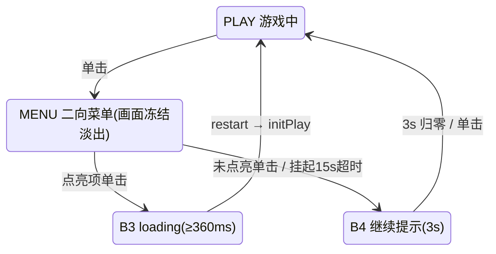

# PRD-04《滚球迷宫》需求分册

| 文档信息 | 内容 |
| --- | --- |
| 分册编号 | **PRD-04** |
| 分册名称 | 《滚球迷宫》Marble Maze |
| 归属总章 | 《摇头晃脑需求说明书》V1.0（下称"总章"，文件路径 `摇头晃脑需求说明书.md`） |
| 分册版本 | **V1.0-r6**（对齐总章 V1.0，本册第 6 次修订：**输入模型改为 AIM 头动对准 + PLAY 增量式位移驱动**） |
| 编写日期 | 2026-09-04 |
| 目标平台 | Rokid Glasses（AIUI 平台） |
| 文档状态 | 待评审（工程实现依据） |
| 需求编号前缀 | `F-LAB-*` |
| 开发优先级 | **P1**（总章 §12 / 附录 B） |
| 工程 gameId | **`marble`**（`utils/games.js` ENTRIES，ringPos `RT`，difficultyRank 3） |

> **本版修订摘要**（相对 V1.0-r3）
> 1. **关卡由 3 关压缩为 1 关**：《蛇形长廊》Serpentine Gallery。原三关的三种机制（静止洞教学 / 双通道分叉 / 移动洞窄廊）**合并进单关的四个段落**，难度在关内递进，而非跨关递进。
> 2. **物理模型重构**：由"每帧速度增量 + 每帧 ×0.92 + 法向 ×0.4"的离散拍脑袋模型，改为开源同构的 **`a = G·sin(θ)` 半隐式欧拉 + Circle-vs-AABB 最近点 + 法向/切向冲量**。两者数值自洽（见 §6.2），但新模型可直接复用成熟实现、可调参。
> 3. **视口与 HUD 对齐工程**：盘面由 (20,40)/440×300 改为 **(16,44)/448×264**（让位给 `VIEWPORT` 与左下提示条 `HINT`）；游戏 HUD 移入系统 HUD 中间空档。
> 4. **交互对齐 v1.20/v1.21**：长按已废弃，游戏内**单击**唤出 B2 二向菜单（左＝退回主页 / 右＝重新游戏）。
> 5. **通道净宽 24px → 60px**：原值对手部控制的木质迷宫盘成立，对头控（±1.6° 死区、±15° 量程）精度严重不足，见 §7.2 推导。
> 6. **移动洞运动方向修正**：由"沿固定轨迹往返"改为**垂直于通道方向往返**——沿通道方向移动时球走另一侧即永久安全，机制失效。
> 7. **（r5 · 2026-09-03）游戏框架页契约前提化**：新增 §2.7「游戏框架页契约（前提性要求 · 五册统一）」——把**顶部标题栏两处预留**（左上=游戏名由框架写入 / 右上=状态信息，可经 `statusText()` 钩子改写）、**画面区 `VIEWPORT 448×296 @(16,44)` 的硬约束 C-FRM-01~05**、冻结契约与 `GameResult` 契约固化为**所有游戏设计与编写的前提**；本册 §5 的盘面几何与 HUD 排布均为其**实例化**，冲突以 §2.7 为准。
> 8. **（r6 · 2026-09-04）输入模型重写（本作核心变更）**：原"倾角直控 · 加速度物理"整体作废，改为 **AIM 头动对准（准星恒在屏幕中心、盘面反向滚 20px/°）→ 0.4s 起跑缓冲 → PLAY 球心锁定（视口中心恒＝球心、增量式位移 12px/°、棘轮抑制回摆、每帧限幅 8px、死区 ±1.5°、回正即停不回退）**。依据：头部无法长时间维持静态偏转，"偏角的绝对值"不成立，改用"偏角的变化量"。连带：① **§4 整章重写**；② §6.2 物理改为**位移落地**（取消 `ACC_MAX`/`DAMP`/`RESTITUTION`/`WALL_FRICTION`，`e=0` 纯滑行，`V_MAX` 重定义为 `STEP_MAX=8px/帧`）；③ §5.1 改为**世界固定 + 相机跟随 + 外侧留空**；④ §7.3 几何重算（迷宫 **448×294**、4 廊净高 **65**、洞**贴壁**、移动洞 **r16**）；⑤ 新增 F-LAB-18/19 状态胶囊三态（待校准 / 校准中 / 游戏中）；⑥ §2.7 落实**提示条取消**（下沿 340）与 **B2 亮度分层**契约。画面设计稿 v1.24（Ardot `722090993915783`）已过用户目视验收。**总章 §5.6 / §4 / 附录 B 需同步**（"头 = 摇杆"→"头 = 相对位移输入"）。

---

## 1. 分册定位与范围边界

### 1.1 本册职责（Own）

《滚球迷宫》**玩法本体**需求的唯一权威来源：倾角映射规格、物理模型与数值、盘面元素、单关迷宫结构与时限、计分与失误规则、本册专有 HUD 与视觉、音效清单、本册专有验收标准。

**一句话定位**：复刻经典木质滚珠迷宫盘（Labyrinth / Marble Maze），**最能体现"头部即注视点"直觉**的一款；也是五款中**唯一无实时惩罚压力**的休闲入口，同时是**唯一采用相对位移输入**的一款（§4）。

### 1.2 本册不负责（Out of Scope）

| 不在本册 | 归属 |
| --- | --- |
| 头动输入解算、死区滤波、坐标系约定、坐标系符号 | 公共基线 §2.2（`utils/input.js`） |
| 触控板手势与 B2 菜单 UI 本体 | 公共基线 §2.3 / §2.4（`utils/gesture.js`、`pages/game/game.js`） |
| 主页环形八向入口、教学页、结算页、最高分存储格式 | PRD-01 |
| 系统 HUD（品牌胶囊 / 状态胶囊） | `utils/hud.js` drawHud |

### 1.3 总章条款映射

| 总章条款 | 本册落点 |
| --- | --- |
| §5.6《滚球迷宫》需求 | §4 ~ §8（完整展开） |
| 附录 B 速查表·滚球迷宫行 | §4 体感映射规格 |
| §5.7 暂停选择器 → 现 B2 二向菜单 | §2.4 + §9 接入要求 |
| §5.8 F-Sys-01/04/05/07 | §10 系统功能接入 |
| §7.1 实心实体统一落地规则 | §5.3 元素规格 |

---

## 2. 公共基线（继承自总章，只读引用）

> **单源原则**：本节摘抄自总章 §2 / §4 / §7 / §9，对全部 6 个分册生效，**逐字一致**。
> - 若本册与总章冲突，**以总章为准**并回写修正本册；
> - 若需变更本节任何数值，**必须先在总章修订，再同步全部 6 册**。

### 2.1 运行环境与技术约束（摘 总章 §2）

| 约束项 | 规格 |
| --- | --- |
| 应用框架 | AIUI（**多文件四件套** `.json/.js/.wxml/.wxss` + `app.json` + `app.js` + `AGENTS.md`） |
| 屏幕类型 | **单绿色单色透明显示**（RokidGlasses1/2）：仅一个绿色发光通道叠加在透明黑底之上——纯黑即"透出现实"，不存在遮蔽现实的黑幕 |
| 应用宽度 | 固定 **480px**，不可变；参考高度 352px |
| 视觉主题 | 官方单绿科学仪表风：6 级亮度阶梯（100/72/48/24/12/6%），1px 结构线，控件圆角 4px / 面板 6px；禁止大面积实色与装饰性 glow |
| 主渲染方式 | Canvas 2D 页面节点 + `wx.createCanvasContext(id)`；每帧 `clearRect → 矢量绘制 → flush()`；**无双缓冲语义、无 requestAnimationFrame**——循环走 `utils/boot.js` 的 `startLoop` 降级链 |
| Canvas 绘图限制 | `drawImage` 仅接受另一 `Canvas` 实例为源；`createPattern` 不可依赖；**`ctx.measureText` 不在确认范围**——测宽一律用 `utils/draw.js` 的 `textWidth()` |
| IMU 数据源 | `AbsoluteOrientationSensor`（四元数）、`Gyroscope`、`Accelerometer`；frequency 为 best-effort 提示 |
| 本地存储 | `wx.setStorageSync` / `wx.getStorageSync`（**可能静默不可用**，须 `storageOk()` 显式探测） |
| 音效 | `Sound`（短音效，走 `utils/sfx.js` 注入点）、`AudioPlayer`（背景音乐） |

### 2.2 输入引擎契约（摘 总章 §4.1 / §4.3 / §4.4 + 工程现状）

#### 2.2.1 基准与相对偏角

以进入界面时静默采样的自然平视为**基准姿态**（中立位），一切输入均基于「当前姿态 − 基准姿态」的相对偏角。

#### 2.2.2 死区与滤波（`utils/input.js` 已实现）

| 参数 | 值 | 说明 |
| --- | --- | --- |
| `HEAD.deadDeg` | 1.6 | ±1.6° 内归零（交互 v1.23，原 3°） |
| `HEAD.softDeg` | 5 | 1.6~5° 软启动 `f(u)=2u²−u³`，边界值与斜率双连续；>5° 线性减 1.6 |
| `HEAD.tauMs` | 45 | 低通**时间常数**（ms），按 dt 换算系数，与帧率解耦（原 α=0.35/帧） |
| `HEAD.jitterW / jitterA` | 6°/s、1.8° | \|ω\|<6°/s 且偏角<1.8° 的低幅高频抖动直接抑制 |
| `HEAD.driftActive / driftRest` | 0.1 / 0.35 °/s | 明显偏离 / 死区附近两档漂移纠正速率（原统一 0.5°/s） |
| `HEAD.maxPxPerSec / menuPxPerSec` | 1200 / 620 | 直控型输出限速（px/**秒**，原 12px/帧） |

> ⚠ 本册的**增量通道**（`rel()`）另用 `MARBLE.DEAD_DEG`（±1.5°），且**不含**角速度前馈——棘轮式累积下前馈衰减会产生反向位移。

#### 2.2.3 坐标系与符号

- **通道语义**：`SWAP_AXES = true`，故引擎输出的 **`x`（yaw 通道）恒为水平（左右转头）**、**`y`（pitch 通道）恒为垂直（抬头低头）**，与设备安装轴无关。
- **符号**：由 `utils/input.js` 的 `SIGN.yaw / SIGN.pitch` 统一调节。**游戏层不得再做取反**——方向不对时改 `SIGN`，不得在分册内加负号。
- 屏幕 y 轴向下；总章 §2.2.3「抬头 = 向上」针对屏幕坐标，本作为物理盘面，**不适用**（见 F-LAB-02）。

> **本作例外（总章 §5.6 授权）**：倾角映射**方向同向、不取反**——头向哪边倾，球向哪边滚。

#### 2.2.4 灵敏度三档（`SENSITIVITY`）

| 档 | factor | coef | rangeYaw | rangePitch |
| --- | --- | --- | --- | --- |
| 迟钝 low | 0.75 | 6.0 | 40° | 26.7° |
| **标准 standard（出厂默认）** | **1.0** | **8.0** | **30°** | **20°** |
| 灵敏 high | 1.3 | 10.4 | 23° | 15.4° |

#### 2.2.5 校准与基准姿态管理（摘 总章 §4.4）

1. **两级基准**：主页不预置基准（选择态以进入时刻的姿态为锚定原点）；进入任意游戏前执行**正式校准**（E1/E2/E3 三屏，`CalibrationSession`：2s 静息 + 方差校验 `CALIB_VAR_MAX=1.2`，最多 3 次）；
2. **漂移纠正**：偏移回到死区且持续 >3s 时，基准向当前姿态插值迁移（明显偏离 ≤0.1°/s、死区附近 ≤0.35°/s）；主页选择态会话短，**冻结漂移纠正**；
3. **累计偏航保护**：本局基准累计迁移超过 ±45° 强制提示重新校准；
4. **手动重校准**：游戏中经 B2 菜单冻结画面后可触发快速重校准；
5. **异常姿态保护**：校准时方差过大则提示重试，不采用错误基准。

> **本作特别重要**：本作采用**相对位移输入**（§4）——基准漂移会直接表现为"AIM 阶段盘面自己滚、PLAY 阶段球自己漂"，漂移纠错的准确性在本作代价最高，校准质量要求也最高。

#### 2.2.6 头动输入处理流程

```mermaid
flowchart TD
    A[AbsoluteOrientationSensor 60Hz 四元数] --> B[quatToAngles 视轴法解算]
    B --> C{当前上下文}
    C -- 待机/二级页 --> C1[仅保留漂移纠错采样]
    C -- 游戏页 AIM --> A1[盘面反向滚动 cam = AIM_CAM + rel x 20]
    A1 --> A2{球距准星 <24px?}
    A2 -- 否 --> A3[维持 AIM · 不计时 · 不判定]
    A2 -- 是 --> A4[就绪 · 单击开始]
    A4 --> A5[0.4s 起跑缓冲] --> P1
    C -- 游戏页 PLAY --> P1[相对角 rel · 本册死区 ±1.5°]
    P1 --> E{已校准?}
    E -- 否 --> E1[引导校准]
    E -- 是 --> F[抖动抑制 + 低通 LP]
    F --> G[本帧增量 d = rel − lastRel]
    G --> H{棘轮: |rel| 增大且同号?}
    H -- 否 --> I[不产生位移]
    H -- 是 --> J["step = clamp(12px/° x d, ±8px/帧)"]
    I --> K[Circle-vs-AABB 碰撞 · e=0 沿墙滑行]
    J --> K
    K --> L[相机 cam = 球心 − 视口中心]
    L --> M[渲染]
```

### 2.3 触控板判定（**交互 v1.20**，摘 总章 §4.2 + 工程现状）

| 物理操作 | 表现 | 上下文 | 功能 |
| --- | --- | --- | --- |
| **单击** | `GlobalHook` D/U 脉冲对 | **游戏中（PLAY）** | **唤出 B2 二向菜单**（原"长按 500ms"已废弃） |
| 单击 | 同上 | **AIM 就绪态** | **开始游戏** → 0.4s 起跑缓冲 → 计时起算（F-LAB-32） |
| 单击 | 同上 | **AIM 未就绪** | **忽略**（无响应，F-LAB-33） |
| 单击 | 同上 | B2 菜单已点亮项 | 确认选择 |
| 单击 | 同上 | B2 菜单未点亮 | 取消 → B4 继续提示（3s / 单击）→ 回 PLAY |
| 单击 | 同上 | B4 继续提示 | 立即继续 |
| 前后滑动 | 方向键序列 | 主页待机 | 进入选择态（**游戏内忽略**） |
| 返回键 | `Backspace`（`onKeyUp` 中 `preventDefault()`） | 全局 | 返回上级 |

**真机取证要点**（`utils/gesture.js` 已实现，勿改）：
- GlobalHook **无长按语义**：一次按压 = 一对 D+U 脉冲，约 483ms 后尾随 Enter D/U → `enterSuppress=600` 吞掉；
- 宿主「双击 = 退出程序」**不可拦截** → 永不要依赖"能拦截宿主默认行为"；
- 真机可能连发 keyDown（auto-repeat）→ `if (this.down) return true` 状态自守；
- 滑动只结算一次（`swipeDebounce=200`），滑进选择态后 `swipeSuppress=300` 吞伪单击。

> **本作例外（F-LAB-34 保留）**：单击在 **PLAY 态不承担任何游戏内职能**（不发炮、不重开）——误触重开会毁掉计时，单击只唤菜单。**只有 AIM 就绪态的单击才表示"开始游戏"**（F-LAB-32）。

### 2.4 游戏内 B2 二向菜单（交互 v1.20 / v1.21，摘总章 §5.7 的现代表述）

1. **PLAY 态单击** → 进入 MENU（B2）：画面**冻结**（物理与倒计时停止），全部元素按 `fade` 渐隐（≥200ms，**禁止黑色遮罩**，只降元素自身 alpha）；
2. B2 世界锚定二向入口（`GAME_MENU_R=114`，待机位 L(126,176) / R(354,176)）：
   - **左位** = `home`「退回主页面」（home 图标）
   - **右位** = `restart`「重新游戏」（refresh 图标）
3. 点亮阈值 <48px；点亮单击 → B3 loading（≥`LOADING_MIN_MS=360ms`）→ 执行；未点亮单击 → B4 继续提示（面板 288×152@(96,100)，中心倒计时环 r24 + 光晕 r44）→ 3s 或单击 → 回 PLAY；
4. 菜单挂起 15s（`TOUCH.selectSuspend`）超时同样经 B4 回 PLAY。



### 2.5 视觉与 UI 规范（摘 总章 §7）

#### 2.5.1 亮度阶梯与颜色常量

| 亮度级 | 值 | 用途 |
| --- | --- | --- |
| 100% | `#40ff5e` | 仅保留给：小球本体、得分关键数值、焦点标记等主动焦点 |
| 72% | `rgba(64,255,94,.72)` | 主可读文本、激活结构线、游戏实体描边 |
| 48% | `rgba(64,255,94,.48)` | 次要文本、常规交互边界、迷宫墙体 |
| 24% | `rgba(64,255,94,.24)` | 分隔线、待机态入口常态 |
| 12% / 6% | 相应 alpha | 局部分组底纹（最大正常面积填充为 12%） |

- **禁止大面积 ≥24% 实色填充**；**禁止绘制黑色遮罩层**——一切变暗通过降低元素自身 alpha 实现；
- **实心实体统一落地规则**（总章 §7.1）：描述为"实心"的实体一律以 **描边高亮 + 内部填充 ≤12%** 呈现；**仅当实体直径 ≤16px 时允许 100% 实心**（面积不构成"大面积"）。本作小球直径 14px，故为 100% 实心（§5.3）。

#### 2.5.2 版式与安全区

- 全画布 480×352；HUD 高度 24，顶/底边距 12；
- 字号阶梯：页面标题 22/500、区块题 16/500、正文 14、密排 12、标签 11/500、数据值 monospace 13；**同屏最多同时出现 3 个字级**；
- 圆角：控件 4px、面板 6px；1px 默认结构线宽，2px 只用于焦点强调；
- 每个语义状态至少**双通道编码**（文字 + 图形/线型变化）。

#### 2.5.3 渲染与动效细则

- **每帧渲染**：`clearRect → 矢量绘制 → flush()`；
- **动效时长**：120ms 快反馈 / 200ms 标准过渡 / 320ms 结构过渡；
- **同一屏只允许一个主导脉冲动效**；
- 所有 UI 文案禁用 emoji；关键文案 ≥72% 亮度。

### 2.6 非功能需求（摘 总章 §9）

| 类别 | 编号 | 要求 |
| --- | --- | --- |
| 性能 | NFR-01 | 帧率稳定 ≥ 30fps，输入到画面响应延迟 ≤ 100ms |
| 性能 | NFR-02 | 传感器高频订阅仅在游戏进行与菜单状态维持；离开页面 `stop()` 释放 |
| 功耗 | NFR-03 | 待机/二级页仅保留低频采样 |
| 健康 | NFR-04 | 舒适性条款（休息提醒、灵敏度档位、死区防误触） |
| 健壮性 | NFR-05 | 传感器权限失败或 error 事件时降级：自动进入"已暂停"保护状态并给出明显提示 |
| 存储健壮性 | NFR-06 | 读档 JSON 解析失败时静默重置为空档案，绝不崩溃 |
| 国际化 | NFR-07 | V1.0 仅简体中文文案（≤12 字/行） |

### 2.7 游戏框架页契约（前提性要求 · 五册统一）

> **定位**：本节是 `pages/game/game.js` **已落地的既有事实**（交互 v1.22），不是待实现项。五款游戏共用同一个框架页，任何一款游戏的画面都必须长在这个框架里。
> **效力**：本册 §5（视口、HUD 与元素规格）的一切布局都是本节约束下的**实例化**；两者冲突时**以本节为准**并回写修正本册。
> **同步**：本节在五册中**逐字一致**（仅章节编号随各册排布不同）。任何变更必须先在 PRD-01《设计说明》修订，再同步全部 5 册。

#### 2.7.1 三层布局结构（自上而下）

| 层 | 区域 | 规格 | 归属 | 本册可否改写 |
| --- | --- | --- | --- | --- |
| ① **顶部标题栏** | HUD 条 y 12 ~ 36（h 24） | 左品牌胶囊 76×24 @(16,12) ｜ **中段空档 x 92 ~ 352** ｜ 右状态胶囊 110×24 @(354,12) | 框架页 `drawHud()` | 中段空档**可自由排布**；两胶囊**不可覆盖** |
| ② **游戏画面区** | `VIEWPORT = 448×296 @(16,44)`，即 x 16~464 / y 44~340 | 虚线框 1px @24% `[4,4]` + 四角外角标 12px @48%（1.5px）+ 四边中点 12px 刻度 @24% | 框架页绘框，**本册填内容** | 内容全归本册；边框/刻度**不可重复绘制** |
| ~~③ 左下操作提示条~~ | **已取消**（2026-09-03 用户裁定） | 原 `HINT (16, 316, h24)` 仅为搭框架页时的占位 | 框架页 `drawHint()` 仍无条件调用（**代码侧遗留工单**） | **该 24px 已归还画面区**（C-FRM-03） |

#### 2.7.2 顶部标题栏的两处预留（硬性）

1. **左上品牌胶囊 = 游戏名**：框架页以 `drawHud(ctx, meta.name, …)` 写入 `utils/games.js` 中本册的 `name`（如「滚球迷宫」）。**本册不绘制、不覆盖**——游戏名是框架资产，不是本册 UI。
2. **右上状态胶囊 = 状态信息**：默认承载框架自身状态（`IMU状态正常 / IMU状态异常`；圆点实心 = 正常，空心 = 异常；B3 loading 期间为 `状态：打开中`）。**本册可通过 `statusText()` 钩子改写为本局状态信息**（波次 / 剩余目标 / 弹药 / 剩余时间等）。
   - 挂载方式：在游戏实例上定义 `statusText()` 返回字符串；**未挂载时行为与默认完全一致**（可选钩子，不挂载不报错）。
   - **宽度上限**：胶囊 110×24 → 状态圆点圆心 x=368、文字左起点 x=378、胶囊右缘 x=464，**可用宽 ≈ 86px**。按 12/500 字号计，CJK 约 **7 字**、数字/拉丁约 **16 字符**；超长会被裁切。
   - **本册取值（F-LAB-18）**：AIM 未开始「状态：待校准」/ AIM 对准中与就绪「状态：校准中」/ 起跑缓冲起「状态：游戏中」；**IMU 异常时回落框架默认「IMU状态异常」**。实测文案宽 72px（右缘 450），未溢出。
3. **中段空档 x ∈ [92, 352]（262px）、墨中心 y = 24**：这是本册**唯一**的 HUD 自由度。得分 / 生命 / 进度 / 波次等游戏状态一律排布在此区间，**与两胶囊同基线（墨中心 y=24）**，不得越入 x<92 或 x>352。

#### 2.7.3 画面区硬约束（「画面信息都要落到画面区」）

| 编号 | 约束 | 说明 |
| --- | --- | --- |
| C-FRM-01 | 本册全部游戏元素（含判定盒、特效、飘字、临时提示）**必须落在 VIEWPORT 内**（x 16~464 / y 44~340） | 越界即视觉溢出到 HUD 条或提示条 |
| C-FRM-02 | **顶部**：HUD 条底边 y=36，画面区上沿 y=44，中间 8px 空档。**不得在 y 36~44 之间放置元素** | 本册另有声明的顶部进度条类元素须显式标注并复核 |
| C-FRM-03 | **底部**：**提示条已取消**，画面区下沿 **y=340 全部可用**。需要底边的本册（球场、地面线、地平线等）底边可收到 **y=332 或 y=340** | 无提示条占位（2026-09-03 裁定） |
| C-FRM-04 | **中央**：R=114 圆域是 B2 菜单活动区，但**菜单期间游戏已冻结**（不调用 `update`），与本册元素不冲突，**无需避让** | 见 §2.7.4 |
| C-FRM-05 | 画面区边框、四角外角标、四边中点刻度**由框架页绘制**，本册**不得重复绘制** | 重复 = 双线叠加发亮 |

#### 2.7.4 状态机与本册的冻结契约

| 框架态 | 触发 | 本册被调用 | 画面处理 |
| --- | --- | --- | --- |
| `B1 PLAY` | 进入 / 回场 | `update(dt)` + `render()` | 正常推进 |
| `B2 MENU` | 游戏中单击 | **仅** `render()` | 冻结；框架 `fadeTo` 统一降至 6% 隐藏档 |
| `B3 LOADING` | 菜单点亮项确认 | **仅** `render()` | 同上；最短 360ms 后执行导航 / 重置 |
| `B4 CONT` | 菜单未点亮单击 / 挂起 15s 超时 | **仅** `render()` | 同上；3s 倒计时归零或单击 → 回 PLAY |

- **时钟**：本册内部计时必须基于 `update(dt)` 累加的 `g.t`，**禁用 `Date.now()` 与任何定时器**——冻结期自动暂停、恢复时自动续算，无需显式 freeze / resume。
- **变暗**：一律由框架页 `fadeTo` 处理，本册**不得自绘遮罩或自行降 alpha**。
- **音效**：本册**不得直接 import sfx**；`update()` 返回事件数组，由框架页负责播音。
- **B2 二向菜单**：固定两项——左「退回主页面」/ 右「重新游戏」（`kind: 'system'` 的入口为「重新进入」），R=114，点亮阈值 48px，15s 无确认经 B4 回场。本册**不实现任何选择器 UI**。
- **B2 亮度分层（2026-09-03 新增契约 · 五册统一）**：MENU 态下**框架资产与菜单恒亮**，**本册元素**经 `fadeTo(a, MENU_FADE = 0.55)` 退至次要层。依据：R=114 圆域覆盖 x 126~354 / y 62~290，本册元素在空间上**根本无法避让**——C-FRM-04 的"不冲突"唯一前提就是亮度分层。B3 / B4 沿 `launchFade` 与瞬时收束至 6%，此时框架与本册**同步**降。本册落地见 §9 F-LAB-87。

#### 2.7.5 本册可覆写的钩子（其余一律归框架）

| 钩子 | 用途 | 缺省 |
| --- | --- | --- |
| `statusText()` → string | 改写右上状态胶囊文案（本局状态信息） | `IMU状态正常 / IMU状态异常`；B3 期间 `状态：打开中` |
| `render(ctx, …)` | 绘制画面区内容 | 占位文案「功能框架占位 · 分册实现后覆盖」 |
| `result()` → `GameResult` | 结算数据 | 见下方 GameResult 契约 |

> **GameResult 契约**：`{ score, cleared, reachedLevel, durationSec, motion{yawUtil, pitchUtil, yawAmpDeg, pitchAmpDeg, tapCount, tapLatencyMs}, extra[] }`。
> `motion` 由框架页 `InputEngine.stats.toMotion()` 统一写入、`durationSec` 由框架页计时——**本册只负责 `score`、`cleared`、`reachedLevel` 与 `extra[]`**。`extra` 每项 label ≤ 6 字。

#### 2.7.6 提示条（已取消）

> 提示条 `HINT (16, 316, h24)` 与其五态文案（PLAY「单击触控唤出菜单」等）已于 **2026-09-03 用户裁定取消**——它只是搭框架页时的占位，**真实游戏页不出现**，其占据的 y 316~340 **归还画面区**（C-FRM-03）。
> ⚠ **代码侧遗留**：`pages/game/game.js` 的 `drawHint()` 仍无条件调用，设计口径取消 ≠ 真机不显示，需按模块声明跳过（独立工单，不属本册）。

---

## 3. 开源参考与借鉴分析（本版新增）

> 目的：本作是复刻型玩法，GitHub 上已有大量成熟实现。实现前**优先复用其物理与关卡数据结构**，只做 AIUI 适配，不自造轮子。

### 3.1 候选仓库评估

| 仓库 | 星 | 技术栈 | **借鉴点** | 不可直接用 / 需改造 |
| --- | --- | --- | --- | --- |
| **AnasHarraz/Maze-ball-game-physic-simulation** | 0 | Processing | ★★★ **核心物理**：`a = G·sin(θ)` 分轴重力 + 半隐式欧拉 + **Circle-vs-AABB 最近点检测** + 法向冲量 `j = −(1+e)(v·n)` + 切向摩擦冲量。约 40 行，可直接翻译成 JS | Processing 语法；`restitution`/`friction` 需按本册 §6 数值重标定；关卡为硬编码类 |
| **jerhon/marble-maze** | 0 | TypeScript + Phaser 3 | ★★ **关卡数据格式**：字符网格（`X`=墙 / `S`=起点 / `E`=终点）+ `maze-loader.ts` 解析器；DeviceOrientation 与方向键双输入通道 | Phaser 依赖；网格关卡对本作"仅 7 个 AABB"的盘面过重（见 §7.4） |
| **microsoft/Windows-appsample-marble-maze** | 115 | C++ / DirectX 11 | ★★ **倾角 → 重力向量**的工程处理、阻尼与滚动摩擦的量纲关系、关卡分段节奏 | 3D + DirectX，与 AIUI Canvas 无交集，只读设计思路 |
| **PunicGames/Marble-Stars** | 7 | Kotlin / Android | ★★ 明确声明"based on wooden mazes"——**经典木质迷宫盘的洞位与关卡节奏**参考 | 平台不同，只读关卡设计 |
| jeromeetienne/marbleTable | 7 | three.js | ★ 3D 球盘的重力/惯性观感参考（timer + rolling sound 设计） | 3D，不可移植 |
| shannon1004/marble-maze-tilt-labyrinth | 0 | HTML5 Canvas | ★ Canvas 2D 渲染组织方式 | 代码质量有限，只读结构 |

### 3.2 核心借鉴代码（Circle vs AABB 最近点）

来源：`AnasHarraz/Maze-ball-game-physic-simulation` 的 `resolveWallCollisions()`。本作据此改写，仅把 Processing 的 `PVector` 拆成标量。

> ⚠ **r6 口径**：本作自 §6.2 起改为**位移驱动 + `e = 0` 纯滑行**，故下方代码的**第 4、5 步（法向冲量 / 切向摩擦冲量）本作不使用**，只保留**第 1~3 步：最近点检测 → 判定 → 位置推出**。保留完整代码是为了说明来源，并为未来若恢复惯性模型留复用路径。

```js
/* 参考实现（Processing）→ 本作改写目标（JS） */
// 1) 最近点：把球心 clamp 到 AABB 内
const cx = clamp(ball.x, w.x, w.x + w.w);
const cy = clamp(ball.y, w.y, w.y + w.h);
const dx = ball.x - cx, dy = ball.y - cy;
const dist = Math.sqrt(dx * dx + dy * dy);

// 2) 判定：dist < R 且 dist > eps（eps 防球心恰在墙内时法向退化）
if (dist < BALL_R && dist > 1e-4) {
  const nx = dx / dist, ny = dy / dist;          // 碰撞法向
  // 3) 位置修正：推出到刚好接触（防陷墙）
  ball.x += nx * (BALL_R - dist);
  ball.y += ny * (BALL_R - dist);
  // 4) 法向冲量：j = -(1+e)(v·n)，仅当球正朝墙运动（v·n < 0）
  const vn = ball.vx * nx + ball.vy * ny;
  if (vn < 0) {
    const j = -(1 + RESTITUTION) * vn;
    ball.vx += j * nx; ball.vy += j * ny;
    // 5) 切向摩擦冲量（擦墙损失，防沿墙无限滑行）
    const tx = -ny, ty = nx;
    const vt = ball.vx * tx + ball.vy * ty;
    let jt = -WALL_FRICTION * Math.abs(j) * Math.sign(vt);
    if (Math.abs(jt) > Math.abs(vt)) jt = -vt;   // 摩擦不得反向
    ball.vx += jt * tx; ball.vy += jt * ty;
  }
}
```

### 3.3 与 AIUI 运行时的差异（**改造红线**）

| 开源实现依赖 | AIUI 现状 | 处理 |
| --- | --- | --- |
| `requestAnimationFrame` / `setInterval` | **不在确认范围，禁止裸调** | 循环走 `utils/boot.js` 的 `startLoop` 降级链；dt 由引擎给 |
| 可变 dt（rAF 时间戳） | 需**固定步长** | 物理用固定 `dt = 1/30`，渲染同帧；见 §6.2 |
| `DeviceOrientation` 事件（alpha/beta/gamma） | AIUI 只承诺 `AbsoluteOrientationSensor` 四元数 | 走 `utils/input.js` 的 `quatToAngles` 视轴法，不用欧拉角事件 |
| `ctx.measureText` | 真机可能返回 0/undefined | 一律 `utils/draw.js` 的 `textWidth()`（实测与估算取大） |
| 物理引擎（cannon-es / rapier / matter） | 体积与 API 均不可接受 | **不引入引擎**，手写 §6 的 60 行积分 + 碰撞 |
| 图片/纹理资源 | 单绿描边风格全矢量 | 全部 `fillRect` / `arc` / `moveTo-lineTo`，零资源 |

---

## 4. 输入模型（本册专有 · **本作核心 · 本版重写**）

> **本版重大变更（r6）**：原「倾角直控 · 加速度物理」模型整体作废，改为 **AIM 头动对准 + PLAY 球心锁定的增量式位移驱动**。
> **变更理由**：**头部不是摇杆——无法长时间维持静态偏转**。原模型要求玩家持续保持 ±15° 倾角才能维持球速，颈部负荷与眩晕风险极高（NFR-04）。新模型把输入从「偏角的**绝对值**」改为「偏角的**变化量**」，用户只需在中立位附近来回小幅摆动即可持续推进，彻底解除"保持偏转"这一不成立的生理前提。
> 来源：用户基于真机推演提出（2026-09-04）；画面设计稿 v1.23 / v1.24（Ardot `722090993915783`）为可视化依据，已过目视验收。

### 4.1 两阶段输入模型

本作游戏期分为两个互斥阶段，**只有 PLAY 阶段计时**：

| 阶段 | 语义 | 画面 | 头动作用 | 单击作用 |
| --- | --- | --- | --- | --- |
| **AIM**（对准） | 待开始 / 对准中 / 就绪 | 盘面 **1:1 全显**（448×294 居中于视口），**准星恒钉在屏幕中心 (240, 192)** | 驱动**盘面反向滚动**，增益 **20 px/°** | **开始游戏**（仅就绪态生效，F-LAB-32） |
| **PLAY**（球心锁定） | 游戏中 | 盘面 1:1，**视口中心恒等于球心**，球恒在 (240, 192)，盘面随球滚动 | 驱动**球的位移**，增益 **12 px/°**（增量式） | **唤出 B2 二向菜单**（§2.4，F-LAB-34） |

> **为什么准星恒在屏幕中心**：眼镜的光学中心即用户的自然注视点。屏幕中心之外的任何位置都无法被稳定注视——把准星钉在中心，用户"看哪儿就瞄哪儿"，不需要用余光去追一个偏离中心的目标。这与 PLAY 阶段"球恒在中心"是**同一个心智模型**：**屏幕中心 = 注视点，画面随头动滚**。

#### 4.1.1 AIM 阶段：准星不动，盘面反向滚

头向左上转 → **盘面向右下滚**（迷宫在屏幕上向右下移动、球则向左上靠近准星）。

```text
cam     = AIM_CAM + rel × AIM_GAIN      // rel = 相对基准的偏角（度）；AIM_GAIN = 20 px/°
scr     = world − cam + (16, 44)        // 世界坐标 → 屏幕坐标（§5.1 F-LAB-12）
AIM_CAM = (0, −1)                       // 初始相机：448×294 盘面在 448×296 视口内垂直居中
```

| 项 | 值 |
| --- | --- |
| 球初始屏幕位 | **(76, 85.5)** |
| 与准星初始中心距 | **195.5 px** |
| 对准全程需转头 | **≈ 9.8°**（yaw 8.2° + pitch 5.4° 的合成） |
| 就绪阈值 | 球屏幕位与准星中心距 **< 24 px**（F-LAB-07） |
| 冻结项 | **AIM 阶段不计时、不推进物理、不判定吸入** |

> ⚠ **易错点**：不要画成"盘面固定、准星在盘面上移动"。两者相对几何完全等价，但**"谁在动"是两回事**——准星离开屏幕中心后用户无法稳定注视，且 AIM→PLAY 会出现位置跳变（见 §4.1.3）。

#### 4.1.2 PLAY 阶段：增量式位移（棘轮）

PLAY 阶段头动驱动的是**球的位移增量**，不是速度、也不是加速度：

```text
每帧（固定 dt = 1/30 s）：
  1) rel  = engine.rel()                      // 相对偏角（度），已过抖动抑制与低通，未套公共死区
  2) d    = rel − lastRel                     // 本帧偏角增量
  3) 若 |rel| 增大且与 lastRel 同号：            // 棘轮：只累加「加深偏转」，忽略「回摆」
        step = clamp(PLAY_GAIN × d, ±STEP_MAX)   // PLAY_GAIN = 12 px/°；STEP_MAX = 8 px/帧
        球的目标位置 += step（分轴独立）
  4) lastRel = rel
  5) 位移落地 + 碰撞求解（§6.2）
```

| 性质 | 表现 |
| --- | --- |
| 头转 → 球动 | 头偏 8° → 球位移 **96 px**（理论值，未计碰撞） |
| **头停 → 球停** | **无惯性拖尾**，球立即静止 |
| **回摆 → 球不回退** | 头转回中立位的过程**不产生反向位移**（棘轮抑制），球停在原地 |
| 可无限推进 | 回摆后再次向同侧偏转即继续前进——像"**划船**"，全程无需维持静态偏转 |

> **为什么不要惯性**：① 惯性会让"头已停、球还在滑"，与"回正即停"直接冲突；② 球恒在屏幕中心时，球的任何自主滑行都会带动相机平移，表现为**画面自己漂移**——这是位移驱动下最严重的眩晕源。故本作**取消 `ACC_MAX` / `DAMP` / `RESTITUTION` / `WALL_FRICTION` 四个惯性参数**（原 F-LAB-34~38 作废，见 §6.2）。

#### 4.1.3 起跑缓冲 0.4s

就绪后单击 → 进入 **0.4s 起跑缓冲**：画面不变、物理不推进、计时未起算。

| 项 | 规格 |
| --- | --- |
| 作用 | 防止"锁定瞬间的误触"直接开跑——对准动作本身就是一次头部大幅摆动，其后的第一次单击极易误触 |
| 视觉 | 球心显示**起跑双环**（r34 @48% + r22 @100%），倒计时结束双环收束消失 |
| 结束 | 0.4s 归零 → 计时起算、物理激活 |

> **这不是"相机推近"**：AIM 就绪时的相机恰好等于 PLAY 开局相机（`cam(AIM 就绪) = cam_of(START)`），两阶段 **1:1 无缝**，中间不存在推近过渡。

### 4.2 需求条目

| 编号 | 要求 |
| --- | --- |
| F-LAB-01 | 双轴独立：`relX` / `relY` 各自独立计算与限幅，斜向转头产生正确的合成位移 |
| F-LAB-02 | **方向约定**：头向左转（yaw 负偏）→ AIM 阶段**盘面向右滚**、PLAY 阶段**球向左位移**；头前倾（低头）→ 球向屏幕上（−y）位移。**不做取反**——符号统一由 `utils/input.js` 的 `SIGN` 调节，分册内不得加负号 |
| F-LAB-03 | **死区 ±1.5°**（本册专有，严于公共基线 §2.2.2 的 3°）：位移驱动下 3° 死区会造成"小幅转头完全无响应"的迟滞感 |
| F-LAB-04 | **每帧位移限幅 8 px**（⇔ 30 fps 下 240 px/s）。这是**防甩头穿墙常量，不是手感参数** |
| F-LAB-05 | 增益：AIM **20 px/°**、PLAY **12 px/°**（物理意义不同：前者驱动相机、后者驱动球） |
| F-LAB-06 | **棘轮抑制**：仅当 `|rel|` 增大且符号不变时累加位移；回摆与抖动一律不产生位移 |
| F-LAB-07 | **就绪阈值 24 px**，带迟滞：进入 <24 px 锁定、退出 >32 px 解锁，防边界抖动 |
| F-LAB-08 | **AIM 阶段不计时**；计时自起跑缓冲结束起算 |
| F-LAB-09 | 传感器失联（`imuOk === false`）时**冻结当前输入**（既不推进也不回退）；PLAY 阶段同时进入"已暂停"保护（NFR-05）。**不得把输入归零**——归零会让棘轮把回摆误判为反向推进 |

### 4.3 实现接口：`InputEngine.rel()`

`utils/input.js` 现有 `update()` 输出的 `_px/_py` 是**直控型像素位移**（已含 coef 缩放与 12px 限幅），混入了其它分册的像素语义；本作需**新增**一个角度通道（不改 `_px/_py`，避免影响其他分册）：

```js
/* utils/input.js —— 新增方法（本册依赖） */
rel(deadDeg = 1.5) {
  // relYaw / relPitch：相对基准的偏角（度），已过 shapeAngle 压扁与低通 LP
  // 本册不使用公共死区（3°），改取原始相对角再套本册死区 ±1.5°
  if (!this.imuOk) return { ok: false, x: 0, y: 0 };   // F-LAB-09：由调用方冻结，勿归零推进
  return {
    ok: true,
    x: deadzone(this.relYaw,   deadDeg),
    y: deadzone(this.relPitch, deadDeg),
  };
}
```

> **依赖 `update()` 已跑过**：`relYaw / relPitch` 由 `update(dtMs)` 维护，游戏循环须先调 `engine.update(dt)` 再调 `engine.rel()`。

### 4.4 体感特殊性

- 唯一一款"**无实时惩罚压力**"的首发游戏：失败仅回起点，无生命值，是各年龄用户的休闲入口；
- **本作是五款中唯一采用"相对位移输入"的一款**（其余四款为偏角直控）。它同时是"头部能否作为连续输入设备"这一核心命题的**压力测试样本**——若增量式模型成立，可推广至其余分册以系统性降低颈部负荷。

---

## 5. 视口、HUD 与元素规格（本册专有）

### 5.1 视口与相机（**本版重写**）

| 编号 | 项 | 规格 |
| --- | --- | --- |
| F-LAB-10 | 画面区 | 沿用 `utils/layout.js` 的 `VIEWPORT = {x:16, y:44, w:448, h:296}`，即 x 16~464 / y 44~340；**下沿 y=340 全部可用**（提示条已取消，见 §2.7.1） |
| F-LAB-11 | **迷宫世界** | **448 × 294**（世界坐标，原点 = 迷宫左上角）。与视口 **1:1 同尺度**，AIM 与 PLAY 两阶段**无缩放跳变** |
| F-LAB-12 | **相机** | `cam = (ballX − 224, ballY − 148)`，即**视口中心恒等于球心**；屏幕坐标 `scr = world − cam + (16, 44)`。相机**每帧直接赋值、不做 lerp**——球在屏幕中心是硬契约，相机滞后会导致球偏离中心 |
| F-LAB-13 | **外侧留空** | 视口滚出迷宫范围的部分**不绘制任何东西**——不画网格、不画延伸边框、不画装饰、不画第二重外框，**仅外墙 8px 标界**（F-LAB-20）。Rokid 为透明屏，留空处透出的是现实场景而非黑块 |

> **留空实测比例**（画面设计稿 v1.24）：AIM 全显 0.7% / 对准中 40.9% / 起跑缓冲 59.6% / 主玩法 27% / 边角视口 47% / 吸入 17% / 终点 60%。设计上**不设最小留空约束**，但**禁止出现整屏全空**；起跑缓冲屏的 59.6% 已过用户目视验收（2026-09-04）。
>
> **变更理由（相对 r4）**：r4 的盘面是**固定**的 448×264 @(16,44)，球在盘面上移动。本版改为**世界固定、相机跟随**——球恒在屏幕中心、盘面随球滚动。这直接消除了"球滚到画面边缘后用户要歪头去追"这一眩晕来源，也是 §4.1 PLAY 阶段的前提。

### 5.2 HUD（移入系统 HUD 中间空档）

系统 HUD 已由 `utils/hud.js` 绘制：左品牌胶囊 76×24 @(16,12)（`game` 页显示「滚球迷宫」）、右状态胶囊 110×24 @(354,12)。中间 **x 92~352 有 260px 空档**，本册游戏 HUD 落在此处，**不再占用画面区**。

| 编号 | 项 | 规格 |
| --- | --- | --- |
| F-LAB-14 | 时间胶囊 | 96×24 @**(100, 12)**，圆角 4，1px 24% 描边 + 6% 底；标签「时间」11/500 48% @x112；数值 monospace 13，**72%**，右对齐 @x184 |
| F-LAB-15 | 失误胶囊 | 96×24 @**(250, 12)**，同规格；标签「失误」@x262；数值右对齐 @x334 |
| F-LAB-16 | 低时告警 | 剩余 ≤10s 时数值提亮至 **100%** 并加 120ms 快反馈（数字每 500ms 闪一次），**不增加第二个主导动效** |
| F-LAB-17 | 字数级 | 全屏字级：胶囊标签 11、数值 13、画面内提示 11 → 共 3 级，符合 §2.5.2 |
| **F-LAB-18** | **状态胶囊（本册挂载 `statusText()`）** | AIM 未开始 → **「状态：待校准」**；AIM 对准中 / 就绪 → **「状态：校准中」**；起跑缓冲起（含 PLAY / B2 / B4）→ **「状态：游戏中」**。**IMU 异常时回落框架默认「IMU状态异常」** |
| **F-LAB-19** | **AIM 阶段 HUD** | 时间 / 失误胶囊保留但**置灰**（标签与数值均 24%），表示"未起算"；就绪单击后恢复 48% / 72% |

> **F-LAB-18 措辞说明**：「待校准 / 校准中」在此处指 **AIM 对准**，与 §2.2.5 的 IMU 正式校准（E1/E2/E3 三屏）**不是同一件事**——正式校准在进入游戏前已完成。此处沿用"校准"一词，是因为在用户心智中"把准星对准球"本身就是一次校准动作。实测文案宽 72 px，右缘落在 450，胶囊内 padding 14（时间 / 失误胶囊为 12），未溢出。
>
> **实现红线**：`statusText()` 是可选钩子，框架须用 `typeof` 守卫调用——**`render()` 内抛错会导致整帧卡死**（真机取证，见 `AIUI-红线.md`）。

### 5.3 盘面元素规格

| 编号 | 项 | 规格 |
| --- | --- | --- |
| F-LAB-20 | **外墙** | 4 面，**厚 8 px**，直角。**加粗是刻意设计**——视口滚出迷宫时，外墙是**唯一的边界标识**。**【v1.34 改版】**由 8px 实心 72% 改为**羽化收边带**：贴迷宫内壁那一面（= 球的反弹面）最亮 **≈40%**，向屏幕外侧分 **4 级 × 2px** 逐级淡出（40% → 22% → 13% → 5%） |
| F-LAB-21 | 隔墙 | 3 道，**厚 6 px、48% 亮度**，直角（木质框感） |
| F-LAB-22 | **静止黑洞** | **半径 14 px**；**12% 底纹填充 + 72% 描边环（2px）**。D-LAB-03 裁决：7 个 100% 实心黑洞将违反"大面积填充 ≤12%" |
| F-LAB-23 | 起点孔 | **半径 10 px 空心圆环**，72%，线宽 2px；**【v1.38】只在 AIM / LAUNCH 显示** —— 起跑后（PLAY / RESPAWN / TIMEOUT）不画：球已离开，留着会被误读成「又一个洞」或「要回到这里」。RESPAWN 送回起点时同样不画（球是被动送回，无需再对准） |
| F-LAB-24 | 终点孔 | 半径 10 px 空心圆环，72%，线宽 2px；**额外加四角焦点标记 2px**（100%），与起点孔构成**形状 + 线型双通道**区分 |
| F-LAB-25 | 小球 | **半径 7 px，100% 实心**（直径 14 ≤ 16px，总章 §7.1 允许）；本作唯一主动焦点 |
| F-LAB-26 | 移动洞 | **半径 16 px**（推导见 §7.3.6）；视觉与静止洞一致，**仅靠运动本身区分**（不额外加标记，避免同屏视觉噪声） |
| F-LAB-27 | 球的运动暗示 | 不画拖尾 / 残影（单色屏无层次可用）；位移驱动下球速即头速，无惯性可暗示 |

### 5.4 渲染实现

| 编号 | 要求 |
| --- | --- |
| F-LAB-28 | 墙体仅 **7 个 AABB**（4 外墙 + 3 隔墙），每帧 7 次 `fillRect` 成本可忽略 → **不需要离屏预绘** |
| F-LAB-29 | 每帧顺序：`clearRect` → **相机裁剪** → 墙体 → 起点 / 终点孔（**起点孔受 phase 门控**，见 F-LAB-23）→ 静止洞 → 移动洞 → 小球 → `flush()` |

> **裁剪函数**：`crect(x, y, w, h)` 先把世界矩形与视口求交再绘制（零面积直接跳过）；`cvis(cx, cy, r)` 判定圆是否**完整**可见，不完整则不画——避免出现"半个洞贴在边界"的残缺观感。全部坐标取自 §7.3 常量表，**禁止在循环内做浮点推导**；禁用 `createPattern`，全矢量绘制。

---

## 6. 操作、位移落地与判定（本册专有）

### 6.1 操作

| 编号 | 操作 | 行为 |
| --- | --- | --- |
| F-LAB-30 | **AIM 阶段头动** | 驱动盘面反向滚动，把球"摇"到屏幕中心（§4.1.1） |
| F-LAB-31 | **PLAY 阶段头动** | 增量式驱动球的位移（§4.1.2） |
| F-LAB-32 | **AIM 就绪态单击** | **开始游戏** → 0.4s 起跑缓冲 → 计时起算 |
| F-LAB-33 | **AIM 未就绪单击** | **忽略**（无响应、不进入 PLAY、不退出）。画面下方维持"继续转头对准小球"提示 |
| F-LAB-34 | **PLAY 态单击** | **唤出 B2 二向菜单**；本作无其它游戏内职能（发炮 / 重开一律不接），误触重开会毁掉计时 |
| F-LAB-35 | 返回键 | 弹"退出确认"浮层，防误退 |
| F-LAB-36 | 游戏中**滑动** | 忽略（滑动语义仅主页待机有效） |

### 6.2 位移落地与碰撞（**本版重写**）

> 输入层已把头动转成"目标位移增量"（§4.1.2），本节只负责**把这段位移安全地落到世界坐标里**——不再有加速度、阻尼与反弹冲量。

```text
每帧（固定 dt = 1/30 s）：
  1) 取目标位移增量 step = (stepX, stepY)      // §4.1.2，已限幅 ±8px / 轴
  2) 子步：若 |step| > 4px，拆 ceil(|step| / 4) 个子步（上限 4 步）
  3) 每子步：
     a) 位置推进   ball += stepSub
     b) 碰撞求解   遍历 7 个 AABB：Circle-vs-AABB 最近点（§3.2）
                   · dist < R_BALL → 沿法向推出到刚好接触
                   · 法向速度分量归零（e = 0，不反弹）
                   · 切向分量保留 → 沿墙滑行
  4) 相机          cam = (ballX − 224, ballY − 148)
```

| 编号 | 参数 / 要求 | 值 | 说明 |
| --- | --- | --- | --- |
| F-LAB-40 | 固定步长 | **dt = 1/30 s** | 物理推进不随实际帧间隔变化 |
| F-LAB-41 | 掉帧钳制 | 单帧间隔 >100ms → **只推进 1 步** | 避免"一次性补 10 步"把球瞬移穿墙 |
| F-LAB-42 | 碰撞求解 | Circle-vs-AABB 最近点 + 位置推出 | 代码骨架见 §3.2（与 r4 相同，**仅去除冲量部分**） |
| F-LAB-43 | **恢复系数 `e = 0`** | 撞墙**不反弹**：法向分量归零、切向保留 → 沿墙滑行 | 位移驱动下，反弹会被下一帧的输入立刻覆盖，表现为**贴墙抖动**。改为纯滑行后手感干净 |
| F-LAB-44 | 子步 | 阈值 4px / 上限 4 步 | 见下方隧穿分析 |

#### 6.2.1 隧穿分析（**子步实际不需要，仅作保险**）

```text
每帧最大位移 = STEP_MAX = 8 px（硬限幅，F-LAB-04）
漏检条件：单帧位移 > 2·R_BALL + 墙厚 = 2×7 + 6 = 20 px
8 px << 20 px → 离散检测不会漏检 ✅
（且本作是位移驱动，8px 是硬上限而非统计上限，比 r4 的速度上限更可靠）
```

故 F-LAB-44 的子步在正常参数下永不触发，保留只为防御"未来调大 STEP_MAX"的回归。

> **作废与重定义的参数**：原 F-LAB-34 `ACC_MAX = 640 px/s²`、F-LAB-35 `DAMP = 0.92/帧`、F-LAB-37 `RESTITUTION = 0.40`、F-LAB-38 `WALL_FRICTION = 0.10` 在位移驱动下**全部作废**（F-LAB-43 的 `e = 0` 取代 RESTITUTION）。原 F-LAB-36 `V_MAX = 240 px/s` **重新定义**为 `STEP_MAX = 8 px/帧`——30fps 下两者完全等价，故限速语义被完整保留。
>
> 📌 **编号出处**：F-LAB-34~38 由 **r4** 定义于当时的 §6.3 物理常量表，r6 重写该表时整表移除，故本册已无其定义行；此处与 §14.1 的引用均为**历史追溯**，不构成有效需求。

### 6.3 判定规则

| 编号 | 项 | 规格 |
| --- | --- | --- |
| F-LAB-50 | **吸入黑洞** | 球心距洞心 **< R − 2** 即被吸入：静止洞 r14 → **12 px**；移动洞 r16 → **14 px**。（统一式：球心进入洞的边缘内 2px 即判定掉落，阈值与洞半径成比例） |
| F-LAB-51 | **抵达终点** | 球心距终点孔圆心 **< 8 px** → 通关 |
| F-LAB-52 | 失误代价 | 每次失误计分 **−50 分**，并损失回起点的移动时间（双重惩罚） |
| F-LAB-53 | 无生命值 | 不设生命值，失误不计上限 |
| F-LAB-54 | 移动洞判定 | 移动洞在球进入其判定半径内时同样按 F-LAB-50 吸入，**不做豁免** |
| F-LAB-55 | 回起点 | **0.6 s 过场**：球缩小消失 → 瞬移回起点孔中心 → 重新可控。**速度清零、棘轮 `lastRel` 重置为当前 `rel`**（防止回摆被误判为反向推进）；倾角保持 |
| F-LAB-56 | 计时 | 回起点过场期间**计时不暂停、不重置** |

---

## 7. 关卡设计：《蛇形长廊》Serpentine Gallery（**单关 · 本版重算**）

### 7.1 关卡来源与命名

| 项 | 内容 |
| --- | --- |
| **原型** | ① 传统**木质滚珠迷宫盘**（Wooden Labyrinth，19 世纪起）的经典**蛇形折返**布局；② 数字版原型 **Microsoft Entertainment Pack 3《Marble Maze》(1991)**——方向键倾斜盘面、避开孔洞、限时抵达终点，与本作结构完全一致 |
| **关卡名** | 《蛇形长廊》Serpentine Gallery |
| **形态** | **四折蛇形**（Boustrophedon）：L1 左→右、L2 右→左、L3 左→右、L4 右→左，转折口在左右两端交替 |
| **为什么经典** | 蛇形折返是迷宫盘类游戏**辨识度最高**的形态：路径唯一不会迷路、转弯处天然形成减速点、视觉上一眼能看懂"从左上绕四圈走到左下"。用户零学习成本 |

### 7.2 为什么是单关（原三关机制压缩进关内四段）

原 r3 的三关递进（S 形→分叉→窄廊移动洞）在**只做一关**的前提下，改为**关内段落递进**——玩家在一关里完整经历难度台阶，体验曲线不打折：

| 段落 | 通道 | 角色 | 对应原关卡 |
| --- | --- | --- | --- |
| **L1 教学** | 第 1 折 | H1 贴上壁 + H2 贴下壁，**之字绕桩入门**，走廊 32px 最宽 | 原第 1 关 |
| **L2 进阶** | 第 2 折 | H3 贴上壁 + H4 贴下壁，**反向之字**，要求连续两次换向 | 原第 2 关（路线选择 → 改为节奏选择） |
| **L3 缓冲** | 第 3 折 | H5 贴下壁，单洞长直道，**回气段** | — |
| **L4 高潮 + 冲刺** | 第 4 折 | H6 贴上壁 + **HM 移动洞**（挡在终点前，必须等时机）+ 终点 | 原第 3 关（移动洞 + 窄廊压迫感） |

### 7.3 精确几何（**可直接编码的常量表**）

**迷宫世界 448 × 294**（世界坐标，原点 = 迷宫左上角）。

```js
const MAZE_W = 448, MAZE_H = 294;
const WO = 8;      // 外墙厚
const WI = 6;      // 隔墙厚
const LANE = 65;   // 廊净高
const NL = 4;      // 廊数
const GAP = 64;    // 转折口宽
// 竖向自洽：8 + 65 + 6 + 65 + 6 + 65 + 6 + 65 + 8 = 294 ✅
```

#### 7.3.1 垂直分区

| 区 | y 范围 | 中心线 y | 说明 |
| --- | --- | --- | --- |
| 上外墙 | 0 ~ 8 | — | 8px 羽化带（内侧面 y=8 最亮 40%，向 y=0 淡出） |
| **L1 净空** | 8 ~ 73 | **40.5** | 上壁 = 上外墙内缘 |
| W1 隔墙 | 73 ~ 79 | — | 6px @48% |
| **L2 净空** | 79 ~ 144 | **111.5** | |
| W2 隔墙 | 144 ~ 150 | — | |
| **L3 净空** | 150 ~ 215 | **182.5** | |
| W3 隔墙 | 215 ~ 221 | — | |
| **L4 净空** | 221 ~ 286 | **253.5** | 下壁 = 下外墙内缘 |
| 下外墙 | 286 ~ 294 | — | 8px 羽化带（内侧面 y=286 最亮 40%，向 y=294 淡出） |

```js
const LANE_Y = [40.5, 111.5, 182.5, 253.5];
const DIV_Y  = [73, 144, 215];
```

#### 7.3.2 水平分区与转折口

左外墙 x 0~8、右外墙 x 440~448；内腔 **x 8 ~ 440**（宽 432），转折口 **64px**：

| 隔墙 | 墙体 x 范围 | 缺口（转折口） | 走向 |
| --- | --- | --- | --- |
| W1 | 8 ~ 376 | 右端 **376 ~ 440** | L1 右端 → L2 |
| W2 | 72 ~ 440 | 左端 **8 ~ 72** | L2 左端 → L3 |
| W3 | 8 ~ 376 | 右端 **376 ~ 440** | L3 右端 → L4 |

#### 7.3.3 墙体 AABB 表（7 个，世界坐标）

```js
const WALLS = [
  { x:   0, y:   0, w: 448, h:   8 },  // 上外墙
  { x:   0, y: 286, w: 448, h:   8 },  // 下外墙
  { x:   0, y:   8, w:   8, h: 278 },  // 左外墙
  { x: 440, y:   8, w:   8, h: 278 },  // 右外墙
  { x:   8, y:  73, w: 368, h:   6 },  // W1（缺口右 376~440）
  { x:  72, y: 144, w: 368, h:   6 },  // W2（缺口左 8~72）
  { x:   8, y: 215, w: 368, h:   6 },  // W3（缺口右 376~440）
];
```

#### 7.3.4 起终点

| 项 | 位置 | 说明 |
| --- | --- | --- |
| **起点孔** | **(60, 40.5)** | L1 左端，通道中心线上；距左内墙 52px |
| **终点孔** | **(60, 253.5)** | L4 左端，通道中心线上；加四角焦点标记区分 |

> 起点在**左上角**是刻意的：AIM 阶段的对准方向为"左上"，与 PLAY 开局相机一致，两阶段无缝（§4.1.3）。代价是起跑缓冲屏的留空达 **59.6%**（视口有 164×107.5 落在迷宫外）——**已过用户目视验收**：透明屏留空处透出的是现实场景，不是黑块。

#### 7.3.5 洞位表（6 个静止洞 + 1 个移动洞）

**所有静止洞一律贴壁**（洞心距最近壁面 14px，即洞与壁相切），把绕行走廊让到最大。吸入阈值 = R − 2 = **12 px**。

| 洞 | 廊 | 贴壁 | 洞心 | r | 类型 | 球心可走区（y） | 走廊 |
| --- | --- | --- | --- | --- | --- | --- | --- |
| **H1** | L1 | 上壁 | (170, **22**) | 14 | 静止 | [34, 66] | **32 px** |
| **H2** | L1 | 下壁 | (310, **59**) | 14 | 静止 | [15, 47] | **32 px** |
| **H3** | L2 | 上壁 | (350, **93**) | 14 | 静止 | [105, 137] | **32 px** |
| **H4** | L2 | 下壁 | (180, **130**) | 14 | 静止 | [86, 118] | **32 px** |
| **H5** | L3 | 下壁 | (250, **201**) | 14 | 静止 | [157, 189] | **32 px** |
| **H6** | L4 | 上壁 | (330, **235**) | 14 | 静止 | [247, 279] | **32 px** |
| **HM** | L4 | — | (200, **253.5 ± 16**) | **16** | **移动** | 见 §7.3.6 | **11.5 ~ 27.5 px**（时变） |

**L1 / L2 形成之字绕桩（Slalom）**：同一廊内两洞分别贴上、下壁，玩家必须连续两次横向换向——这是迷宫盘最经典的节奏段落。

**为什么必须贴壁（走廊推导）**：

```text
设廊净高 W、洞半径 R 贴上壁（洞心距上壁 R）、吸入阈值 T = R − 2、球半径 Rb：
  球心可走区下界 = 上壁 + R + T        （距洞心 ≥ T）
  球心可走区上界 = 下壁 − Rb           （不穿墙）
  走廊 = (W − Rb) − (R + T) = W − Rb − R − T

  W = 65, R = 14, T = 12, Rb = 7  →  走廊 = 65 − 7 − 14 − 12 = 32 px ✅ ≈ 球直径的 2.3 倍

  反例（设计稿 v1.24 的居中画法）：
    单侧缝球心区宽 = (W / 2) − T − Rb = 32.5 − 12 − 7 = 13.5 px   ⚠ 过窄
    且球心距洞心 12px 时球已压入洞内 9px（12 < Rb + R = 21）→ "球压在洞上却没掉"，观感失真
    → 本版改为贴壁，走廊 32px（D-LAB-11：设计稿需同步更新洞位）
```

#### 7.3.6 移动洞 HM（**本版重算**）

| 项 | 值 |
| --- | --- |
| 位置 | L4，x = **200**（挡在终点 x=60 之前的最后一道关卡） |
| 半径 | **r16** |
| 运动方向 | **垂直于通道**（沿 y 轴），在 L4 净空内上下往返 |
| 行程 | **±16 px**，洞心 y ∈ **[237.5, 269.5]** |
| 速度 | **10 px/s** → 单程 3.2s，往返周期 6.4s |
| 端点 | 触端点反向，**不做缓动**（匀速往返是木质迷宫盘的机械感来源） |
| 吸入阈值 | **14 px**（= Rm − 2） |

**半径为什么是 16 而不是设计稿的 20**：

```text
移动洞的作用是"中位封路、两端让路"，必须同时满足：
  ① 中位（居中）时两侧缝都窄到无法从容通过 → 玩家必须等时机
  ② 顶 / 底位时一侧敞开 ≥ 25px → 恒有解

设移动洞半径 Rm、阈值 T = Rm − 2、球半径 Rb = 7：
  中位走廊 = (W / 2) − T − Rb        = 32.5 − (Rm − 2) − 7 = 27.5 − Rm
  端位走廊 = (W − Rm) − T − Rb       = 65 − Rm − (Rm − 2) − 7 = 60 − 2Rm

  Rm = 20（设计稿 v1.24）→ 中位  7.5px / 端位 20.0px   ❌ 中位容错 < 球半径，且端位不够敞
  Rm = 16（本版）        → 中位 11.5px / 端位 27.5px   ✅ 与 r4 的 11 / 32 同档
  Rm = 14               → 中位 13.5px / 端位 32.0px   ❌ 中位过松，失去"必须等待"的压迫感
```

> **为什么必须是垂直方向**：若轨迹沿通道（x 方向），球走另一侧即**永久安全**，机制完全失效。垂直往返时，洞在中位把通道压成上下各 11.5px 的窄缝，**玩家必须等待时机**——这才是移动障碍的正确形态。任何时刻至少有一条 ≥11.5px 的通路，机制有挑战但**恒有解**。

#### 7.3.7 路径与节奏

```text
起点(60, 40.5) →L1→ H1(170) → H2(310) →右转折(x≈408)→
      →L2→ H3(350) → H4(180) →左转折(x≈40)→
      →L3→ H5(250) →右转折(x≈408)→
      →L4→ H6(330) → HM(200, 移动) → 终点(60, 253.5)

直线段合计 ≈ 1645 px（4 段直道 1432 + 3 次转折落差 213）
含绕洞横向偏移 → 实际路径 ≈ 1740 px（与 r4 的 1732px 基本持平）
理论最快（STEP_MAX 8px/帧 ⇔ 240px/s）≈ 7.3 s
实际首通预期 25 ~ 35 s（棘轮推进占空比 ≈50% → 均速 ≈120px/s，另加绕洞与等移动洞）
```

### 7.4 关卡数据表示（沿用 AABB 列表）

| 编号 | 要求 |
| --- | --- |
| F-LAB-60 | 关卡数据用**两个扁平数组**表示：`WALLS[]`（7 个 AABB）+ `HOLES[]`（7 个 `{x, y, r, move?}`），常量内联在 `pages/game/game.js` 或独立 `utils/levels/marble.js` |
| F-LAB-61 | **不采用字符网格**：网格分辨率若为 8px，448×294 需 56×37 = 2072 格；本作盘面仅 7 个矩形，网格表示反而更重、且 65px 廊与 6px 墙无法被同一整数格整除（会引入取整误差） |
| F-LAB-62 | 所有几何取自 §7.3 常量表，**禁止在运行时用除法 / 取整推导坐标** |

### 7.5 关卡规则与过场

| 编号 | 要求 |
| --- | --- |
| F-LAB-63 | **单关**，无跨关进度 |
| F-LAB-64 | 时限 **75 s**（首通预期 25~35s，留 40s+ 容错；计分 = 剩余×10，快速通关仍有高分激励）。实际路径 1740px 与 r4 的 1732px **基本持平**，故时限维持 75s 不上调 |
| F-LAB-65 | **廊净高 65 px**（球直径 14px 的 4.6 倍），贴壁洞走廊 **32 px**。推导见 §7.3.5 |
| F-LAB-66 | **超时** → 本关重开（计时归零、失误清零、球回起点），**不扣任何全局资源**；无失败结局，可无限重试 |
| F-LAB-67 | 抵达终点即**通关** |
| F-LAB-68 | 回起点过场（0.6s）期间启用**漂移纠正加速收敛**；同时**重置棘轮 `lastRel`**（F-LAB-55） |
| F-LAB-69 | 起点孔不与任何洞 / 移动轨迹重叠（设计保证：起点↔H1 距离 111.5px；终点↔HM 距离 140px） |

---

## 8. 计分（本册专有 · 单关）

**得分 = max(0, 剩余秒数 × 10 − 失误次数 × 50)**

| 编号 | 要求 |
| --- | --- |
| F-LAB-70 | 单关得分 = **剩余秒数 × 10** − **失误次数 × 50**；**下限为 0**（不出现负数，D-LAB-02 裁决保留） |
| F-LAB-71 | 该得分即 `GameResult.score` |
| F-LAB-72 | 本作**无失败结局**——超时仅本关重开，玩家可无限重试直至通关 |
| F-LAB-73 | 通关或超时退出，均按当前局产出成绩 |

---

## 9. B2 菜单接入要求（本册专有实现约束）

| 编号 | 要求 |
| --- | --- |
| F-LAB-80 | 实现 `freeze()`：停止物理积分、倒计时、移动洞；**保留渲染最后帧** |
| F-LAB-81 | 实现 `resume()`：从冻结帧无缝继续，**保留小球当前速度**（不得清零，否则惯性手感断裂） |
| F-LAB-82 | MENU / B4 期间全部元素 `globalAlpha` 按 `fade` 渐隐（≥200ms），**禁止黑色遮罩**；与 `pages/game/game.js` 现有 `fade`/`fadeTo` 机制一致 |
| F-LAB-83 | 菜单 UI 由框架页绘制叠加，本册**不得自行实现** |
| F-LAB-84 | 冻结期间传感器保持采样（供漂移纠错与快速重校准） |
| F-LAB-85 | **恢复时必须校验基准**：长时间挂起期间头部姿态可能已变，恢复时若检测到基准偏移 >5°，提示"建议重新校准"（**不强制阻断**，D-LAB-04 裁决保留） |
| F-LAB-86 | `restart`（重新游戏）→ 计时归零、失误清零、球回起点、速度清零、倾角保持、棘轮 `lastRel` 重置 |
| **F-LAB-87** | **B2 亮度分层**：MENU 态**框架资产与菜单恒亮**，**本册元素**经 `fadeTo(a, 0.55)` 退至次要层（球 / 外墙 **40%→22%**（v1.34 外墙基准已降为 40%）、洞描边 72%→40%、填充 12%→9%）。B3 / B4 沿 `launchFade` 与瞬时收束至 6%，此时框架与本册**同步**降（依据见 §2.7.4） |

---

## 10. 系统功能接入（与 PRD-01 对齐）

| 编号 | 功能 | 本册接入要求 |
| --- | --- | --- |
| F-LAB-90 | F-Sys-01 最高分 | 结算时读写 **`hi_marble`**（`gameId = 'marble'`，与 `utils/games.js` 一致）；读-插-排序-截断 **Top3** 后写回 |
| F-LAB-91 | F-Sys-04 首次引导 | 已在 `games.js` 提交：`{ id:'marble', name:'滚球迷宫', ringPos:'RT', difficultyRank:3, axisLabel:'双轴 · 倾斜盘面', tutorialLine:'倾斜头部控制盘面，把球滚进终点' }` |
| F-LAB-92 | F-Sys-05 音效 | 复用 `utils/sfx.js` 现有键：碰墙→`catch`、掉洞→`fail`、过关→`clear`、超时→`boom`。受全局开关控制；文件缺失时静默 no-op 【**v1.45 双通道加固**：`assets/sfx/` 8 个 wav 就位（16kHz / 16bit / 单声道，共 65KB）；`utils/sfx.js` 经**四级探测**拿宿主构造器（注入 / `globalThis.Sound` / `globalThis.audio.Sound` / 运行时 `require('audio')`），**全项目禁止 `import 'audio'`**（静态 / 动态 import 均曾致整页黑屏）；拿不到时静默 no-op】 |
| F-LAB-93 | F-Sys-07 体感摘要 | `GameResult.motion` 由 `MotionStats` 统一写入（六字段），本册不计算 |
| F-LAB-94 | 结算专有指标 | `extra` 建议 2 项：**「总失误」**（次数）、**「用时」**（`38s`）；label ≤6 字 |

**结算数据产出**（契约见 PRD-01 §3.2）：

```text
GameResult {
  gameId: 'marble',
  score: max(0, 剩余秒数×10 − 失误×50),
  cleared: 是否抵达终点,
  reachedLevel: 1,                      // 单关，恒为 1
  durationSec: 净游玩时长（不含菜单挂起/校准）,
  motion: { ...由 MotionStats 填充... },
  extra: [ { label:'总失误', value:'3' }, { label:'用时', value:'38s' } ]
}
```

---

## 11. 异常与边界场景（本册专有）

| 场景 | 处理策略 |
| --- | --- |
| 快速甩头 | 倾角每帧限幅 ≤2° + ±15° 夹紧，无法产生作弊式位移 |
| 高频连点触控板 | PLAY 态单击无游戏内职能，永不触发重开；只唤菜单（F-LAB-34） |
| 球被推入墙体内部（位置修正失败 / 多墙夹角） | Circle-vs-AABB 的 `dist > 1e-4` 守卫；若球心恰在墙内（`dist≈0`），沿该 AABB 的最短轴法向推出 |
| 球以极高速度穿透薄墙（隧穿） | 正常参数下不会（§6.2.1）；仍保留 ≤4 子步作为防御（F-LAB-44） |
| 移动洞与球重叠生成 | 移动洞同样按 F-LAB-50 判定吸入，**不做豁免** |
| 回起点瞬间起点孔恰好被覆盖 | 起点静态且不与洞/移动轨迹重叠，设计期保证（F-LAB-69） |
| **传感器 error / 权限失败** | 自动进入"已暂停"保护状态并给出明显提示，**禁止在无输入状态下继续倒计时**（NFR-05，本作用时制，代价最高）；**输入冻结**（不推进也不回退）而非归零（F-LAB-09） |
| 长时间静止挂机 | 球静止且无输入 >5 分钟自动暂停并停止倒计时 |
| 掉帧 / 回前台 | 单帧间隔 >100ms 时钳制为 1 步物理推进，不补步（F-LAB-41） |
| **IMU 异常发生在 AIM 态** | AIM 态**本就不计时**，故直接显示「IMU 异常 · 已暂停」并停止盘面滚动；**不得强制退出**（否则用户连重校准入口都摸不到）。IMU 恢复后自动回到 AIM 待开始位（D-LAB-13） |
| **AIM 长时间无法对准** | AIM 态**不设超时**（用户可能需要多次尝试）；若 30s 仍未就绪，画面下方追加提示「左右缓慢转头 · 把小球移到中心」 |

---

## 12. 验收标准（本册专有）

**输入模型（本作核心 · 本版重写）**

- [ ] 进入游戏为 **AIM 态**：盘面 1:1 全显、准星恒在屏幕中心 (240,192)、**计时未起算**；
- [ ] 头向左上转 → **盘面向右下滚**（球向左上靠近准星），**不是**准星在盘面上移动；
- [ ] 球与准星中心距 <24px → 准星转锁定态（双环 + 四角 + 光晕）；>32px 才解锁（迟滞生效）；
- [ ] AIM 就绪单击 → **0.4s 起跑缓冲**（球心双环 r34/r22）→ 计时起算；**未就绪单击无任何响应**；
- [ ] AIM→PLAY **无缩放跳变**（盘面始终 1:1，只有相机平移）；
- [ ] PLAY 阶段球**恒在 (240,192)**，盘面随球滚动；视口滚出迷宫处**不绘制任何东西**（仅外墙 8px 标界）；
- [ ] **头停 → 球立即静止**（无惯性拖尾）；**头回摆 → 球不回退**；
- [ ] 死区 ±1.5° 内不产生位移；每帧位移 **≤8px**（快速甩头时球不穿墙、不瞬移）；
- [ ] 传感器失联时输入**冻结**（不推进也不回退），并进入"已暂停"保护。

**HUD 与状态**

- [ ] 时间胶囊 @(100,12)、失误胶囊 @(250,12)，不侵入 `VIEWPORT`；
- [ ] AIM 阶段两胶囊**置灰**（标签与数值均 24%），就绪单击后恢复 48% / 72%；
- [ ] 状态胶囊三态：**「状态：待校准」→「状态：校准中」→「状态：游戏中」**；IMU 异常时回落「IMU状态异常」；
- [ ] 剩余 ≤10s 时数值提亮至 100% 并闪烁（≤120ms 快反馈）。

**物理与判定**

- [ ] 撞墙**不反弹**、改为沿墙滑行；不穿墙、不卡墙角、球可在墙角被正确推出；
- [ ] 球心距静止洞心 **<12px** 吸入；距移动洞心 **<14px** 吸入；距终点 **<8px** 通关；
- [ ] 吸入后 **0.6s 过场**回起点，**计时不暂停**；回起点后棘轮 `lastRel` 已重置（回摆不被误判为推进）；
- [ ] 移动洞在中位时通道仅剩 **11.5px**（必须等时机），顶 / 底位时一侧敞开 **27.5px**（**恒有解**）。

**关卡与计分**

- [ ] 迷宫世界 **448×294**（世界坐标）；外墙 **8px 羽化带（40/22/13/5%）** / 隔墙 6px 48% / 转折口 64px / 廊净高 65px；
- [ ] 起终点 **(60,40.5) / (60,253.5)**；6 个**贴壁**静止洞按 §7.3.5 落位，走廊 **32px**；
- [ ] 元素规格：洞 r14（12% 底 + 72% 描边）、移动洞 r16（行程 ±16、10px/s）、起终点孔 r10 空心 72%、小球 r7 100% 实心；
- [ ] 时限 **75s**；超时仅本关重开，无生命值、无失败结局；
- [ ] 得分 = max(0, 剩余秒×10 − 失误×50)；总分正确落盘 `hi_marble`，战绩页与重启后可见。

**菜单与系统**

- [ ] PLAY 态单击必出 B2 菜单，画面冻结；**本册元素退至 55% 次要层、框架资产与菜单恒亮**（§9 F-LAB-87）；
- [ ] 未点亮单击 → B4 → 无缝继续；左右位（退回主页面 / 重新游戏）行为正确；
- [ ] 连点触控板不产生任何游戏动作；
- [ ] 结算页正确展示得分 / 最高分 / 新纪录 / 体感摘要 / 专有指标（总失误、用时）。

**视觉合规**

- [ ] 内容落在 `VIEWPORT` 内（x 16~464 / y 44~340）；**原提示条区域 y 316~340 已被游戏画面占用**，且无元素越出下沿；
- [ ] **黑洞未使用 ≥24% 实色填充**（12% 底纹 + 72% 描边环）；
- [ ] 起点孔 / 终点孔具备形状 + 线型双通道区分；同屏仅一个主导脉冲动效；
- [ ] 30fps 达标（7 个 AABB 碰撞 + 7 洞判定，无离屏也达标）。

---

## 13. 与总章的协同规则

### 13.1 单源原则

| 内容类别 | 唯一权威来源 | 本册可否改写 |
| --- | --- | --- |
| 运行环境与技术约束 | 总章 §2 | ❌ 只读引用（本册 §2.1） |
| 输入引擎契约 | 总章 §4.1/§4.3/§4.4 + `utils/input.js` | ❌ 只读引用（本册 §2.2）；**新增 `rel()` 接口需同步总章附录 A** |
| 触控板与 B2 菜单 | 总章 §4.2 / §5.7（v1.20） | ❌ 只读引用（本册 §2.3 / §2.4），仅可在 §9 补充**接入实现约束** |
| 视觉与 UI 规范 | 总章 §7 | ❌ 只读引用（本册 §2.5） |
| 主页/教学/结算/存储契约 | PRD-01 | ❌ 只读引用（本册 §10） |
| **滚球迷宫玩法数值关卡** | **本册** | ✅ 本册独享 |

### 13.2 变更流程

1. 改共享基线 → **先总章后分册**，6 册同批同步，禁止单边先行；
2. 改本册玩法数值（§4 ~ §9）→ 只改本册，修订号 +1；
3. 改分册间接口契约（PRD-01 §3.2 `GameResult` / §3.1 `GameManifest`）→ 必须同批修订本册 §10；
4. 任何变更在**总章附录 C：分册同步登记表**登记一行；
5. 本作为 **P1**，且被总章定位为"**引擎手感调校样本**"——P0 阶段调校出的平滑/摩擦参数若变更，本册 §6.2 必须**首个**同步复核。

### 13.3 版本对齐规则

分册版本号格式：**`V{总章主版本}-r{本册修订号}`**；总章主版本升级时修订号重置为 r1。

---

## 14. 遗留冲突与待决项

> ✅ r3 阶段的 6 项待决项（D-LAB-01~06）已于 2026-08-29 全部裁决并落地，结论已写入总章与本文对应条款。下表保留作决策追溯，并列出**本版（r4）新产生的待决项**。

### 14.1 已裁决（历史追溯）

| 编号 | 类型 | 描述 | 裁决结论（已落地） |
| --- | --- | --- | --- |
| D-LAB-01 | 歧义 | 总章原记加速度 `a ≈ 22px/s²`，按每秒理解稳态仅 8.4px/s，与 240px/s 上限不自洽 | ✅ 改为**每帧速度增量 Δv = 22px/s × (offset/15°)**（等效 660px/s²），稳态 253px/s 恰被上限夹紧。**r4 进一步重构为帧率无关的 `ACC_MAX = 640px/s²`**，稳态 255.8px/s，结论一致（§6.2.2）。**⚠ r6 起随惯性模型一并作废**——位移驱动下无 `ACC_MAX`（§6.2） |
| D-LAB-02 | 缺口 | 单关得分为负时的处理 | ✅ 单关得分与总分下限均为 0（F-LAB-70） |
| D-LAB-03 | 冲突 | "半径 14px 实心圆"与"填充 ≤12%"冲突 | ✅ 改为 **12% 底纹 + 72% 描边环**（F-LAB-22） |
| D-LAB-04 | 缺口 | 长时间挂起后恢复是否需重新校准 | ✅ 偏移 >5° **提示"建议重新校准"，不强制阻断**（F-LAB-85） |
| D-LAB-05 | 缺口 | 原第 3 关"狭窄走廊"净宽 | ⚠️ **r4 作废**。原值 24px 经推导为**数学上不可通过**（走廊 −9px）；单关全部通道净宽统一 **60px**（§7.5 推导、F-LAB-65） |
| D-LAB-06 | 缺口 | 碰墙"衰减 0.6"的含义 | ✅ **反弹后法向速度 ×0.4**，等价于新模型的 `RESTITUTION = 0.4`（F-LAB-37，两模型自洽）。**⚠ r6 起作废**：位移驱动下改为 `e = 0` 纯滑行（F-LAB-43） |

### 14.2 本版新开待决项

| 编号 | 类型 | 描述 | 建议 / 状态 |
| --- | --- | --- | --- |
| ~~D-LAB-07~~ | ~~缺口~~ | ~~`WALL_FRICTION` 切向摩擦~~ | ✅ **r6 作废**：位移驱动下无切向摩擦概念，撞墙改为 `e = 0` 纯滑行（F-LAB-43）。若实机出现"贴墙发黏"，改用**减小 STEP_MAX** 或**加大推出量**解决 |
| **D-LAB-08** | 缺口 | 时限 75s 是否偏松 | ⚠ **口径更新**：r6 重算首通预期 **25~35s**（位移驱动均速 ≈120px/s）。路径 1740px 与 r4 的 1732px 持平，故**维持 75s**；仍待 10 人以上试玩取中位数后再定 |
| **D-LAB-09** | 缺口 | HM 移动洞速度 10px/s（往返周期 6.4s）可能偏慢，等待感强 | 建议实机对比 10 / 16 px/s 两档；等待 >4s 即为负面体验。**r6 行程已由 32px 调整为 ±16px**，周期不变 |
| **D-LAB-10** | 缺口 | 总计 7 个洞是否偏多（原第 1 关仅 2 个） | 单关 1740px 路径配 7 洞，密度 ≈ 249px/洞。若首通失误 >5 次则减到 5 洞（撤 H5、H6） |
| **D-LAB-11** | **冲突** | **画面设计稿 v1.24 的静止洞画在廊中心线上**，推导走廊仅 13.5px（且球会"压在洞上却没掉"），**不可玩** | ✅ **PRD 改为贴壁**（走廊 32px，§7.3.5）。**设计稿需同步更新洞位**：H1~H6 的 y 由廊中心线改为贴壁（±18.5px），移动洞 r20 → **r16**。待用户决定是否重出设计稿 |
| **D-LAB-12** | 缺口 | 起跑缓冲屏留空 **59.6%**（起点在迷宫左上角，视口有 164×107.5 落在迷宫外） | ✅ **已裁决可接受**（2026-09-04 用户目视验收）：透明屏留空处透出的是现实场景。若后续嫌空，唯一解法是把起点移到迷宫中段（动路径设计 + 时限复算） |
| **D-LAB-13** | 缺口 | **IMU 异常发生在 AIM 态**时的逃生路径（对准不了就永远开不了局） | 建议：AIM 态不计时，直接显示「IMU 异常 · 已暂停」+ 提供"重新校准"入口，**不强制退出**。已按此写入 §11，待真机验证 |

---

## 15. 变更记录

| 版本 | 日期 | 变更摘要 | 影响范围 |
| --- | --- | --- | --- |
| V1.0-r1 | 2026-08-29 | 从总章 V1.0 §5.6 拆分生成首版：倾角映射、物理模型、三关结构、计分、选择器接入、验收标准 | 本册新建；总章新增 §0 与附录 C |
| V1.0-r2 | 2026-08-29 | 待决项裁决落地：D-LAB-01 加速度释义、D-LAB-03 黑洞填充、D-LAB-02 得分下限、D-LAB-05 走廊净宽、D-LAB-06 碰墙 ×0.4、D-LAB-04 重校准提示 | 本册 + 总章 §5.6 / §7.1 / 附录 A / C / D |
| V1.0-r3 | 2026-08-31 | 公共基线同步：主页交互范式重设计（环形八向入口 + 世界锚定选择模式）——映射参数表、两级基准、漂移纠正、输入流程图、三态判定、暂停选择器措辞同步；**玩法需求无变化** | 公共基线（§2） |
| **V1.0-r4** | **2026-09-03** | **玩法重构 + 工程对齐**：① 三关合并为**单关《蛇形长廊》**（四折蛇形 448×264，7 洞含 1 移动洞，时限 75s），原三关机制压缩进关内四段；② 物理改为**`a=G·sin(θ)` 半隐式欧拉 + Circle-vs-AABB 冲量**（`ACC_MAX=640`、`DAMP=0.92`、`RESTITUTION=0.4`、`WALL_FRICTION=0.1`），与 r3 裁决值数值自洽且帧率无关；③ 盘面 (20,40)/440×300 → **(16,44)/448×264**（让位 `VIEWPORT` 与 `HINT`），游戏 HUD 移入系统 HUD 中间空档；④ 交互对齐 v1.20/1.21（单击唤 B2 菜单，长按废弃）；⑤ **新增 §3 开源参考与借鉴分析**（6 个仓库 + 核心碰撞代码 + AIUI 改造红线）；⑥ 通道净宽 24px → **60px**（D-LAB-05 作废，见 §7.5 推导）；⑦ 移动洞方向修正为**垂直于通道往返**；⑧ 撤销离屏预绘要求（仅 7 个 AABB）；⑨ 新增 D-LAB-07~10 待决项 | 本册 §3~§12 重写；**总章 §5.6 需同步**（关卡数 3→1、时限、通道净宽、物理量纲）；`utils/input.js` 需新增 `tilt()` |
| **V1.0-r6** | **2026-09-04** | **输入模型重写（本作核心 · 依据画面设计稿 v1.24 已验收）**：① 原"倾角直控 · 加速度物理"**整体作废**——头部无法长时间维持静态偏转；改为 **AIM 头动对准（准星恒在屏幕中心、盘面反向滚 20px/°、就绪阈值 24px、不计时）→ 0.4s 起跑缓冲 → PLAY 球心锁定（视口中心恒＝球心、增量式位移 12px/°、棘轮抑制回摆、每帧限幅 8px、死区 ±1.5°、回正即停不回退）**；② §4 整章重写（新增两阶段模型、F-LAB-01~09 重定义、`InputEngine.rel()` 取代 `tilt()`）；③ §6.2 改为**位移落地**（取消 `ACC_MAX`/`DAMP`/`RESTITUTION`/`WALL_FRICTION`，`e=0` 纯滑行，`V_MAX=240px/s` 重定义为 `STEP_MAX=8px/帧`）；④ §5.1 改为**世界固定 + 相机跟随 + 外侧留空**（迷宫 **448×294**，1:1，留空 17%~60%）；⑤ §7.3 几何重算：4 廊净高 **65** / 外墙 **8px 72%** / 静止洞**贴壁**（走廊 32px）/ 移动洞 **r16 行程 ±16**；⑥ 新增 **F-LAB-18/19** 状态胶囊三态（待校准 / 校准中 / 游戏中）与 **F-LAB-87** B2 亮度分层；⑦ §2.7 落实**提示条取消**（下沿 340）与 B2 亮度分层契约；⑧ 新增 **D-LAB-11~13**，作废 D-LAB-07 | 本册 §2.7 / §4 / §5 / §6 / §7 / §9 / §11 / §12 / §14 / §15；**总章需同步**：§0 / §4（"头 = 摇杆"→"头 = 相对位移输入"）/ §5.6 整节 / 附录 A（`rel()`）/ 附录 B 常量表 / 附录 C 登记；**设计稿需同步**：D-LAB-11（洞位改贴壁、移动洞 r20→r16） |
| **V1.0-r5** | **2026-09-03** | **框架页契约前提化（交互 v1.22）**：① 新增 **§2.7「游戏框架页契约（前提性要求 · 五册统一）」**——三层布局（顶部 HUD 条 / 画面区 `VIEWPORT 448×296 @(16,44)` / 左下提示条）、**顶部标题栏两处预留**（左上=游戏名由框架写入、右上=状态信息可经 `statusText()` 钩子改写，可用宽 ≈86px）、画面区硬约束 **C-FRM-01~05**、冻结契约（B2/B3/B4 仅调用 `render`）、`GameResult` 契约、提示条五态；② 明确本册 §5.1 盘面 `(16,44)~(464,308)` 与 §5.2 HUD 中段空档 262px 均为该契约的**实例化**，冲突以 §2.7 为准 | 本册 §2.7 新增（五册逐字同步）；`pages/game/game.js` 新增 `_hudStatus()` 状态预留钩子；`utils/layout.js` BUILD → **v1.22** |
| **V1.0-r6+（v1.34 视觉）** | **2026-09-07** | ① **外墙改版（F-LAB-20）**：8px 实心 @72% → **8px 羽化收边带**，贴迷宫内壁那一面最亮 **≈40%**，向屏幕外侧 40/22/13/5% 四级淡出（与另四款同款语言）；② **隔墙 6px @48% 不变**（是玩法障碍不是边框，要能一眼看清缺口）；③ F-LAB-87 的 B2 分层基数随之改为 **40% → 22%**；④ 几何零变化：迷宫 448×294、WO 8 / WI 6 / 廊净高 65 全部不变。代码：`utils/marble.js` drawWalls 改走 `fadeBand()`、`MARBLE` 增 `WALL_STEPS`；**harness-marble 148/148** | 本册 §5.3 F-LAB-20 / §7.3.1 常量表 / §11 验收 / 变更记录
| **V1.0-r6+（v1.35 视觉）** | **2026-09-07** | ① **新增留白招租卡片（总章 F-Sys-08）**：本册画面区两侧恒留 40px 空白（视口 16~464 内、裁剪窗 56~424 外），各钉一张竖排卡片 —— **圆角 7px 描边 @12%** + 两列竖排文字「Rokid头控游戏」/「广告招租中」@11px / **24%**；**钉在游戏世界上**（v1.36 修正：不是屏幕固定），随相机一起滑动 —— 相机居中时落在可见区之外被 clip 掉，**刚进游戏看不见，转头把画面推走后才滑进那侧留白**。② **本册差异**：卡片钉在**迷宫矩形之外**的世界坐标（−37 / 451）、clip 取视口全宽 16~464 —— 迷宫铺满视口时卡片在视口外（**看不见**），相机把迷宫推走后才滑进那侧留白；**纵向屏幕固定 104**（迷宫纵向余量仅 2px，跟随会被视口切掉一截）；③ 几何零变化：迷宫 448×294、WO 8 / WI 6 / 廊净高 65、AIM 就绪 cam(−164,−107.5) 全部不变。代码：`pages/marble/marble.js` 在 `drawCourt()` 后按 `this.mb.cam.x` 现算 gap；**harness-marble 148/148** | 本册 §11 验收 / 变更记录
| **V1.0-rN+（v1.39 美术精修 · 无改动）** | **2026-09-07** | 本轮四类元素精修（蛋篮 / 敌机 / 砖块 / 城市炮台）**不涉及本册**。迷宫的球 / 外墙 / 隔墙 / 起终点环维持 v1.34~v1.38 口径不变。**harness-marble 152/152** | 本册变更记录（仅登记，无实质改动）
| **V1.0-rN+（v1.38 视觉）** | **2026-09-07** | ① **起点环起跑后隐藏（F-LAB-23）**：`drawPorts(g, …)` 加 phase 门控，只在 **AIM / LAUNCH** 画；PLAY / RESPAWN / TIMEOUT 不画 —— 用户反馈"开始之后球的发起位置那个圆圈还继续显示，造成迷惑"（会被误读成「又一个洞」）。RESPAWN 送回起点时同样不画；② **终点环恒显示**（它是目标）；③ F-LAB-29 绘制顺序同步注明门控；④ 几何零变化。代码：`utils/marble.js`；**新增 harness M13（4 项），harness-marble 152/152** | 本册 §7.3 F-LAB-23 / F-LAB-29 / §11 验收 / 变更记录 |
| **V1.0-rN+（v1.37 视觉）** | **2026-09-07** | ① **招租卡片改横版（v1.37）**：卡片 **34×176 竖条 → 112×48 横版**，文字由逐字竖排两列改为**两行横排、水平居中**（11px / 24% / 行距 6）；圆角 7px、描边 12% 不变，尺寸 11px / 24% 不变。② 落位：卡片世界坐标 **−120 / 456**（**迷宫矩形之外**，clip 取视口全宽 16~464，距迷宫边 8px）；**纵向仍屏幕固定 168**（迷宫高 294 vs 视口 296，余量仅 2px，跟随会被切）；③ 实测 cam.x=0 两张不可见、cam.x=−164（开局）左卡 60~172 完整露出、cam.x=+209 右卡 263~375；④ ⚠ **已知差异**：球起点在迷宫左上角，开局左侧本就有 164px 留白 ⇒ **左卡开局即可见**，与另四款"开局不可见"不同（"有留白就显示"的必然结果）；如需一致可加 phase 门槛；⑤ 玩法几何零变化。代码：`layout.AD.maze`；**harness-marble 148/148** | 本册 §11 验收 / 变更记录
| **V1.0-rN+（v1.40 结束画面）** | **2026-09-07** | **新增通用结束弹窗（总章 F-Sys-10）**：本册 `finished` 不再直接跳结算页 —— 球抵终点（F-LAB-51）→ **撒花 26 片 +「恭喜，您已通关」**；挂机 5 分钟 → **「GAME OVER」**。⚠ **本册超时不是失败**：`timeLeftMs` 归零走 TIMEOUT 过场（1.2s）后**本关重来**（F-LAB-66），不进弹窗 —— 弹窗只服务真正的通关 / 结束。**5 秒或单击 → 回主页**。变暗：弹窗期内容收 6% 隐藏档、HUD 降 48%（招租卡片随内容一并隐去）。⚠ IMU 异常逃生仍走 `finishGame()` 直达结算页。几何零变化：迷宫 448×294 / 起终点 / 洞位 / AIM 就绪 cam(−164,−107.5) 全不动。代码：`pages/marble/marble.js` 接四处；**harness-marble 155/155**（新增 P4e/P4f/P4g） | 本册 §11 验收 / 变更记录 |
| **V1.0-rN+（v1.43 音效）** | **2026-09-07** | **F-Sys-05 音效由「链路全通、资源为空」转为真正生效**：① `assets/sfx/` 补齐 8 个 wav（8kHz / 8bit / 单声道，共 **16.5KB**，整包 479KB → 496KB，**+3.5%**）；音色为 8-bit 芯片音，由 `tools/gen-sfx.py` 生成。② `utils/sfx.js` 改为读 **`globalThis.Sound`** 拿宿主构造器——**不 import 任何模块**，彻底绕开黑屏崩溃面；`injectSound()` 保留为页面级兜底。本册 `SFX_OF` 映射与调用点**零改动**。新增 `harness-sfx.mjs` 42 项；全套 **941/941 通过** | 总章变更记录 #23；本册音效条款 |
| **V1.0-rN+（v1.44 音效规格修正）** | **2026-09-07** | **F-Sys-05 音效规格修正（v1.43 真机无声）**：v1.43 出包后真机实测**完全没有任何音效**。逐段排查确认：包内 8 个 wav 确实在、`sfxOn` 默认开、玩法链路 `SFX_OF` / `_play()` 正常 ⇒ 问题锁定在**音频规格**与**拿构造器**两处，本轮一并加固。① **8kHz/8bit → 16kHz/16bit**（65KB，+13%）：8-bit PCM 是遗留格式，**多数嵌入式 / 移动端解码器已不吃**，是「没声音」最可能的主因。② **构造器改四级探测**：注入值 → `globalThis.Sound` → `globalThis.audio.Sound`（命名空间形式）→ 运行时 `require('audio').Sound`（**不是 import**，解析期无崩溃面，失败可 catch）。**全项目仍禁止 `import 'audio'`**（黑屏教训）。③ **路径候选**：`/assets/sfx/` → `assets/sfx/` → `./assets/sfx/` 逐个试、成功即记住下标。④ **音量**：仅在宿主默认值为 0 时纠正为 1（宿主量程可能是 0~1 或 0~100，**乱设会几乎无声**）。⑤ **诊断可判读**：新增 `sfx.probe()`（只构造不发声）与 `sfx.brief()`；主页诊断行由 `sfx ok/none` 改为 `8/8x3`（就绪数/总数 × 已播放次数）或 `NO-CTOR`——**一眼区分「拿不到构造器 / 文件加载失败 / 播了但不出声」**。**本册玩法代码零改动**。harness-sfx 42 → 58 项（新增 I 组四级探测与路径回退；G4 新增「文件在 ≠ 有声」波形峰值校验）；**十套 957/957 通过** + 冒烟 27/27 | 总章变更记录 #24；本册音效条款 |
| **V1.0-rN+（v1.45 音效双通道）** | **2026-09-07** | **F-Sys-05 双通道加固（v1.44 真机仍无声）**：16bit 规格未命中 ⇒ 问题在**通道或路径基准**。① **双通道**：Sound 不可用时自动切 **AudioPlayer**（官方通用播放 API；播前 `seek(0)` 保证重头播）。② **路径候选 3 → 5**：新增 `../assets/sfx/` 与 `../../assets/sfx/`——官方示例 `new Sound('./click.wav')` 暗示部分运行时按**调用方文件**解析相对路径。③ **诊断迁移**：主页诊断行只有 6s 窗口且要先转头 ⇒ 改为**设置页「音效」行常驻显示** `· S8/8x3`（S=Sound / A=AudioPlayer）或 `· NO-CTOR`；设置页 onLoad 先 `sfx.probe()`。**本册玩法代码零改动**。harness-sfx 58 → 67 项（J 组 AudioPlayer 兜底）；**十套 966/966 通过** | 总章变更记录 #25；本册音效条款 |
| **V1.0-rN+（v1.52 游玩提示）** | **2026-09-08** | **进游戏 / 重开先落「游玩提示」弹窗（S.READY）**：总章 **F-Sys-11** —— 面板 400×240 @(40,56)，三块内容（简要说明 ≤50 字 / 操作说明 ≤3 行 / 底部「调整好头部位置，单击触控开始」）；**不自动关闭**，单击才以**当前头部姿态** `resetBase` 重建 IMU 基准 + **3s 倒计时**后开跑；弹窗期游戏内容收 **6% 隐藏档**、HUD **48%**、**不推进玩法**。⚠ 传感器**保持起采**（宿主可能无定时器，渲染时钟由传感器读数驱动；停采 = 画面静止）。本册文案（`utils/games.js` 的 `brief` / `ops`）：滚球迷宫：划船式平移，先对准小球单击开跑。代码：`utils/gamepage.js`（`_beginReady` / `_readyTap` / `_tickReady` / `drawReady` / `_hudAlpha`）+ `utils/overlay.js` `drawReady` + `utils/layout.js` `READY` + `utils/draw.js` `wrapText` + 本页三处接入（onTap / tick / render）。新增 **harness-ready.mjs 145 项**；**十三套 1236/1236** + 冒烟 27/27；BUILD → **v1.52** | 总章 §5.8 F-Sys-11；本册 §2 公共基线 |
| **V1.0-rN+（v1.53 品牌广告墙）** | **2026-09-08** | **留白区由「招租文字卡」改版为品牌广告墙（总章 F-Sys-08 · v1.53）**：**128×256（4 列 × 8 行、格 32×32）**，四家 logo（**Rokid / WorkBuddy / 智谱 / DeepSeek**，Ø22 图形 + 21×21 圆角方描边框 @12%）按 **(r + c) % 4** 交替密排（右墙移位 +2 防同相位镜像），**任意裁切宽度下四家曝光次数相等**（单列 8 格四家各 2 次）。亮度 **logo 24% / 描边 12%**（= 原广告文字 / 卡片描边档，用户硬要求不更高）。落位：本册墙钉在**迷宫矩形之外**的世界坐标 **−136 / 456**（maze 版，clip 取视口全宽 16~464；**纵向屏幕固定 48**，迷宫纵向余量仅 2px），绘制按**整列剔除**。代码：`utils/layout.js` 重写 `AD`（`AD.maze` 随之更新）+ **新增 `utils/brandwall.js`**（构建期展平折线 + `drawBrandWall`，合并一次 fill/stroke）+ `utils/gamepage.js` `drawAdCards()` 改调 `drawBrandWall` —— **本册调用点零改动**。harness-game 17 → **32 项**（BW1~15，含 BW9 迷宫锚点钉死）；**十三套 1251/1251** + 冒烟 27/27；BUILD → **v1.53** | 总章 §5.8 F-Sys-08（已改写）；本册变更记录 |
| **V1.0-rN+（v1.54 广告墙纵向钉世界）** | **2026-09-08** | **用户指出品牌墙纵向未相对游戏画面固定（总章 F-Sys-08 · v1.54）**：本作是五款中唯一**双轴相机**（AIM 就绪点 `cam.y=−107.5`、PLAY 恒 `ball−CAM_HALF`），迷宫世界纵向大幅滑动；v1.53 墙纵向钉**屏幕 48**（`marble.js` 只传 `adOff.x`、dy=0），球一上下走墙就与迷宫画面脱节。修正：**墙纵向也钉世界坐标** —— `AD.maze.y: 48 → 0`（墙顶与迷宫顶外墙平齐，墙 0~256 ⊂ 迷宫 0~294，任意相机位墙都贴在迷宫体侧），AIM 中立位时屏幕 45~301 与旧观感一致；`pages/marble/marble.js` 改传 `worldOffset(cam).y` 作 dy（**本册调用点变更，四款相机版不受影响** —— 它们世界层只有横移，屏幕固定 = 世界固定）。回归：harness-game 32 → **34 项**（BW9 改钉 y=0；新增 BW16 源码锁 `adOff.y` 接线 / BW17 墙世界跨度 ⊂ 迷宫）；**十三套 1253/1253** + 冒烟 27/27 + marble 冒烟 44/44；BUILD → **v1.54** | 总章 §5.8 F-Sys-08（纵向表述已改写）；本册变更记录 |
