# PRD-05《导弹指挥部》需求分册

| 文档信息 | 内容 |
| --- | --- |
| 分册编号 | **PRD-05** |
| 分册名称 | 《导弹指挥部》Missile Command |
| 归属总章 | 《摇头晃脑需求说明书》V1.0（下称"总章"） |
| 分册版本 | **V1.0-r6**（映射形态重构：横向 **直控光标** → **锚定型 yaw 相机**（光标恒钉屏心 x=240、画面反向滑动、战场两侧留白）；纵向行程 **±160 收窄为 ±80**；地平线下移 **y=332**；**代码已落地**） |
| 编写日期 | 2026-09-03 |
| 目标平台 | Rokid Glasses（AIUI 平台） |
| 文档状态 | **可实施**（数值已全部固化，可直接编码） |
| 需求编号前缀 | `F-MSL-*` |
| 开发优先级 | **P0**（总章 §12 / 附录 B） |

> **本次重构的三条硬指令**（用户 2026-09-03）：
> ① 只实现**一关**（选一关经典的）；② 重点是**头部 IMU 控制上下左右**瞄准；③ 选经典老游戏，GitHub 上有开源实现可借鉴改造。
> 落地结果见 §6（单关三波）与 §3（**锚定型 yaw 相机 + 纵向直控**），开源参考与借鉴边界见**附录 A**。

---

## 1. 分册定位与范围边界

### 1.1 本册职责（Own）

《导弹指挥部》**玩法本体**需求的唯一权威来源：双轴光标映射规格、拦截雷与爆炸机制与数值、敌方弹道与分叉规则、单关三波结构、计分与失败规则、本册专有 HUD 与视觉、音效清单、本册专有验收标准、**tapRole 触控语义改造项**（§8）。

**一句话定位**：Atari 1980 街机厅的镇馆之作，"瞄准镜"式玩法——转头移动十字光标瞄准、单击引爆拦截雷。是五款游戏里唯一把「单击」用作战术动作、唯一追求"点对点精准打击"的玩法，也是头控"指哪打哪"体验最直观的一款。

### 1.2 本册不负责（Out of Scope）

| 不在本册 | 归属 |
| --- | --- |
| 头动输入解算、死区滤波、坐标系约定、灵敏度三档 | 公共基线 §2.2（`utils/input.js`） |
| 触控板滑动 / 单击的原始判定 | 公共基线 §2.3（`utils/gesture.js`） |
| 游戏内二向菜单（B2）本体、返回握手、结算页 | PRD-01（`utils/ring.js` + `pages/game/game.js`） |
| 主页环形八向入口、教学页、最高分存储格式 | PRD-01（`utils/games.js` / `utils/storage.js`） |
| 《打砖块》单轴直控、《接鸡蛋》双轴直控的实现 | PRD-02 / PRD-03 |

### 1.3 总章条款映射

| 总章条款 | 本册落点 |
| --- | --- |
| §5.4《导弹指挥部》需求 | §3 ~ §7（完整展开，**已覆盖总章的三关口径**） |
| 附录 B 速查表·导弹指挥部行 | §3 体感映射规格（**已回写总章附录 B**，见 §12.2） |
| §5.7 暂停选择器 | §2.4 + §8 接入要求（**总章口径已过时**） |
| §5.8 F-Sys-01/04/05/07 | §9 系统功能接入 |

---

## 2. 公共基线（对齐 v1.20 工程现状）

> **单源原则**：本节为总章 §2/§4/§7/§9 的摘抄，但**已按 v1.20 工程实测结果就地纠正**。
> 凡标 ⚠ 的条目，总章原文已过时，本册采用工程实测口径，需按 §12.2 回写总章。

### 2.1 运行环境与技术约束

| 约束项 | 规格 |
| --- | --- |
| 应用框架 | AIUI **多文件四件套**（`.json` / `.js` / `.wxml` / `.wxss`）⚠（总章写的 `.ink` 单文件已废弃，Craft 静默失败） |
| 页面格式 | ESM `export default {}`；`.json` 只含 `navigationBarTitleText`；`.wxml` 顶层 `<view class="root">` 包 `<canvas id="stage">` |
| 生命周期 | **唯一确认的是 `onLoad`**；`onReady/onShow/onHide/onUnload` 按"有则调、无则跳"处理，初始化逻辑一律放 `onLoad` |
| 屏幕类型 | 单绿色单色透明显示，**480×352**，纯黑即透出现实，禁止黑色遮罩 |
| 安全区 | 横向 16px / 纵向 12px；游戏画面区 `VIEWPORT = 448×296 @ (16,44)` |
| 主渲染 | Canvas 2D + `wx.createCanvasContext('stage')`；每帧 `clearRect → 矢量绘制 → flush()`；**无双缓冲语义** |
| 帧循环 | ⚠ 禁止裸调 `setInterval` / `setTimeout` / `requestAnimationFrame`（不在 AIUI 确认范围）。统一走 `utils/boot.js` 的 `startLoop`（`setInterval → rAF → setTimeout → 传感器 reading` 降级链），节拍 `FRAME_MS = 33`（30fps） |
| 延时逻辑 | ⚠ 禁止定时器做延时。一律"未决登记 + 每帧 tick 派发"（本册的波次过场、爆炸扩散、失守提示均按此实现） |
| 文本测宽 | ⚠ `ctx.measureText` 不在确认范围（真机可能返回 0）。容器宽度一律用 `utils/draw.js` 的 `textWidth()`（实测与估算**取大**） |
| IMU 数据源 | `AbsoluteOrientationSensor`（四元数，建议 60Hz，best-effort） |
| 本地存储 | `wx.setStorageSync` / `wx.getStorageSync`，**可能静默不可用**，必须 `storageOk()` 探测 |
| 音效 | ⚠ 当前 `utils/sfx.js` 为 **no-op 注入点**。可用 key 固定为 `['select','confirm','launch','boom','catch','clear','fail']`，本册只做 key 映射，不自行引入音频模块 |

### 2.2 输入引擎契约（`utils/input.js`）

#### 2.2.1 七级流水线

```
采样(绝对姿态四元数 + 陀螺角速度) → 解算(视轴法 yaw/pitch + 同一套 SWAP_AXES/SIGN)
→ 互补融合(陀螺出动态 + 绝对姿态自适应 τ 校正：静止 0.3s / 运动 2.5s)
→ 死区(≤1.6° 归零) → 软启动(1.6~5°) → 低通(τ=45ms) + 抖动抑制(|ω|<6°/s 且偏角<1.8°)
→ 前馈(+0.022×ω，上限 2°)
→ 映射(coef px/°) → 限速(游戏态 1200px/s、菜单态 620px/s) → 快照
```

- **轴交换**：`SWAP_AXES = true`（设备轴系差 90°，交换后 `yaw` 恒为水平、`pitch` 恒为垂直）。
- **方向**：抬头 → `pitch` 为正（`SIGN.pitch = 1`）；右转 → `yaw` 为正（`SIGN.yaw = 1`）。真机若整体反向，只调 `SIGN.*`，不改解算数学。
- **引擎输出**：`engine.update(dt)` 返回 `{ ok, x, y, rawYaw, rawPitch }`，其中 `x/y` 是**已完成死区+低通+限幅的像素偏移量**（标准档 x ∈ ±240px、y ∈ ±160px，可直接用，**不要再自己乘 coef**）。

#### 2.2.2 灵敏度三档

| 档位 | factor | coef（px/°） | rangeYaw | rangePitch |
| --- | --- | --- | --- | --- |
| 迟钝 low | ×0.75 | 6.0 | 40° | 26.7° |
| **标准 standard（出厂默认）** | ×1.0 | **8.0** | **30°** | **20°** |
| 灵敏 high | ×1.3 | 10.4 | 23° | 15.4° |

`coef` 同时作用于 x 与 y；本作**双轴同权、无纵向缩放**（与接鸡蛋的 VSCALE=0.5 不同，见 §3.1）。

#### 2.2.3 校准与基准（两级）

1. 首次进入走 `pages/calibrate` 正式校准（2s 静息 + 方差 ≤1.2 度²，最多 3 次）；
2. 游戏中**滑动唤出菜单时框架会 `engine.resetBase()`** —— 这是天然的重校准入口（见 §8.3）；
3. **漂移纠正**：本册**游戏全程冻结**（`freezeDrift(true)`），仅波次过场 1.2s 内启用加速收敛（裁决 **D-MSL-11**，与接鸡蛋 D-EGG-11 同口径）；
4. 累计偏航 > ±45° 提示重新校准（单关 ≈80s，实际不会触发，保留作保护）。

#### 2.2.4 IMU 可用性

`engine.imuOk` = 有读数 + 未过期（3s）。为 false 时按 §10 处理，**不降级玩法**（不得改用键盘/自动拦截）。

### 2.3 触控板判定（交互 v1.20 现行口径 + **本作特例**）⚠

| 物理操作 | 表现 | 上下文 | 语义 |
| --- | --- | --- | --- |
| **滑动**触控板 | 方向键 ArrowUp/Down/Left/Right | 主页待机 | 进入选择态 |
| 滑动 | 同上 | **`tapRole:'fire'` 游戏（本作 + 打飞机）** | ⚠ **唤出 B2 菜单**（`'menu'` 游戏滑动忽略） |
| **单击**（<300ms） | GlobalHook 一对 D+U（U@~24ms） | 其他游戏 | 唤出二向菜单（PRD-03 §2.3） |
| **单击** | 同上 | **本作游戏中** | ⚠ **引爆拦截雷**（最高频战术动作，走最快响应路径） |
| 单击 | 同上 | 菜单态·有点亮项 | 确认该项 |
| 单击 | 同上 | 菜单态·无点亮项 | 继续游戏（经 B4） |
| 双击 | — | 全局 | ⚠ **宿主"双击=退出程序"不可拦截**，全项目禁用双击语义 |

> ⚠ **总章 §4.2 的"长按 ≥500ms 唤起选择器"已废弃**（GlobalHook 无长按通道）。
> ⚠ **本作是全项目第一个"单击 = 游戏动作"的游戏**（2026-09-04 起不再是唯一）：单击必须留给最高频的引爆，菜单移到滑动通道。这是**裁决 D-MSL-09**，框架按 `GameManifest.tapRole` 分流（§8），`'menu'` 游戏零影响。
>
> 📌 **第二个 `'fire'` 游戏：《打飞机》**（PRD-06 V1.0-r6，D-PLN-14）——单击投弹、滑动唤出 B2，**完全复用本册 §8 的分流设计**（F-MSL-72~73），框架无需二次改造。本册 §8 的 `tapRole` 条款即**该机制的唯一权威来源**，PRD-06 只做引用不另立规格。

**真机脉冲特征**（必须按此实现，否则误触）：
- 一次物理按压 = GlobalHook D/U 对 + 约 483ms 后的 Enter D/U 对 → `enterSuppress = 600ms` 吞掉后者；
- 单击消抖 `tapDebounce = 150ms`（上限 ≈6.6 次/s，对本作足够）；滑动消抖 `swipeDebounce = 200ms`（四向任意一滑即结算一次）；
- 真机可能连发 keyDown（auto-repeat）→ `gesture.js` 内部 `if (this.down) return true` 自守。

### 2.4 游戏内二向菜单（B2）⚠

> ⚠ 总章 §5.7 的"长按唤起 + 左暂停 / 右后退 + 画面降至 0.15"口径已废弃。
> 现行实现（`pages/game/game.js` + `utils/ring.js`，交互 v1.19/v1.20）：

1. 本作游戏中**滑动**（四向任意）→ `state = MENU`，唤出 B2 二向菜单：**左 = 退回主页面 / 右 = 重新游戏**；
2. 菜单沿用主页世界锚定范式：`R = 114`、`−8px/°`、点亮阈值 `<48px`、待机位 L(126,176) / R(354,176)；
3. 中心圈恒在屏心 (240,176)，圈内显示 15s 菜单倒计时；15s 无确认自动经 B4 回游戏；
4. 点亮项单击 → B3 loading（最短 `LOADING_MIN_MS = 360ms`）→ 执行目标；未点亮单击 → 经 B4 继续游戏；
5. 确认/淡出全程**禁止 `engine.recenter()`**（位置锁定在头部坐标系，只做亮度渐隐）。

本册**不自行实现暂停 UI**，只实现 `freeze()` / `resume()` 语义（§8）。

### 2.5 视觉与 UI 规范（v1.19 / v1.20 设计语言）

| 项 | 规格 |
| --- | --- |
| 亮度阶梯 | 6 级：100 / 72 / 48 / 24 / 12 / 6%（`utils/theme.js` 的 `L` / `C` / `g()`） |
| 100% 保留给 | 十字光标本体、当前吸附图标、得分关键数值、**拦截爆炸描边**等主动焦点 |
| 72% | 主可读文本、激活结构线、游戏实体描边 |
| 48% | 次要文本、常规边界 |
| 24% | 分隔线、非选中引导线 |
| 12% / 6% | 局部分组底纹（**最大正常面积填充 = 12%**）、渐隐带 |
| α 峰值上限 | **0.30**（透明屏上同 α 比灰底冲击更强）；大面填充红线 ≤0.12 |
| 线宽 | 1px 结构线，2px 只用于焦点强调 |
| 圆角 | 控件 4 / 面板 6 / 圆点可全圆 |
| 字号（`FS`） | title 22 / block 16 / body 14 / dense 12 / label 11 / mono 13；**同屏最多 3 个字级** |
| 字体 | Sarasa Gothic SC（Regular / Semi Bold，**无 Medium**）；数值用 JetBrains Mono |
| 字宽估算 | CJK ≈ 0.99×size，拉丁/半角 ≈ 0.52×size |
| 动效时长 | `DUR = { fast:120, normal:200, struct:320 }` |
| 禁止项 | 黑色遮罩 / 大面实色 / 装饰性 glow / emoji / 绕圆的放射标线 |
| 光晕面 | `GRADIENT_RADIAL` 三停（0 / 0.55 / 1），外缘 α=0；`GLOW.lit` 峰值 0.30 |
| 文字锚点 | `text()` 的 (x,y) 是**墨中心**（textBaseline middle），默认 `align:'center'` |

> **本作爆炸专项**：爆炸最大半径 60px（直径 120px），若实心填充即违规大面。必须**圆环描边（≤100%）+ 内部填充 ≤12%** 呈现（F-MSL-33）。

### 2.6 游戏框架页契约（前提性要求 · 五册统一）

> **定位**：本节是 `pages/game/game.js` **已落地的既有事实**（交互 v1.22），不是待实现项。五款游戏共用同一个框架页，任何一款游戏的画面都必须长在这个框架里。
> **效力**：本册 §4（视口与 HUD）的一切布局都是本节约束下的**实例化**；两者冲突时**以本节为准**并回写修正本册。
> **同步**：本节在五册中**逐字一致**（仅章节编号随各册排布不同）。任何变更必须先在 PRD-01《设计说明》修订，再同步全部 5 册。

#### 2.6.1 三层布局结构（自上而下）

| 层 | 区域 | 规格 | 归属 | 本册可否改写 |
| --- | --- | --- | --- | --- |
| ① **顶部标题栏** | HUD 条 y 12 ~ 36（h 24） | 左品牌胶囊 76×24 @(16,12) ｜ **中段空档 x 92 ~ 352** ｜ 右状态胶囊 110×24 @(354,12) | 框架页 `drawHud()` | 中段空档**可自由排布**；两胶囊**不可覆盖** |
| ② **游戏画面区** | `VIEWPORT = 448×296 @(16,44)`，即 x 16~464 / y 44~340 | 虚线框 1px @24% `[4,4]` + 四角外角标 12px @48%（1.5px）+ 四边中点 12px 刻度 @24% | 框架页绘框，**本册填内容** | 内容全归本册；边框/刻度**不可重复绘制** |
| ③ **左下操作提示条** | `HINT (16, 316, h24)`，宽随文案自适应（`padX` 12） | 12% 底纹 + 24% 描边 + 72% 文字 12/500 | 框架页 `drawHint()` | **不可占用**（文案由框架按态切换） |

#### 2.6.2 顶部标题栏的两处预留（硬性）

1. **左上品牌胶囊 = 游戏名**：框架页以 `drawHud(ctx, meta.name, …)` 写入 `utils/games.js` 中本册的 `name`（如「导弹指挥部」）。**本册不绘制、不覆盖**——游戏名是框架资产，不是本册 UI。
2. **右上状态胶囊 = 状态信息**：默认承载框架自身状态（`IMU状态正常 / IMU状态异常`；圆点实心 = 正常，空心 = 异常；B3 loading 期间为 `状态：打开中`）。**本册可通过 `statusText()` 钩子改写为本局状态信息**（波次 / 剩余目标 / 弹药 / 剩余时间等）。
   - 挂载方式：在游戏实例上定义 `statusText()` 返回字符串；**未挂载时行为与默认完全一致**（可选钩子，不挂载不报错）。
   - **宽度上限**：胶囊 110×24 → 状态圆点圆心 x=368、文字左起点 x=378、胶囊右缘 x=464，**可用宽 ≈ 86px**。按 12/500 字号计，CJK 约 **7 字**、数字/拉丁约 **16 字符**；超长会被裁切。
3. **中段空档 x ∈ [92, 352]（262px）、墨中心 y = 24**：这是本册**唯一**的 HUD 自由度。得分 / 生命 / 进度 / 波次等游戏状态一律排布在此区间，**与两胶囊同基线（墨中心 y=24）**，不得越入 x<92 或 x>352。

#### 2.6.3 画面区硬约束（「画面信息都要落到画面区」）

| 编号 | 约束 | 说明 |
| --- | --- | --- |
| C-FRM-01 | 本册全部游戏元素（含判定盒、特效、飘字、临时提示）**必须落在 VIEWPORT 内**（x 16~464 / y 44~340） | 越界即视觉溢出到 HUD 条或提示条 |
| C-FRM-02 | **顶部**：HUD 条底边 y=36，画面区上沿 y=44，中间 8px 空档。**不得在 y 36~44 之间放置元素** | 本册另有声明的顶部进度条类元素须显式标注并复核 |
| C-FRM-03 | **底部**：左下提示条占 y 316~340（x 自 16 起、宽度随文案）。需要底边的本册（球场、地面线、地平线等）底边应收到 **y=308 或 y=316** | 与提示条留 8px，或直接贴齐提示条上沿 |
| C-FRM-04 | **中央**：R=114 圆域是 B2 菜单活动区，但**菜单期间游戏已冻结**（不调用 `update`），与本册元素不冲突，**无需避让** | 见 §2.6.4 |
| C-FRM-05 | 画面区边框、四角外角标、四边中点刻度**由框架页绘制**，本册**不得重复绘制** | 重复 = 双线叠加发亮 |

#### 2.6.4 状态机与本册的冻结契约

| 框架态 | 触发 | 本册被调用 | 画面处理 |
| --- | --- | --- | --- |
| `B1 PLAY` | 进入 / 回场 | `update(dt)` + `render()` | 正常推进 |
| `B2 MENU` | 游戏中单击 | **仅** `render()` | 冻结；框架 `fadeTo` 统一降至 6% 隐藏档 |
| `B3 LOADING` | 菜单点亮项确认 | **仅** `render()` | 同上；最短 360ms 后执行导航 / 重置 |
| `B4 CONT` | 菜单未点亮单击 / 挂起 15s 超时 | **仅** `render()` | 同上；3s 倒计时归零或单击 → 回 PLAY |

- **时钟**：本册内部计时必须基于 `update(dt)` 累加的 `g.t`，**禁用 `Date.now()` 与任何定时器**——冻结期自动暂停、恢复时自动续算，无需显式 freeze / resume。
- **变暗**：一律由框架页 `fadeTo` 处理，本册**不得自绘遮罩或自行降 alpha**。
- **音效**：本册**不得直接 import sfx**；`update()` 返回事件数组，由框架页负责播音。
- **B2 二向菜单**：固定两项——左「退回主页面」/ 右「重新游戏」（`kind: 'system'` 的入口为「重新进入」），R=114，点亮阈值 48px，15s 无确认经 B4 回场。本册**不实现任何选择器 UI**。

#### 2.6.5 本册可覆写的钩子（其余一律归框架）

| 钩子 | 用途 | 缺省 |
| --- | --- | --- |
| `statusText()` → string | 改写右上状态胶囊文案（本局状态信息） | `IMU状态正常 / IMU状态异常`；B3 期间 `状态：打开中` |
| `render(ctx, …)` | 绘制画面区内容 | 占位文案「功能框架占位 · 分册实现后覆盖」 |
| `result()` → `GameResult` | 结算数据 | 见下方 GameResult 契约 |

> **GameResult 契约**：`{ score, cleared, reachedLevel, durationSec, motion{yawUtil, pitchUtil, yawAmpDeg, pitchAmpDeg, tapCount, tapLatencyMs}, extra[] }`。
> `motion` 由框架页 `InputEngine.stats.toMotion()` 统一写入、`durationSec` 由框架页计时——**本册只负责 `score`、`cleared`、`reachedLevel` 与 `extra[]`**。`extra` 每项 label ≤ 6 字。

#### 2.6.6 提示条文案五态（框架按态切换，本册不得改写）

| 框架态 | 提示条文案 |
| --- | --- |
| PLAY | 单击触控唤出菜单 |
| MENU · 有点亮项 | 单击触控确认选择 |
| MENU · 无点亮项 | 转头选择，单击返回游戏 |
| B4 CONT | 单击触控立即继续 |
| B3 LOADING | 正在打开… |

---

## 3. 体感映射规格（本册专有 · **锚定型 yaw 相机 + 纵向直控**）

> **v1.0-r6 重构（用户 2026-09-05 裁定）**：r5 的「双轴 1:1 直控光标」在真机上会晕——
> 眼镜屏幕随头动，光标又跟着头在屏幕上跑，用户看到的是"整个画面在追着眼睛动"。
> r6 把**横向**改成**锚定型 yaw 相机**：光标恒钉屏幕中心，**画面反向滑动**；
> **纵向**保留直控，但行程由 ±160 收窄到 **±80**。
> 与 PRD-02 / 03 / 06 的相机版同源（总章 §1.2.1），本册是**第四例**。

### 3.1 轴职责

| 轴 | 控制对象 | 语义 |
| --- | --- | --- |
| **yaw（左右转头）** | **相机中心 camCx**（画面反向滑动） | 头左转 → 画面右滑 → 视野看向战场左侧 |
| **pitch（抬头 / 低头）** | 光标**垂直位置** cursorY | 抬头 = 光标上移，低头 = 下移 |

> **横向不再移动光标**：光标在屏幕上恒为 x=240（画面区中心），移动的永远是**世界**。

### 3.2 相机公式与可达域

| 参数 | 取值 |
| --- | --- |
| 形态 | **锚定型 yaw 相机**（横向）+ **直控型**（纵向，1:1 带 0.5 缩放） |
| 战场（世界） | `COURT = { x: 64, y: 44, w: 352, h: 288 }` → 世界 x ∈ [64, 416]，**明显窄于画面区 448**，两侧各恒留 ≥48px 空白 |
| 横向公式 | `camCx = clamp(240 + SEM_FOLLOW × snap.x, 80, 400)`，`SEM_FOLLOW = -1`；世界绘制偏移 `dx = 240 − camCx` |
| 纵向公式 | `cursorY = clamp(176 − clamp(snap.y × 0.5, −80, 80), 96, 256)` |
| 横向行程 | `TRAVEL = COURT.w / 2 − CURSOR.r = 160` → 相机域 `camCx ∈ [80, 400]` |
| 纵向行程 | **±80px** → `cursorY ∈ [96, 256]`（r5 为 ±160，纵向头动位移降 75%） |
| 纵向满偏输入 | 三档满偏恒 160px × `vscale 0.5` = 80 → 恰好铺满行程并夹紧（迟钝 ±26.7° / 标准 ±20° / 灵敏 ±15.4°） |
| 单帧限幅 | 12px（引擎保证）→ 画面横移全宽 320px 最慢 ≈0.89s |
| 方向 | 抬头 = 光标上移（y 减小）；**头左转 → 画面右滑**。真机若整体反向只调 `SIGN.yaw`，**禁止靠翻 `SEM_FOLLOW` 的符号去凑**（会连主页菜单一起反转） |

**等价性（零玩法损失）**：r5 直控的「光标世界 x = 240 + snap.x」与 r6 的「camCx = 240 + snap.x」是**同一个表达式**。
相机化只把渲染层从"移动光标"换成"移动世界"，命中判定、目标池、计分、波次节奏**一个字都不用改**。

### 3.3 边界与留白（用户 2026-09-05 硬指令）

| 编号 | 要求 |
| --- | --- |
| F-MSL-09 | 战场左右各立**一堵边界墙**（宽 **8px 羽化收边带**、高贯穿战场），属**世界层**——跟着画面滑，玩家才认得出那是战场边界而不是眼镜框。**【v1.34 改版】**由「3px 底纹 + 内侧面 1px / 72% 亮线」改为**羽化带**：内侧面（贴战场那一面）最亮 **≈40%**，向屏幕外侧分 **4 级 × 2px** 逐级淡出（40% → 22% → 13% → 5%） |
| F-MSL-09b | **【v1.34】**裁剪窗 `x ∈ [56, 424]`（随墙带由 3 加宽到 8）**屏幕固定**；越出裁剪窗的世界内容**直接消失**，墙外区域**显示空白**——不补底色、不画遮罩、不写"到此为止" |
| F-MSL-09c | 战场宽度必须**明显窄于画面区**（352 vs 448，两侧各 ≥48px）——不收窄则墙会贴在屏幕两侧，看起来仍是眼镜框，眩晕治不干净（PRD-06 v1.26 / v1.27 连错两次的根因） |
| F-MSL-09d | 弹头滑出裁剪窗时，在对应屏幕边画**三角形方向指示器**（贴裁剪窗内缘 8px，4×6px），只标方向不标距离。用户 2026-09-05 裁定：**只做弹头指示器，不给视野外城市加告警**，与既有三款一致、视觉噪音最低 |

### 3.4 需求条目

| 编号 | 要求 |
| --- | --- |
| F-MSL-01 | 订阅 **yaw + pitch 双轴**；引擎快照 `x` 走横向相机、`y` 走纵向光标（**取负号**：抬头为正 → cursorY 减小） |
| F-MSL-02 | `camCx = clamp(240 + SEM_FOLLOW × snap.x, 80, 400)`、`cursorY = clamp(176 − clamp(snap.y × 0.5, −80, 80), 96, 256)` |
| F-MSL-03 | **轴解耦**：抬头/低头不改变 camCx，左右转头不改变 cursorY（两路独立计算，禁止耦合项） |
| F-MSL-04 | 单帧限幅 12px 由引擎保证，不得另加 easing 造成迟滞（输入到画面 ≤100ms） |
| F-MSL-05 | 灵敏度三档作用于纵向（横向由相机行程承载，同档位下"度 / pixel"比恒定）；纵向三档满偏恒 80px |
| F-MSL-06 | 进入本作前完成正式校准；校准需同时校验 yaw 与 pitch 方差（`input.js` 已实现） |
| F-MSL-07 | 游戏全程 `freezeDrift(true)`；仅波次过场 1.2s 内 `freezeDrift(false)` 加速收敛（≤2°/s） |
| F-MSL-08 | **引擎复用**：相机与 B2 菜单共用同一套屏内头控引擎层（映射形态不同：游戏 = 锚定相机、菜单 = 世界锚定入口） |

### 3.5 纵向 ±80 的联立解（D-MSL-17 裁决说明）

纵向行程不是拍脑袋定的，是**爆炸覆盖率**与**纵向头动位移**的联立解：

| 约束 | 推导 | 结论 |
| --- | --- | --- |
| 下够到城市顶（y = 316） | `home + half + rMax ≥ 316` → `176 + H + 60 ≥ 316` | `H ≥ 80` |
| 上够到生成线（y = 44） | `home − half − rMax ≤ 44` → `176 − H − 60 ≤ 44` | `H ≥ 72` |
| 纵向头动越小越好 | 取同时满足两条约束的**最小值** | **`half = 80`** |

取 `half = 80`：光标可达域 `y ∈ [96, 256]`，爆炸覆盖 **y ∈ [36, 316]**——上盖生成线 44、下盖城市顶 316，**无死角**；
相比 r5 的 ±160（320px 行程），纵向头动位移**降 75%**。

### 3.6 死区盲区（D-MSL-12 修订）

引擎死区 ±1.6° → 中立位附近有 ±12.8px 的"够不着"圈（交互 v1.23 由 ±3°/±24px 收窄）。相机化后语义分两条：

- **横向**：死区表现为**画面不滑动**（camCx 锁在中立 240）；而光标恒在屏幕中心，玩家瞄屏心弹道**天生顺手**，且爆炸 r60 完全覆盖该盲区；
- **纵向**：死区 ±1.6° 经 `vscale 0.5` 折算为 ±6.4px，同样被 r60 覆盖；
- 真机若反馈屏心目标难打，再议 per-game 死区参数（`input.js` 预留，本版不实现）。

### 3.7 体感特殊点

- 与打砖块 / 接鸡蛋 / 打飞机的相机版**同源**：三者横向都是"元素钉中心、世界反向滑"；本册是唯一**纵向仍直控**的一款（瞄准需要纵向精度，纵向相机化反而会丢精度、且纵向不产生横向那种"整屏在追眼睛"的眩晕）；
- 弹速最慢 40px/s（单程 7.0 ~ 10.8s），玩家有充裕时间完成"发现 → 转头 → 微调 → 引爆"闭环，符合"经典老游戏容易上手"的定位；
- 单击引爆与转头瞄准**同时进行**（瞄准中随时可点），无模式切换负担。

---

## 4. 视口与 HUD（本册专有）

### 4.1 画面区布局（480×352）

```
 y=12 ┌──────────────────────────────────────────────────────────┐
      │ [品牌胶囊 76×24] [得分  波次  拦截雷]        [IMU胶囊 110] │  HUD 条 (y 12..36)
 y=44 ├──────────────────────────────────────────────────────────┤
      │    ╎                                                  ╎    │
      │ 空 ╎   · 弹头生成线 y=44（世界层 · 随画面滑动）         ╎ 空 │
      │ 白 ╎                                                  ╎ 白 │
      │ ←→ ╎        ⊕ 十字光标 32px（屏幕层 · 恒钉 x=240）      ╎ ←→ │
      │ 48 ╎                                                  ╎ 48 │
      │    ╎   ▁▁   ▁▁   ▁▁  ▁▁   ▁▁   ▁▁    城市顶 y=316      ╎    │
 y=332│  ▏ ╎━━━━━━━━━━━━━━━━━━━━━━━━━━━━━━━━━━━━━━━━━━━━━━━━╎ ▕  │ 地平线 (24%)
 y=340└──────────────────────────────────────────────────────────┘
      x16  x61                                            x419  x464
           ↑ 裁剪窗（屏幕固定 · 越窗内容直接消失）              ↑
      x64 ════════════════════════════════════════ x416 ← 战场（世界层 w=352）
           左墙 ▏                                    ▕ 右墙
```

> ⚠ **三处坐标修订（V1.0-r6）**
> ① **地平线 y=316 → y=332**（D-MSL-15 修订）：r5 因 v1.14 提示条占 y316..340 而上移；
> **提示条已全局取消**（v1.22 框架页契约），地平线回归画面区下沿，并与接鸡蛋地面线（y=332）拉齐。
> 城市 / 炮台**底边贴 y=332**，**城市顶边 y = 332 − 16 = 316**。
> ⚠ 连带效应：**§2.6.1 C-FRM-03 的"需要底边的元素底边应收到 y=308 或 y=316"随提示条一并失效**
> （该约束的唯一理由就是避让提示条），本册取 **y=332**。C-FRM-03 正文待五册同批修订，本册以本注为准。
> ② 战场由"画面区全宽"收窄为 **x64..x416（w=352）**，两侧各恒留 ≥48px 空白——
> 这是眩晕治理的硬约束，不是排版偏好（§3.3 F-MSL-09c）。
> 这是眩晕治理的硬约束，不是排版偏好（§3.3 F-MSL-09c）。

### 4.2 元素规格

| 编号 | 项 | 规格 |
| --- | --- | --- |
| F-MSL-10 | 画面区 | `VIEWPORT = 448×296 @ (16,44)`，沿用 B1 骨架（虚线框 24% + 四角角标 48% + 四边中点刻度） |
| F-MSL-11 | 城市 | **6 座，各 24×16**，底边贴 y=332（即 y 316..332）；完好 = 72% 描边 + 12% 底纹；被毁 = 24% **虚线**残影轮廓（亮度 + 线型双通道）。**世界层**，随画面滑动。**【v1.39 精修】**外框尺寸**严格不变**，框内由「矩形 + 3 根竖线」改为 **3 栋高低错落的楼**组成的天际线：`[左偏 dx, 宽, 顶下沉]` = `[-12, 8, 0]` / `[-3, 6, 6]` / `[4, 8, 4]`（楼顶 y = **316 / 322 / 320**，底边均贴 332）。每栋加一列**居中 2×1 横向窗带** @48%（行距 4、首行距楼顶 4、距底至少留 1px），最高那栋再立一根 **3px 天线** @48%（y 313~316）。**被毁态维持虚线框不变**（虚线是状态通道） |
| F-MSL-12 | 城市坐标 | 中心 x = **80 / 144 / 208 / 272 / 336 / 400**（间距 64，对称）——落在战场 x64..416 内，两端各距边界墙 16px，可直接当世界坐标用 |
| F-MSL-13 | 发射炮台 | **32×16**，x 224..256（与两侧城市各留 4px 间隙），底边贴 y=332；描边 72% + 12% 底纹。**世界层**。**【v1.39 精修】**由「光秃梯形盒子」补两处部件：① **底座** —— y 329~332、宽 28（x 226~254，贴梯形斜边内缩，**不溢出轮廓**）@24%；② **双联装高炮** —— 两根 **2px 炮管**自顶面斜向上张开（`lineWidth 2` @72%：左 `(237,319)→(233,310)`、右 `(243,319)→(247,310)`），管端各一个 **2×2 炮口** @100%（y 308~310）。有炮管才读得出「这是能打导弹的炮台」。**被毁态维持虚线梯形不变** |
| F-MSL-14 | 地平线 | y = **332**，1px / 24%，横穿战场 x 64..416；**世界层**，随画面滑动（不再是横穿画面区全宽） |
| F-MSL-15 | 十字光标 | **32px = 外圈圆环（r16）+ 中心十字准星**，100% 亮度——本作唯一主动焦点，允许 ≤8px bloom 点睛 |
| F-MSL-16 | 弹头 | 1px 拖尾线段 + 端点 r2 圆点，48%；分叉后各弹头视觉一致。**【v1.38 修 bug】属世界层，绘制坐标必须是世界坐标**（`w.x`），**禁止再叠 `dx`** —— 世界层已 `translate(dx)`，叠加后落在 `w.x + 2·dx`，转头时弹头偏离真实位置最多 ±160px（表现＝"导弹在爆炸圈里却打不掉"） |
| F-MSL-17 | 弹道接近提示 | 弹道段距光标 <20px 时该段 48% → 72% 微加亮——**只做视觉辅助，无自动吸附** |
| F-MSL-18 | HUD 中段条 | 墨中心 y=24，占用 `x ∈ [92, 354]`：得分 / 波次 / 拦截雷余量三段（§4.3） |

### 4.3 HUD 中段条三段排布（x ∈ [92, 354]，墨中心 y=24）

| 段 | 内容 | 位置 | 字体 / 亮度 |
| --- | --- | --- | --- |
| 得分 | 当前总分（整数） | `LEFT` x=92 | mono **13 / 100%**（最多 4 位） |
| 波次 | `W1/3` | `CENTER` x=223 | mono **12 / 72%** |
| 雷余量·文字 | 「雷」 | `LEFT` x=268 | **11 / 500 / 48%** |
| 雷余量·数值 | 余量整数 | `LEFT` x=300 | mono **13 / 72%**；**≤3 提亮 100%**；**=0 时 120ms 方波闪烁**（100%↔24%，全场同相位） |

> **双通道编码**：雷余量同时由「文字标签」与「数值」表达；低雷/空仓再叠亮度/闪烁第三通道。

---

## 5. 操作与拦截机制（本册专有）

### 5.1 操作

| 编号 | 操作 | 行为 |
| --- | --- | --- |
| F-MSL-20 | **左右转头（yaw）** | 连续控制**相机中心 camCx**——画面反向滑动，光标恒钉屏幕中心 x=240（§3.2） |
| F-MSL-20b | **抬头 / 低头（pitch）** | 连续控制光标**垂直位置** cursorY ∈ [96, 256]（§3.2，行程 ±80） |
| F-MSL-21 | **单击** | 在光标位置**引爆一枚拦截雷**——最高频战术动作（见 §5.2） |
| F-MSL-22 | **滑动（四向任意）** | 唤出 B2 二向菜单（§2.4）；游戏中是菜单唯一入口 |
| F-MSL-23 | 返回键 | 由框架处理（弹退出确认 / 回主页），本册不接管 |

### 5.2 拦截雷与爆炸

| 编号 | 项 | 规格 |
| --- | --- | --- |
| F-MSL-30 | 爆炸生命周期 | 从生成到消散 **0.6s**：前 0.3s 半径 8 → 60 扩张（ease-out），后 0.3s 收缩归零。**【v1.38 扫掠判定】**判定半径取 `max(当前半径, 上一帧半径)` —— 只判当前半径会在外圈留下"看得见却打不掉"的窄带（大帧间隔易整段跨过某个距离） |
| F-MSL-31 | 拦截判定 | 弹头中心与爆炸圆心距离 ≤ 当前半径 → 弹头被毁；**每弹头只结算一次**；爆炸之间无相互作用 |
| F-MSL-32 | 同屏活跃爆炸上限 | **≤3 枚**；达上限时单击**不消耗**拦截雷，并给 120ms 光标闪烁反馈（不静默吞输入） |
| F-MSL-33 | 爆炸视觉 | **圆环描边 100% + 内部填充 ≤12%**；描边 α 随半径增大递减，形成"消散"感；**禁止实心大圆** |
| F-MSL-34 | 拦截雷消耗 | 每次成功引爆消耗 1 枚；余量 0 时单击无效并给空仓反馈（HUD 数值 120ms 闪烁） |
| F-MSL-35 | 发射连线 | 引爆瞬间画炮台 → 光标的 1px 连线，120ms 快反馈档渐隐（纯视觉，无弹头飞行）。**相机版下该线画在世界层**——起点炮台中心（世界 x=240, y=332）、终点引爆点（世界 `camCx, cursorY`），经 `dx` 平移后在屏幕上看起来是"炮台 → 屏幕中心" |

### 5.3 敌方弹道

| 编号 | 项 | 规格 |
| --- | --- | --- |
| F-MSL-40 | 弹道形态 | 弹头自画面区上沿 y=44、顶部任意 x 生成，**直线**飞向出生时锁定的目标坐标（城市或炮台，D-MSL-14） |
| F-MSL-41 | 目标池 | 生成时从**存活**目标中随机选：W1 仅城市；**W2 起加入炮台，权重 城市4 : 炮台1**（D-MSL-10）；被毁城市不再进入后续新弹的目标池 |
| F-MSL-42 | 弹速 | 三波递增：**40 / 55 / 70 px/s**（沿用原三关速度曲线为三波速度） |
| F-MSL-43 | 空中分叉（MIRV） | 仅 W3：2 发分叉弹在 **y=176** 分裂为 **2~3 个弹头**（随机），各弹头改瞄当前存活目标，视觉一致 |
| F-MSL-44 | 命中判定 | 弹头坐标进入目标矩形（外扩 2px）→ 城市被毁 / 炮台被毁；城市被毁当局内不可恢复 |
| F-MSL-45 | 落地无害 | 弹头按锁定坐标落地而目标已毁（如城市被其他爆炸波及炸毁）→ 仅 0.3s 扬尘，**无伤害不扣分** |

### 5.4 为什么单击即引爆、省略拦截弹飞行（D-MSL-07 裁决说明）

经典 Missile Command 单击后有一枚拦截弹从炮台**飞向**光标再爆炸（双重预判）。本作**省略飞行、单击即爆**：

| 维度 | 经典弹头飞行 | 单击即引爆（本作） |
| --- | --- | --- |
| 操作反馈 | 发射 → 飞行 1~2s → 爆炸，双重预判 | 所见即所得，落点即爆点 |
| 头控适配 | 光标 + 弹道**双移动目标**，眩晕风险高 | 只剩光标一个移动目标 |
| 上手成本 | 要学"提前量 ×2" | 只学"提前量 ×1"（敌弹预判） |
| 经典还原 | 高 | 中——由 **0.6s 爆炸寿命 + 40~70px/s 慢弹**补偿提前量玩法 |

保留的经典三要素：**提前量预判**（敌弹在动，须打提前点）、**弹药管理**（雷数有限、空仓惩罚）、**波末结算**（城市/余雷奖励）。可玩性核心不变，操作深度减半，正对"普通用户容易上手"。

---

## 6. 单关结构（本册专有 · **一关三波**）

### 6.1 为什么是这一关（D-MSL-08 裁决说明）

原三关结构压缩为**一关**，选型即原版街机最经典的 **Level 1 渐进曲线**：慢速单发 → 齐落 → 分叉弹头。把原三关的难度要素（速度 40/55/70、单发→齐落→MIRV）**逐波搬进单关内部**（Kaboom! 式 wave ramp，同 PRD-03 口径），一关之内完成"瞄准 → 抢时间 → 取舍 → 决战"的完整弧线。

| 经典原型 | 借鉴点 |
| --- | --- |
| **Atari《Missile Command》(1980 街机)** | 六城 + 中央炮台、十字光标 + 轨迹球瞄准、爆炸圆环拦截、25 分/弹、波末 100×城市 + 5×余雷奖励 |
| 街机 **MIRV / 分叉弹头**（原版中后期引入） | 屏高 1/2 处一分为多的"防空警报时刻"，本作放在 W3 |
| **Activision《Kaboom!》wave ramp 精神**（同 PRD-03） | 难度递增从"关卡之间"搬到"单关内部波次之间" |

**W1 保持"单发慢速直线"** —— 最经典、最容易上手的段落；W2 起加"齐落"，W3 再加"分叉"，符合"老游戏用户容易上手"的目标。

### 6.2 波次表

| 波 | 敌弹发数 | 齐落 | 生成节奏 | 弹速 | 分叉弹 | 拦截雷 | 弹头总数 |
| --- | --- | --- | --- | --- | --- | --- | --- |
| **W1** | 10 | 单发 | 每 **2.8s** 一发 | **40px/s** | — | **12** | 10 |
| **W2** | 10 | **双发** | 每 **3.2s** 一组 | **55px/s** | — | **12** | 10 |
| **W3** | 12 | **三发** | 每 **4.0s** 一组 | **70px/s** | **2 发**（第 2、4 组各 1） | **15** | **14~16** |

- W3 弹头总数 = 12 − 2 + 2×(2~3) = **14~16**（分叉数随机）；
- **波结束** = 本波全部弹头结算完（被拦截 / 命中 / 落地扬尘）；
- **拦截雷每波独立补给**（上波剩余清零，按波次表重置）。

### 6.3 波次过场

| 编号 | 要求 |
| --- | --- |
| F-MSL-50 | 每波之间保留 **1.2s 过场**：清空在场弹头与爆炸、停止生成 |
| F-MSL-51 | 过场画面：画面区中央 14/500 / 72%「第 N 波」+ 12/400 / 48% 副行（W1「拦截来袭导弹」/ W2「双发齐落」/ W3「分叉弹头 · 最后一波」） |
| F-MSL-52 | 过场期间**光标保持可控**（不冻结输入），并 `freezeDrift(false)` 启用加速漂移收敛（≤2°/s，仅此 1.2s 内） |
| F-MSL-53 | W3 全部弹头结算完且 **≥1 座城市存活** → 通关（`cleared = true`） |

### 6.4 关卡状态机

```mermaid
stateDiagram-v2
    [*] --> Intro: 进入游戏（已完成校准）
    Intro: 过场 1.2s「第 1 波」
    Wave: 波次进行中（生成 / 推进 / 引爆 / 拦截 / 损毁）
    Gap: 波次过场 1.2s
    Menu: B2 二向菜单（框架冻结）
    Over: 结算（finishGame）
    Intro --> Wave
    Wave --> Gap: 本波弹头全部结算
    Gap --> Wave: 还有下一波
    Gap --> Over: W3 完成 + 城市存活 → cleared=true
    Wave --> Over: 城市全毁 / 炮台被毁 → cleared=false
    Wave --> Menu: 滑动（框架 freeze）
    Menu --> Wave: 未点亮单击 / 15s 超时（经 B4 resume）
    Menu --> [*]: 点亮项 → B3 → 退回主页 / 重新游戏
    Over --> [*]: redirect 结算页
```



### 6.5 时长与得分区间估算

| 项 | 推导 | 结果 |
| --- | --- | --- |
| W1 波长 | 10×2.8s 生成 + 末弹 256px/40px/s ≈ 6.4s 飞行 | ≈ 34s |
| W2 波长 | 5×3.2s + 末组 256/55 ≈ 4.7s | ≈ 21s |
| W3 波长 | 4×4.0s + 末组 256/70 ≈ 3.7s | ≈ 20s |
| **单关净时长** | 34 + 21 + 20 + 2×1.2 过场 | **≈ 78s（1.3 分钟）** |
| 拦截分上限 | (10+10+16) × 25 | ≈ 900 |
| 波末城市奖励上限 | 6 城 × 100 × 3 波 | 1800 |
| 波末余雷奖励上限 | 39 雷 × 5（全拦截且多杀时） | ≈ 145 |
| **总分区间** | 保守 ~500（拦截一半 + 城市受损）~ **≈2700** | — |

> 注：W3 雷数 15 < 弹头数上限 16——**全拦必须依赖一爆多杀**，这是经典"连锁拦截"策略的保留（见 §6.2 注）。

---

## 7. 失败与通关（本册专有）

| 编号 | 要求 |
| --- | --- |
| F-MSL-60 | 拦截计分：每拦截 1 个弹头 **+25 分**（分叉后每个弹头独立计分） |
| F-MSL-61 | 波末奖励：**存活城市数 × 100 + 剩余拦截雷 × 5**（经典规则还原；通关波照常结算） |
| F-MSL-62 | 城市被毁**当局内不可恢复**；被毁城市的波末奖励不再计入 |
| F-MSL-63 | **失败条件（仅两条）**：① **6 座城市全毁**；② **炮台被毁**（唯一发射源与视觉锚点）。满足任一立即失败 |
| F-MSL-64 | 失败瞬间：0.6s「防线失守」提示（画面区中央）后调 `finishGame(buildResult(false))`；**城市全毁但仍有弹头在飞 → 立即判定，不等落地** |
| F-MSL-65 | **通关**：W3 全部弹头结算完且 **≥1 座城市存活**（炮台存活是前提，否则已失败） |
| F-MSL-66 | 重开（菜单右位）一律从 **W1** 开始：城市 6 座、得分、雷数全部重置 |
| F-MSL-67 | `reachedLevel` 字段复用为"**到达波次**"1..3（PRD-01 契约不变，仍是整数） |

### 7.1 结算数据

```text
GameResult {
  gameId: "missile",
  score: 本局总分（0 ~ ~2700）,
  cleared: W3 结束时 ≥1 城市存活,
  reachedLevel: 1|2|3,             // 到达波次
  durationSec: 净游玩时长,
  motion: { ...由 utils/input.js 的 MotionStats 统一填充，本册不计算... },
  extra: [ { label:"拦截率", value:"78%" }, { label:"幸存城市", value:"4/6" } ]
}
```

- **拦截率** = 被拦截弹头数 / 本局总弹头数（含分叉弹头），百分比取整；
- `extra` 最多 2 项，label ≤4 字（PRD-01 要求 ≤6 字，本册收紧到 4 字以适配结算页窄卡）。

---

## 8. 框架接入要求（tapRole 触控语义改造 · 本册专有）

> 本作引入全项目第一个 `tapRole: 'fire'` 游戏语义，需要对 `pages/game/game.js` 做一次**小而收敛**的改造。改造原则：默认行为完全不变（接鸡蛋等 'menu' 游戏零感知），仅 `tapRole === 'fire'` 时分流。

| 编号 | 要求 |
| --- | --- |
| F-MSL-70 | 实现 `freeze()`：停止弹头生成计时、弹头推进、爆炸扩散计时、波次计时；**爆炸冻结在当前半径**；保留渲染最后帧 |
| F-MSL-71 | 实现 `resume()`：从冻结帧无缝继续，所有计时以冻结时刻为基准续算，**不重置波次进度、不补发弹头、不重复结算** |
| F-MSL-72 | **tapRole 分流**：`GameManifest` 新增 `tapRole: 'menu' \| 'fire'` 字段（缺省 `'menu'`）。`'fire'` 时 PLAY 态：**单击 → `fire(g)` 引爆**（落点由玩法模块自取 = 世界坐标 `camCx, cursorY`，页面不传参——横向是相机、不是光标，页面手上没有"光标 x"）；**滑动（四向任意）→ 唤出 B2 菜单**（复用现有进入逻辑：`engine.resetBase()` + `freezeDrift(true)` + `state = MENU`）。`'menu'` 游戏行为完全不变 |
| F-MSL-73 | **滑动后单击保护**：菜单经滑动唤出后 **300ms 内的单击忽略**（复用 `TOUCH.swipeSuppress` 语义），防止"滑动 + 手指残留误触"直接点亮菜单项 |
| F-MSL-74 | **提示条覆盖**：PLAY 态提示文案按 gameId 覆盖为本作「单击引爆 · 滑动唤出菜单」；MENU / CONT / LOADING 态文案沿用框架现行（"单击触控确认选择"等） |
| F-MSL-75 | **IMU 异常逃生**：PLAY 态 `!imuOk` 时：单击 = 结束游戏（沿用现有 `finishGame` 逃生出口）；滑动无语义（菜单依赖头控选择，不可用）。**禁止在无输入状态下推进波次**（NFR-05） |
| F-MSL-76 | 菜单态（MENU/CONT/LOADING）滑动一律忽略，防止菜单内再触发 |
| F-MSL-77 | **重开链路**：菜单右位「重新游戏」→ B3 → `initPlay()`，本册须在 `initPlay()` 里重置到 W1 初始状态（城市/得分/雷/光标全清） |

**GameManifest 变更（须同步 `utils/games.js`）**：

```js
{
  id: 'missile', name: '导弹指挥部', ringPos: 'L', difficultyRank: 4,
  axisLabel: '双轴 · 转头瞄准',                    // 原「双轴 · 转头俯仰」
  tutorialLine: '转头瞄准，单击引爆拦截',           // 原「转头瞄准来袭目标，单击发射拦截」
  tapRole: 'fire',                                // ★ 新增：单击=引爆，滑动=菜单
  iconId: 'missile', kind: 'game', page: 'pages/game/game',
}
```

> `difficultyRank` 保持 **4** 不变：双轴（相机平移 + 纵向直控）+ 单击引爆的操作密度高于滚球迷宫(3)、低于打飞机(5)。

---

## 9. 系统功能接入（与 PRD-01 对齐）

| 编号 | 功能 | 本册接入要求 |
| --- | --- | --- |
| F-MSL-80 | F-Sys-01 最高分 | 结算时读写 `hi_missile`，读-插-排序-截断 **Top3** 后写回（`utils/storage.js` 的 `pushScore`） |
| F-MSL-81 | F-Sys-04 首次引导 | 须同步修改 `utils/games.js`（见 §8 manifest 变更） |
| F-MSL-82 | F-Sys-05 音效 | 本作 4 类短音效，映射到 `utils/sfx.js` 现有 key（**不新增 key、不自行引入音频模块**，同 D-EGG-13）：单击引爆 `launch` / 弹头被毁 `boom` / 城市或炮台被毁 `fail` / 波次通过 `clear` 【**v1.45 双通道加固**：`assets/sfx/` 8 个 wav 就位（16kHz / 16bit / 单声道，共 65KB）；`utils/sfx.js` 经**四级探测**拿宿主构造器（注入 / `globalThis.Sound` / `globalThis.audio.Sound` / 运行时 `require('audio')`），**全项目禁止 `import 'audio'`**（静态 / 动态 import 均曾致整页黑屏）；拿不到时静默 no-op】 |
| F-MSL-83 | F-Sys-07 体感摘要 | `GameResult.motion` 由 `MotionStats` 统一写入，本册不计算 |
| F-MSL-84 | 结算专有指标 | 「拦截率」「幸存城市」（各 ≤4 字，见 §7.1） |

---

## 10. 异常与边界场景

| 场景 | 处理策略 |
| --- | --- |
| **IMU 不可用 / error** | 立即 `freeze()`：停止生成、清空在场弹头与爆炸、光标锁屏心；画面区中央 14/400 / 72%「IMU 状态异常 · 单击结束游戏」；单击 → `finishGame(buildResult(false))`（F-MSL-75）。**禁止在无输入状态下继续推进波次** |
| 快速甩头 | 横向：相机 12px/帧限幅 + 夹在战场内（camCx ∈ [80,400]），画面不会瞬移；纵向：光标同限幅并夹在 [96,256] |
| 高频连点触控板 | `tapDebounce 150ms` 消抖；同屏爆炸达 3 枚上限时不耗雷并给 120ms 反馈（不静默吞输入） |
| 拦截雷耗尽 | 本波剩余弹头自由落地；玩家只能等波次结束，**不强制失败**；HUD 雷数 0 + 单击给空仓闪烁 |
| 目标中途被毁 | 弹头按出生时**锁定坐标**继续飞行，落地仅扬尘无害（D-MSL-14，不 retarget） |
| 分叉弹头目标已毁 | 分裂时刻从**当前存活**目标池重选（分叉是"新生成"事件，适用 F-MSL-41） |
| 城市全毁但仍有弹头在飞 | 立即判定失败（F-MSL-64），不等弹道落地 |
| 暂停瞬间恰在爆炸扩散中 | 冻结当前半径，恢复后继续扩散（F-MSL-71） |
| 误滑动唤出菜单 | 游戏**冻结无损**；15s 超时自动经 B4 回游戏；300ms 单击保护防误选（F-MSL-73） |
| 中立死区盲区 | 横向：画面在中立位 ±12.8px 内**不滑动**（交互 v1.23 由 ±24px 收窄），而光标恒在屏心（天生瞄中屏心弹道）；纵向：死区 ±1.6° × `vscale 0.5` = ±6.4px；两者均被爆炸 r60 全覆盖（§3.6，D-MSL-12） |
| 单帧 dt 过大（切后台/卡顿） | `dt` 一律 `clamp(dt, 0, 100)`ms（框架现状），防止弹头一帧穿透判定带 |
| pitch 与 yaw 同时大幅偏转 | 两轴独立夹紧，光标停在可达域角点，不产生耦合漂移（F-MSL-03） |
| 长时间静止挂机 | 复用框架 `restFrames` 计数（9000 帧 @30fps = 5 分钟），画面区提示「长时间未操作 · 单击结束游戏」 |

---

## 11. 验收标准（本册专有）

**体感映射（锚定相机 + 纵向直控）**

- [ ] 头左转 → 画面右滑、右转 → 画面左滑，**无反转**；画面横移全宽 320px 在标准档 ±30° 内可达
- [ ] **抬头 = 光标上升、低头 = 光标下降**，方向无反转；标准档 ±20° 覆盖 `cursorY ∈ [96, 256]`
- [ ] **抬头 / 低头不改变 camCx，左右转头不改变 cursorY**（F-MSL-03）
- [ ] 光标在**屏幕上恒为 x=240**（转头到极限也不动），移动的是世界层
- [ ] 战场两侧各恒留 ≥48px 空白；**边界墙随画面滑动**（是战场边界不是眼镜框，8px 羽化带 40/22/13/5%）；越出裁剪窗的内容直接消失
- [ ] 视野外弹头在对应屏幕边显示三角形方向指示器，贴裁剪窗内缘 8px
- [ ] ±1.6° 死区内日常晃动不产生可见移动；说话 / 走路颠簸被抖动抑制吃掉
- [ ] 输入到画面 ≤100ms；单帧限幅 12px 生效，无高频抖动
- [ ] 三档灵敏度切换后纵向行程变化可感知（横向行程恒定 ±160）
**玩法完整性**

- [ ] 6 座城市 24×16 @ y316..332、中心 x = 80/144/208/272/336/400；炮台 32×16 居中不与城市重叠；**地平线 y=332、战场 x64..416 两侧各留 ≥48px 空白**
- [ ] 十字光标 32px（外圈 + 十字）100% 亮度；**光标恒钉 x=240**，纵向夹在 [96,256]、不压城市顶
- [ ] 单击引爆：爆炸 0.6s、半径 8→60→0、扫过弹头即毁；**同屏爆炸 ≤3**，达上限不耗雷有反馈
- [ ] 弹道接近提示（<20px）加亮生效，且**无自动吸附**
- [ ] 弹速 40 / 55 / 70px/s 按波递增；W3 在 y=176 分叉 2~3 弹头、各弹头独立计分
- [ ] 波次表逐项符合 §6.2（发数/齐落/节奏/雷数/弹头总数 10/10/14~16）
- [ ] W2 起炮台入目标池（城市4:炮台1）；炮台被毁即失败
- [ ] **城市全毁即失败**（不等弹道落地）；W3 保住 ≥1 城市即通关；重开从 W1 全清零
- [ ] 计分：+25/弹头、波末 城市×100 + 余雷×5；总分落盘并在战绩页与重启后可见

**框架接入（tapRole）**

- [ ] **PLAY 态单击 100% 是引爆，永不唤出菜单**；滑动（任意方向）100% 唤出 B2 菜单
- [ ] 菜单唤出后 300ms 内单击被忽略，不误选菜单项
- [ ] 未点亮单击经 B4 无缝继续；菜单/继续/加载期间画面冻结、弹头不动
- [ ] 唤出菜单再返回后，光标基准已刷新（`resetBase` 重校准链路）
- [ ] IMU 异常时单击 = 结束游戏、滑动无语义，不出现无输入推进
- [ ] **'menu' 游戏（接鸡蛋等）行为完全不变**（回归验证项）

**视觉合规**

- [ ] 内容全部落在画面区 448×296 @(16,44) 内；同屏 ≤3 个字级（13 mono / 12 mono / 11），无 emoji
- [ ] **爆炸以圆环描边 + 内部 ≤12% 填充呈现，无实心大圆**
- [ ] 城市完好/被毁具备亮度 + 线型（实线/虚线）双通道区分
- [ ] 弹头 1px 拖尾 + r2 圆点 48%；弹道加亮仅为 48→72，不超 72
- [ ] 无黑色遮罩、无 ≥24% 大面实色填充；同屏仅一个主导脉冲动效（光标 bloom）

---

## 12. 与总章的协同规则

### 12.1 单源原则

| 内容类别 | 唯一权威来源 | 本册可否改写 |
| --- | --- | --- |
| 运行环境与技术约束 | 总章 §2 | ❌ 只读引用（本册 §2.1，**已按 v1.20 就地纠正**） |
| 输入引擎契约 | 总章 §4.1/§4.3/§4.4 | ❌ 只读引用（本册 §2.2） |
| 触控板判定 | 总章 §4.2 | ❌ 只读引用（本册 §2.3，**本作 tapRole 特例需回写总章**） |
| 二向菜单 | 总章 §5.7 | ❌ 只读引用（本册 §2.4，**总章口径已过时**） |
| 视觉与 UI 规范 | 总章 §7 | ❌ 只读引用（本册 §2.5） |
| 主页 / 教学 / 结算 / 存储契约 | PRD-01 | ❌ 只读引用（本册 §8/§9） |
| **导弹指挥部玩法数值与波次结构** | **本册** | ✅ 本册独享 |

### 12.2 变更流程与回写项

1. 改共享基线 → **先总章后分册**，6 册同批同步，禁止单边先行；
2. 改本册玩法数值（§3 ~ §8）→ 只改本册，修订号 +1；
3. 改分册间接口契约 → 必须同批修订本册 §9 与 PRD-01；
4. 任何变更在**总章附录 C：分册同步登记表**登记一行；
5. **本册遗留的回写项（必须在总章下次修订时同步）**：

| # | 总章位置 | 现状 | 应改为 |
| --- | --- | --- | --- |
| R-1 | 附录 B 速查表·导弹指挥部行 | 三关 40/55/70、长按菜单 | **单关三波**（40/55/70 为三波速度）、单击=引爆 / 滑动=菜单、`tapRole:'fire'` |
| R-2 | §4.2 触控板三态 | 长按 ≥500ms 唤起选择器 | 单击=菜单（一般游戏）/ **单击=动作、滑动=菜单（tapRole:'fire' 游戏）**；长按通道废弃 |
| R-3 | §5.7 暂停选择器 | 长按 + 左暂停/右后退 + 降至 0.15 | **B2 二向菜单：左退回主页面 / 右重新游戏**，R=114 |
| R-4 | §2 技术约束 | `.ink` 单文件 | **多文件四件套** |
| R-5 | §5.4-1/2 导弹指挥部关卡 | 三关、每关 3 波、炮台无目标池定义 | **单关三波**、W2 起炮台入池（城市4:炮台1）、单击即引爆 |
| R-6 | §2.2.7-2 漂移纠正 | 波间/过场加速收敛（未说游戏中） | **游戏中冻结** + 菜单 `resetBase()` 主通道（与接鸡蛋 D-EGG-11 同口径） |
| **R-7** | **附录 B 速查表·导弹指挥部行 / §5.4 体感映射** | 双轴 1:1 直控光标（±240 / ±160）、地平线 316 | **锚定型 yaw 相机**（横向，光标恒钉 x=240、战场 x64..416 两侧留白、越窗留白）+ **纵向直控 ±80**；地平线 **332**；页面 `pages/missile/missile`、`tapRole:'fire'`；**代码已落地**（D-MSL-16 / 17） |

---

## 13. 待决项与裁决

### 13.1 历史裁决（V1.0-r2 已落地，保留追溯）

| 编号 | 描述 | 裁决结论 | 现状 |
| --- | --- | --- | --- |
| D-MSL-01 | 三关拦截雷补给量 | 12 / 12 / 15 | ⚠ "关"改"波"，数值沿用（§6.2） |
| D-MSL-02 | 每关波数 | 每关 3 波 | ⚠ 被 D-MSL-08 覆盖（三关→单关三波） |
| D-MSL-03 | ±30° 量程表述 | 从屏心可达 ±240px（全屏宽） | ⚠ **被 D-MSL-16 / 17 覆盖**：横向改为相机 ±160（`camCx ∈ [80,400]`）、纵向 ±80（§3.2） |
| D-MSL-04 | 炮台被毁等同失败 | 是 | ✅ 本版沿用并扩展（F-MSL-63） |
| D-MSL-05 | 斜线弹道起点 | 顶部任意 x | ✅ 本版沿用（F-MSL-40） |
| D-MSL-06 | 通关波波末奖励 | 照常结算 | ✅ 本版沿用（F-MSL-61） |

### 13.2 本版新增裁决（2026-09-03 / **2026-09-05**）

| 编号 | 类型 | 描述 | **裁决结论** |
| --- | --- | --- | --- |
| **D-MSL-07** | 变更 | 经典"拦截弹飞行"是否保留 | ✅ **省略弹头飞行，单击即引爆**；0.6s 爆炸寿命 + 慢弹保留"提前量"玩法核心，操作深度减半换上手成本（§5.4） |
| **D-MSL-08** | 变更 | 关卡数：3 关 → 1 关，单关会不会太单调 | ✅ **单关三波**；原三关的速度曲线（40/55/70）与要素引入顺序（单发→齐落→分叉）逐波搬进单关内部（§6.1） |
| **D-MSL-09** | 变更 | 单击=引爆与 v1.20"单击=菜单"冲突 | ✅ **菜单改滑动唤出**；`GameManifest` 新增 `tapRole` 字段，框架按游戏分流，其他游戏零影响（§8，F-MSL-72~74） |
| **D-MSL-10** | 缺口 | 炮台是否入敌弹目标池 | ✅ **W1 不入（新手保护）；W2 起入池，权重 城市4:炮台1**；炮台被毁即失败（F-MSL-41/63） |
| **D-MSL-11** | 冲突 | 游戏中是否启用漂移纠正 | ✅ **全程冻结**，仅波次过场 1.2s 启用；主通道 = 滑动唤菜单触发的 `resetBase()`（F-MSL-72；同 D-EGG-11，漂移对瞄准游戏更致命） |
| **D-MSL-12** | 缺口 | 引擎死区 → 光标屏心盲区 | ✅ **接受**（横向）；⚠ **V1.0-r6 修订**：相机版下横向表现为"画面不滑 + 光标恒在屏心"；**交互 v1.23**：死区由 ±3° 收窄到 ±1.6°，横向盲区 ±24px → ±12.8px、纵向 ±12px → ±6.4px，两者均被 r60 覆盖（§3.6） |
| **D-MSL-13** | 缺口 | 新增音效要不要新增 sfx key | ✅ **不新增**，复用现有 key：引爆→`launch`、弹毁→`boom`、城毁/炮毁→`fail`、过波→`clear`（音频模块当前是 no-op 注入点，改动面越小越好） |
| **D-MSL-14** | 缺口 | 弹头飞行中目标被毁怎么办 | ✅ **锁定出生坐标不 retarget**，落地仅扬尘无害；新弹与分叉弹才从存活池重选（F-MSL-41/45） |
| **D-MSL-15** | 缺口 | 原稿地平线 y=340 与 v1.14 提示条（y316..340）重叠 | ⚠ **V1.0-r6 修订**：提示条已全局取消（v1.22 契约），理由不再成立 → 地平线回归 **y=332**（城市顶 316），与接鸡蛋地面线拉齐；**§2.6.1 C-FRM-03 的"底边收到 y≤316"随提示条一并失效**（§4.1） |
| **D-MSL-16** | 变更 | 横向：直控光标 → 是否改锚定型 yaw 相机 | ✅ **改相机**：光标恒钉屏幕中心 x=240，世界反向滑动（`camCx = 240 + SEM_FOLLOW × snap.x`）；**战场收窄至 x64..416（w=352，两侧各留 ≥48px 空白）**；边界墙入**世界层**随画面滑；裁剪窗 x∈[56,424] 屏幕固定（v1.34 随墙带加宽），**越窗内容直接消失、墙外留白**；弹头出窗画三角形方向指示器。**零玩法损失**——`camCx` 与 r5 光标世界坐标是同一表达式（§3.2 / §3.3） |
| **D-MSL-17** | 变更 | 纵向保留直控，行程 ±160 收窄到多少 | ✅ **±80**：联立"下够城市顶 316 / 上够生成线 44"两条约束的最小解；`vscale = 0.5` 使三档满偏恒 80px；爆炸 r60 覆盖 y∈[36,316] 无死角；纵向头动位移比 r5 降 **75%**（§3.5） |

---

## 14. 变更记录

| 版本 | 日期 | 变更摘要 | 影响范围 |
| --- | --- | --- | --- |
| V1.0-r1 | 2026-08-29 | 从总章 §5.4 拆分生成首版：直控光标映射、拦截机制、弹道规则、三关波次、计分与失败、选择器接入、验收标准 | 本册新建；总章新增 §0 与附录 C |
| V1.0-r2 | 2026-08-29 | D-MSL-01~06 裁决落地（雷数 12/12/15、每关 3 波、量程表述、炮台失败、斜线弹道、通关波奖励） | 本册 + 总章 §5.4 / 附录 A / 附录 C / 附录 D |
| V1.0-r3 | 2026-08-31 | 公共基线同步：主页交互范式重设计（环形八向 + 世界锚定），玩法需求无变化 | 公共基线（§2） |
| **V1.0-r4** | **2026-09-03** | **重大重构**：① 三关 → **单关三波**（≈78s / 总分 500~2700）；② **单击=引爆保留 + 菜单改滑动**，新增 `tapRole` 框架改造项（§8）；③ 全册对齐 **v1.20 工程现状**（四件套 / startLoop / B2 菜单 R=114 / HUD 双胶囊 / 提示条 / 死区盲区分析）；④ 地平线上移 y=316（D-MSL-15）；⑤ 新增 **附录 A 开源参考**、**附录 B 实现速查表**；⑥ 新增裁决 D-MSL-07~15 | 本册全文 + `utils/games.js` manifest + `pages/game/game.js` tapRole 分流 + 总章 6 处回写（§12.2） |
| **V1.0-r5** | **2026-09-03** | **框架页契约前提化（交互 v1.22）**：① 新增 **§2.6「游戏框架页契约（前提性要求 · 五册统一）」**——三层布局（顶部 HUD 条 / 画面区 `VIEWPORT 448×296 @(16,44)` / 左下提示条）、**顶部标题栏两处预留**（左上=游戏名由框架写入、右上=状态信息可经 `statusText()` 钩子改写，可用宽 ≈86px）、画面区硬约束 **C-FRM-01~05**、冻结契约（B2/B3/B4 仅调用 `render`）、`GameResult` 契约、提示条五态；② 明确本册 §4.1 地平线 y=316 与 HUD 三段排布均为该契约的**实例化**，冲突以 §2.6 为准 | 本册 §2.6 新增（五册逐字同步）；`pages/game/game.js` 新增 `_hudStatus()` 状态预留钩子；`utils/layout.js` BUILD → **v1.22** |
| **V1.0-r6** | **2026-09-05** | **映射形态重构 + 代码落地（D-MSL-16 / 17）**：① 横向 **直控光标 → 锚定型 yaw 相机**——光标恒钉屏幕中心 x=240、世界反向滑动、**战场收窄至 x64..416（w=352，两侧各恒留 ≥48px 空白）**、边界墙入**世界层**随画面滑、裁剪窗 x∈[61,419] 屏幕固定、**越窗内容直接消失且墙外留白**、弹头出窗画三角形方向指示器（新增 **F-MSL-09 / 09b / 09c / 09d**）；② 纵向行程 **±160 → ±80**（`vscale = 0.5`，爆炸 r60 覆盖 y∈[36,316] 无死角，纵向头动位移降 75%）；③ 地平线 **y=316 → 332**、城市 y **316..332**（提示条已全局取消，D-MSL-15 修订）；④ §3.6 死区盲区语义按相机形态重述（D-MSL-12 修订）；⑤ 附录 B 增 `COURT / CAMERA / CURSOR` 段并重算派生值（行程 280px、W1 飞行 7.0~10.8s、单关净时长 ≈80s）；⑥ 附录 A.3 骨架更新为**已落地**结构；⑦ **代码落地** | 本册 §1.3 / §3 / §4.1 / §4.2 / §5.1 / §10 / §11 / §13 / §14 / 附录 A.3 / 附录 B；`utils/layout.js` 新增 `MSL` 段；**`utils/missile.js`（新建，纯逻辑无 wx 依赖）**；**`pages/missile/` 四件套（新建，以框架页为模板）**；`app.json` 注册新页；`utils/games.js`  missile 条目改指 `pages/missile/missile` + 补 `tapRole: 'fire'`（plane 同补）；`tests/navsim/build.mjs` + **`harness-missile.mjs`（新建，200 项）**；`harness.mjs` K3 段改为**从清单动态取页面路径**（修 missile 落地导致的 2 项误报）；总章 6 处回写（§12.2） |
| **V1.0-r6+（v1.34 视觉）** | **2026-09-07** | ① **边界墙改版（F-MSL-09）**：宽 3px / 内侧面 1px @72% → **8px 羽化收边带**，内侧面最亮 ≈40%，向外 40/22/13/5% 四级淡出；② 裁剪窗 **[61,419] → [56,424]**（F-MSL-09b）；`CAMERA.markGap` 8 → **13**（指示器落点恒 69/411）；③ 「转头到极限被裁掉的战场宽度」**157px → 152px**（附录 B 派生值随裁剪窗右沿 424 重算）；④ 玩法零变化：战场 64~416、内侧面 64/416、纵向 ±80 全部不变。代码：`utils/missile.js` drawWalls 改走 `fadeBand()`；**harness-missile 200/200** | 本册 §3 F-MSL-09/09b / §11 验收 / 附录 B CAMERA + 派生值 / 变更记录
| **V1.0-r6+（v1.35 视觉）** | **2026-09-07** | ① **新增留白招租卡片（总章 F-Sys-08）**：本册画面区两侧恒留 40px 空白（视口 16~464 内、裁剪窗 56~424 外），各钉一张竖排卡片 —— **圆角 7px 描边 @12%** + 两列竖排文字「Rokid头控游戏」/「广告招租中」@11px / **24%**；**钉在游戏世界上**（v1.36 修正：不是屏幕固定），随相机一起滑动 —— 相机居中时落在可见区之外被 clip 掉，**刚进游戏看不见，转头把画面推走后才滑进那侧留白**。② 卡片钉在世界坐标 19 / 427（裁剪窗 56~424 之外），居中不可见、转头才露出；③ 几何零变化：战场 64~416、内侧面 64/416、纵向直控 ±80、TRAVEL 160 全部不变。代码：`pages/missile/missile.js` 在 `drawCourt()` 后接一行；**harness-missile 200/200** | 本册 §11 验收 / 变更记录
| **V1.0-rN+（v1.39 美术精修）** | **2026-09-07** | **① 城市改楼群**：24×16 外框**严格不变**，框内由「矩形 + 3 根竖线」改为 **3 栋高低错落的楼**（顶 316 / 322 / 320，底边均贴 332）+ 每栋一列 **2×1 横向窗带** @48% + 最高楼 **3px 天线**；**② 炮台加部件**：底座（y 329~332、宽 28 @24%）+ **双联装高炮**（两根 2px 炮管斜向上张开 @72%，管端 2×2 炮口 @100%）。两处**被毁态维持虚线不变**（虚线是状态通道）。城市/炮台坐标、尺寸、地平线 332 **均零变化**。代码：`utils/missile.js` 新增 `TOWERS` 与 `drawCityBlock()`；**harness-missile 213/213**（新增 A20 七条断言） | 本册 F-MSL-11 / F-MSL-13 / 变更记录
| **V1.0-rN+（v1.38 修 bug）** | **2026-09-07** | ① **弹头画错层（F-MSL-16）**：`drawWarheads` 在世界层（已 `translate(dx)`）内却用 `w.x + dx` 作画 → 实际 `w.x + 2·dx`，转头时弹头偏离真实位置最多 ±160px。用户现象「导弹在火力覆盖圆圈之内却不被引爆」：爆炸圈画对了、引爆判定（世界坐标）也是对的，**只有弹头画偏了**。改为世界坐标，仅"距光标加亮"换算屏幕系；② **扫掠判定（F-MSL-30）**：判定半径取 `max(当前, 上一帧)`，消除外圈窄带；③ 几何 / 玩法零变化（r0 8 / rMax 60 / 0.6s / 同屏 ≤3 不变）。代码：`utils/missile.js`；**新增 harness A19（6 项），harness-missile 206/206** | 本册 §5 F-MSL-16 / F-MSL-30 / §11 验收 / 变更记录 |
| **V1.0-rN+（v1.37 视觉）** | **2026-09-07** | ① **招租卡片改横版（v1.37）**：卡片 **34×176 竖条 → 112×48 横版**，文字由逐字竖排两列改为**两行横排、水平居中**（11px / 24% / 行距 6）；圆角 7px、描边 12% 不变，尺寸 11px / 24% 不变。② 落位：卡片世界坐标 **−64**（clip 56~424，距墙 8px）；转头到底留白 152px（TRAVEL 160 − 8），横卡 112 完整露出；离屏指示器在 411，与右卡最近间距 11px 不重叠；③ 实测 dx=0 不可见、dx=+160 左卡 96~208、dx=−160 右卡 272~384；④ 玩法几何零变化。代码：`layout.AD` + `gamepage.drawAdCards()`；**harness-missile 200/200** | 本册 §11 验收 / 变更记录
| **V1.0-rN+（v1.40 结束画面）** | **2026-09-07** | **新增通用结束弹窗（总章 F-Sys-10）**：本册 `finished` 不再直接跳结算页 —— 三波全拦（W3 结束）→ **撒花 26 片 +「恭喜，您已通关」**；城市与炮台全毁 → **「GAME OVER」**；**5 秒或单击 → 回主页**。**⚠ 本册唯一的口径变更**：IMU 异常的逃生出口由 `this._finish()` 改为 `this.finishGame()`（F-MSL-75）—— 结束弹窗只服务真正的通关 / 失败，IMU 退出两者都不是，显示 GAME OVER 不准确；由此与其余四款完全一致（brick / egg / marble 本就走 finishGame）。变暗：弹窗期内容收 6% 隐藏档、HUD 降 48%。几何零变化：战场 64~416 / 城市 6 座 / 炮台 / 纵向 ±80 / TRAVEL 160 全不动。代码：`pages/missile/missile.js` 接四处；**harness-missile 215/215**（P8i 源码锁同步改为 `finishGame()`，新增 P7g/P7h） | 本册 F-MSL-75 / §11 验收 / 变更记录 |
| **V1.0-rN+（v1.43 音效）** | **2026-09-07** | **F-Sys-05 音效由「链路全通、资源为空」转为真正生效**：① `assets/sfx/` 补齐 8 个 wav（8kHz / 8bit / 单声道，共 **16.5KB**，整包 479KB → 496KB，**+3.5%**）；音色为 8-bit 芯片音，由 `tools/gen-sfx.py` 生成。② `utils/sfx.js` 改为读 **`globalThis.Sound`** 拿宿主构造器——**不 import 任何模块**，彻底绕开黑屏崩溃面；`injectSound()` 保留为页面级兜底。本册 `SFX_OF` 映射与调用点**零改动**。新增 `harness-sfx.mjs` 42 项；全套 **941/941 通过** | 总章变更记录 #23；本册音效条款 |
| **V1.0-rN+（v1.44 音效规格修正）** | **2026-09-07** | **F-Sys-05 音效规格修正（v1.43 真机无声）**：v1.43 出包后真机实测**完全没有任何音效**。逐段排查确认：包内 8 个 wav 确实在、`sfxOn` 默认开、玩法链路 `SFX_OF` / `_play()` 正常 ⇒ 问题锁定在**音频规格**与**拿构造器**两处，本轮一并加固。① **8kHz/8bit → 16kHz/16bit**（65KB，+13%）：8-bit PCM 是遗留格式，**多数嵌入式 / 移动端解码器已不吃**，是「没声音」最可能的主因。② **构造器改四级探测**：注入值 → `globalThis.Sound` → `globalThis.audio.Sound`（命名空间形式）→ 运行时 `require('audio').Sound`（**不是 import**，解析期无崩溃面，失败可 catch）。**全项目仍禁止 `import 'audio'`**（黑屏教训）。③ **路径候选**：`/assets/sfx/` → `assets/sfx/` → `./assets/sfx/` 逐个试、成功即记住下标。④ **音量**：仅在宿主默认值为 0 时纠正为 1（宿主量程可能是 0~1 或 0~100，**乱设会几乎无声**）。⑤ **诊断可判读**：新增 `sfx.probe()`（只构造不发声）与 `sfx.brief()`；主页诊断行由 `sfx ok/none` 改为 `8/8x3`（就绪数/总数 × 已播放次数）或 `NO-CTOR`——**一眼区分「拿不到构造器 / 文件加载失败 / 播了但不出声」**。**本册玩法代码零改动**。harness-sfx 42 → 58 项（新增 I 组四级探测与路径回退；G4 新增「文件在 ≠ 有声」波形峰值校验）；**十套 957/957 通过** + 冒烟 27/27 | 总章变更记录 #24；本册音效条款 |
| **V1.0-rN+（v1.45 音效双通道）** | **2026-09-07** | **F-Sys-05 双通道加固（v1.44 真机仍无声）**：16bit 规格未命中 ⇒ 问题在**通道或路径基准**。① **双通道**：Sound 不可用时自动切 **AudioPlayer**（官方通用播放 API；播前 `seek(0)` 保证重头播）。② **路径候选 3 → 5**：新增 `../assets/sfx/` 与 `../../assets/sfx/`——官方示例 `new Sound('./click.wav')` 暗示部分运行时按**调用方文件**解析相对路径。③ **诊断迁移**：主页诊断行只有 6s 窗口且要先转头 ⇒ 改为**设置页「音效」行常驻显示** `· S8/8x3`（S=Sound / A=AudioPlayer）或 `· NO-CTOR`；设置页 onLoad 先 `sfx.probe()`。**本册玩法代码零改动**。harness-sfx 58 → 67 项（J 组 AudioPlayer 兜底）；**十套 966/966 通过** | 总章变更记录 #25；本册音效条款 |
| **V1.0-rN+（v1.52 游玩提示）** | **2026-09-08** | **进游戏 / 重开先落「游玩提示」弹窗（S.READY）**：总章 **F-Sys-11** —— 面板 400×240 @(40,56)，三块内容（简要说明 ≤50 字 / 操作说明 ≤3 行 / 底部「调整好头部位置，单击触控开始」）；**不自动关闭**，单击才以**当前头部姿态** `resetBase` 重建 IMU 基准 + **3s 倒计时**后开跑；弹窗期游戏内容收 **6% 隐藏档**、HUD **48%**、**不推进玩法**。⚠ 传感器**保持起采**（宿主可能无定时器，渲染时钟由传感器读数驱动；停采 = 画面静止）。本册文案（`utils/games.js` 的 `brief` / `ops`）：导弹指挥部：准星恒钉中央，抬头调高度、单击引爆。代码：`utils/gamepage.js`（`_beginReady` / `_readyTap` / `_tickReady` / `drawReady` / `_hudAlpha`）+ `utils/overlay.js` `drawReady` + `utils/layout.js` `READY` + `utils/draw.js` `wrapText` + 本页三处接入（onTap / tick / render）。新增 **harness-ready.mjs 145 项**；**十三套 1236/1236** + 冒烟 27/27；BUILD → **v1.52** | 总章 §5.8 F-Sys-11；本册 §2 公共基线 |
| **V1.0-rN+（v1.53 品牌广告墙）** | **2026-09-08** | **留白区由「招租文字卡」改版为品牌广告墙（总章 F-Sys-08 · v1.53）**：**128×256（4 列 × 8 行、格 32×32）**，四家 logo（**Rokid / WorkBuddy / 智谱 / DeepSeek**，Ø22 图形 + 21×21 圆角方描边框 @12%）按 **(r + c) % 4** 交替密排（右墙移位 +2 防同相位镜像），**任意裁切宽度下四家曝光次数相等**（单列 8 格四家各 2 次）。亮度 **logo 24% / 描边 12%**（= 原广告文字 / 卡片描边档，用户硬要求不更高）。落位：本册墙世界坐标 **−80 / 432**（cam 版，y=48；本册 TRAVEL 160 ⇒ 转到底留白 152px，128 完整露出；离屏指示器 411 与右墙不重叠），绘制按**整列剔除**（墙 89% 时间被裁）。代码：`utils/layout.js` 重写 `AD` + **新增 `utils/brandwall.js`**（构建期展平折线 + `drawBrandWall`，合并一次 fill/stroke）+ `utils/gamepage.js` `drawAdCards()` 改调 `drawBrandWall` —— **本册调用点零改动**。harness-game 17 → **32 项**（BW1~15）；**十三套 1251/1251** + 冒烟 27/27；BUILD → **v1.53** | 总章 §5.8 F-Sys-08（已改写）；本册变更记录 |

---

## 附录 A · GitHub 开源参考与借鉴边界

### A.1 参考清单

| # | 项目 | 许可 | 可直接借鉴的点 | 不可用的部分 |
| --- | --- | --- | --- | --- |
| 1 | **[straker/Basic Missile Command](https://gist.github.com/straker/afc4e2a30b6df772a5f9f6ef01751d41)**（单文件 ~200 行原生 JS + Canvas） | **CC0 1.0（可任意使用，无需署名）** | **首选骨架参考**：① `missiles[]` / `explosions[]` 双数组 + 倒序遍历 splice 的实体管理；② `levels` 生成表驱动的波次结构（改数据不改逻辑）；③ 拦截弹 → 爆炸扩散 → 距离判定的碰撞三段式；④ `groundY / cityW / cityH` 常量组织；⑤ +25 分计分口径与官方一致 | 键鼠输入（换 IMU 光标）；彩色配色（换单绿）；CC0 虽宽松仍逐行核对与本册数值差异 |
| 2 | **[enzocage/Missile-Command](https://github.com/enzocage/Missile-Command)**（Neon Command，忠实复刻 1980 街机） | **MIT** | ① **波次难度表**的编排方式（wave 1~3 基础慢速 → 4~6 引入 smart bomb）；② MIRV 一分为三弹头的实现；③ 计分表（25~75 分按弹种 / 城市奖励 100×波次）；④ 一爆多杀的连锁结算 | 三炮台布局（本作单炮台）；霓虹配色 / CRT 扫描线 / 屏震；Web Audio 与背景乐 |
| 3 | **[Craig0sborne/missile-command-game](https://github.com/Craig0sborne/missile-command-game)** | **MIT** | ① ES6 类划分 `EnemyMissile / Explosion / City / PlayerMissile`——可平移为纯函数模块；② 爆炸扩散用"目标半径 + 生命周期插值"而非物理积分；③ 波内敌方生成节奏可调 interval 的组织方式 | 图片素材 / Orbitron 字体；城市修复机制（本作城市不可恢复）；localStorage 直接读写（须走 `utils/storage.js`） |
| 4 | **[Kris-Martin/MissileCommandJS](https://github.com/Kris-Martin/MissileCommandJS)** | 仓库未标注许可 → **仅参考思路，不复制代码** | "避免全局变量、实体模块化"的工程纪律；波次/关卡拆分思路 | 代码本体不可复制 |
| 5 | **Wikipedia《Missile Command》#Gameplay** | — | **规则权威口径**：25 分/弹、波末 5×余雷 + 100×城市 × 关卡倍率、MIRV 与 smart bomb 引入时点——用于核对本册复刻得对不对 | 街机原版的关卡倍率表（本作单关，倍率恒 1） |

### A.2 借鉴边界（硬约束）

在 AIUI 上"借鉴"必须过这六条，否则一定踩坑：

| 约束 | 原因 |
| --- | --- |
| **只抄结构与数值组织方式，不引入任何第三方运行时** | AIUI 无 npm / 无打包器，工程只有 ESM + 四件套；任何游戏引擎一律不可用 |
| **不引入任何图片/精灵素材** | 单色透明屏全部矢量绘制；`drawImage` 仅接受另一 Canvas 实例（离屏预绘可以，`new Canvas(w,h)`——本作的 6 座城市适合预绘） |
| **不用 `requestAnimationFrame`、`setTimeout`、`setInterval`** | 不在 AIUI 确认范围，缺失即抛错黑屏。帧循环走 `utils/boot.js` 的 `startLoop`，延时走"未决登记 + 每帧 tick" |
| **不用 `ctx.measureText` / `ctx.translate` / `ctx.save/restore` 做关键路径** | 支持度未确认。测宽用 `utils/draw.js` 的 `textWidth()` |
| **忽略一切配色与辉光特效** | 参考项目的霓虹/CRT/粒子全是彩色屏产物；本作单绿 6 级亮度阶梯，爆炸只能"圆环描边 + 低 α 填充" |
| **鼠标输入整段替换为 IMU 光标** | 参考项目的 mousemove/click 直接换成引擎快照 + 单击；触控语义按 §2.3（单击=引爆 / 滑动=菜单） |

### A.3 建议的实现骨架（对齐本工程）

```
pages/game/game.js        框架页（模板，本册不改）★ 已按 §8 加 tapRole 分流（onSwipe 注册 + fire 转发）
pages/missile/missile.*   ✅ 已落地：以框架页为模板复制的四件套（.js/.json/.wxml/.wxss）
                          JS 相对框架页五处差异 + 相对 plane 两处差异：
                            · 无 grantGrace（本作无生命/无敌概念）
                            · IMU 异常时单击 = _finish()（逃生出口，而非静默忽略）
                            · MENU_FADE = 0.55（contentFade）/ entryFade = 0（菜单恒亮）
                            · 自绘 drawCourt()（画面区虚线框 + 四角角标 + 四边中点刻度）
                            · statusText() → 「城市 N/6」
utils/missile.js          ✅ 已落地：纯逻辑，零 wx 依赖（create / update / render / result
                            / fire / aliveCities / targetRect / boomRadius / statusText / camDx）
  ├─ MSL               数值常量表（**在 utils/layout.js**，见附录 B）
  ├─ create()           返回 state；phase: 'gap' | 'wave' | 'over'
  ├─ update(g, dt, snap)  相机 → 生成 → 弹头推进 → 命中/落地 → 爆炸 → 计分 → 波次推进
  ├─ fire(g)            单击引爆：耗雷 / 上限检查 / 落爆炸，返回 true|false
  ├─ render(g, ctx, fade)  屏幕层① → clip+translate 世界层 → restore → 屏幕层②
  └─ result(g) / statusText(g)
utils/layout.js          MSL 段（几何唯一来源；COURT / CURSOR / CAMERA 为 V1.0-r6 新增）
tests/navsim/           harness-missile.mjs：200 项断言（A 组玩法 18 节 + P 组页面 8 节）
```
```

> `utils/missilecmd.js` 保持**零 `wx` 依赖**，可在本地用 node 直接跑波次时长 / 弹头并发数 / 得分区间的数值仿真（与 `tests/navsim/` 同一思路），不必每次上真机验数值。

---

## 附录 B · 实现速查表（数值常量）

```js
/* ✅ V1.0-r6 已落地：常量表就是 utils/layout.js 的 MSL 段（唯一来源）。
 * 玩法模块 utils/missile.js 只从中派生，不自带常量；改这里 = 改代码。 */
export const MSL = {
  /* 战场（世界坐标）：x 64..416（w=352），y 44..332（h=288）
   * ⚠ 宽度**必须明显小于画面区宽 448** —— 两侧各恒留 ≥48px 空白。
   *   不收窄则墙贴屏幕两侧，看起来仍是眼镜框，眩晕治不干净（F-MSL-09c）。 */
  COURT: { x: 64, y: 44, w: 352, h: 288 },

  /* 城市（F-MSL-11/12）：6 座，各 24×16，底边贴地平线 332（y 316..332） */
  CITY: { w: 24, h: 16, xs: [80, 144, 208, 272, 336, 400] },
  /* 发射炮台（F-MSL-13）：32×16，x 224..256，底边贴 332，中心 240 = 战场中心 */
  BATTERY: { x0: 224, w: 32, h: 16 },

  /* 地平线 / 生成线 / 分叉高度（世界 y；纵向不经相机，世界 y == 屏幕 y） */
  HORIZON_Y: 332,   // 地平线（D-MSL-15 修订：提示条已取消 → 从 316 下移）
  SPAWN_Y: 44,
  MIRV_Y: 176,      // 分叉高度（屏高 1/2），仅 W3

  SPAWN_X: { min: 72, max: 408 },   // 生成 x（战场内留 8px，不贴墙）

  /* 十字光标（F-MSL-15）：横向恒钉屏幕 x=240，其世界坐标 == camCx；
   * 纵向直控 y ∈ [96,256]，home 176，half 80，vscale 0.5（§3.5 联立解） */
  CURSOR: { r: 16, home: 176, half: 80, vscale: 0.5 },

  /* 相机 / 边界（§3.3）：camCx ∈ [80,400]，dx = 240 − camCx。
   * TRAVEL = COURT.w/2 − CURSOR.r = 160（在 missile.js 里算，不硬编码） */
  CAMERA: {
    wallBand: 8,      // 羽化收边带宽（v1.34：3px 单线 → 8px 羽化带）
    wallSteps: [0.37, 0.18, 0.09, 0.05], // 由内向外 4 级 ×2px，叠加后 ≈40/22/13/5%
    markGap: 13, markW: 4, markH: 6, // 离屏弹头指示器（落点恒 69/411）
  },

  /* 弹头（F-MSL-16）：1px 拖尾 trail + r2 圆点，48% */
  WARHEAD: { r: 2, trail: 14, hintDist: 20 },
  /* 爆炸（F-MSL-30~33）：0.6s，r8 → 60 → 0，同屏 ≤3 */
  BOOM: { r0: 8, rMax: 60, ms: 600, max: 3 },

  /* 波次（§6.2）：单关三波，每波独立补给拦截雷 */
  WAVES: [
    { missiles: 10, perEvent: 1, gapMs: 2800, speed: 40, mirv: 0, ammo: 12 },
    { missiles: 10, perEvent: 2, gapMs: 3200, speed: 55, mirv: 0, ammo: 12 },
    { missiles: 12, perEvent: 3, gapMs: 4000, speed: 70, mirv: 2, ammo: 15 },
  ],
  GAP_MS: 1200,                     // 波次过场（F-MSL-50）
  MIRV_N: [2, 3],                   // 分叉弹头数（随机）
  TARGET_W: { city: 4, battery: 1 }, // W2 起炮台入池权重（F-MSL-41）
  HIT_INSET: 2,                     // 命中判定外扩（F-MSL-44）

  /* 计分（F-MSL-60/61） */
  SCORE: { perWarhead: 25, cityBonus: 100, ammoBonus: 5 },

  /* HUD 中段条（F-MSL-18）：墨中心 y=24，三段落在空档 x ∈ [92, 352] */
  HUDX: {
    scoreX: 92, waveX: 223, ammoLabelX: 268, ammoX: 300,
    midY: 24, ammoWarn: 3, flashMs: 120,
  },

  FX: { dustMs: 300, linkMs: 120, denyMs: 120 },   // 动效三档
  WAVE_SUB: ['拦截来袭导弹', '双发齐落', '分叉弹头 · 最后一波'],
  IDLE_MS: 300000,                  // 挂机阈值 5 分钟（§10）
  IMU_TEXT: 'IMU 状态异常 · 单击结束游戏',
};
```

**验收用关键派生值（V1.0-r6 重算）**

| 项 | 值 | 推导 |
| --- | --- | --- |
| 城市顶 / 底 | **y = 316 / 332** | `HORIZON_Y − CITY.h` / `HORIZON_Y` |
| 目标中心 y | **324** | `(316 + 332) / 2`（弹道瞄准点） |
| 弹头垂直落差 | **280px** | 生成线 44 → 目标中心 324 |
| 弹道实际长度 | **280 ~ 431px**（平均 312） | 叠加横向分量 `|目标x − 生成x| ∈ [0, 336]` |
| W1 单发飞行耗时 | **7.0 ~ 10.8s**（平均 7.8s） | 280~431 / 40 |
| W2 / W3 飞行耗时 | 5.1~7.8s / 4.0~6.2s | 同长度 / 55、/ 70 |
| 相机横向行程 | **±160**（`camCx ∈ [80,400]`） | `COURT.w/2 − CURSOR.r = 176 − 16` |
| 画面横移全宽耗时 | ≤0.89s | 320px / (12px/帧 × 30fps) → **远快于最短飞行 4.0s，来得及** |
| 光标纵向可达域 | **y ∈ [96, 256]** | `home 176 ± half 80` |
| 爆炸纵向覆盖 | **y ∈ [36, 316]** | `176 ∓ (80 + 60)` → 上盖生成线 44、下盖城市顶 316，**无死角** |
| 转头到极限时被裁掉的战场宽度 | **152px（≈2.4 座城市）** | 战场右端 416 → 屏幕 576，裁剪窗右 424 → 576 − 424 |
| 单关净时长 | **≈80s** | W1 28+7.8 / W2 16+5.7 / W3 16+4.5 / 过场 2×1.2 |
| 总分区间 | **500 ~ ≈2700** | 拦截 ≈900 上限 + 城市 1800 上限 + 余雷 ≈145 上限 |
| W3 弹头/雷比 | 14~16 : 15 | **全拦必须一爆多杀**（经典连锁策略保留） |