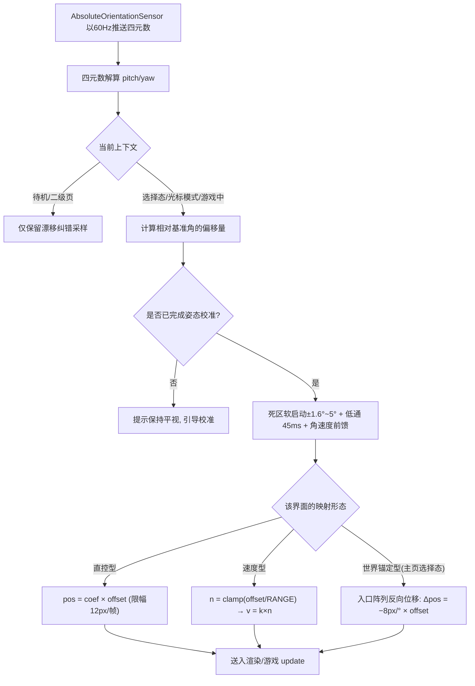
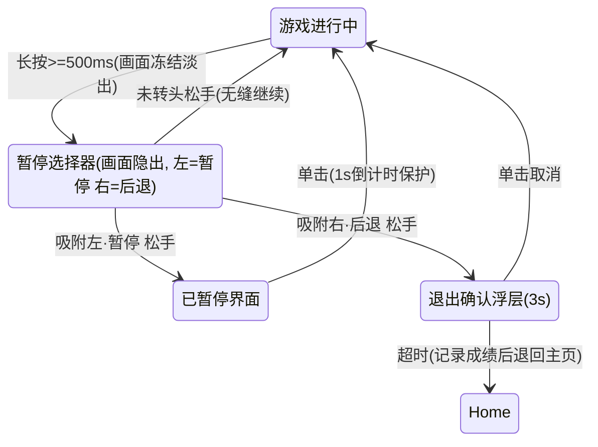

# PRD-06《打飞机》需求分册

| 文档信息 | 内容 |
| --- | --- |
| 分册编号 | **PRD-06** |
| 分册名称 | 《打飞机》Plane Shooter |
| 归属总章 | 《摇头晃脑需求说明书》V1.0（下称"总章"，文件路径 `摇头晃脑需求说明书.md`） |
| 分册版本 | **V1.0-r7**（本册第 7 次修订：**改为锚定型相机**——横向由"机体跟着头动"改为"机体恒钉屏幕中心 x=240、世界反向滑动"，根治真机眩晕；战场收窄为 **64~416（w=352）**、裁剪窗 **56~424**（v1.34）、窗外留白；列距 **56→40**、步进初速 **9→8px/s**、行程 **120→112px**；轰炸机下压 **50→32px/s**；纵向行程由 260px 收窄至 80px（y 242~322）；**v1.38：上行程 40 → 80（y 202~322），下行程与 home 不动；防线由 48% 虚线改为 1px 实线 48% + 两端 10px 竖刻度 72%**） |
| 编写日期 | 2026-08-29（r7 修订 2026-09-05） |
| 画面设计稿 | Ardot `722072020929730`（r4 十三屏 + 图例，**本期定稿依据**）；相对位移输入方案 `722148068486591`（v1.25）**仅存档、不在本期实现** |
| 目标平台 | Rokid Glasses（AIUI 平台） |
| 文档状态 | 初稿（待评审） |
| 需求编号前缀 | `F-PLN-*` |
| 开发优先级 | **P0**（总章 §12 / 附录 B） |

---

## 1. 分册定位与范围边界

### 1.1 本册职责（Own）

《打飞机》的**玩法本体**需求的唯一权威来源：**锚定型横向相机 + 纵向直控**映射规格、单关"编队歼灭战"波次结构、机型数值、投弹机制、生存与计分规则、本册专有 HUD 与视觉、音效清单、开源借鉴清单、本册专有验收标准。

**一句话定位**：竖版卷轴射击，**Space Invaders 经典"编队歼灭战"的单关复刻**——**五款中同屏实体最多、对相机与裁剪最敏感的一款**；操作压力全部集中在走位（自动射击）。

**单关化说明（2026-09-03 裁决）**：首发实现**仅一关**。选型经典原型而非自创波次表——① 老游戏规则十秒可讲清，普通用户零学习成本；② 经典波次久经验证，节奏张弛有度；③ 有 MIT 开源实现可直接借鉴改造（见 §6.4）。原三关机制**合并进单关四个段落**，难度在关内递进（同滚球迷宫单关化先例，总章 §5.6）。

**输入方案裁定（2026-09-04 用户裁决）**：曾就"头部不是摇杆、无法持续偏转"提出 **PRD-04 式相对位移改造**（AIM 准星对准 → PLAY 增量位移棘轮，锚点下移至 (240,288)），并已产出完整设计稿 `722148068486591`（v1.25 十五屏）。**该方案本期不实现，仅作存档**——理由是它是 AIM/PLAY 双态改造（新增对准态与增量棘轮），而本期目标是"先跑起来"。**本册继续以 §3 的锚定型横向相机 + 纵向直控为准**（r7 起，见 D-PLN-15）；PRD-04 的**相对位移**模型留待后续版本评估是否横向推广到 PRD-02/03/05/06。
>
> ⚠ **术语澄清**：v1.25 方案虽名为"相对位移"，但其**世界坐标系 + 相机**的外壳已在 r7 被采纳（锚定型相机），被搁置的是 **AIM/PLAY 双态与增量棘轮**这部分交互。二者不要混淆。

**首期实现范围**：见 **§6.5**。本期以"跑通完整一局"为验收目标，P1 入场动画与 P3 正弦横摆允许用简化实现替代（结构保留、算法降级），其余条款不变。

### 1.2 本册不负责（Out of Scope）

| 不在本册 | 归属 |
| --- | --- |
| 头动输入解算、死区滤波、坐标系约定 | 公共基线 §2.2（总章 §4.1/§4.3/§4.4） |
| 触控板单击/长按的原始判定 | 公共基线 §2.3（总章 §4.2） |
| 暂停选择器 UI 本体 | 公共基线 §2.4（总章 §5.7） |
| 主页环形八向入口、教学页、结算页、最高分存储格式 | PRD-01 |

### 1.3 总章条款映射

| 总章条款 | 本册落点 |
| --- | --- |
| §5.2《打飞机》需求 | §3 ~ §8（完整展开） |
| 附录 B 速查表·打飞机行 | §3 体感映射规格 + §6 单关结构 |
| §5.7 暂停选择器 | §2.4 + §8 接入要求 |
| §5.8 F-Sys-01/04/05/07 | §9 系统功能接入 |

---

## 2. 公共基线（继承自总章，只读引用）

> **单源原则**：本节摘抄自总章 §2 / §4 / §7 / §9，对全部 6 个分册生效，**逐字一致**。
> - 若本册与总章冲突，**以总章为准**并回写修正本册；
> - 若需变更本节任何数值，**必须先在总章修订，再同步全部 6 册**（流程见 §12.2）。

### 2.1 运行环境与技术约束（摘 总章 §2）

| 约束项 | 规格 |
| --- | --- |
| 应用框架 | AIUI（`.ink` 单文件组件格式 + `app.json` + `app.js` + `AGENTS.md`） |
| 屏幕类型 | **单绿色单色透明显示**（RokidGlasses1/2）：仅一个绿色发光通道叠加在透明黑底之上——纯黑即"透出现实"，不存在遮蔽现实的黑幕 |
| 应用宽度 | 固定 **480px**，不可变 |
| 推荐高度 | 120px ～ 352px，全屏参考尺寸 **480 × 352**；安全内边距横向 16px / 纵向 12px（有效内容区 **448×328**） |
| 视觉主题 | 官方单绿科学仪表风：6 级亮度阶梯（100/72/48/24/12/6%），1px 结构线，控件圆角 4px / 面板 6px；禁止大面积实色与装饰性 glow |
| 主渲染方式 | Canvas 2D 页面节点 + `wx.createCanvasContext(id)`；每帧 `clearRect → 矢量绘制 → flush()` 呈现；**无双缓冲语义、无 requestAnimationFrame**——游戏循环用 `setInterval` 固定节拍驱动 |
| Canvas 绘图限制 | `drawImage` 仅接受另一 `Canvas` 实例为源（离屏精灵可用 `new Canvas(w,h)` 自建）；`createPattern` 忽略传入图像不可依赖；fillStyle 仅支持 #rrggbb/#rgb/rgb()/rgba()/基础命名色 |
| IMU 数据源 | `AbsoluteOrientationSensor`（四元数）、`Gyroscope`、`Accelerometer`；frequency 参数为 best-effort 提示（建议请求 60Hz，不承诺保证） |
| 按键事件 | 页面级 `onKeyDown` / `onKeyUp`；触控板对应 `GlobalHook` 键码；默认行为拦截只对 `onKeyUp` 的 `preventDefault()` 生效 |
| 本地存储 | `wx.setStorageSync` / `wx.getStorageSync` |
| 音效 | `Sound`（短音效）、`AudioPlayer`（背景音乐），资源置于 `assets/audio/` |

### 2.2 输入引擎契约（摘 总章 §4.1 / §4.3 / §4.4）

#### 2.2.1 基准与相对偏角

以进入界面时静默采样的自然平视为**基准姿态**（中立位），一切输入均基于「当前姿态 − 基准姿态」的相对偏角。

#### 2.2.2 死区与滤波

1. **死区**：±1.6° 内视为中立——1.6~5° 走**软启动** `f(u)=2u²−u³`，>5° 线性跟随；
   > 交互 v1.23：旧版 3° 处输出从 0 跳到 3°（≈24px），"先不动再突跳"已消除。
2. **低通抑制**：时间常数 **τ=45ms**（按 dt 计算，与帧率解耦）；角速度 |ω| < 6°/s 且偏角 < 1.8° 的低幅高频抖动（说话、走路颠簸）直接抑制；
3. **互补融合 + 前馈**：陀螺积分抵消融合滞后（须先 220ms 同向准入），输出再叠加 clamp(0.022×ω, ±2°) 的前馈。详见 PRD-01 §05。

#### 2.2.3 坐标约定

屏幕 y 轴向下而抬头为负 pitch，统一取反保证「**抬头 = 向上**」的直觉。

#### 2.2.4 两种映射形态

| 形态 | 公式 | 手感 | 适用 |
| --- | --- | --- | --- |
| **直控型**（位置跟随） | `pos = coef × offset`，coef ≈ 8px/° | 头指哪、打到哪，零迟滞感 | 打砖块 / 接鸡蛋 / 导弹指挥部光标 / 滚球迷宫倾角（±15°） |
| **速度型**（摇杆拖拽） | `v = k × n`；`n = clamp(offset / RANGE, -1, 1)`，YAW_RANGE 30°、PITCH_RANGE 20° | 类似推摇杆的加速感，自带平滑缓冲 | **打飞机机身移动** |

#### 2.2.5 平滑约束

所有直控输出叠加**按时间的限速（游戏态 ≤1200px/s、选择/菜单态 ≤620px/s；滚球迷宫为倾角每帧 ≤2°）**，杜绝头部微颤导致实体高频抖动产生眩晕。
> 交互 v1.23：旧版「每帧 ≤12px」在 30fps 下只有 360px/s，是「转头迟钝」的最大单一来源。

#### 2.2.6 映射参数与灵敏度

| 界面/游戏 | 形态 | 轴数 | 有效量程 | 输出对象 |
| --- | --- | --- | --- | --- |
| 主页选择态图标阵列 | 世界锚定型（反向补偿） | 双轴 | 8px/° 反向位移 | 入口随头动反向移动；中心与屏显内容固定 |
| 打砖块 | 直控型 | 单轴 yaw | ±28° → 屏宽全幅 | 底部挡板水平位置 |
| 接鸡蛋 | 直控型 | 单轴 yaw | ±28° | 接蛋篮水平位置 |
| 滚球迷宫 | 倾角直控 | 双轴 | ±15° → 盘面倾角 | 小球受重力滚动 |
| 导弹指挥部 | 直控型 | 双轴 | ±30°（8px/°）夹紧边界 | 十字瞄准光标 |
| **打飞机** | **速度型** | **双轴** | **30°/20°** | **机体平面速度** |

灵敏度三档：**迟钝 ×0.75 / 标准 ×1.0 / 灵敏 ×1.3**，作用于各游戏 RANGE 与 coef，出厂默认**标准档**。

#### 2.2.7 校准与基准姿态管理（摘 总章 §4.4）

1. **两级基准**：主页**不预置基准**（待机态不消费头动输入，选择态以长按达成时刻的姿态为锚定原点）；进入任意游戏前执行**正式校准**——提示"请保持自然平视注视中央 2 秒"，采样 pitch/yaw 均值与方差作为本局基准；
2. **漂移纠正**：偏移回到死区且持续 >3 秒时，基准向当前姿态缓慢插值迁移（**明显偏离 ≤0.1°/s、静止在死区附近 ≤0.35°/s**），补偿长时间佩戴漂移；**直控型界面在波间/关卡过场等无输入压力期加速收敛，速度型界面（打飞机）在段落间隙与页面过场同样启用加速收敛；主页选择态会话短（≤15s），期间**冻结漂移纠正**，避免入口阵列缓慢爬移**；
3. **累计偏航保护**：本局基准累计迁移超过 **±45°** 时强制提示"请重新校准"；
4. **手动重校准**：游戏中经暂停选择器冻结画面后，单击触控板即可触发快速重校准流程；
5. **异常姿态保护**：校准时方差过大（用户未静息）则提示重试，不采用错误基准。

> **本作注意**：本作为速度型界面，按 §2.2.7-2（D-PLN-05 已裁决，总章 §4.4-2 已同步）**在段落间隙与页面过场同样启用漂移纠正加速收敛**，否则长时间游玩会出现"需要持续偏头才能维持中立"的漂移感。

#### 2.2.8 头动输入处理流程（摘 总章 §4.3）



### 2.3 触控板三态判定（摘 总章 §4.2）

| 物理操作 | 按键码 | 上下文 | 功能 |
| --- | --- | --- | --- |
| 触控板长按（≥500ms 激活） | `GlobalHook` | 主页 | 唤起"光标模式"（PRD-01 §4） |
| 触控板长按（≥500ms 激活） | 同上 | 游戏内 | ~~唤起"暂停选择器"（本册 §8）~~ → **【本册偏离 · r6】不绑定**（见下方注）；本册菜单入口为**滑动** |
| 触控板松开 | `GlobalHook` keyup | 主页/选择器中 | 完成选取确认：有点亮入口即确认；无点亮入口则取消 |
| **触控板单击（<300ms）** | `GlobalHook` + 时长判定 | **游戏内** | **发炮 / 发射 / 引爆（本作 = 投弹，最快响应路径）** |
| 触控板单击 | 同上 | 主页 | 显示引导文案 |
| 触控板单击 | 同上 | 二级页面 / 确认浮层 / 已暂停界面 | 确认 / 开始 / 恢复游戏 / 取消浮层 |
| 实体返回键 | `Backspace`（onKeyUp 中 `preventDefault()`） | 全局 | 返回上级菜单（游戏中弹"退出确认"浮层） |

**互斥判定时序**：按下后 <300ms 松手 = 单击；持续 ≥300ms 预约长按态（期间松手若 <500ms 仍按单击处理）；≥500ms 进入激活态并锁定语义直至松手。

> 长按的系统级默认行为必须在 `onKeyDown`/`onKeyUp` 阶段 `preventDefault()` 拦截并给出可见反馈。

> ⚠ **本册对该表的偏离（r6，D-PLN-14）**：本册声明 `tapRole: 'fire'`，**单击 = 投弹**（表中"游戏内 = 发炮/发射/引爆"一行），**菜单入口改由「滑动（四向任意）」承担**，**长按不绑定任何语义**。与导弹指挥部同构，复用 PRD-05 既有裁决（D-MSL-09 / F-MSL-72~73）。生效口径见 **§5.2 F-PLN-75~77 与 §8.1**。

### 2.4 游戏内暂停选择器（摘 总章 §5.7）

1. 游戏进行中长按触控板 ≥500ms → 画面**冻结，全部元素 globalAlpha 整体渐隐至 0.15（过渡 ≥200ms）**——降低元素自身亮度而非叠加黑色遮罩；
2. 屏幕浮现简化两向选择器（屏内直控光标）：仅 **左、右两个功能位 + 中央原点**，每功能位同时提供图形图标与文字标签——左位 = **暂停**（方块双竖线图标 + "暂停"）；右位 = **后退**（回折箭头图标 + "主页"）；
3. 选择器期间头部照常直控移动原点：
   - **吸附左位松手** → 持久"已暂停"界面（画面亮度恢复至 40% + "已暂停 · 单击继续"）；此后单击即恢复游戏（1 秒倒计时保护）；
   - **吸附右位松手** → 确认浮层"确定退回主页？当前进度将丢失（单击取消 / 3 秒后自动执行）"；超时记录本局成绩后返回主页；
   - **未转头直接松手** → 选择器淡出、亮度恢复、从冻结帧无缝继续（最高频路径）。



- 与主页选择态的差异：选择器为屏内直控光标（光标动、功能位固定），主页为世界锚定图标阵列（图标反向动、原点固定）；传感器解算与三态判定引擎共享，选择器无泛光激活态（出现即激活）；
- 长按阈值全端统一 500ms；**本作单击＝投弹，与长按在时间线上互斥判定**；
- 菜单期间传感器保持采样但游戏逻辑 tick 冻结；连续挂起 >60s 自动进入 B4 继续提示兜底。

> ⚠ **本册对该节的偏离（r6，D-PLN-14）**：上表"长按 ≥500ms → 暂停选择器"是总章 §5.7 的旧口径，框架交互 v1.22 后已由 **B2 二向菜单**（左「退回主页面」/ 右「重新游戏」，R=114）取代，且 **B2 在本册由「滑动」而非「单击」唤出**（单击已让位给投弹）。本册 §8.1 为唯一生效口径；§2.4 保留作总章条款的只读引用。

### 2.5 视觉与 UI 规范（摘 总章 §7）

#### 2.5.1 亮度阶梯与颜色常量

| 亮度级 | 值 | 用途 |
| --- | --- | --- |
| 100% | `#40ff5e` | 仅保留给：光标本体、当前吸附图标、得分关键数值、**投弹爆炸**等主动焦点 |
| 72% | `rgba(64,255,94,.72)` | 主可读文本、激活结构线、游戏实体描边 |
| 48% | `rgba(64,255,94,.48)` | 次要文本、常规交互边界、未吸附实体 |
| 24% | `rgba(64,255,94,.24)` | 分隔线、非选中引导线、待机态主页环形入口常态 |
| 12% / 6% | 相应 alpha | 局部分组底纹（最大正常面积填充为 12%） |

- Canvas 内不得引用 WXSS Token 名，直接使用上述常量；
- **禁止大面积 ≥24% 实色填充**；选区高亮 = 12% 底纹 + 72% 强调框 + 2px 焦点标记；
- **禁止绘制黑色遮罩层**——一切变暗通过降低元素自身 alpha 实现。

> **本作注意**：投弹扩散波最大半径 90px（直径 180px）。总章 §5.2 称炸弹为"**半径 8px 实心块**"，但扩散波须以**圆环描边 100% + 内部 ≤12% 填充**呈现。详见 F-PLN-33 与待决 D-PLN-04。

#### 2.5.2 版式与安全区

- 全画布 480×352，**有效内容区内缩：横向 16px、纵向 12px**；HUD、暂停选择器均须落在安全区内；
- HUD 条高 24px，字号阶梯：页面标题 22px/500、区块题 16px/500、正文 14px、密排 12px、标签 11px/500、数据值 monospace 13px；**同屏最多同时出现 3 个字级**；
- 圆角：控件 4px、面板 6px、圆点才可用全圆；1px 默认结构线宽，2px 只用于焦点强调；
- 每个语义状态至少双通道编码（文字标签 + 图形/线型变化）。

#### 2.5.3 渲染与动效细则

- **每帧渲染**：`clearRect → 矢量绘制实体 → flush()`；帧节拍 `setInterval`（30fps ≈ 33ms）；
- **精灵策略**：静态复杂图形（机型、敌阵图标）预绘到离屏 `new Canvas(w,h)`，主循环 `drawImage` 贴图；**本作同屏实体数最多（编队 + 弹幕 + 己机），是离屏优化的关键战场**（对应总章风险 R1）；禁用 `createPattern`；
- **动效时长**：120ms 快反馈 / 200ms 标准过渡 / 320ms 结构过渡；
- 光标/激活点允许 **≤8px 细微 bloom 点睛**；**同一屏只允许一个主导脉冲动效**；
- 所有 UI 文案禁用 emoji；关键文案 ≥72% 亮度。

### 2.6 渲染帧循环约定

传感器读数频率高于游戏帧率：输入引擎持续更新"最新意图快照"，游戏循环每帧合并一次，两者解耦；Canvas 无双缓冲语义，每帧以 `clearRect` 起手、`flush()` 收尾呈现。

```mermaid
sequenceDiagram
    participant H as 用户头部动作
    participant S as AbsoluteOrientationSensor(60Hz)
    participant IE as 输入引擎(InputEngine)
    participant T as 触控板(GlobalHook)
    participant GM as 打飞机游戏循环
    participant CV as Canvas 渲染器

    loop 传感器读数流(独立于游戏帧)
        H->>S: 转头/俯仰(双轴)
        S->>IE: reading 事件(四元数)
        IE->>IE: 解算→滤波→速度型映射(n=k×offset/RANGE)
        IE-->>GM: 缓存机体速度向量 (vx, vy)
    end

    loop 每个游戏帧(固定tick, setInterval驱动)
        T->>GM: 单击=投弹 ; 滑动=B2菜单 ; 长按=不绑定
        GM->>GM: 机体积分(限幅12px+加速度600)→自动开火→编队步进/俯冲/敌弹推进→碰撞→段落判定
        GM->>CV: clearRect→矢量绘制/离屏贴图→flush()
    end
```

### 2.7 非功能需求（摘 总章 §9）

| 类别 | 编号 | 要求 |
| --- | --- | --- |
| 性能 | NFR-01 | 帧率稳定 ≥ 30fps，输入到画面响应延迟 ≤ 100ms |
| 性能 | NFR-02 | 传感器高频订阅仅在游戏进行与选择器状态维持；离开页面 `stop()` 释放 |
| 功耗 | NFR-03 | 待机/二级页仅保留低频采样 |
| 健康 | NFR-04 | 舒适性条款（休息提醒、灵敏度档位、死区防误触） |
| 健壮性 | NFR-05 | 传感器权限失败或 error 事件时降级：自动进入"已暂停"保护状态并给出明显提示 |
| 存储健壮性 | NFR-06 | 读档 JSON 解析失败时静默重置为空档案，绝不崩溃 |
| 国际化 | NFR-07 | V1.0 仅简体中文文案（≤12 字/行） |

### 2.8 游戏框架页契约（前提性要求 · 五册统一）

> **定位**：本节是 `pages/game/game.js` **已落地的既有事实**（交互 v1.22），不是待实现项。五款游戏共用同一个框架页，任何一款游戏的画面都必须长在这个框架里。
> **效力**：本册 §4（视口与 HUD）与 §6.1（三区布局）的一切布局都是本节约束下的**实例化**；冲突时**以本节为准**并回写修正本册（§4.1 已据此纠正 F-PLN-10 / F-PLN-11）。
> **同步**：本节在五册中**逐字一致**（仅章节编号随各册排布不同）。任何变更必须先在 PRD-01《设计说明》修订，再同步全部 5 册。

#### 2.8.1 三层布局结构（自上而下）

| 层 | 区域 | 规格 | 归属 | 本册可否改写 |
| --- | --- | --- | --- | --- |
| ① **顶部标题栏** | HUD 条 y 12 ~ 36（h 24） | 左品牌胶囊 76×24 @(16,12) ｜ **中段空档 x 92 ~ 352** ｜ 右状态胶囊 110×24 @(354,12) | 框架页 `drawHud()` | 中段空档**可自由排布**；两胶囊**不可覆盖** |
| ② **游戏画面区** | `VIEWPORT = 448×296 @(16,44)`，即 x 16~464 / y 44~340 | 虚线框 1px @24% `[4,4]` + 四角外角标 12px @48%（1.5px）+ 四边中点 12px 刻度 @24% | 框架页绘框，**本册填内容** | 内容全归本册；边框/刻度**不可重复绘制** |
| ③ ~~左下操作提示条~~ | ~~`HINT (16, 316, h24)`~~ | — | 框架页 `drawHint()` | **【2026-09-03 用户裁定 · 已取消】**该行只是搭框架页时的占位，**真实游戏页不显示**；y 316~340 全部归还画面区（本册防线仍在 y=276，未占用该区；HUD 三段落在中段空档）。⚠ 五册逐字一致章节，本条由 PRD-03/04 先行修订，本册 **r6 同步追平**（PRD-02/05 待同步） |

#### 2.8.2 顶部标题栏的两处预留（硬性）

1. **左上品牌胶囊 = 游戏名**：框架页以 `drawHud(ctx, meta.name, …)` 写入 `utils/games.js` 中本册的 `name`（如「打飞机」）。**本册不绘制、不覆盖**——游戏名是框架资产，不是本册 UI。
2. **右上状态胶囊 = 状态信息**：默认承载框架自身状态（`IMU状态正常 / IMU状态异常`；圆点实心 = 正常，空心 = 异常；B3 loading 期间为 `状态：打开中`）。**本册可通过 `statusText()` 钩子改写为本局状态信息**（波次 / 剩余目标 / 弹药 / 剩余时间等）。
   - 挂载方式：在游戏实例上定义 `statusText()` 返回字符串；**未挂载时行为与默认完全一致**（可选钩子，不挂载不报错）。
   - **宽度上限**：胶囊 110×24 → 状态圆点圆心 x=368、文字左起点 x=378、胶囊右缘 x=464，**可用宽 ≈ 86px**。按 12/500 字号计，CJK 约 **7 字**、数字/拉丁约 **16 字符**；超长会被裁切。
3. **中段空档 x ∈ [92, 352]（262px）、墨中心 y = 24**：这是本册**唯一**的 HUD 自由度。得分 / 生命 / 进度 / 波次等游戏状态一律排布在此区间，**与两胶囊同基线（墨中心 y=24）**，不得越入 x<92 或 x>352。

#### 2.8.3 画面区硬约束（「画面信息都要落到画面区」）

| 编号 | 约束 | 说明 |
| --- | --- | --- |
| C-FRM-01 | 本册全部游戏元素（含判定盒、特效、飘字、临时提示、扩散波）**必须落在 VIEWPORT 内**（x 16~464 / y 44~340） | 越界即视觉溢出到 HUD 条。**扩散波最大半径 90px，故其圆心不得高于 y=134**（见 F-PLN-25 自动引爆线 y=144） |
| C-FRM-02 | **顶部**：HUD 条底边 y=36，画面区上沿 y=44，中间 8px 空档。**不得在 y 36~44 之间放置元素** | 编队区上沿 y=64 已预留 20px，无冲突 |
| C-FRM-03 | **底部**：~~左下提示条占 y 316~340，需要底边的本册底边应收到 y=308 或 y=316~~ → **【2026-09-03 裁定】提示条取消，画面区下沿 y=340 全部可用**。本册无"底边"类元素（敌阵为自由飞行体），实际由**机体夹紧下沿 y=322**（F-PLN-03）约束，与视口下沿留 18px 余量 | 与视口下沿留 8px 以上余量 |
| C-FRM-04 | **中央**：R=114 圆域（中心 (240,176)，覆盖 x 126~354 / y 62~290）是 B2 菜单活动区。该圆域**空间上无法避让**——编队区（y 64~132）、交战区（y 132~276）、机体夹紧区（y 62~322）**全部与之重叠**。冻结期"不冲突"的**唯一前提是亮度分层**：菜单期间本册元素由框架 `fadeTo` 退至次要层（见 §2.8.4），故**无需做空间避让** | 见 §2.8.4 |
| C-FRM-05 | 画面区边框、四角外角标、四边中点刻度**由框架页绘制**，本册**不得重复绘制** | 重复 = 双线叠加发亮 |

#### 2.8.4 状态机与本册的冻结契约

| 框架态 | 触发 | 本册被调用 | 画面处理 |
| --- | --- | --- | --- |
| `B1 PLAY` | 进入 / 回场 | `update(dt)` + `render()` | 正常推进，本册元素按 §4/§5 各档位原亮度 |
| `B2 MENU` | 游戏中单击 | **仅** `render()` | 冻结；本册元素由框架经 `fadeTo(a, MENU_FADE)` **退至次要层**（`MENU_FADE = 0.55`，见下方换算表）。**框架资产（HUD / 视口框 / 角标 / 刻度）与菜单元素保持原亮度** |
| `B3 LOADING` | 菜单点亮项确认 | **仅** `render()` | 冻结；沿 `launchFade()` 节拍曲线收束至 **6% 隐藏档**（最短 360ms 后执行导航 / 重置） |
| `B4 CONT` | 菜单未点亮单击 / 挂起 15s 超时 | **仅** `render()` | 冻结；瞬时收束至 **6% 隐藏档**；3s 倒计时归零或单击 → 回 PLAY |

**`MENU_FADE = 0.55` 换算表**（`fadeTo(a, f) = a + (0.06 − a) × f`，保留本册内部层级关系）：

| 本册元素 | 常态 | B2 MENU |
| --- | --- | --- |
| 己方机体描边、投弹弹体 | 100% | **48%** |
| 三种敌机描边、己方子弹 | 72% | **36%** |
| 敌方子弹 | 48% | **24%** |
| 防线（**v1.38 改实线**：1px @48% + 两端 10px 竖刻度 @72%，取代原 `[7,5]` 虚线） | 48% | **24%** |
| HUD 次要说明文字 | 24% | **14%** |
| 敌机内部填充、编队区底纹 | 6% | 6%（已在最低档，不参与收束） |

- **为何不用 6%**：6% 是"画面退场档"，语义为本局即将离场（B3 导航 / B4 恢复）。B2 是**暂停快选**，玩家需看着场上局势（编队压到哪、还剩几架）决定继续还是重开，降到 6% 等于抹掉决策上下文；且与菜单的 100% 落差过大，回场时会有突兀的亮度跳变。取 0.55 后菜单与本册约 **2:1** 对比，主次清晰且回场无跳变。
- **框架资产不参与 B2 收束**：视口框（24%）/ 四角角标（48%）/ 四边刻度（24%）是"容器"而非"内容"，B2 期间恒亮，否则画面边框散架、失去区域界定。B3 / B4 因整体退场，框架与本册**同步**收束至 6%。
- ⚠ **代码现状（2026-09-03 核对）**：`pages/game/game.js:384` 的 `fade` 在 B2 MENU 态取 **0**（`fadeTo(a, 0) = a`，即完全不降），与本表规定不符；且该 `fade` 同时作用于 `drawPlayfield`（框架资产）与未来接入的本册渲染，未做拆分。**接入本册前需在框架页拆出 `frameFade` / `fieldFade` 两个参数**。
- ⚠ 五册逐字一致章节，本条由 PRD-03/04 先行修订，本册 **r6 同步追平**（PRD-02/05 待同步）。

- **时钟**：本册内部计时必须基于 `update(dt)` 累加的 `g.t`，**禁用 `Date.now()` 与任何定时器**——冻结期自动暂停、恢复时自动续算，无需显式 freeze / resume。
- **变暗**：一律由框架页 `fadeTo` 处理，本册**不得自绘遮罩或自行降 alpha**。
- **音效**：本册**不得直接 import sfx**；`update()` 返回事件数组，由框架页负责播音。
- **B2 二向菜单**：固定两项——左「退回主页面」/ 右「重新游戏」（`kind: 'system'` 的入口为「重新进入」），R=114，点亮阈值 48px，15s 无确认经 B4 回场。本册**不实现任何选择器 UI**。

#### 2.8.5 本册可覆写的钩子（其余一律归框架）

| 钩子 | 用途 | 缺省 |
| --- | --- | --- |
| `statusText()` → string | 改写右上状态胶囊文案（本局状态信息） | `IMU状态正常 / IMU状态异常`；B3 期间 `状态：打开中` |
| `render(ctx, …)` | 绘制画面区内容 | 占位文案「功能框架占位 · 分册实现后覆盖」 |
| `result()` → `GameResult` | 结算数据 | 见下方 GameResult 契约 |

> **GameResult 契约**：`{ score, cleared, reachedLevel, durationSec, motion{yawUtil, pitchUtil, yawAmpDeg, pitchAmpDeg, tapCount, tapLatencyMs}, extra[] }`。
> `motion` 由框架页 `InputEngine.stats.toMotion()` 统一写入、`durationSec` 由框架页计时——**本册只负责 `score`、`cleared`、`reachedLevel` 与 `extra[]`**。`extra` 每项 label ≤ 6 字。

#### 2.8.6 提示条文案五态 ——【2026-09-03 裁定】本册画面已取消提示条

> ⚠ **本节对本册失效**：用户裁定左下操作提示条只是搭框架页时的占位，**真实游戏页不显示**，y 316~340 全部归还画面区。
> 下表五态文案**仍属框架资产**（`pages/game/game.js` 的 `render()` 末尾按态取值、无条件调用 `drawHint()`），仅在**本册画面上不呈现**。要真机消失须改框架（按模块声明跳过，代码侧本轮**未**改动）。
> ⚠ 五册逐字一致章节，本条由 PRD-03/04 先行修订，本册 **r6 同步追平**（PRD-02/05 待同步）。

| 框架态 | 提示条文案（保留 · 本册不呈现） |
| --- | --- |
| PLAY | 单击触控唤出菜单 |
| MENU · 有点亮项 | 单击触控确认选择 |
| MENU · 无点亮项 | 转头选择，单击返回游戏 |
| B4 CONT | 单击触控立即继续 |
| B3 LOADING | 正在打开… |

---

## 3. 体感映射规格（本册专有，**本作实现重点**）

> ⚠ **r7 改版：由"速度型双轴"改为"锚定型横向相机 + 纵向直控"（D-PLN-15）**
>
> **动因（真机实证）**：r6 的速度型双轴下，机体随头部**同向**在屏幕上移动。眼镜屏随头动，**屏幕上有东西跟头同向移动正是眩晕主因**。用户 2026-09-05 明确要求改为"机体恒钉屏幕中心、画面反向滑动"。该结论与 PRD-02 打砖块（v1.28）、PRD-03 接鸡蛋（v1.29）**同源**，本册不再另立口径。
>
> **代价与收益**：横向自由度由"机体在 412px 内移动"降为"画面在 ±164px 内滑动"，绝对值不变、参照系反转；换来的是屏幕中心永远有一个**不动的锚点**，前庭冲突消失。

| 参数 | 取值 | 说明 |
| --- | --- | --- |
| **横向映射形态** | **锚定型相机** | 机体**恒钉屏幕中心 `x = 240`**；`camCx = clamp(240 + SEM_FOLLOW × snap.x, 76, 404)`，世界层整体 `translate(dx)`，`dx = 240 − camCx` |
| **纵向映射形态** | 直控（跟随头动） | `planeY = clamp(282 − dy, 202, 322)`；`dy = snap.y ≥ 0 ? min(snap.y × 0.62, 80) : −min(−snap.y × 0.31, 40)` |
| **横向行程** | **TRAVEL = 352/2 − 24/2 = 164px**（`dx ∈ [−164, +164]`） | 由战场宽与机体宽算出，**代码内计算不写死** |
| **纵向行程** | **120px**（y 202 ~ 322，home 282；**上 80 / 下 40**） | 原 260px → 80px（D-PLN-18）；**v1.38 用户反馈"飞机能飞得更高、最好到屏幕一半高"** → 上行程 40 → **80**（机身上缘 190 ≈ 画面区中线 192）。**下行程 40 与 home 282 一律不动** —— 反应窗 0.875s 是 §6.3 联立解 |
| **战场** | **x 64 ~ 416（w = 352）**，明显窄于视口 448 | 两侧各留 48px 恒为空白（D-PLN-15） |
| **裁剪窗** | **【v1.34】x 56 ~ 424**（战场 ± 墙厚 8px） | 严格窄于视口 16~464；越窗内容直接消失 → **墙外留白** |
| **边界墙** | **世界层**，随画面滑动；**8px 羽化收边带**（内侧面最亮 ≈40% → 向外 22% / 13% / 5%） | 墙即"战场到此为止"的物理边界，滑出窗即被裁掉；v1.34 由「3px 底纹 + 1px / 72% 亮线」改版，降亮度 + 去"单根细线"的粗糙感 |
| **量程/平滑** | 沿用输入引擎（YAW 30° / PITCH 20°、三档灵敏度、死区 ±1.5°） | 相机无速度积分，微颤不累积，无需额外限幅 |
| **离屏指示器** | 轰炸机滑出裁剪窗时贴对应屏幕边给方向三角 | 只标方向不标距离（否则"看不见就输"） |

| 编号 | 要求 |
| --- | --- |
| **F-PLN-01** | 横向：`camCx = clamp(240 + SEM_FOLLOW × snap.x, 76, 404)`，其中 **`SEM_FOLLOW = −1`（全项目统一，不得本册自定）**；`snap.x > 0`（头左转）→ `camCx` 减小 → `dx` 增大 → **世界右滑**。⚠ **永远不要改 `input.js` 的 SIGN**，只在本册乘 `SEM_FOLLOW` |
| **F-PLN-02** | 纵向：`planeY = clamp(282 − dy, 202, 322)`，`dy = snap.y ≥ 0 ? min(snap.y × upScale 0.62, 80) : −min(−snap.y × downScale 0.31, 40)`。⚠ **上下行程不等 ⇒ 必须分别标定**：共用 vscale 会让下向在半程就顶到 322，后半个 pitch 行程无响应。⚠ **`snap.y`（pitch）符号尚未真机标定**——若真机上下反向，改 `PLANE_Y.vscale` 或在此处取反，**不要动 `input.js`** |
| **F-PLN-03** | **机体屏幕坐标恒为 `(240, planeY)`**，任何相机位都不变；相机中心 `camCx` 夹紧在 **`[76, 404]`** = `[64+12, 416−12]`（战场缘 ± 机体半宽 12）。**r6 的 `[34,446] × [62,322]` 横向夹紧随相机化作废**（横向已无"机体出界"概念，改用相机夹紧） |
| **F-PLN-04** | 正式校准后进入本作；**进入 B2 菜单时重校准 + 冻结漂移**（`engine.resetBase()` + `freezeDrift(true)`，F-PLN-27）。段落间隙的漂移纠正加速收敛本期**延后**（§6.5 ③） |
| **F-PLN-05** | 世界层绘制必须包裹在 `ctx.save() → ctx.rect(56, 44, 368, 296) → ctx.clip() → ctx.translate(dx, 0) → … → ctx.restore()` 内（v1.34：裁剪窗随墙带由 61/358 改为 56/368）。**裁剪窗严格窄于视口**是"墙外留白"的唯一实现路径 |
| **F-PLN-06** | 分层规则：**HUD / 机体 / 离屏指示器 / 文字 = 屏幕固定层**（不随相机平移）；**场地横线 / 边界墙 / 敌机 / 敌弹 / 己弹 / 炸弹 / 扩散波 / 碎屑 = 世界层**（随相机平移） |
| **F-PLN-07** | 轰炸机滑出裁剪窗（`sx < 61` 或 `sx > 419`）时，在对应屏幕边内侧 8px 处画 4×6px 方向三角（72% 亮度），y 取轰炸机 y 并夹紧在 `[50, 334]` |

**体感特殊点（改版后的操作压力分布）**：

- **屏幕中心成为稳定锚点**：机体不动 → 玩家的视觉参照系稳定，前庭冲突由"整屏跟头动"降为"背景滑动"，与打砖块 / 接鸡蛋同源；
- **战场必须明显窄于视口**：若战场宽度接近视口（如 r6 的 412px 活动区），玩家看到的两侧边界墙会**贴着屏幕两侧**，转头时"边界墙跟着头走"的错觉依旧，收窄到 352px（两侧各 48px 空白）后边界成为明确的画面内物体（D-PLN-15，这是 v1.26/27 连错两次的根因教训）；
- **横向让位是主要躲避手段**：敌弹垂直下落，横向滑动 14px 即可让开（0.04s @360px/s），纵向 80px 行程仅用于微调与对齐弹道；
- **边界墙属世界层而非屏幕层**：墙是"球/敌机的反弹面与失守参照"，必须跟战场一起滑，否则玩家会以为墙是眼镜框。

---

## 4. 视口与 HUD（本册专有）

| 编号 | 项 | 规格 |
| --- | --- | --- |
| F-PLN-10 | 视口 | **画面区 `VIEWPORT = 448×296 @(16,44)`**（x 16~464 / y 44~340）——**不是 480×352 全屏**：顶部 HUD 条（y 12~36）归框架页所有，本册元素不得进入（§2.8.3 C-FRM-01~02）。**左下提示条已取消**，y 316~340 全归游戏（§2.8.1 ③）。编队区 / 交战区 / 防线三区见 §6.1 |
| F-PLN-11 | HUD | 顶部 **24px**（y 12～36）：左品牌胶囊（游戏名，**框架绘制**）｜**中段空档 x 92~352：得分 / 生命图标 ×3 / 投弹余量 三段一律排布于此**｜右状态胶囊（**本册经 `statusText()` 改写为「剩余 N」**，见 F-PLN-16）。三段墨中心 y=24，与两胶囊同基线（§2.8.2 第 3 条）；原稿「得分（左）/ 生命（中）/ 投弹（右）」易被误读为占用左右胶囊，已纠正 |
| F-PLN-12 | 己方机体 | 碰撞盒 **20×20px**；绘制为 24×24px 机形描边（碰撞盒略小于视觉，宽容处理） |
| F-PLN-13 | 敌弹 | **碰撞半径 4px**；绘制为 r=3px 圆点 + 1px 短拖尾（视觉略小于判定，符合"子弹判定点"惯例） |
| F-PLN-14 | 生命图标 | 三个小机形图标 + 数字双通道编码，72% 亮度 |
| F-PLN-15 | 投弹余量 | 数字 monospace 13px + 小方块图标，**≤1 时提亮至 100%** |
| **F-PLN-17** | **状态胶囊** | 本册**挂载 `statusText()`**，返回 **`剩余 N`**（N = 编队存活数 + 轰炸机存活数，0~19）。实测宽 40px < 可用宽 86px，安全。不挂载时框架回落显示 `IMU状态正常 / IMU状态异常`（三级回落：`statusText()` > B3「状态：打开中」> IMU）。⚠ 必须加 `typeof this.statusText === 'function'` 守卫——render 期抛错会导致整帧卡死 |

> 枪等级 HUD 项（原 F-PLN-16 编号）随武器成长系统裁撤而删除（D-PLN-10，见 §5.3）；**该编号不再复用**，状态胶囊改用 F-PLN-17。

> ⚠ **v1.22 口径纠正（与 §2.8 框架页契约对齐）**
> 1. **F-PLN-10** 原写「480×352 全屏」，与画面区契约冲突——顶部 HUD 条是**框架资产**，本册不可占用。现明确为 `VIEWPORT = 448×296 @(16,44)`。（左下提示条已于 2026-09-03 裁定取消，r6 同步，见 §2.8.1 ③）
> 2. **F-PLN-11** 原写「得分（左）/ 生命（中）/ 投弹（右）」，字面会占满整条 HUD（含左右胶囊区）。现明确三段**全部落在中段空档 x 92~352**。
> 3. ✅ **F-PLN-03 已裁决（D-PLN-11，2026-09-04）**：原夹紧 `[18, 462] × [46, 330]` 按 **480 全屏 + 8px 死区**推算，与画面区契约冲突。现定为 **`[34, 446] × [62, 322]`**（画面区缘 + 8px 死区 + 碰撞盒半宽 10px），与设计稿 `722072020929730` **S13 几何标注实测一致**。纵向活动高度由 284px 缩至 **260px**，§6.3 可躲性已复核**仍成立**（敌弹反应窗取决于落程 144px，与活动高度无关）。
>    ⚠️ **该裁决的横向部分已于 r7 作废（D-PLN-15）**：改锚定型相机后机体屏幕 x **恒为 240**，横向不再有"机体夹紧"概念，改由**相机中心 `camCx ∈ [76, 404]`** 夹紧。**纵向部分保留但收窄为 `[242, 322]`**（D-PLN-18，260px → 80px）；**v1.38 再放宽为 `[202, 322]`**（上行程 40 → 80）。以 §3 F-PLN-02/03 为准。

---

## 5. 机型与武器系统（本册专有）

### 5.1 敌方机型（复用原三机型，映射进编队角色）

| 机型 | 血量 | 分值 | 编队角色 | 运动方式 |
| --- | --- | --- | --- | --- |
| **侦察机** | **1** | **10 分** | 编队第 2、3 排（共 **12 架**） | 随编队横移步进；P3 段参与俯冲 |
| **攻击机** | **2** | **30 分** | 编队第 1 排（共 **6 架**） | 随编队横移步进；P3 段为俯冲主力（正弦横摆，**摆幅 40px**） |
| **轰炸机** | **5** | **80 分** | **压轴机 ×1**（P3 入场，不入编队） | 缓慢直线下压 **v = 32px/s**，**被撞时我方损 2 点生命**（D-PLN-03 已裁决；速度 50→32 见 D-PLN-17） |

> **【v1.39 剪影精修 · 四种机体统一补内部构造线】**
> 22~40px 的机体在 480×352 上**只有外轮廓时是一团模糊多边形** —— 分不清侦察机 / 攻击机 / 轰炸机，也看不出机头朝向。故每型补 3~4 条**两顶点内部构造线**（相对机体中心，1px）：
>
> | 机型 | 构造线 | 亮度 |
> |---|---|---|
> | 侦察机 | 机身中轴 + 座舱横杠 + 两道翼根缝 | 中轴 / 座舱 **48%**，翼缝 **24%** |
> | 攻击机 | 机身中轴 + 机头尖 + 两道外翼缝 | 中轴 / 机头 **48%**，翼缝 **24%** |
> | 轰炸机 | 机身中轴 + 座舱横杠 + 两道长翼缝 | 中轴 / 座舱 **48%**，翼缝 **24%** |
> | **己方机体** | 座舱中轴 + 两道机翼前缘 + 尾喷口横杠 | 中轴 / 尾喷口 **48%**，翼前缘 **24%** |
>
> 构造线亮度按机体整体 alpha 缩放：入场淡入 `intro`、无敌期 `P48`（0.48）同进同退。
> ⚠ **构造线一律为 2 顶点** —— harness A15a 靠「**11 顶点的 poly**」定位己方机体，内部细节不得凑巧也是 11 顶点（会顶掉 `find` 结果）。

| 编号 | 要求 |
| --- | --- |
| F-PLN-20 | 三种机型的碰撞盒与绘制需具备**形状双通道区分**（侦察机=小三角 / 攻击机=蟹形双翼 / 轰炸机=宽体双 engine，非仅亮度区分） |
| F-PLN-21 | 攻击机俯冲轨迹为正弦横摆，摆幅（峰峰值）40px，横摆速度与编队剩余数联动（§6.2 P3） |
| F-PLN-22 | 轰炸机下压速度 **32px/s**（原 50px/s，**r7 由 D-PLN-17 改**：50px/s 下从入场到防线仅 4.5s，而击落它至少需 2s 输出 + 对齐时间，容错过窄；32px/s → **6.97s**），血厚 5 点，是投弹的主要使用场景；**下压不回编队、不参与横移**；抵达防线同样触发失守判定 |

### 5.2 己方操作

| 编号 | 操作 | 行为 |
| --- | --- | --- |
| F-PLN-23 | **头部双轴** | **横向 = 锚定型相机**（画面反向滑动、机体恒钉 240）；**纵向 = 直控上下机动**（y 202~322，home 282）。两轴**独立、无耦合项**（见 §3 F-PLN-01/02） |
| F-PLN-24 | **自动射击** | 飞机**始终自动开火，玩家零操作**——操作压力全部集中在走位上 |
| F-PLN-25 | **单击** | **投弹**：机头前方（**屏幕上方**）立即生成一枚炸弹，半径 **8px 弹体**（按 §2.5.1 实心实体规则绘制），**v = 200px/s**；**触敌即引爆**，未命中则上行至 **自动引爆线 y = 144**（= 画面区上沿 44 + 100px，即"距上边界 100px / 飞出前 0.5s"）处自动引爆为扩散波（**半径 12 → 90 → 0px，扫过即毁**），清空前进路径上的敌机与敌弹。**D-PLN-12 已裁决**：引爆线取画面区坐标而非屏幕坐标，否则 y=100 会落入 HUD 条、且扩散波上缘（144−90=54）会溢出画面区 |
| F-PLN-26 | **投弹补给** | **本关开局补给 2 枚，失败重开时重置**（单关化，D-PLN-02"同屏 ≤1 枚"维持不变） |
| **F-PLN-27** | **滑动（四向任意）** | **唤出 B2 二向菜单——本作游戏中菜单的唯一入口**。（r6 修订：原写"长按 ≥500ms 唤起暂停选择器"，但单击已被投弹占用、而框架 v1.22 的菜单入口是单击，二者直接冲突。现**复用 PRD-05 已裁决的 `tapRole: 'fire'` 分流**，与导弹指挥部同构，见 §8.1） |
| F-PLN-28 | 返回键 | 弹"退出确认"浮层，防误退 |
| **F-PLN-75** | **tapRole 声明** | 本册 `GameManifest` 声明 **`tapRole: 'fire'`**（缺省 `'menu'`）。PLAY 态：**单击 → `bomb()` 投弹**；**滑动（四向任意）→ 唤出 B2 菜单**。`'menu'` 类游戏行为零影响 |
| **F-PLN-76** | **滑动后单击保护** | 菜单经滑动唤出后 **300ms 内的单击忽略**（复用 `TOUCH.swipeSuppress` 语义），防"滑动 + 手指残留误触"直接点亮菜单项 |
| **F-PLN-77** | **长按** | 本作**不绑定**长按语义（`tapRole='fire'` 下菜单已走滑动）。长按不得触发任何游戏动作，也不得误进导航 |

> ⚠ **r6 缺口修补（D-PLN-14）**：r5 及以前本册只写了"单击 = 投弹"（§2.3 / F-PLN-25 / §10"连点不误触导航"），却**从未定义 B2 菜单的入口**——而框架 v1.22 的默认入口正是单击。该缺口在 §11"高频连点投弹不误触选择器"一条上自相矛盾（选择器根本无法唤出）。r6 采用 PRD-05 的既有裁决 `tapRole: 'fire'`（D-MSL-09 / F-MSL-72~73），**不新增框架概念**。

> **炸弹方向释义（D-PLN-01 已裁决，总章 §5.2-3 已同步；引爆线由 D-PLN-12 于 2026-09-04 裁决为画面区坐标）**：炸弹沿**机头前方（屏幕上方）**以 200px/s 前进；命中敌机/敌弹立即引爆；未命中则在**自动引爆线 y = 144**（画面区上沿 44 + 100px）处自动引爆。
>
> **引爆线的三重约束**：① 保 C-FRM-01——扩散波最大半径 90px，圆心 y=144 时波上缘 y=54，仍在画面区（y≥44）内；② 与"距上边界 100px / 飞出前 0.5s"原口径一致（200px/s × 0.5s = 100px）；③ 机体最低可至 y=322，弹体行程最长 178px ≈ 0.89s。

### 5.3 自动射击（单关简化，裁撤枪级成长）

| 编号 | 要求 |
| --- | --- |
| F-PLN-30 | **枪级成长系统（原 G0/G1/G2 与双发枪/护盾道具）整建制裁撤**（D-PLN-10 已裁决）：单关约 90 秒内成长线无展开空间；经典原型（Space Invaders）本身无成长系统；裁撤后操作焦点完全回归头部走位 |
| F-PLN-31 | 全程 **G0 基准火力**：单发直线弹，伤害 1，**每 0.4s 一发**；己方子弹弹速 **300px/s**、碰撞半径 3px |
| F-PLN-32 | 己方子弹与敌机 AABB 碰撞判定；**己方子弹不与敌弹对消**（经典规则：各走各的，躲避靠走位） |
| F-PLN-33 | 投弹与扩散波按总章 §7.1"实心实体统一落地规则"以**描边 100% + 内部 ≤12% 填充**呈现，随半径增大描边 alpha 递减；**同屏同时最多 1 枚炸弹在飞**（D-PLN-02/04 已裁决） |

---

## 6. 关卡结构（本册专有，**单关**）

### 6.1 经典原型与三区布局

**原型：Space Invaders（1978，太东）第一波"编队歼灭战"**——史上最经典的射击关卡：敌方编队横移步进、触边下压，**每击落一架全队快一分**，编队压到底线即失守。选型理由：① 规则十秒可讲清（"打光编队即胜，编队压到防线即败"），普通用户零学习成本；② 节奏张弛久经验证；③ 有 MIT 开源实现可直接借鉴（§6.4）。

单关画面三区（480×352）：

| 分区 | y 范围 | 用途 |
| --- | --- | --- |
| **编队区** | 64 ～ 132 | 敌机编队锚定位（**列距 40px**、排距 34px，横移步进在此区间往返） |
| **交战区** | 132 ～ 276 | 敌弹、己方子弹、俯冲轨迹、轰炸机下压通道 |
| **防线** | **y = 276** | **失守判定线**：**【v1.38 换样式】1px 实线 @48% + 两端 10px 竖刻度 @72%**（原 `[7,5]` 虚线：① 单绿 1px 下碎成点阵发脏；② 虚线已被"被毁城市残影"占用，语义撞车）。任意编队敌机（不含俯冲中）下缘触及即失守（§7 F-PLN-53）。⚠ **它不是机体高度上限** —— 机体 y ∈ [202,322] 会穿过这条线（§7 F-PLN-23） |

**战场（相机版新增概念，r7）**：世界层可用宽度 = **战场 `x 64 ~ 416`（w = 352）**，纵向 `y 44 ~ 336`。战场**明显窄于视口 448**（两侧各 48px 恒为空白）。裁剪窗 = 战场 ± 墙厚 8px = **`x 56 ~ 424`**（v1.34：边界墙由「3px 底纹 + 1px/72% 亮线」改为 **8px 羽化带**）。

> ⚠ **战场必须窄于视口**（D-PLN-15）：战场若接近视口宽度，两侧边界墙会贴住屏幕边缘，转头时"墙跟着头走"的错觉依然存在，眩晕治不干净。预留两侧各 48px 空白后，边界墙成为画面内一个明确的、会随头滑动的物体。

**编队锚位几何（列距 40）**：列心 `x = 240 + (i − 2.5) × 40`，i = 0..5 → **140 / 180 / 220 / 260 / 300 / 340**；排心 `y = 64 / 98 / 132`。敌机外接 24×20 → **编队包围盒 W = 5×40 + 24 = 224px**（x 128 ～ 352）。

**横移轨道（固定，不随存活列收缩）**：触边留 8px → 包围盒活动区间 `x ∈ [184, 296]`（宽 112px）→ **单程行程 D = 296 − 184 = 112px**；编队中心初始 x=240，首半程（240 → 296）**56px**，其后每个整程 112px。固定轨道的意义：击落后编队变窄，若按存活列重算包围盒，行程会反向变大、抵消"越打越快"的提速，压迫感反而消失。

**机体**：屏幕坐标恒为 **`(240, planeY)`**，`planeY ∈ [202, 322]`（home 282，上行程 80 / 下行程 40）。**机体可穿越防线上下移动**（防线只约束敌机，不约束己机）。相机中心 `camCx ∈ [76, 404]`，`dx = 240 − camCx ∈ [−164, +164]`。

### 6.2 单关四段落（合并原三关机制，难度关内递进）

**编队总兵力 18 架：第 1 排攻击机 ×6（顶）＋ 第 2、3 排侦察机 ×12。总分 300 ＋ 压轴轰炸机 80 ＝ 380 分封顶。全程约 60～90 秒。**

| 段落 | 时长 | 内容 | 继承自原 |
| --- | --- | --- | --- |
| **P1 入场**（0～12s） | ~12s | 侦察机走**左路斜线**、攻击机走**右路斜线**依次飞入编队区锚定位（相邻机错开 200ms 出发，带横向分量）；入场期间即受击、即投弹 | 原第 1 关"交错斜落"转为入场动画 |
| **P2 行进歼灭**（就位 ～ 编队剩 6 架） | ~40s | **经典横移步进**：编队整体 **8px/s** 横移，触侧边（轨道 184/296，即战场缘留 8px）整体下移 **16px** 并反向；**每击落 1 架，步进速度 +3%**（封顶 24px/s）——经典"越打越快"；最底部列随机投弹 | 原第 1 关"整列齐落"阵型 + 经典步进 |
| **P3 俯冲强袭**（编队剩 ≤6 架触发） | ~20s | **压轴轰炸机**从屏顶入场（5 血、缓慢下压）；残存敌机开始**周期性俯冲**（正弦横摆摆幅 40px，飞行中可投弹），飞出屏底后从屏顶**回归编队空位**；间隔 = 3.5s ÷（1 + 剩余数 × 0.1） | 原第 2 关攻击机横摆 + 原第 3 关终盘压力 |
| **通关** | — | **编队 18 架 + 轰炸机全灭** → 结算 `cleared=true` | 原第 3 关"击破 Boss 即通关" |

| 编号 | 要求 |
| --- | --- |
| F-PLN-40 | **仅 1 关**，全程约 60～90 秒；四段落单向推进，**不循环、不续波**（单关化裁决 D-PLN-08） |
| F-PLN-41 | 编队锚定与步进几何如 §6.1/§6.2：**列距 40px**（r7 由 56 改，见 D-PLN-16）、排距 34px、下移步长 16px、**初速 8px/s**（r7 由 9 改）、**每杀 +3%**、封顶 24px/s（18 架全灭时 `1.03¹⁸ = 1.70` → 峰值 13.6px/s，封顶不触及，仅作参数保险）、**单程行程 112px**、**触边 9 次失守**。横移速度按存活数实时计算，**轨道固定不重算**（§6.1） |
| F-PLN-42 | P2 投弹规则：**由当前编队最底部一列随机一架**投弹（经典规则），基础间隔 **2.2s**，每击落 3 架缩短 0.15s，下限 **0.8s**；敌弹弹速 **120px/s**，每击落 5 架 +10px/s，封顶 **160px/s**（保证相机型机体可躲，见 §6.3） |
| F-PLN-43 | P3 俯冲规则：同一时刻**最多 2 架**在俯冲（防弹幕失控）；俯冲敌机血量不变、可被击落；轰炸机**不俯冲、不横移**，只直线下压 |
| F-PLN-44 | **投弹的战术定位**：P3 阶段轰炸机血厚 + 弹幕变密，投弹（扫过即毁）是主要的应急清屏资源；P2 阶段可用于快速撕开底部一列 |
| F-PLN-45 | 段落切换（P1→P2、P2→P3）各保留 ≥200ms 过场（结构过渡档），期间**启用漂移纠正加速收敛**（F-PLN-04） |
| F-PLN-46 | 通关后敌弹与俯冲立即清场，机体 100% 提亮 320ms 后进结算（胜利路径） |

### 6.3 难度自洽核验（r7 按相机版战场重算 · D-PLN-13 / D-PLN-16）

> ⚠ **本节已按 r7 相机版战场整体重算**。历次核算的边界条件变化如下，结论是**列距与步进初速必须联立求解、且以"失守时长"为反推目标**——这是本册连续三次（r5 列距 72 / r6 列距 56 / r7 列距 56 撞上相机战场）踩同一个坑的教训。
>
> | 版本 | 可用宽度 | 列距 | 包围盒 | 行程 | 初速 | 满编不杀失守 |
> | --- | --- | --- | --- | --- | --- | --- |
> | r5 | 424（画面区 − 2×12） | 72 | 384 | 40 | 24px/s | **15s（必失守）** |
> | r6 | 424 | 56 | 304 | 120 | 9px/s | 113s |
> | **r7** | **336（战场 352 − 2×8）** | **40** | **224** | **112** | **8px/s** | **119s** |
>
> r6 的参数在 r7 直接**不成立**：相机版战场只有 352px，列距 56 时包围盒 304px 只剩 **32px** 行程（幅度 ±16px），满编不杀 **30s 必失守**——与 r5 是同一类错误，只是换了边界。

**① 可躲性（成立）**

- 敌弹**垂直下落** 120 → 160px/s（F-PLN-42）。躲避以**横向**为主：需相对位移 ≥ 弹半径 4 + 碰撞盒半宽 10 = **14px**；相机版下横向让位由画面滑动完成，满偏一帧即可覆盖，**≈0.04s**（30fps 下 1～2 帧）。
  > r7 修正：原"横向满偏 180px/s → 0.08s"是速度型的估算口径；相机型**没有速度积分**，转头即时映射到位，反应更快。
- **最小反应窗**：满编时编队底排下缘 y=142，机体最低 y=322 → 落程 180px @ 160px/s = **1.13s**（30fps 下 34 帧），满足"≥30 帧预警"。
- **终局收窄**：编队压至底排下缘 y=270（第 8 次触边）时投弹，落到 322 仅 52px → 0.33s。此时已临近失守，属高压力终局，**可接受**（经典原型同样如此）。
- **纵向行程收窄的影响**：纵向由 260px 收窄为 80px（D-PLN-18），纵向不再是躲避主轴。但敌弹垂直下落，**纵向位移对垂直弹幕本就无效**，故可躲性不受影响；纵向仅用于微调与对齐弹道。

**② 可胜性（成立）**

- 总伤害需求 = 侦察机 12×1 + 攻击机 6×2 + 轰炸机 1×5 = **29 点**；
- G0 火力 0.4s/发 → 纯输出理论下限 **11.6s**；按走位命中率 40% 估算 → **≈29s** 纯射击时间，叠加躲避与段落过场 → **全程 60～90s**，与 §6.2 段落时长匹配；
- **轰炸机击落窗口**：下压 32px/s，从入场（y=44）到防线（y=276 − 半高 9）行程 223px → **6.97s**。击落需 5 发 = 2.0s 输出（对齐良好时），余量 **≈5s** 用于发现与转头对齐 —— **成立**（原 50px/s 只有 4.5s，余量 2.5s，过窄）。

**③ 不失守性（r7 成立）**

| 项 | 算式 | 值 |
| --- | --- | --- |
| 底排下缘起点 | 排心 132 + 半高 10 | y = 142 |
| 失守所需触边次数 | `142 + 16k ≥ 276` → `k ≥ 8.375` | **9 次**（第 8 次后 y=270 安全，第 9 次后 y=286 越线） |
| 单程行程 D | `296 − 184` | **112px**（首半程 56px） |
| 满编不杀失守时长 | `(56 + 8 × 112) / 8` | **119s** |
| 实战均速 | `8 × 1.32`（每杀 +3%，18 杀后 1.70×，全程均值系数 1.32） | **≈10.6px/s** |
| 实战失守时长 | `952 / 10.6` | **≈90s** |

→ 通关预期 60～90s（§6.2）：**正常发挥（≤80s）不失守**，拖沓超过 **90s** 才失守。失守是一条真实但可避免的压力线，符合经典街机口径。

**④ 列距 56 为何在相机版下作废（D-PLN-16）**

| 项 | r6（列距 56 / 9px/s，424px 轨道） | **r7（列距 40 / 8px/s，336px 轨道）** | 变化 |
| --- | --- | --- | --- |
| 编队包围盒 W | 5×56 + 24 = **304px** | 5×40 + 24 = **224px** | −80px |
| 单程行程 D | 424 − 304 = 120px | **336 − 224 = 112px** | 基本持平 |
| 在 352px 战场下的行程 | 336 − 304 = **32px**（幅度 ±16px） | **112px** | **×3.5** |
| 满编不杀失守（352 战场） | `(56 + 8×32) / 9` ≈ **35s** | **119s** | **×3.4** |

**根因**：列距、包围盒、行程、周期、失守时长是一个**联立方程**，可用宽度一变（448 → 352）就必须重解。**先定"满编不杀失守 ≥110s"这个目标，再反推列距**，而不是先挑一个"看起来合适"的列距再去验算 —— r5/r6/r7 三次都栽在顺序反了。

### 6.4 开源借鉴清单（实现时参考）

| 仓库 | 许可 | 技术栈 | 借鉴点 |
| --- | --- | --- | --- |
| **dwmkerr/spaceinvaders**（213★，2026-07 仍在维护） | **MIT** | 原生 JS + Canvas | ① Game/Entity 分层框架（update/draw 分离，实体统一 tick）② **编队整体步进**实现（帧驱动 step，非每机独立速度，天然防漂移错位）③ **击落数驱动全局提速**（以存活数计算步进间隔）④ AABB 网格碰撞快速剔除 |

**改造映射**（借鉴 ≠ 照搬，逐项适配）：

| 原型机制 | 本作改造 |
| --- | --- |
| 键盘左右键 | **头部锚定型相机**（本册 §3）：画面反向滑动、机体恒钉屏幕中心 |
| 像素位图精灵 | **单绿矢量描边**（§2.5，复用离屏 Canvas 精灵策略） |
| 三条绿色掩体 | **不移植**——透明屏无"遮挡"语义，且节省实体预算（总章风险 R1） |
| 顶部神秘 UFO | **轰炸机压轴机**（有血量、有威胁、有失守压力，投弹主要目标） |
| 编队全程固定行进 | + **P1 斜线入场 / P3 俯冲回归**两段纵向运动，弥补竖屏纵深与走位压力 |

> 合规注记：MIT 许可允许借鉴与改造，工程中须在 `AGENTS.md` 或页面注释头部保留原仓库版权声明；仅借鉴**逻辑结构**（状态机、步进算法），**不复制**其精灵图与音效资产。另检索到的 Galaga / 1942 复刻仓库许可未逐一核实，暂不采用。

### 6.5 首期实现范围（MVP 裁剪 · 2026-09-04 用户裁决）

> 用户裁决：**第一期先不搞这么复杂，跑起来再说**。本节给出"跑通完整一局"的最小闭环，以及允许降级/延后的项。**范围裁剪只降实现复杂度，不改对外契约**（数值、几何、判定口径一律按本册正文）。

**① 必做（跑通一局的最小闭环）**

| 模块 | 内容 |
| --- | --- |
| 输入 | **锚定型相机**（机体恒钉 240、`camCx ∈ [76,404]`、`dx ∈ [−164,+164]`、战场 64~416、裁剪窗 **56~424**、墙外留白）+ 纵向直控 `planeY ∈ [202,322]`（home 282，上行程 80 / 下行程 40）+ 离屏轰炸机指示器 |
| 编队 | 6 列 × 3 排 = 18 架、列距 **40**、排距 34、包围盒 **224px**、轨道 184~296、行程 **112px**、初速 **8px/s**、每杀 +3%、下移 16px |
| 射击 | 自动开火 G0 0.4s/发、弹速 300px/s、r3、AABB 碰撞 |
| 敌弹 | 最底列随机、间隔 2.2s、每 3 杀 −0.15s、下限 0.8s、120→160px/s、r4 |
| 投弹 | 2 枚、同屏 1 枚、r8、200px/s、引爆线 y=144、扩散波 12→90→0 扫过即毁 |
| 生存 | 3 命、受击 2s 无敌闪烁、命尽即结算 |
| 判定 | 防线 y=276 失守、全灭通关 |
| HUD | 中段空档三段（得分 / 生命 ×3 / 投弹）+ `statusText()`「剩余 N」 |
| 框架 | B2/B4 冻结契约 + MENU_FADE 0.55 亮度分层、`update(dt)` 计时、事件数组出音效 |

**② 可简化（结构保留、算法降级，本期允许）**

| 原条款 | 简化实现 | 省掉什么 |
| --- | --- | --- |
| P1 斜线入场（侦察左路 / 攻击右路，错开 200ms 出发） | **编队淡入就位**（200ms 渐显，直接落在锚位） | 斜线轨迹插值、逐机出发队列调度 |
| P3 俯冲正弦横摆（摆幅 40px） | **直线下压**，出屏底后从屏顶回归空位 | 正弦相位计算、横摆与步进的叠加 |
| 段落切换过场（≥200ms 结构过渡） | 保留 ≥200ms 间隔，**不做专门动效** | 过渡插值 |

**③ 可延后（本期不实现，不影响跑通）**

- 漂移纠正加速收敛（F-PLN-04）——需框架输入引擎配合，本期按标准收敛即可；
- 失守警报音（F-PLN-72 第 4 类：编队距防线 ≤48px 循环提示音）；
- 无敌闪烁的 100ms 周期 100%/24% 交替 → 本期可先做**定档 48% 常显**。

**④ 明确不做**

- **相对位移输入方案（v1.25，设计稿 `722148068486591`）**——仅存档，本期不实现（§1.1 裁定）；
- 枪级成长与道具掉落——D-PLN-10 已裁撤。

> **若压轴轰炸机延后**：通关条件改为"编队 18 架全灭"，计分封顶由 380 降为 **300**，`GameResult.cleared` 口径同步调整（§7 F-PLN-53）。轰炸机是 D-PLN-08 中替代原 Boss 的核心，**建议仍放进首期**，延后属兜底选项。

---

## 7. 生存、计分与失败（本册专有）

| 编号 | 项 | 规格 |
| --- | --- | --- |
| F-PLN-50 | 生命 | **3 命**；受击后不恢复 |
| F-PLN-51 | 受击 | 中弹或被撞 → 损 1 命 + **2 秒无敌闪烁**（100ms 周期的 100%/24% 交替）；**被轰炸机撞击时损 2 点生命**（D-PLN-03 已裁决） |
| F-PLN-52 | 失败 | **生命耗尽** 或 **编队触及防线**（§6.1）→ 本局立即结束进结算（`cleared=false`），**不重开**（经典街机 Game Over 口径，单关化 D-PLN-08 一并裁决；原"从当前关重开"随三关裁撤） |
| F-PLN-53 | 计分 | 击落分值累计（封顶 380 分）；**不设时间奖励、不设连击加成** |
| F-PLN-54 | 结算指标 | 结算页展示总分、最高分与本局体感摘要（**偏角利用率、投弹命中率**） |
| F-PLN-56 | 最终成绩 | 击落分值累加写入 `GameResult.score` |

---

## 8. 框架接入要求（tapRole 触控语义 + 冻结契约 · 本册专有实现约束）

### 8.1 tapRole 触控语义（复用 PRD-05 既有裁决，不新增框架概念）

> 本作是全项目**第二个"单击 = 游戏动作"**的游戏（第一个是导弹指挥部）。改造方式与 PRD-05 §8 **完全一致**，属同一套 `GameManifest.tapRole` 分流，**不再重复设计**。条款见 §5.2 F-PLN-75 ~ F-PLN-77。

| 手势 | PLAY 态行为 | 说明 |
| --- | --- | --- |
| **单击**（<300ms） | **投弹** `bomb()` | 最高频动作，走最快响应路径（总章 §4.2） |
| **滑动**（四向任意） | **唤出 B2 二向菜单** | 菜单唯一入口；复用 `engine.resetBase()` + `freezeDrift(true)` + `state = MENU` |
| **滑动后 300ms 内单击** | **忽略** | `TOUCH.swipeSuppress`，防手指残留误点亮 |
| **长按** | 不绑定 | 不得触发游戏动作或导航 |
| 返回键 | 退出确认浮层 | F-PLN-28 |

> **为何不用长按**：长按 ≥500ms 的语义在框架 v1.22 已被 B2 菜单取代（PRD-03 §13 R-3），而投弹要求"最快响应"，长按会增加 500ms 延迟；滑动则是本作在"单击已占用"前提下**唯一未被占用的高频手势**，且与导弹指挥部口径统一。

### 8.2 冻结契约（本册实现约束）

| 编号 | 要求 |
| --- | --- |
| F-PLN-60 | 实现 `freeze()`：停止编队步进、俯冲推进、敌弹与己弹推进、自动开火计时、轰炸机下压、无敌闪烁计时、投弹节奏计时；**保留渲染最后帧** |
| F-PLN-61 | 实现 `resume()`：从冻结帧无缝继续，**相机偏移 `dx` 与机体纵向位置 `planeY` 原样保留**（若恢复瞬间相机归中，画面会猛地跳一下，手感断裂） |
| F-PLN-62 | 变暗**一律由框架 `fadeTo` 处理**：B2 MENU 走 `fadeTo(a, 0.55)`、B3/B4 收束至 6%（换算表见 §2.8.4）。**本册不得自绘遮罩或自行降 alpha**。~~原写"globalAlpha 整体降至 0.15"~~ → **该值来自 §2.4 旧版暂停选择器口径，已被框架 v1.22 的 B2 分层取代，r6 作废** |
| F-PLN-63 | 菜单 UI 由系统层绘制叠加，本册不得自行实现（F-HOME-08） |
| F-PLN-64 | 冻结期间传感器保持采样（供漂移纠错与快速重校准），连续挂起 >60s 自动转入 B4 继续提示 |
| F-PLN-65 | 恢复游戏时给 **1 秒倒计时保护**，防止恢复瞬间被弹幕击中造成无谓损失 |
| F-PLN-66 | 无敌闪烁状态在冻结/恢复后**不得被重置或缩短** |

---

## 9. 系统功能接入（与 PRD-01 对齐）

| 编号 | 功能 | 本册接入要求 |
| --- | --- | --- |
| F-PLN-70 | F-Sys-01 最高分 | 结算时读写 `hi_plane`，读-插-排序-截断 **Top3** 后写回 |
| F-PLN-71 | F-Sys-04 首次引导 | 必须提交 `GameManifest{ id:"plane", name:"打飞机", ringPos:"R", difficultyRank:5, axisLabel:"双轴·转头飞行", tutorialLine:"抬头上升，转头平移", tapRole:"fire" }`。**`tapRole:"fire"` 为新必需字段**（PRD-05 F-MSL-72 引入，缺省 `'menu'`）；本作是第二个 `'fire'` 游戏，框架分流逻辑已存在、无需改造 |
| F-PLN-72 | F-Sys-05 音效 | 本作 4 类短促合成音：**射击**（低音量、高频，需压制避免疲劳）、**击中**、**爆炸**、**失守警报**（防线临近时：编队距防线 ≤48px 内循环提示音）；受全局开关控制 【**v1.45 双通道加固**：`assets/sfx/` 8 个 wav 就位（16kHz / 16bit / 单声道，共 65KB）；`utils/sfx.js` 经**四级探测**拿宿主构造器（注入 / `globalThis.Sound` / `globalThis.audio.Sound` / 运行时 `require('audio')`），**全项目禁止 `import 'audio'`**（静态 / 动态 import 均曾致整页黑屏）；拿不到时静默 no-op】 |
| F-PLN-73 | F-Sys-07 体感摘要 | `GameResult.motion` 由输入引擎统一写入，本册不计算；`extra` 最多 2 项 |
| F-PLN-74 | 结算专有指标 | `extra` 建议项：**投弹命中率**（总章 §5.2-7 明确要求）、**击落总数**；label ≤6 字 |

**结算数据产出**（契约见 PRD-01 §3.2）：

```text
GameResult {
  gameId: "plane",
  score: 单关击落分值总和（封顶 380）,
  cleared: 是否全灭编队与轰炸机,
  reachedLevel: 1（字段保留契约兼容，单关恒为 1）,
  durationSec: 净游玩时长,
  motion: { ...由输入引擎填充... },
  extra: [ { label:"投弹命中", value:"2/2" }, { label:"击落总数", value:"19" } ]
}
```

---

## 10. 异常与边界场景（本册专有）

| 场景 | 处理策略 |
| --- | --- |
| 快速甩头 | 相机无速度积分、不做限幅，转头即时映射；`camCx` 硬夹紧 `[76,404]`、`planeY` 硬夹紧 `[202,322]`，画面不会滑出战场、机体不会出画面 |
| 高频连点触控板 | 单击按"投弹"处理，永不误触发导航；投弹余量为 0 时单击无效并给 120ms 无弹反馈 |
| **滑动误触 / 手指残留** | 菜单经滑动唤出后 **300ms 内单击忽略**（F-PLN-76），不会直接点亮菜单项 |
| 同时投出多枚炸弹 | 同屏上限 1 枚；第 2 次单击在上枚引爆前不消耗余量 |
| 画面滑到战场尽头 | `camCx` 夹紧后画面停在边界，两侧空白带宽度不再变化；**边界墙此时仍完整可见**，玩家能判断"已到战场尽头" |
| 轰炸机滑出裁剪窗 | 屏幕对应边内侧 8px 处显示方向三角指示器（F-PLN-07），只标方向不标距离 |
| 无敌闪烁期间再次受击 | 免疫，不重复损命 |
| 俯冲/轰炸机入场时被冻结 | 俯冲相位、轰炸机 y 坐标、投弹节奏全部冻结，恢复后原样继续 |
| 编队步进与下压的边界 | 横移触边（轨道 184/296，即战场缘留 8px）即整体下移 16px 并反向；**满编需 9 次触边才越线**；下移后若编队底排已越防线立即判失守，不做过渡帧 |
| **编队包围盒随击落变窄** | 横移轨道**固定不重算**（§6.1），击落后编队变窄不扩大行程，保证"越打越快"生效 |
| 最后一架敌机在俯冲中被击落 | 直接计入全灭，通关判定不等待回归动画 |
| 传感器 error / 权限失败 | 自动进入 B4 继续提示 + "IMU 状态异常"提示，禁止在无输入状态下继续推进段落（NFR-05） |
| 长时间静止挂机 | 无输入 >5 分钟自动暂停并停止段落推进 |
| **扩散波越出画面区** | 引爆线固定在 y=144，波峰上缘 y=54 ≥ 画面区上沿 44，天然不越界（C-FRM-01） |

---

## 11. 验收标准（本册专有）

**体感映射（本作实现重点 · r7 相机版）**

- [ ] **锚定型相机**：转头时**机体屏幕坐标恒为 x=240 不动**，画面整体反向滑动，方向无反转（头左转 → 世界右滑）；
- [ ] **真机无眩晕**：连续左右转头 30s 无明显眩晕感（与打砖块 / 接鸡蛋同口径对比验证）；
- [ ] `camCx` 夹紧 `[76,404]`、`dx ∈ [−164,+164]`，甩头时画面停在战场边界不越界；
- [ ] **战场 64~416 明显窄于视口 16~464**：两侧各 48px 恒为空白，**边界墙不贴屏幕边缘**；
- [ ] 越出裁剪窗 56~424 的世界内容**直接消失**（不绘制、不留残影）；
- [ ] **边界墙随画面一起滑动**（属世界层，不是屏幕固定框）；
- [ ] 纵向直控 `planeY ∈ [202,322]`（**行程 120px：上 80 / 下 40**，home 282），低头/抬头方向无反转；⚠ **pitch 符号需真机标定一次**；
- [ ] 轰炸机滑出裁剪窗时，对应屏幕边显示方向三角指示器；
- [ ] ±1.6° 死区内画面不产生可感滑动；
- [ ] 三档灵敏度切换后机动性变化可感知；
- [ ] **敌弹封顶 160px/s 可被稳定躲开**——以**横向让位**为主（需相对位移 14px，相机型 ≈0.04s 内完成），满编时反应窗 ≥1.13s。

**玩法完整性（单关）**

- [ ] HUD 24px：得分 / 生命 ×3 / 投弹余量齐全（无枪等级项），三段**全部落在 x 92~352**；
- [ ] 右上状态胶囊显示 **「剩余 N」**（`statusText()` 挂载生效，回落链路不报错）；
- [ ] 己方碰撞盒 20×20px、敌弹碰撞半径 4px、己方子弹半径 3px；
- [ ] 三种机型血量/分值与规格一致（侦察机 1/10、攻击机 2/30、轰炸机 5/80 被撞损 2 命）；**轰炸机下压 32px/s**，入场到防线 ≈6.97s；
- [ ] **自动射击**始终开启（G0 单发 0.4s、300px/s），玩家零操作；无成长道具；
- [ ] 编队 3 排 × 6 列 = 18 架，**列距 40 / 排距 34 / 包围盒 224px / 轨道 184~296**；P2 步进 **初速 8px/s、每杀 +3%、下移 16px、单程行程 112px**；
- [ ] **步进周期实测 ≈14s**（单程 112px ÷ 8px/s）；**满编不杀 119s 才失守、实战 ≈90s**，与 §6.3 一致；
- [ ] 投弹：半径 8px 实体、v=200px/s、**引爆线 y=144**、扩散波 12→90→0 扫过即毁；**本关 2 枚、同屏 1 枚**；
- [ ] **扩散波上缘不越过画面区上沿**（圆心 y=144 时上缘 y=54 ≥ 44）；
- [ ] **防线 y=276 失守判定**生效：编队下缘触线立即结算失败；
- [ ] **全灭 18+1 架即通关**，`cleared=true`；
- [ ] 3 命，受击 2 秒无敌闪烁，命尽直接结算；
- [ ] 总分正确落盘并在战绩页与重启后可见。

**框架接入（tapRole / 冻结契约）**

- [ ] **PLAY 态单击 100% 是投弹，永不唤出菜单**；滑动（任意方向）100% 唤出 B2 菜单；
- [ ] 滑动唤出菜单后 **300ms 内单击被忽略**，不会误点亮菜单项；
- [ ] 长按不触发任何游戏动作或导航；
- [ ] 画面冻结且按 §2.8.4 分层（B2 → 0.55、B3/B4 → 6%），**无黑色遮罩**；框架资产（HUD / 视口框 / 角标 / 刻度）B2 期间恒亮；
- [ ] 未点亮退出 100% 无缝继续且**保留机体速度**；左右位吸附行为正确；
- [ ] 高频连点投弹不误触菜单或任何导航；
- [ ] 恢复时 1 秒倒计时保护与无敌状态均正确保持；
- [ ] 结算页展示**投弹命中率**与击落总数。

**视觉合规（本作同屏实体最多）**

- [ ] 内容全部落在 `VIEWPORT` 内（x 16~464 / y 44~340）；**画面上不出现左下提示条**；
- [ ] **投弹扩散波为圆环描边 + 内部 ≤12% 填充**，无大面积实色圆；
- [ ] 敌机/敌弹/炸弹具备形状双通道区分（三角/蟹形/宽体）；
- [ ] 同屏仅一个主导脉冲动效；
- [ ] HUD 三段位于中段空档 x 92~352，与两胶囊同基线（墨中心 y=24）；
- [ ] **编队 + 俯冲 + 双向弹幕满载下帧率仍 ≥30fps**（离屏精灵复用验证，对应总章风险 R1）。

**首期范围（§6.5）**

- [ ] P2 经典步进 + 投弹 + 3 命 + 防线失守 + 全灭通关**完整跑通一局**；
- [ ] P1 入场 / P3 俯冲已按 §6.5 ② 降级实现，无卡死、无错位；
- [ ] 未实现项（漂移加速收敛、失守警报音）不影响主流程。

---

## 12. 与总章的协同规则

### 12.1 单源原则

| 内容类别 | 唯一权威来源 | 本册可否改写 |
| --- | --- | --- |
| 运行环境与技术约束 | 总章 §2 | ❌ 只读引用（本册 §2.1） |
| 输入引擎契约 | 总章 §4.1/§4.3/§4.4/附录 A | ❌ 只读引用（本册 §2.2） |
| 触控板三态判定 | 总章 §4.2 | ❌ 只读引用（本册 §2.3） |
| 暂停选择器 | 总章 §5.7 | ❌ 只读引用（本册 §2.4），仅可在 §8 补充**接入实现约束**。⚠ 框架 v1.22 后该角色由 **B2 二向菜单**承担，本册菜单入口为**滑动**而非单击/长按（D-PLN-14，§8.1） |
| 视觉与 UI 规范 | 总章 §7 | ❌ 只读引用（本册 §2.5） |
| 主页/教学/结算/存储契约 | PRD-01 | ❌ 只读引用（本册 §9） |
| **打飞机玩法数值关卡** | **本册** | ✅ 本册独享 |

### 12.2 变更流程

1. 改共享基线 → **先总章后分册**，6 册同批同步，禁止单边先行；
2. 改本册玩法数值（§3 ~ §8）→ 只改本册，修订号 +1；
3. 改分册间接口契约（PRD-01 §3.2 `GameResult` / §3.1 `GameManifest`）→ 必须同批修订本册 §9；
4. 任何变更在**总章附录 C：分册同步登记表**登记一行；
5. 本作为 P0 且是**同屏实体最多的相机型场景**——Spike-1（传感器实际采样率与 jitter，风险 R2）与 Spike-2（满屏渲染压测，风险 R1）结论回填后，本册 §3 的**相机灵敏度与裁剪开销**与 §6 的编队实体数**必须首批复核**；另外 **§3 F-PLN-02 的 pitch 符号必须真机标定一次**（snap.y 未标定，与 PRD-03/04/05 同一待办）。

### 12.3 版本对齐规则

分册版本号格式：**`V{总章主版本}-r{本册修订号}`**；总章主版本升级时修订号重置为 r1。

---

## 13. 遗留冲突与待决项

> ✅ **D-PLN-01～07** 已于 2026-08-29 裁决并落地（总章附录 C 第 7~9 行）；**D-PLN-08～10** 为 2026-09-03 单关化新增裁决；**D-PLN-11～14** 为 2026-09-04 按画面设计稿 `722072020929730` 订正时新增裁决（其中 **D-PLN-13 / D-PLN-14 为阻塞级**，不裁决则无法实现）；**D-PLN-15～18** 为 2026-09-05 改锚定型相机时新增裁决（**D-PLN-15 / D-PLN-16 为阻塞级**：不改则真机眩晕、且编队在 352px 战场下 35s 必失守）。
> ✅ **至此本册无待决项**（pitch 真机标定属实现期验证项，非口径待决）。

| 编号 | 类型 | 描述 | **裁决结论（已落地）** |
| --- | --- | --- | --- |
| **D-PLN-01** | 歧义 | 总章称炸弹"向前**下落** v=200px/s""飞出屏前 0.5s 引爆"——竖版射击中"机头前方"为屏幕上方，与"下落"表述冲突 | ✅ 炸弹沿**机头前方（屏幕上方）** 200px/s 前进；**触敌即引爆**，未命中在**距上边界 100px** 处自动引爆（总章 §5.2-3、本册 F-PLN-25 已修订） |
| **D-PLN-02** | 缺口 | 总章未规定同屏炸弹数量上限 | ✅ **同屏最多 1 枚炸弹**；第 2 次单击在上枚引爆前不消耗余量（本册 F-PLN-33、总章 §5.2-3 已写入） |
| **D-PLN-03** | 歧义 | "轰炸机**撞击伤害翻倍**"——是撞击我方时我方损 2 命，还是撞击时轰炸机受双倍伤害 | ✅ **撞击我方时我方损 2 点生命**（总章 §5.2-2、本册 §5.1 / F-PLN-51 已修订） |
| **D-PLN-04** | 冲突 | 总章称炸弹为"半径 8px **实心块**"、扩散波半径达 90px，但 §7.1 禁止大面积 ≥24% 实色填充 | ✅ 统一适用总章 **§7.1"实心实体统一落地规则"**：描边 100% + 内部 ≤12%；仅直径 ≤16px 允许实心（本册 F-PLN-33） |
| **D-PLN-05** | 缺口 | 总章 §4.4-2 的"过场期加速收敛"仅提及直控型，未覆盖速度型 | ✅ 总章 §4.4-2 已修订为"直控型与速度型界面均在无输入压力期加速收敛"（本册 §2.2.7-2 已同步） |
| **D-PLN-06** | 缺口 | 总章未规定轰炸机的具体下落速度（仅"慢速"） | ✅ 轰炸机下压速度 **50px/s**（本册 F-PLN-22、总章 §5.2-2 已写入）。⚠️ **r7 已改为 32px/s**（D-PLN-17） |
| **D-PLN-07** | 缺口 | 总章未规定第 1 关"两种落点模式"的具体形态 | ✅ **① 整列齐落 ② 交错斜落**；r4 单关化后两模式分别转为 P2 步进阵型与 P1 入场动画（本册 §6.2、总章 §5.2-5 已同步） |
| **D-PLN-08** | 范围 | 原三关结构（60s×3 + Boss）实现周期长，首发仅能实现一关 | ✅ **单关化**：三关机制合并进单关四段落（P1 入场 / P2 步进 / P3 俯冲+压轴 / 通关），原型选 **Space Invaders 第一波"编队歼灭战"**；失败即结算不重开；原 Boss（20 血三弹幕）由**压轴轰炸机**（5 血）替代（2026-09-03 用户裁决；本册 §6、总章 §5.2-5 已同步） |
| **D-PLN-09** | 核验 | 单关化后需确认敌弹速度与速度型机体机动能力的可躲性自洽 | ✅ 敌弹封顶 160px/s < 机体双轴合成机动能力，反应窗 ≥0.9s；核验过程见本册 §6.3 |
| **D-PLN-10** | 范围 | 单关 60~90s 内枪级成长线（G0/G1/G2 + 20s 回落 + 道具掉落）无展开空间 | ✅ **整建制裁撤**枪级成长与道具掉落，全程 G0 自动射击；受击掉级条款废止；HUD 枪等级项删除（本册 §5.3 / §4 / 总章 §5.2-4 已同步） |
| **D-PLN-11** | 冲突 | F-PLN-03 机体中心夹紧 `[18,462] × [46,330]` 按 **480 全屏 + 8px 死区**推算，与 §2.8 画面区契约冲突：左右各溢出画面区 8px、底部与左下提示条重叠 | ✅ **裁决为 `[34,446] × [62,322]`**（画面区缘 + 8px 死区 + **碰撞盒**半宽 10px），与设计稿 `722072020929730` S13 实测一致。纵向活动高度 284→**260px**，§6.3 可躲性已复核仍成立（反应窗由落程 144px 决定，与活动高度无关）。2026-09-04 随 r6 落地。⚠️ **r7 部分作废**：横向夹紧随相机化取消（改 `camCx ∈ [76,404]`），纵向收窄为 `[242,322]`（D-PLN-15 / D-PLN-18） |
| **D-PLN-12** | 歧义 | 投弹"未命中则在**距屏幕上边界 100px** 处自动引爆"——"屏幕上边界"指 y=0（全屏）还是画面区上沿 y=44？按前者得引爆线 y=100，会落入 HUD 条，且扩散波上缘（100−90=10）严重溢出画面区，违反 C-FRM-01 | ✅ **取画面区坐标：引爆线 y = 144**（= 画面区上沿 44 + 100px）。同时满足三重约束：① 波峰上缘 y=54 ≥ 44 不越界；② 与"飞出前 0.5s"原口径一致（200px/s × 0.5s = 100px）；③ 机体最低 y=322，弹体行程最长 178px ≈ 0.89s。2026-09-04 随 r6 落地 |
| **D-PLN-13** | **冲突（阻塞级）** | §6.2「列距 72px + 初速 24px/s」与 §6.3「平均横移周期 ~14s」**相差 8.4 倍**：列距 72 时编队包围盒 384px，占满 448px 画面区 → 单程行程仅 40px（幅度 ±20px）→ 单程 1.67s → **满编不杀 15s 必失守**，§6.3「不失守性」结论完全不成立 | ✅ **列距 72 → 56、初速 24 → 9px/s、每杀 +4% → +3%**（封顶 72 → 24px/s）。包围盒 384→304px、行程 40→**120px**、单程 1.67→**13.3s**（×8）；满编不杀失守 15s → **113s**，实战 ≈**86s**，与 60~90s 通关预期匹配。横移轨道**固定按满编包围盒计算、不随存活列收缩**。§6.3 全文重算，2026-09-04 随 r6 落地 |
| **D-PLN-14** | **缺口（阻塞级）** | 本册只写了"单击 = 投弹"（§2.3 / F-PLN-25 / §10），却**从未定义 B2 菜单入口**——框架 v1.22 的默认入口正是单击，二者直接冲突；§11"高频连点投弹不误触选择器"自相矛盾（选择器根本唤不出） | ✅ **复用 PRD-05 既有裁决 `tapRole: 'fire'`**（D-MSL-09 / F-MSL-72~73）：单击 → 投弹，**滑动（四向任意）→ 唤出 B2 菜单**，滑动后 300ms 单击忽略，长按不绑定。**不新增框架概念**，与导弹指挥部同构。见 §5.2 F-PLN-75~77、§8.1。2026-09-04 随 r6 落地 |
| **D-PLN-15** | **冲突（阻塞级）** | r6 的**速度型双轴**下机体随头部**同向**在屏幕上移动，而眼镜屏本身随头动 —— **屏幕上有东西跟头同向移动正是眩晕主因**（真机实证）。用户 2026-09-05 明确要求改为"机体恒钉屏幕中心、画面反向滑动"。同时要求"左右加边界、超界显示空白" | ✅ **改为锚定型横向相机**（与 PRD-02 打砖块 v1.28 / PRD-03 接鸡蛋 v1.29 同源，非本册自定）：机体屏幕坐标**恒为 (240, planeY)**；`camCx = clamp(240 + SEM_FOLLOW × snap.x, 76, 404)`，`SEM_FOLLOW = −1`；世界层整体 `translate(dx)`，`dx = 240 − camCx ∈ [−164, +164]`。**战场收窄为 64~416（w=352）**，明显窄于视口 448 —— 不改窄则边界墙贴住屏幕两侧，"墙跟着头走"的错觉依旧、眩晕治不干净。裁剪窗 **61~419** 严格窄于视口，越窗内容直接消失 → **墙外留白**。边界墙判为**世界层**（它是战场边界，必须跟着滑）。新增 F-PLN-05/06/07 + §3 全文重写。2026-09-05 随 r7 落地 |
| **D-PLN-16** | **冲突（阻塞级）** | r6 的**列距 56px / 初速 9px/s** 是按 **424px 画面区轨道**解出的。相机版战场只有 **352px**（轨道 336px），列距 56 时包围盒 304px 只剩 **32px** 行程（幅度 ±16px，轨道 224~256）→ 步进周期 3.6s → 满编不杀 `(16 + 8×32) / 9` ≈ **30s 必失守**，§6.3「不失守性」再次不成立 | ✅ **列距 56 → 40、初速 9 → 8px/s**（包围盒 304→**224px**、行程 →**112px**、单程 →**14s**）；重算后满编不杀失守 **119s**、实战 ≈**90s**，与 60~90s 通关预期匹配。**方法论固化**：列距 / 包围盒 / 行程 / 周期 / 失守时长是联立方程，**先定失守时长目标再反推列距**，可用宽度一变就必须重解（r5/r6/r7 三次栽在顺序反了）。§6.1 / §6.3 全文重算。2026-09-05 随 r7 落地 |
| **D-PLN-17** | 冲突 | 轰炸机下压 50px/s（D-PLN-06）在相机版下容错过窄：从入场 y=44 到失守线（y=267，即 276 − 半高 9）行程 **223px** → 仅 **4.5s**，而击落它需 5 发 = 2.0s 输出 + 发现/对齐时间，余量仅 2.5s | ✅ **50 → 32px/s**（行程 223px → **6.97s**，余量 ≈5s）。相机版下转头对齐比速度型更快，但"发现 → 判断 → 对齐 → 输出"的认知链路不变，仍须留足。§5.1 / F-PLN-22 / §6.3 ② 同步。2026-09-05 随 r7 落地 |
| **D-PLN-18** | 决策 | 纵向行程是否也收窄？原速度型下 `y ∈ [62,322]`（260px），相机版若照搬，机体会随 pitch 在屏幕上纵向移动 260px —— **纵向同样是"跟头同向动"，是同一类眩晕源** | ✅ **收窄至 `y ∈ [242,322]`（80px，home 282）**。**【v1.38 补充】**用户反馈「飞机能飞的高度再高一些，最好飞到屏幕一半高」→ 上行程放宽至 **80**（`y ∈ [202,322]`，总行程 120px）；**home 282 与下行程 40 不动**（反应窗 0.875s 是 §6.3 联立解）。依据：敌弹垂直下落，**纵向位移对垂直弹幕本就无效**，躲避以横向为主（14px / ≈0.04s）；纵向仅用于微调与对齐弹道，80px 足够。⚠ **`snap.y`（pitch）符号尚未真机标定**，若真机上下反向，改 `PLANE_Y.vscale` 或取反，**不要动 `input.js` 的 SIGN**（会连主页菜单一起反转）。§3 / F-PLN-02 同步。2026-09-05 随 r7 落地 |

---

## 14. 变更记录

| 版本 | 日期 | 变更摘要 | 影响范围 |
| --- | --- | --- | --- |
| **V1.0-r7** | **2026-09-05** | **改锚定型相机（根治真机眩晕）+ 几何联立重解**：① **D-PLN-15（阻塞级）**——横向由「速度型·机体跟头同向动」改为**锚定型相机**：机体屏幕坐标恒钉 `(240, planeY)`，画面反向滑动（`camCx = clamp(240 + SEM_FOLLOW × snap.x, 76, 404)`、`dx = 240 − camCx ∈ [−164,+164]`、TRAVEL = 352/2 − 24/2 = 164）；**战场收窄 64~416（w=352）**、**裁剪窗 61~419**、**窗外恒为空白**、**边界墙判为世界层**；新增 F-PLN-05/06/07（分层 / 裁剪 / 离屏指示器），F-PLN-01/03 重写，F-PLN-23 改为「横向相机 + 纵向直控」。② **D-PLN-16（阻塞级）**——列距 **56→40**、步进初速 **9→8px/s**：r6 参数在 352px 战场下只剩 32px 行程、满编 **≈30s 必失守**；重解后包围盒 304→**224px**、轨道 **184~296**、行程 →**112px**、单程 →**14s**、满编失守 →**119s**、实战 ≈**90s**。③ **D-PLN-17**——轰炸机下压 **50→32px/s**（4.5s → **6.97s**，给足「发现→对齐→5 发」余量）。④ **D-PLN-18**——纵向行程 **260→80px**（`y ∈ [242,322]`，home 282）：纵向同样是跟头同向动的眩晕源，而敌弹垂直下落、纵向位移本就无效。⑤ §3 全文重写、§6.1 新增战场/裁剪窗/分层、§6.3 全文重算（含 r5/r6/r7 三代参数对照与「先定失守时长再反推列距」的方法论固化）、§6.5 参数行更新、§10 边界条目换相机口径、§11 体感与玩法条目重写 | 本册 §3 重写 / §5.1 / §5.2 / §6.1 / §6.2(F-PLN-41) / §6.3 重写 / §6.5 / §10 / §11 / §13 新增 D-PLN-15~18 / §14；**总章待同步**：§5.2（相机化 + 列距 40 + 轰炸机 32px/s）、附录 C 分册同步登记表 |
| V1.0-r1 | 2026-08-29 | 从总章 V1.0 §5.2 拆分生成首版：速度型映射、机型与武器系统、投弹机制、三关波次与 Boss、生存计分、选择器接入、验收标准 | 本册新建；总章新增 §0 与附录 C |
| V1.0-r2 | 2026-08-29 | 待决项裁决落地：D-PLN-01 投弹方向与引爆时机（F-PLN-25）、D-PLN-02 同屏 1 枚（F-PLN-33）、D-PLN-03 撞击损 2 命（§5.1/F-PLN-51）、D-PLN-04 实心实体规则（F-PLN-33）、D-PLN-05 速度型漂移收敛（§2.2.7）、D-PLN-06 轰炸机 50px/s（F-PLN-22）、D-PLN-07 落点模式（F-PLN-41） | 本册 + 总章 §4.4 / §5.2 / §7.1 / 附录 A / 附录 C / 附录 D |
| V1.0-r3 | 2026-08-31 | 公共基线同步：主页交互范式重设计（环形八向入口 + 世界锚定选择模式）——映射参数表、两级基准、漂移纠正、输入流程图、三态判定、暂停选择器措辞同步；**本册玩法需求无变化** | 公共基线（§2） |
| **V1.0-r4** | **2026-09-03** | **单关化重构（D-PLN-08/09/10）**：三关 + Boss → **单关"编队歼灭战"**（Space Invaders 经典第一波复刻，四段落 P1 入场 / P2 经典步进 / P3 俯冲+压轴轰炸机 / 通关）；新增 §6.1 三区布局与防线失守、§6.3 难度自洽核验、**§6.4 开源借鉴清单**（dwmkerr/spaceinvaders，MIT）；裁撤枪级成长 G1/G2 与道具（D-PLN-10），HUD 删枪等级；失败改为命尽/失守直接结算；`reachedLevel` 恒 1 保留契约兼容 | 本册 §1/§4/§5/§6/§7/§9/§10/§11/§13；总章 §5.2 / 附录 B / 附录 C |
| **V1.0-r6** | **2026-09-04** | **按画面设计稿 `722072020929730` 订正（首期定稿）**：① **D-PLN-13（阻塞级）**——列距 72→**56**、步进初速 24→**9px/s**、每杀 +4%→**+3%**（封顶 72→24px/s），修复「列距 72 时满编不杀 **15s 必失守**」与 §6.3「~14s 周期」的 8.4 倍矛盾；包围盒 384→304px、单程行程 40→**120px**、周期 1.67→**13.3s**，满编失守 15s→**113s**、实战 ≈**86s**；横移轨道固定不随存活列收缩。② **D-PLN-14（阻塞级）**——补上从未定义的 B2 菜单入口：复用 PRD-05 `tapRole: 'fire'`，**单击=投弹 / 滑动=唤出 B2 / 滑动后 300ms 单击忽略 / 长按不绑定**（F-PLN-75~77 + 新增 §8.1）。③ **D-PLN-11 裁决**——机体夹紧定 `[34,446] × [62,322]`（碰撞盒半宽 10），与设计稿 S13 实测一致。④ **D-PLN-12 裁决**——投弹自动引爆线取画面区坐标 **y=144**（保 C-FRM-01，原「屏幕上边界」口径会落入 HUD）。⑤ **五册同步追平**——提示条取消（§2.8.1 ③ / C-FRM-03 / §2.8.6）、B2 亮度分层 `MENU_FADE=0.55` 换算表（§2.8.4，含本册五档）、C-FRM-04 改为"无法避让、唯一前提是分层"（对齐 PRD-03/04，PRD-02/05 待同步）。⑥ 新增 **F-PLN-17** `statusText()` →「剩余 N」。⑦ 新增 **§6.5 首期实现范围（MVP 裁剪）**——必做闭环 + 可简化（P1 淡入 / P3 直线下压）+ 可延后（漂移加速收敛 / 失守警报音）+ 明确不做（相对位移方案 v1.25 存档）。⑧ §1.1 记录输入方案裁定：v1.25 设计稿 `722148068486591` **仅存档不实现**，本期继续用速度型双轴。⑨ §6.3 全文重算（可躲性改以**横向让位**为主、可胜性、不失守性、原参数作废对照表）；§10/§11 同步 | 本册 §1.1 / §2.8.1 / §2.8.3 / §2.8.4 / §2.8.6 / §3 / §4 / §5.2 / §6.1 / §6.2 / §6.3 / §6.5 新增 / §8 重构（§8.1+§8.2）/ §10 / §11 / §13 / §14；**总章待同步**：§5.2（列距/步进/夹紧/引爆线）、§4.2（tapRole 第二例）、附录 B 速查表 |
| **V1.0-r5** | **2026-09-03** | **框架页契约前提化（交互 v1.22）**：① 新增 **§2.8「游戏框架页契约（前提性要求 · 五册统一）」**——三层布局（顶部 HUD 条 / 画面区 `VIEWPORT 448×296 @(16,44)` / 左下提示条）、**顶部标题栏两处预留**（左上=游戏名由框架写入、右上=状态信息可经 `statusText()` 钩子改写，可用宽 ≈86px）、画面区硬约束 **C-FRM-01~05**、冻结契约、`GameResult` 契约、提示条五态；② **口径纠正**：F-PLN-10「480×352 全屏」→ `VIEWPORT 448×296 @(16,44)`（顶部 HUD 条与左下提示条归框架）；F-PLN-11 HUD 三段明确落在**中段空档 x 92~352**（原「左/中/右」易误读为占用左右胶囊）；③ 新增待决项 **D-PLN-11**（F-PLN-03 机体夹紧按 480 全屏推算，与画面区冲突，待裁决并复核 §6.3） | 本册 §2.8 新增（五册逐字同步）、§4 纠正注 + F-PLN-10/11 改写、§13 新增 D-PLN-11；`pages/game/game.js` 新增 `_hudStatus()`；`utils/layout.js` BUILD → **v1.22** |
| **V1.0-r7+（v1.34 视觉）** | **2026-09-07** | ① **边界墙改版**：3px 底纹 + 1px @72% 亮线 → **8px 羽化收边带**，内侧面最亮 ≈40%，向外 40/22/13/5% 四级淡出；② 裁剪窗 **61~419 → 56~424**（F-PLN-05 的 clip 矩形同步改为 `rect(56, 44, 368, 296)`）；③ 玩法零变化：战场 64~416、TRAVEL 164、列距 40、行程 112 全部不变。代码：`utils/plane.js` drawWalls 改走 `fadeBand()`；**harness-plane 152/152** | 本册 §3 几何表 / F-PLN-05 / §6.1 / §11 验收 / 变更记录
| **V1.0-r7+（v1.35 视觉）** | **2026-09-07** | ① **新增留白招租卡片（总章 F-Sys-08）**：本册画面区两侧恒留 40px 空白（视口 16~464 内、裁剪窗 56~424 外），各钉一张竖排卡片 —— **圆角 7px 描边 @12%** + 两列竖排文字「Rokid头控游戏」/「广告招租中」@11px / **24%**；**钉在游戏世界上**（v1.36 修正：不是屏幕固定），随相机一起滑动 —— 相机居中时落在可见区之外被 clip 掉，**刚进游戏看不见，转头把画面推走后才滑进那侧留白**。② 卡片钉在世界坐标 19 / 427（裁剪窗 56~424 之外），居中不可见、转头才露出；③ 几何零变化：战场 64~416、TRAVEL 164、列距 40、行程 112 全部不变。代码：`pages/plane/plane.js` 在 `drawCourt()` 后接一行；**harness-plane 152/152** | 本册 §11 验收 / 变更记录
| **V1.0-rN+（v1.39 美术精修）** | **2026-09-07** | **四种机体统一补内部构造线**：侦察机 / 攻击机 / 轰炸机 / **己方机体**各加 3~4 条**两顶点**内部构造线（机身中轴、座舱横杠、翼缝、尾喷口等），中轴类 **48%**、翼缝类 **24%**；亮度随入场淡入 `intro` 与无敌期 `P48` 同进同退。理由：22~40px 的机体只有外轮廓时是一团模糊多边形，分不清机型也看不出机头朝向。⚠ 构造线**一律 2 顶点**（A15a 靠「11 顶点的 poly」定位己方机体，不得撞车）。机型分值 / 数量 / 几何**零变化**。代码：`utils/plane.js` 新增 `DETAIL` 与 `craftDetail()`；**harness-plane 159/159**（新增 A19 三条断言） | 本册 §4 敌机表 / 变更记录
| **V1.0-rN+（v1.38 手感 + 视觉）** | **2026-09-07** | ① **机体上限抬高**（用户反馈"飞机能飞的高度再高一些，最好飞到屏幕一半高"）：上行程 40 → **80**，`planeY ∈ [202,322]`，机身上缘 190 ≈ 画面区中线 192；**下行程 40 与 home 282 不动**（反应窗 0.875s 是 §6.3 联立解，抬高 home 会削弱生存性）；上下行程不等 ⇒ `upScale 0.62 / downScale 0.31` **分别标定**，避免下向在半程顶到 322 后无响应；② **防线 y=276 换样式**：`[7,5]` 虚线 → **1px 实线 @48% + 两端 10px 竖刻度 @72%**（虚线在单绿 1px 下碎成点阵发脏，且与"被毁城市残影"线型撞车）；并明确它**不是**机体高度上限（机体会穿过它）；③ 玩法几何零变化（列距 40 / 行程 112 / 初速 8 / 失守 9 次触边全部不变）。代码：`utils/layout.js` PLANE_Y 结构改 up/down + upScale/downScale；`utils/plane.js` pitch 分支 + drawField；**新增 harness A3d2~A3d5，harness-plane 156/156** | 本册 §3 纵向映射 / F-PLN-02 / F-PLN-23 / §6.1 防线 / §11 验收 / 变更记录 |
| **V1.0-rN+（v1.37 视觉）** | **2026-09-07** | ① **招租卡片改横版（v1.37）**：卡片 **34×176 竖条 → 112×48 横版**，文字由逐字竖排两列改为**两行横排、水平居中**（11px / 24% / 行距 6）；圆角 7px、描边 12% 不变，尺寸 11px / 24% 不变。② 落位：卡片世界坐标 **−64**（clip 56~424，距墙 8px）；转头到底留白 156px（TRAVEL 164 − 8，四款最宽），横卡 112 完整露出；③ 实测 dx=0 不可见、dx=+164 左卡 100~212、dx=−164 右卡 268~380；④ 玩法几何零变化。代码：`layout.AD` + `gamepage.drawAdCards()`；**harness-plane 152/152** | 本册 §11 验收 / 变更记录
| **V1.0-rN+（v1.40 结束画面）** | **2026-09-07** | **新增通用结束弹窗（总章 F-Sys-10）**：本册 `finished` 不再直接跳结算页 —— 全歼 18 架 + 轰炸机 → **撒花 26 片 +「恭喜，您已通关」**；3 命耗尽 / 编队压到防线（F-PLN-51）→ **「GAME OVER」**；**5 秒或单击 → 回主页**（走 B3 返回握手）。**变暗**：弹窗期内容收 6% 隐藏档、HUD 降 48%（`grantGrace` 不涉及 —— 弹窗期不推进玩法，`g.t` 冻结）。⚠ 本册单击是投弹（tapRole=fire），弹窗期单击**改判为「提前回主页」**（走 onTap 最前的 OVER 分支，优先于投弹分支）。几何零变化：战场 64~416 / 列距 40 / 行程 112 / PLANE_Y 全不动。代码：`pages/plane/plane.js` 接四处；**harness-plane 161/161**（新增 P6b/P6g/P6h） | 本册 F-PLN-75 / §11 验收 / 变更记录 |
| **V1.0-rN+（v1.43 音效）** | **2026-09-07** | **F-Sys-05 音效由「链路全通、资源为空」转为真正生效**：① `assets/sfx/` 补齐 8 个 wav（8kHz / 8bit / 单声道，共 **16.5KB**，整包 479KB → 496KB，**+3.5%**）；音色为 8-bit 芯片音，由 `tools/gen-sfx.py` 生成。② `utils/sfx.js` 改为读 **`globalThis.Sound`** 拿宿主构造器——**不 import 任何模块**，彻底绕开黑屏崩溃面；`injectSound()` 保留为页面级兜底。本册 `SFX_OF` 映射与调用点**零改动**。新增 `harness-sfx.mjs` 42 项；全套 **941/941 通过** | 总章变更记录 #23；本册音效条款 |
| **V1.0-rN+（v1.44 音效规格修正）** | **2026-09-07** | **F-Sys-05 音效规格修正（v1.43 真机无声）**：v1.43 出包后真机实测**完全没有任何音效**。逐段排查确认：包内 8 个 wav 确实在、`sfxOn` 默认开、玩法链路 `SFX_OF` / `_play()` 正常 ⇒ 问题锁定在**音频规格**与**拿构造器**两处，本轮一并加固。① **8kHz/8bit → 16kHz/16bit**（65KB，+13%）：8-bit PCM 是遗留格式，**多数嵌入式 / 移动端解码器已不吃**，是「没声音」最可能的主因。② **构造器改四级探测**：注入值 → `globalThis.Sound` → `globalThis.audio.Sound`（命名空间形式）→ 运行时 `require('audio').Sound`（**不是 import**，解析期无崩溃面，失败可 catch）。**全项目仍禁止 `import 'audio'`**（黑屏教训）。③ **路径候选**：`/assets/sfx/` → `assets/sfx/` → `./assets/sfx/` 逐个试、成功即记住下标。④ **音量**：仅在宿主默认值为 0 时纠正为 1（宿主量程可能是 0~1 或 0~100，**乱设会几乎无声**）。⑤ **诊断可判读**：新增 `sfx.probe()`（只构造不发声）与 `sfx.brief()`；主页诊断行由 `sfx ok/none` 改为 `8/8x3`（就绪数/总数 × 已播放次数）或 `NO-CTOR`——**一眼区分「拿不到构造器 / 文件加载失败 / 播了但不出声」**。**本册玩法代码零改动**。harness-sfx 42 → 58 项（新增 I 组四级探测与路径回退；G4 新增「文件在 ≠ 有声」波形峰值校验）；**十套 957/957 通过** + 冒烟 27/27 | 总章变更记录 #24；本册音效条款 |
| **V1.0-rN+（v1.45 音效双通道）** | **2026-09-07** | **F-Sys-05 双通道加固（v1.44 真机仍无声）**：16bit 规格未命中 ⇒ 问题在**通道或路径基准**。① **双通道**：Sound 不可用时自动切 **AudioPlayer**（官方通用播放 API；播前 `seek(0)` 保证重头播）。② **路径候选 3 → 5**：新增 `../assets/sfx/` 与 `../../assets/sfx/`——官方示例 `new Sound('./click.wav')` 暗示部分运行时按**调用方文件**解析相对路径。③ **诊断迁移**：主页诊断行只有 6s 窗口且要先转头 ⇒ 改为**设置页「音效」行常驻显示** `· S8/8x3`（S=Sound / A=AudioPlayer）或 `· NO-CTOR`；设置页 onLoad 先 `sfx.probe()`。**本册玩法代码零改动**。harness-sfx 58 → 67 项（J 组 AudioPlayer 兜底）；**十套 966/966 通过** | 总章变更记录 #25；本册音效条款 |
| **V1.0-rN+（v1.52 游玩提示）** | **2026-09-08** | **进游戏 / 重开先落「游玩提示」弹窗（S.READY）**：总章 **F-Sys-11** —— 面板 400×240 @(40,56)，三块内容（简要说明 ≤50 字 / 操作说明 ≤3 行 / 底部「调整好头部位置，单击触控开始」）；**不自动关闭**，单击才以**当前头部姿态** `resetBase` 重建 IMU 基准 + **3s 倒计时**后开跑；弹窗期游戏内容收 **6% 隐藏档**、HUD **48%**、**不推进玩法**。⚠ 传感器**保持起采**（宿主可能无定时器，渲染时钟由传感器读数驱动；停采 = 画面静止）。本册文案（`utils/games.js` 的 `brief` / `ops`）：打飞机：机体恒钉中央，转头走位、单击投弹。代码：`utils/gamepage.js`（`_beginReady` / `_readyTap` / `_tickReady` / `drawReady` / `_hudAlpha`）+ `utils/overlay.js` `drawReady` + `utils/layout.js` `READY` + `utils/draw.js` `wrapText` + 本页三处接入（onTap / tick / render）。新增 **harness-ready.mjs 145 项**；**十三套 1236/1236** + 冒烟 27/27；BUILD → **v1.52** | 总章 §5.8 F-Sys-11；本册 §2 公共基线 |
| **V1.0-rN+（v1.53 品牌广告墙）** | **2026-09-08** | **留白区由「招租文字卡」改版为品牌广告墙（总章 F-Sys-08 · v1.53）**：**128×256（4 列 × 8 行、格 32×32）**，四家 logo（**Rokid / WorkBuddy / 智谱 / DeepSeek**，Ø22 图形 + 21×21 圆角方描边框 @12%）按 **(r + c) % 4** 交替密排（右墙移位 +2 防同相位镜像），**任意裁切宽度下四家曝光次数相等**（单列 8 格四家各 2 次）。亮度 **logo 24% / 描边 12%**（= 原广告文字 / 卡片描边档，用户硬要求不更高）。落位：本册墙世界坐标 **−80 / 432**（cam 版，y=48；本册 TRAVEL 164 ⇒ 转到底留白 156px，四款最宽，128 完整露出），绘制按**整列剔除**（墙 89% 时间被裁）。代码：`utils/layout.js` 重写 `AD` + **新增 `utils/brandwall.js`**（构建期展平折线 + `drawBrandWall`，合并一次 fill/stroke）+ `utils/gamepage.js` `drawAdCards()` 改调 `drawBrandWall` —— **本册调用点零改动**。harness-game 17 → **32 项**（BW1~15）；**十三套 1251/1251** + 冒烟 27/27；BUILD → **v1.53** | 总章 §5.8 F-Sys-08（已改写）；本册变更记录 |
